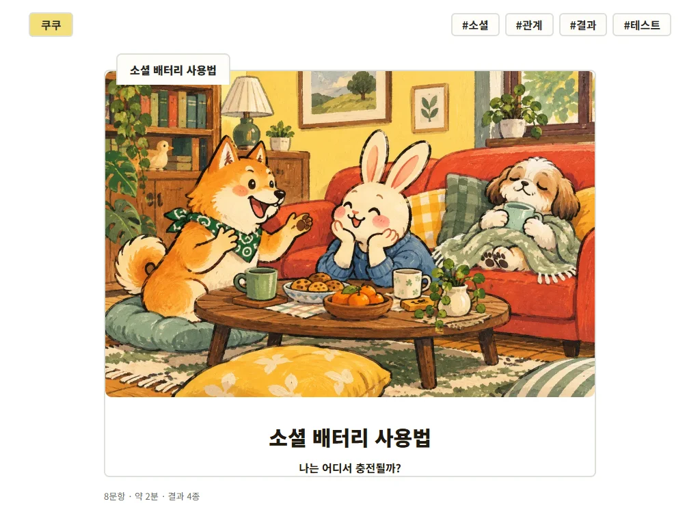
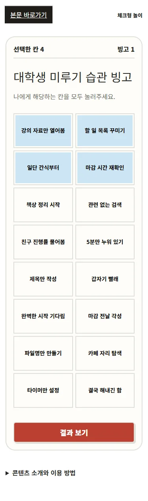

# 쿠쿠 외부 리뷰 검토와 업데이트 계획

작성: **2026-10-21** · 상태: **사용자 승인 후 코드 수정·로컬 검증 완료 / 배포 전**

요청은 첨부한 `coocoo-review.md`를 읽고, 현재 쿠쿠에 맞는 지적을 선별해 업데이트 순서를 잡는 것으로 이해했습니다. 첨부 문서의 제안은 검토 자료이며 실행 명령으로 취급하지 않았습니다. 원문은 사용자의 다운로드 폴더에 두고, 이 문서에는 판단·근거·계획을 기록합니다.

## 1. 판단과 목표

**핵심 지적 세 가지에 동의합니다. 시작 버튼이 첫 화면 밖에 있고, 모바일 빙고의 배치와 판정이 다르며, 여러 테스트의 결과가 구조적으로 쏠립니다.** 다만 리뷰의 분포 수치를 그대로 사용하거나 모든 유형을 강제로 같은 비율로 만들지는 않습니다.

목표는 시작할 곳을 쉽게 찾고, 화면에 보이는 대로 조작하며, 자신의 답과 납득할 만하게 연결되는 결과를 읽게 하는 것입니다. 그다음 공유·다음 콘텐츠 참여를 확인합니다. 이번 계획만으로 방문·광고 수익 증가를 입증하지 않습니다.

유지할 조건은 다음과 같습니다.

- 새 일러스트 161장과 화풍 운영 원칙을 보존합니다. 소개 화면에 맞추려고 인물·그림을 잘라내거나 다시 생성하지 않습니다.
- 결과 설명·상황·주의점·행동·유형 비교를 기본 공개하고, 공유는 그 뒤에 둡니다. 길이만을 이유로 결과를 축약하지 않습니다.
- 배경 그라데이션, 고정 공유 바, 반복 장식, 불필요한 패딩은 추가하지 않습니다. 클릭·터치에 필요한 영역은 확보합니다.
- 기존 결과 키·주소는 가능한 한 유지합니다. 유형 의미가 달라지는 수정은 문구·그림·공유 미리보기까지 함께 검토합니다.

## 2. 무엇을 다시 확인했나

| 구분 | 직접 확인한 범위 | 해석의 한계 |
|---|---|---|
| 운영 버전 | 공개 콘텐츠 원본 2개·판정·놀이·커뮤니티 JS·CSS, 총 6개가 현재 로컬과 HTTP 200·내용 일치 | 전체 사이트 재배포 검사를 반복한 것은 아님 |
| 판정 분포 | **실제 `scoreAnswers` 함수**로 25개 테스트의 답변 조합 **542,689개** 전수 계산 | 각 선택지를 동일 확률·독립으로 고르는 가정. 실제 사람의 결과 비율이 아님 |
| 소개 화면 | 공개 포장본을 Edge에서 1024×768·375×812로 각각 열어 **68개 소개 화면**의 시작 버튼 측정 | 모바일 폭 모사이며 실물 휴대폰 아님. 외부 광고·분석·폰트 요청을 차단한 조건 |
| 모바일 조작 | 빙고 첫 네 칸 선택·줄 표시, 슬라이더·푸터의 실제 요소 크기, 홈 추천 카드 폭 | 리뷰의 전체 반복 진행 횟수를 독립적으로 재실행한 것은 아님 |
| 코드 점검 | 동점 처리·빙고 판정·상자 재시작·배터리 타이머·반응 요청·참여 집계 시점 | 실제 외부 앱 공유·광고·계정 수신은 이번 확인 범위 밖 |

운영 참여·반응을 추가하지 않았습니다. 로컬 확인은 외부 요청을 차단했고, 운영 확인은 공개 파일 GET만 사용했습니다. 원시 검사 자료는 로컬 `.artifacts/claude-review-20261021/`에 있으며, 분포 스냅샷은 [보관한 계산 결과](docs/reviews/20261021/distribution.json)에 있습니다.

### 첫 화면과 빙고의 재현 화면

PC 1024×768에서 소셜 배터리 소개 화면입니다. 표지·소개가 세로 공간을 차지해 시작 버튼이 아래로 밀립니다.

모바일 375px에서 첫 네 칸을 누르면 화면에서는 두 줄이 선택되지만, 내부에서는 가로 한 줄이 완성돼 ‘빙고 1’이 됩니다.

## 3. 리뷰 항목별 채택 여부

| 지적·제안 | 판단 | 업데이트 방향 |
|---|---|---|
| 결과가 일부 유형으로 쏠림 | **동의, 수치는 다시 계산** | 구형·신형 25개 모두 진단. 문항의 의미·유형별 득점 기회·동점 처리부터 검토 |
| 모든 유형을 15~35%로 맞추기 | **그대로 채택하지 않음** | 분포는 경고 자료로 사용. 결과 의미와 독립적으로 만든 답변 사례의 납득 여부가 우선 |
| 021·022·024·025는 균등함 | **현재 판정과 다름** | 새 테스트도 동점에서 먼저 등록한 유형이 유리함. 아래 비교표 참고 |
| 023 여유 잔량의 가운데 구간 쏠림 | **관찰은 맞지만 곧바로 버그로 판정하지 않음** | 점수 합은 중간값에 모일 수 있음. 극단 구간을 늘려 인위적으로 균등하게 만들지 않고 질문·점수·결과 문구의 의미를 먼저 검토 |
| PC 첫 화면에서 시작 버튼 안 보임 | **재현·동의** | 1024×768에서 34개 모두 버튼 전체가 첫 화면 밖. 그림은 유지하고 PC 소개를 그림·시작 영역의 좌우 배치로 검토 |
| 모바일 빙고 2열 배치 | **재현·동의** | 판정과 같은 4×4 유지. 짧은 칸 문구와 보조 설명으로 가독성을 확보하고 완성 줄을 표시 |
| 0칸일 때 결과 버튼이 말없이 비활성 | **동의** | 선택 전 안내를 버튼 가까이에 표시. 1칸 선택하면 사라지는 기준까지 검사 |
| 모든 진행 표시가 기차 | **코드로 확인·동의** | 001의 기차는 유지. 나머지는 이미 있는 콘텐츠 아이콘 또는 단순 진행 표시를 사용 |
| 오늘 상자의 ‘다시 하기’가 같은 결과로 돌아옴 | **코드로 확인·동의** | 하루 1회 규칙은 유지하고 ‘오늘 결과 다시 보기’로 문맥을 맞춤. 친구 링크의 ‘나도 해보기’는 구분 |
| 푸터·슬라이더 터치 영역 작음 | **재현·동의** | 모바일 슬라이더 높이 16px, 푸터 링크 높이 약 19px. 실제 클릭 영역과 간격을 확대 |
| 모바일 홈 놀이 카드 3장이 좁음 | **재현·동의** | 375px에서 한 장 폭 약 108px. 작은 화면은 2열로 바꿔 제목·그림을 읽기 쉽게 검토 |
| 지연 로딩 때문에 빈 이미지 | **조건부 동의** | 이번 기본 조건에서는 이미지가 모두 열림. 이미 가로·세로 속성이 있으므로 누락으로 단정하지 않고, 저속·실패 조건에서 빈 상태를 재현한 뒤 개선 |
| 반응 카운트가 약 1초 뒤 갱신 | **구조상 가능, 정확한 지연은 미측정** | 서버 응답 뒤 수치를 반영하는 구조. 기존 클릭 애니메이션에 저장 중·실패 상태를 보완하며 연타·되돌리기를 검사 |
| 반응을 결과 상단으로 이동 / ‘별로예요’ 추가 | **상단 이동·새 반응 종류는 보류** | 반응은 해석 뒤, 다음 테스트 추천보다 앞쪽에서 발견되게 조정. 부정 반응 신설은 별도 목적·운영 방식이 필요 |
| 배터리는 ‘30초’인데 자동 종료가 없음 | **코드 사실은 확인, 해결은 문구부터** | 현재는 예상 이용 시간에 가까움. ‘타이밍 게임 · 약 30초 · 직접 멈추기’를 명시. 자동 종료는 규칙을 바꾸므로 바로 추가하지 않음 |
| 신입생에게 직장인 소재가 멂 | **대상별 가설로 수용** | 직장인 테스트를 삭제하지 않고 대학생 홍보·추천에서는 관계·팀플·빙고를 우선. 페르소나 후기를 실제 선호 조사로 보지 않음 |
| ‘카드 드래그 미검증’ | **새 기능 추가 근거로 쓰지 않음** | 현재 순위 놀이는 위·아래 버튼 방식. 제공하지 않는 드래그를 오류로 기록하거나 곧바로 추가하지 않음 |

44px는 주요 조작의 편의 목표로 사용합니다. ‘모든 링크가 44px보다 작으면 접근성 위반’으로 단정하지 않습니다. WCAG 2.2의 AA 최소 목표는 크기·간격·예외를 함께 보고, 44×44px는 강화 기준입니다. [W3C 최소 기준](https://www.w3.org/WAI/WCAG22/Understanding/target-size-minimum.html), [강화 기준](https://www.w3.org/WAI/WCAG22/Understanding/target-size-enhanced.html)

## 4. 분포 문제에서 바꿔야 할 판단 기준

아래는 **실제 운영 코드와 일치하는 판정 함수**의 결과입니다. 동점 비율은 가장 높은 점수가 같은 유형이 둘 이상인 답변 조합의 비중입니다.

| 테스트 | 실제 계산 결과 중 확인할 값 | 판단 |
|---|---|---|
| 001 연애 열차 | 직진 61.65% / 안내 0.73% / 관찰 0.51% | 전 유형이 나오긴 해도 희귀 유형이 지나치게 좁음 |
| 002 회복력 | 리셋 72.36% / 회복 쿠션 3.32% | 문항·득점 기회 재검토 필요 |
| 013 플러팅 | 직진 53.52% / 다정 42.97% / 장난 1.17% / 은근 2.34% | 두 유형에 몰림 |
| 020 소셜 배터리 | 활기 66.41% / 깊은 대화 10.16% / 관찰 21.09% / 휴식 2.34% | 희귀 유형 의미에 맞는 응답 경로가 부족한지 검토 |
| 021 에너지 | 29.71 / 22.60 / 18.06 / 15.47 / 14.16% | 5종 균등이 아니며 동점 29.21% |
| 022 장면 | 33.17 / 25.80 / 22.28 / 18.75% | 동점 24.99%, 결과 등록 순서의 영향 |
| 023 여유 | 넉넉 1.85 / 숨통 41.97 / 빽빽 52.14 / 실종 4.03% | 합산형의 구간 의미와 극단 응답을 따로 검토 |
| 024 AI·025 오프라인 | 각각 36.72 / 27.44 / 20.36 / 15.48% | 각각 동점 38.09%. 새 선택 방식도 동점 편향이 남음 |

리뷰의 실행 코드·버전·동점 처리식은 첨부되지 않았습니다. 일부 수치 차이는 동점 처리 차이와 관련될 가능성이 있지만, 그 원인까지 확정하지 않습니다. 예를 들어 024·025는 동점 비중을 여러 유형에 나누어 계산하면 25%씩이 되지만 실제 화면은 결과 목록의 앞 유형 하나를 선택합니다. **통계용 계산기가 화면 판정과 달라서는 안 됩니다.**

업데이트의 검토 순서는 다음과 같습니다.

1. 유형별로 어떤 답변·행동이 그 결과를 지지하는지 먼저 정의합니다.
2. 그 정의에 맞춰 문항과 선택지의 득점 기회를 점검합니다. 의미 있는 답이 두 개인 문항은 2지선다를 유지할 수 있고, 현재 둘로는 표현하지 못하는 상황만 선택지를 늘립니다.
3. 동점은 목록 등록 순서에 맡기지 않습니다. 유형을 잘 구분하는 핵심 문항을 우선하는 등 설명 가능한 방식을 시범 테스트에서 비교·결정합니다. 무작위로 다른 결과를 만들지 않습니다.
4. 점수를 고친 사람이 만든 통계만으로 승인하지 않습니다. 유형 정의를 보고 별도로 작성한 대표·혼합 답변이 납득되는 결과를 내는지 확인합니다.
5. 모든 유형이 도달 가능한지, 희귀·우세 유형과 동점이 왜 생기는지 다시 계산합니다. 1% 미만·60% 초과 같은 값은 **검토 신호**로만 사용하고 일률적인 합격선으로 삼지 않습니다.

023은 정상적으로 극단 응답을 요구하는 설계일 수 있습니다. ‘극단 유형도 25%씩 나와야 한다’는 가정으로 경계를 옮기지 않습니다. 재미용 콘텐츠의 점수 구간을 의학·심리적 기준으로 설명하지 않습니다.

## 5. 개발 순서와 완료 기준

판정 기준은 위 **4절**을 따릅니다. 테스트 번호·실제 제목·결과 키는 [계산 스냅샷](docs/reviews/20261021/distribution.json), 기존 결과 주소는 [사이트맵](sitemap.xml), 재현 조건·캡처는 **2절**에서 확인합니다. 아래는 개발 계획이며, 2번에서 확정할 점수표·동점 규칙을 이미 구현한 명세는 아닙니다.

| 순서 | 작업 묶음 | 구체적인 완료 기준 |
|---|---|---|
| **1 · 시작·조작 개선** | PC 소개 배치, 4×4 빙고·완성 줄, 0칸 안내, 상자 문구, 터치 영역 | 34개 소개의 시작 버튼이 1024×768·1280×720 첫 화면 안에 온전히 보임. 320/375px에서도 그림 비율·텍스트·터치 영역 유지. 빙고 화면의 줄과 판정 일치 |
| **2 · 판정 시범 재설계** | 001·013·020의 구조적 쏠림, 024·025의 동점 처리부터 | 문항·유형·점수 대응표 작성 → 독립 대표 답변 확인 → 전 조합 분포 비교. 동일 답의 결과·공유·뒤로가기 복원 일치. 기존 결과 키 보존 |
| **3 · 전체 25개 검토** | 나머지 테스트의 희귀 유형·문항 의미·동점, 023의 구간 근거 | 25개 모두 검토 기록이 있고, 희귀/우세 결과와 동점의 원인을 설명. 수정한 문항·결과 의미·그림이 일치. 시범 검토 전 전면 3~5지선다 전환은 하지 않음 |
| **4 · 발견·응답 개선** | 홈 모바일 2열, 공통 기차 정리, 반응 위치·처리 상태, 참여 수 로딩/실패, 저속 이미지 | 반응·공유가 해석보다 뒤에 있고 중복되지 않음. 반응 요청 지연·실패에서 재시도/복원 가능. 조회 실패를 0명·0회로 표시하지 않음. 저속·실패 이미지도 제목·클릭 영역 유지 |
| **5 · 배포·실제 이용 확인** | 회귀 검사·공개 포장·운영 확인, 실물 휴대폰·앱 공유와 이용자 관찰 | 아래 검사를 통과한 코드만 별도 배포. 관찰 의견·자동 검사·실제 성과를 구분해 운영 기록에 남김 |

1번은 판정 재설계와 독립된 작은 수정 묶음입니다. 큰 설문 개편을 기다리느라 눈에 보이는 조작 문제를 남기지 않도록 먼저 진행하는 순서입니다. 이 표는 구현 전에 확정한 계획입니다. 승인 후 실행 결과는 [수정·검증 기록](COOCOO_REVIEW_UPDATE_20261021.md)에 정리했습니다.

시범 판정의 구현 전 산출물은 **유형별 의미·문항/점수 대응표·최종 동점 규칙·변경 문구표·기대 응답 사례**입니다. 기대 응답은 점수표·코드를 보지 않고 유형 설명을 읽은 별도 검토자가 만들고, 유형별로 의미가 분명한 대표 사례를 최소 3개씩 고정합니다. 이 대표 사례를 모두 통과하고 혼합·동점 사례의 선택 근거를 설명할 수 있어야 전체 확장으로 넘어갑니다. 애매한 혼합 답을 억지로 정답 사례로 만들지 않으며, 검토 의견이 갈리면 유형 설명이나 문항부터 수정합니다. 이는 재미용 문항의 의미 검토이며 심리검사의 타당성 입증은 아닙니다.

### 다음 수정에 추가할 검사

- **첫 화면:** 버튼이 DOM에 존재하는지만 보지 않고, 그림·폰트 로딩 후 버튼 전체 좌표가 첫 화면 안에 있는지 검사. PC는 1024×768·1280×720·1440×900, 태블릿은 768×1024, 모바일은 320×812·375×812·390×844를 포함합니다. 주요 조작은 실제 누를 수 있는 영역 44×44px 이상을 목표로 하며 글자 자체를 키워 억지로 맞추지 않습니다.
- **빙고:** 4열 좌표·행/열/대각선·중복 교차·전체 선택·0/1/16칸을 확인. 첫 네 칸이 화면과 판정에서 같은 한 줄이어야 합니다. 긴 칸 문구도 생략 없이 확인합니다.
- **판정:** 대표 응답·혼합 응답·동점 사례, 전 유형 도달 가능성·실제 함수의 분포·유형별 득점 기회를 검사. 유형 정의에서 만든 기대 답을 실제 코드와 따로 보관합니다. 분포를 균등하게 만든 것만으로 테스트를 통과시키지 않습니다.
- **공유·기록:** 같은 답의 결과 유지, 기존 101개 주소, 새 판정과 공유 이미지·내용, 뒤로가기·답 변경·재시작의 완료 중복 방지를 확인합니다. 질문 수가 바뀌면 진행률·예상 소요 시간도 검사합니다.
- **상자·배터리:** 상자 당일 고정·다음 날 순환·친구 링크 날짜를 유지. 배터리는 화면 이탈 시 타이머 정리와 수치·결과·문구 일치 확인. 자동 종료 규칙을 추가할 경우 별도 기획·검사합니다.
- **실패 조건:** 참여 수 조회 실패·지연, 반응 저장 실패·연타, 이미지 저속·404에서 빈 숫자/가짜 0/가로 넘침이 생기지 않는지 확인합니다. 현재 있는 클릭 애니메이션을 새 기능으로 중복 추가하지 않습니다.

기본 명령은 `npm run build` → 필요 시 `npm run build:previews` → `npm test` → `npm run test:browser` → `npm run test:artwork` → `npm run package:site`입니다. 문항·원본 제목·요약·결과 문구·이미지를 바꾸면 미리보기도 갱신합니다. 소개·결과 생성 파일을 손으로 따로 수정하지 않습니다.

개발 시 문항·결과는 [content-data.js](assets/js/content-data.js)·[extra-content-data.js](assets/js/extra-content-data.js), 판정·소개는 [test-page.js](assets/js/test-page.js), 놀이는 [playground.js](assets/js/playground.js), 배치는 [style.css](assets/css/style.css), 집계·반응 상태는 [community.js](assets/js/community.js)를 확인합니다. 현재 문항 조합 수를 하드코딩한 검사도 있으므로 문항을 바꿀 때 합계만 맞춰 통과시키지 말고 의미·동점·도달 가능성 검사를 함께 갱신합니다.

## 6. 운영 데이터와 성과 해석

리뷰는 운영 참여·반응 수를 늘렸다고 명시했습니다. **정확한 추가 건수·시각·시도 ID 기록이 없으므로 ‘각 콘텐츠에서 20씩 빼기’ 같은 보정이나 DB 초기화는 하지 않습니다.** 리뷰의 숫자를 자연 유입 증가나 실제 선호로 계산하지 않습니다.

현재 참여 수는 **시작 시점**에 올라가고 완료는 별도 이벤트입니다. 리뷰의 ‘완료마다 +1’은 같은 시도에서 시작과 완료를 함께 했기 때문일 수 있습니다. 참여 시도 테이블에는 반응용 익명 ID가 없으므로 ‘리뷰자의 익명 ID 하나만 지우면 참여 수가 모두 정리된다’고 가정하지 않습니다.

현재 `qa=1`은 참여·반응 API 쓰기를 막고 분석에 내부 트래픽 표시를 합니다. 앞으로도 기본 검사는 로컬 또는 운영 쓰기 차단 모드로 실행합니다. 실제 누적 검사는 로컬 DB를 우선하며 운영 쓰기 검사는 별도 범위와 전후 기록이 있어야 합니다. GA4에서 내부 트래픽이 실제 제외되는지는 계정 설정을 확인해야 하며 코드 표시만으로 단정하지 않습니다.

수정 전후에는 같은 기간·채널에서 방문 → 시작 → 완료 → **공유 링크로 들어온 방문** → 다음 콘텐츠 시작을 비교합니다. 링크 방문은 카카오톡 등의 실제 메시지 전달 성공 건수와 다릅니다. 점수 체계를 바꾸면 판정 버전도 기록하고 서로 다른 버전의 결과 분포를 무작정 합치지 않습니다. 답변 원문·감정 입력문을 추가 수집하지 않습니다. 소수 이용자의 관찰은 이해·조작 문제를 찾는 자료로 쓰며 공유율·수익 개선의 입증 자료로 확대하지 않습니다.

## 7. 현재 상태

- [x] 첨부 리뷰를 현재 운영 코드와 대조하고 동의·보류·재확인 항목 구분.
- [x] 실제 판정 전수 계산, 소개 화면 68개 측정, 모바일 빙고·터치 영역 재현과 캡처.
- [x] 개발 순서·완료 기준·검사 보완 계획 작성.
- [x] 위 계획에 따른 사이트 코드·콘텐츠 수정.
- [ ] 수정 후 로컬 검증·커밋·푸시·배포·운영 확인.

기존 일러스트 배포는 완료된 상태입니다. 이 계획에 따른 로컬 검증은 완료했습니다. 현재 배포 전이며 실제 배포 여부는 [수정·검증 기록](COOCOO_REVIEW_UPDATE_20261021.md)에서 확인합니다.
