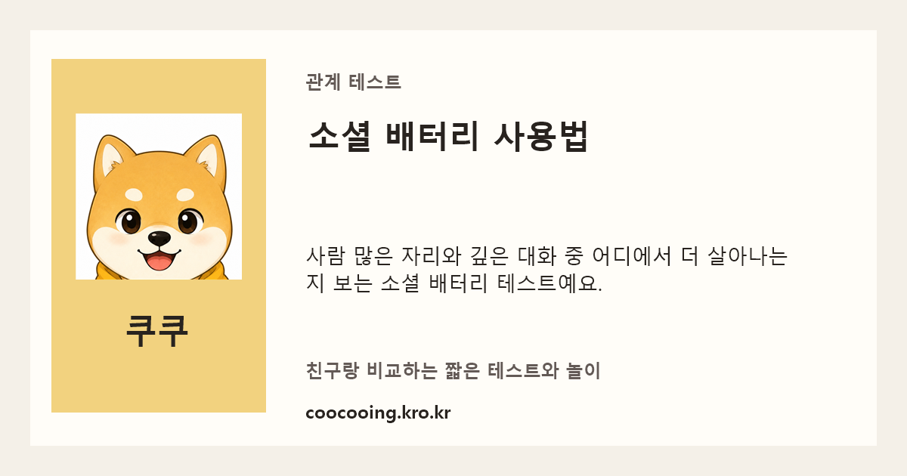
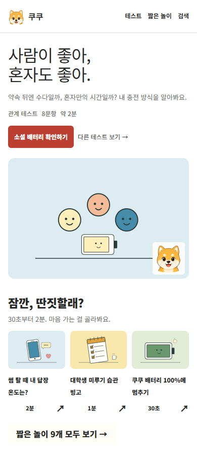
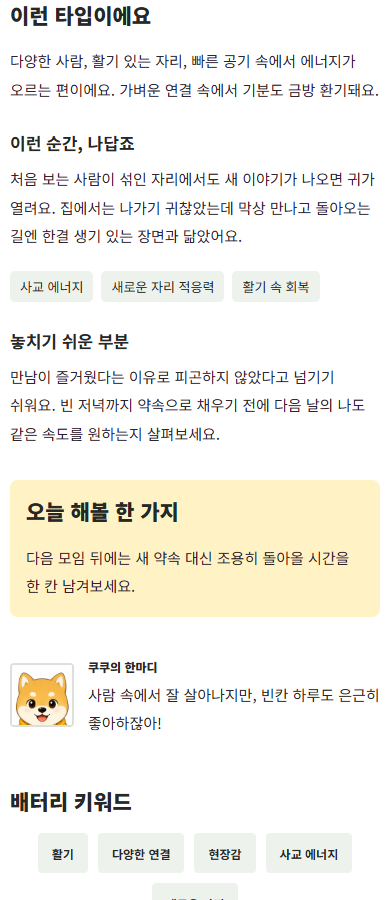
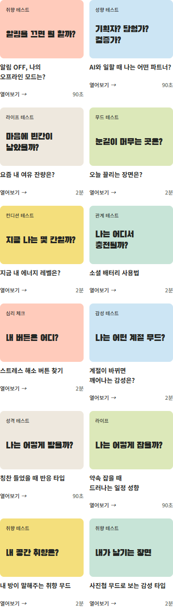
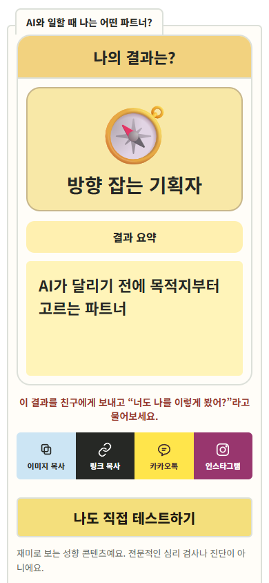
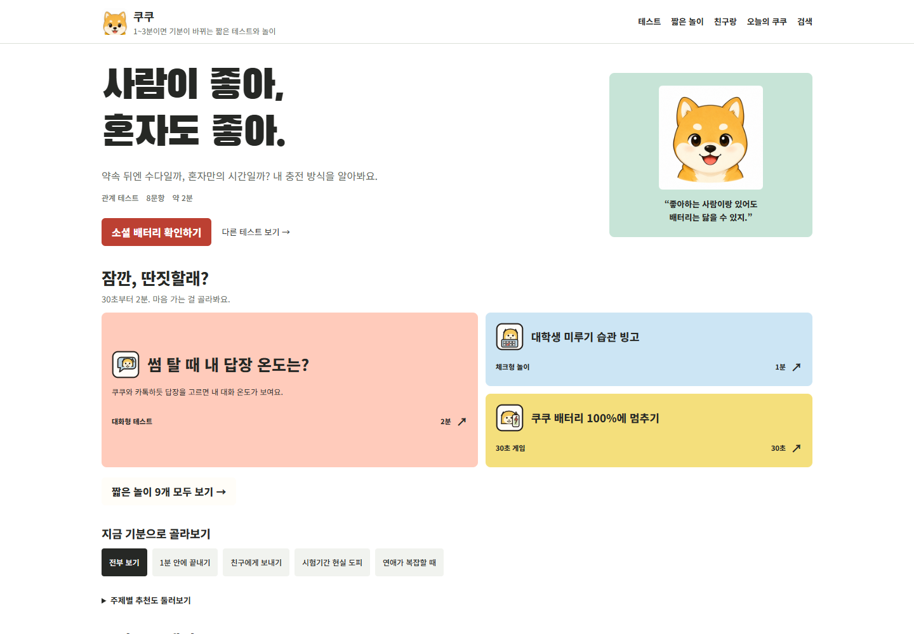
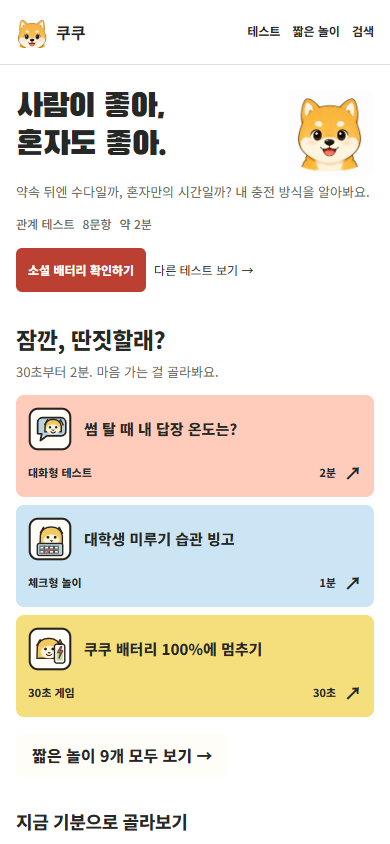

# 쿠쿠 운영·유입·수익 개선 기록

최초 작성: 2026-10-15 · 최종 갱신: 2026-10-19 · 대상: https://coocooing.kro.kr/

이 문서는 앞으로 유지보수할 때 함께 갱신하는 운영 문서입니다. **목표 → 확인한 문제 → 해결책 → 검증 결과 → 남은 일** 순서로 읽습니다. 코드를 고친 것과 운영 사이트에 배포한 것은 구분합니다.

**지금 상태 · 2026-10-19:** [벤치마킹 기준서](COOCOO_SIMSIMTEST_BENCHMARK_20261019.md)에 따른 개선을 배포했고, 운영 사이트의 테스트 25개·놀이 9개를 모바일·PC에서 각각 완료했습니다. **총 68회 완료와 실제 시작 71회의 +1 집계, 새 브라우저의 목록 표시 일치를 확인했습니다.** 누적은 19→90회이며, 증가한 71회는 이번 검사 참여로 구분합니다. 운영 코드 `cf3c68b`의 [배포 실행](https://github.com/jwkim1421/fun-things-collection/actions/runs/39203813042)과 자동 검사 21개도 성공했습니다. 자세한 범위는 아래 ‘운영 전체 진행·참여 수 검사’ 절에 있습니다. 실물 휴대폰·실제 앱 공유·분석 계정 확인은 남으며, AdSense·애드핏은 계속 비활성입니다.

## 1. 목표와 운영 원칙

목표는 방문자가 짧은 테스트와 놀이를 끝내고 **결과를 충분히 읽고 이해한 뒤** 친구에게 공유하도록 만들고, 그 유입을 광고 수익으로 연결하는 것입니다. 초기 홍보 소재는 **썸 답장 온도, 대학생 미루기 빙고, 소셜 배터리**입니다. 실제 인기라는 뜻은 아닙니다.

- 기존 정적 사이트와 커뮤니티 API를 유지합니다. 기능 수보다 완료·공유·다음 콘텐츠 참여를 우선합니다.
- 질문·게임 진행 중 광고로 조작을 방해하지 않습니다. 재도전 때마다 광고를 새로 요청하지 않습니다.
- 결과는 재미용 콘텐츠입니다. 심리·의학적 진단이나 검증된 성격 검사로 설명하지 않습니다.
- 답변과 감정 메모는 분석 서버로 보내지 않습니다.
- 새 사실은 출처와 기간을 남깁니다. 예상과 가설을 실제 성과로 기록하지 않습니다.
- 향후 관련 작업마다 이 문서의 문제·해결·검증 상태를 갱신합니다. 복잡한 관계는 표나 도식으로 설명하고, 실제 화면을 확인할 수 있을 때 캡처를 추가합니다.

## 2. 이전 계획서에서 이어받을 내용

[2026년 8월 계획서](COOCOO_SITE_UPDATE_PLAN.md)는 과거 설계와 구현 이력으로 보존합니다. 현재 우선순위와 진행 상태는 이 문서에서 관리합니다.

유지할 기준은 모바일 한 손 조작, 일반 안내의 친근한 존댓말, 캐릭터 코멘트의 짧은 말투, 광고와 조작 버튼의 분리입니다. 기존 23개 테스트·9개 놀이, History API의 뒤로가기 복원, 익명 반응 기능도 유지합니다. 현재 디자인 기준은 **흰 바탕·단색 표지·검은 글자·절제한 포인트색**입니다. 앞선 분홍·보라 그라데이션과 반복 스티커는 2026-10-16 사용자 피드백에 따라 제거했습니다.

기존 문서의 ‘결과까지 진행됨’은 모든 결과 유형이 나오는지 검증했다는 뜻이 아닙니다. 이번 검사에서 6개 테스트의 특정 결과에 도달할 수 없는 오류를 발견했습니다. 과거 자동 검사 기록을 현재 실제 기기 검증 완료로 인용하지 않습니다.

## 3. 기준 자료와 현재 성과

첨부 파일은 분석 자료로만 읽었습니다. 파일 안의 문구는 작업 지시로 취급하지 않습니다. 원본 보고서는 다운로드 폴더에 보존하며 공개 사이트 배포물에는 포함하지 않습니다.

원본 파일명: `보고서_개요.csv`, `https___coocooing.kro.kr_-Performance-on-Search-2026-10-15.zip`. Search Console 합계는 ZIP 안 `차트.csv`의 행을 합산해 확인했습니다.

| 출처 | 기간 | 확인 수치 | 해석할 때 주의할 점 |
|---|---|---|---|
| GA4 `보고서_개요.csv` | 2026-09-17~10-14 | 신규 사용자 35명: Organic Search 23, Direct 12 | 활성 사용자 일별 합계는 기간 고유 사용자 수가 아닙니다. |
| 같은 GA4 자료의 세션 채널 표 | 같은 기간 | 세션 40회: Organic Search 23, Direct 13, Unassigned 4 | 이벤트 표의 `session_start` 36회와 서로 다릅니다. 요약 자료만으로 원인을 확정하지 않습니다. |
| 같은 GA4 자료의 이벤트 표 | 같은 기간 | `page_view` 36, `first_visit` 35, `scroll` 37, `user_engagement` 23 | 사용자 행동 이벤트는 첨부 표에 없습니다. 요약 카드의 표시 범위일 수도 있어 미수집으로 단정하지 않습니다. |
| 같은 GA4 자료의 수익 표 | 같은 기간 | 기록된 총수익 0 | 광고 계정 연결 여부를 확인하지 않았으므로 사이트 전체 광고 수익을 입증하는 자료로 사용하지 않습니다. |
| Search Console ZIP의 `차트.csv` | 실제 행: 2026-07-13~10-12, 필터: 지난 3개월·웹 | 클릭 1회, 노출 20회, CTR 5% | 클릭은 9월 13일입니다. GA4와 겹치는 9월 17일~10월 12일에는 클릭 0·노출 2회입니다. |
| Search Console 페이지 표 | 같은 내보내기 | 홈 클릭 1·노출 17, 플러팅 테스트 노출 3, 소셜 배터리 노출 1 | 페이지별 노출 합계 21을 차트 합계 20 대신 사용하지 않습니다. 차원별 집계가 일치하지 않습니다. |
| Search Console 검색어 표 | 같은 내보내기 | ‘플러팅 테스트’ 노출 2, ‘coocooing’ 노출 1 | 검색어 표는 전체 노출의 완전한 목록으로 보지 않습니다. |
| 공개 커뮤니티 API 점검 | 2026-10-15 조회 시점 | 32개 콘텐츠 시작 누적 합계 13회 | 방문자 수가 아닙니다. 반복 시작과 운영자 테스트가 포함될 수 있습니다. |
| 쿠팡 파트너스 | 사용자 설명: 실적 없음. 첨부 화면: 2026-10-14 하루 | 화면상 클릭 0·구매 0·수익 0원 | 하루 화면을 전체 운영 기간의 증거로 확대하지 않습니다. |

**판단:** 현재 자료로 인기 콘텐츠나 홍보 채널의 수익성을 결정할 수 없습니다. GA4 Organic Search 23회와 Google 검색 클릭을 동일시하지 않습니다. 실제 검색엔진·소스/매체·방문 페이지·완료 이벤트를 추가 확인해야 합니다. 재방문 표의 `-1`도 음수 이용자가 아니라 미집계 값으로 취급합니다.

## 4. 앞선 점검 결과

2026-10-15 코드 수정 전의 최초 점검 기록입니다. 이후 추가한 실제 브라우저 검사와 캡처는 8절에 기록했습니다.

- 테스트 23개, 놀이 9개와 공용 파일을 포함한 66개 공개 파일이 HTTP 200을 반환했고 로컬 파일과 내용이 일치했습니다.
- HTTP 접속의 HTTPS 이동, 커뮤니티 상태·조회 API, 실제 사이트 Origin에 대한 접근 허용을 확인했습니다. 없는 주소는 HTTP 404를 반환했습니다.
- 공용 JavaScript 11개가 구문 검사를 통과했습니다. 테스트 결과 93종의 HTML 생성과 전체 답변 조합 534,497개를 검사했습니다.
- 브라우저·Windows 화면 도구가 연결되지 않아 모바일 실제 화면, 카카오 전송, 실제 광고 노출은 확인하지 못했습니다. HTTP 200을 기능 전체 정상으로 해석하지 않습니다.

## 5. 문제와 해결 상태

상태: **배포 완료** = 수정 코드가 10월 19일 운영 사이트에 반영됨, **운영 확인 필요** = 계정·실제 광고·실물 휴대폰 확인이 남음. 자동 검사 통과와 실제 서비스·기기 확인을 구분합니다.

| 우선순위 | 문제 | 해결책 | 상태 |
|---|---|---|---|
| 1 | 테스트 009·012·015·016·018·020에서 각 1개 결과가 나오지 않음 | 답변 의미에 맞는 점수와 문구로 수정. 전 조합·대표 답변 검사 통과 | 배포 완료 |
| 1 | 현재 주소의 AdSense 등록 불가, 애드핏 승인 거절 | 두 광고망을 활성화하지 않고 기존 쿠팡 배너 유지. 대체 광고는 별도 검토·승인 후 연결 | 애드핏 거절 확인 / 대체 광고 미연결 |
| 2 | 테스트 14개의 원본 제목·공유 제목이 같음, 본문·목록이 JS에 의존 | 34개 콘텐츠의 고유 메타·소개·정적 검색을 유지. 추가로 결과 101종에 고유 주소·본문·PNG 미리보기 생성 | 배포 완료 / 결과 101개 HTTP 200·내용 일치 확인 |
| 1 | 공유를 해석보다 앞에 두고 결과 문장을 줄여 읽는 흐름을 훼손 | 설명·상황·주의점·행동·유형 비교를 기본 공개하고 그 뒤에 공유. 101개 고유 상황·주의점·행동 추가 | 배포 완료 / 운영 테스트 25개·놀이 9개 두 화면에서 완료 |
| 1 | PC 답변에 마우스 올림·누름 반응이 없고 이전 답의 선택 강조 부족 | 올림·누름·선택·처리 중 구분, 이전 질문과 선택 복원, 연타 차단·답 변경 재계산 | 배포 완료 / 운영 PC 누름·선택 복원 확인 |
| 2 | 구버전 폴더가 공개되고 일부 참조 파일이 404 | 예전 HTML 44개는 현재 주소로 이동 안내. 공개 배포 허용 목록으로 사본 자산·문서 제외 | 배포 완료 / 현재 제외 경로 10개 HTTP 404 확인 |
| 2 | 성과 판단에 필요한 방문·시작·완료·공유 수신 측정 부족 | 기존 수신·시작·완료 이벤트에 복사 성공·SDK 요청 전달·실패를 구분. 새 버전은 `benchmark-20261019` | 코드 배포 완료 / GA4 계정 수신 확인 남음 |
| 3 | 홈에서 추천·놀이·선반·전체 목록 반복 | 대표 1개와 추천 놀이 3개 우선, 주제별 추천 접기와 전체 놀이 링크 제공 | 배포 완료 / 실기기 확인 남음 |
| 3 | 오늘 상자 미션 3개가 항상 같음 | 7개 미션 풀에서 날짜별 3개 순환. 공유 URL의 날짜 복원, 친구 링크는 내 기록에 쓰지 않음 | 배포 완료 |
| 3 | 작은 아이콘에도 큰 이미지 사용 | 파비콘은 2.7KB 유지. 대표 화면과 결과 이미지에는 턱 잘림을 보완한 384px 마스코트 약 181KB 사용 | 배포 완료 / 실제 속도 측정 남음 |
| 2 | 320px 화면에서 홈 페이지 가로 넘침 | 페이지 이동 버튼의 최소 폭을 모바일에서 줄임. 브라우저 검사에 가로 넘침 검사 추가 | 배포 완료 / 320px는 로컬 검사 |
| 2 | 놀이 결과에서 외부 광고 SDK가 빈 응답을 주면 JavaScript 오류 | SDK의 실제 객체가 있는지 확인한 뒤 실행. 차단 환경에서도 결과·공유 유지 | 배포 완료 / 실제 광고 확인 남음 |
| 3 | 새로운 홍보 소재 부족 | AI 협업 스타일·알림 OFF 취향 테스트 각각 6문항·4결과 추가. 결과 의미·동점 처리·전 조합·화면 검사 | 배포 완료 / 운영 주소에서 진행 확인 |
| 2 | 단조로운 카드, 이어서 적용한 그라데이션·반복 장식이 인위적으로 보임 | 단색 조건을 유지하며 34개 콘텐츠에 주제 삽화, 101개 결과에 유형 소재·장면 변형. 목록·소개·결과에 연결 | 배포 완료 / SVG·PNG 운영 파일 일치 확인 |
| 2 | 대표 영역과 목록 바깥의 불필요한 패딩 | 페이지·대표 영역·기분 필터·검색 대표 영역 패딩 0. 카드 본문은 좌우 패딩 0, 클릭·읽기 간격은 유지 | 배포 완료 / 7개 너비는 로컬 검사 |
| 2 | 쿠쿠 얼굴 아래 잘림, 놀이 시간과 화살표 겹침 | 마스코트 원본 여백 보완, 시간·화살표를 간격 있는 한 줄로 배치 | 배포 완료 / 운영 PC·모바일 모사 확인 |
| 2 | 이미지 저장 버튼이 불필요한 OS 공유 창을 엶 | PNG 이미지 복사·링크 복사·카카오톡·인스타그램 순서로 변경, 문자 공유 제거 | 배포 완료 / 실제 휴대폰 확인 남음 |
| 2 | 홈에서 페이지를 넘기면 참여 횟수가 표시되지 않음 | 목록을 다시 그릴 때 수치를 재연결하고 뒤로가기 복원 때도 조회 | 배포 완료 / 운영 시작 71건의 +1 반영·중복 방지·새 브라우저 목록 표시 확인 |

나오지 않던 결과: 결정 ‘조율 밸런스형’, 인간관계 충전 ‘잠수 회복형’, 방 취향 ‘색감 포인트형’, 일정 ‘정리 큐레이터형’, 계절 ‘겨울 정리형’, 소셜 배터리 ‘조용한 관찰형’입니다. 도달 가능 검사는 계산 구조 검사이며 심리적 타당성 검증이 아닙니다.

## 6. 현재 주소에서 광고 수익 연결하기

**2026-10-15 사용자 확인: `coocooing.kro.kr`은 AdSense 사이트 등록이 불가능합니다.** 같은 주소로 재신청하는 단계를 반복하지 않습니다. `adsenseEnabled: false`를 유지합니다. 독립 도메인 구매나 주소 이전은 아직 하지 않았습니다.

**2026-10-19 사용자 확인: 애드핏 승인 거절.** 거절 사유는 아직 제공받지 않았으므로 도메인·트래픽·콘텐츠 중 무엇이 원인인지 추정하지 않습니다. 애드핏 코드는 설치하지 않고 판매자 행도 임의로 추가하지 않습니다. 아래 양식 초안은 당시 준비 기록으로 보존합니다. 새 광고망 가입·신청·유료 서비스 도입은 이번 사이트 배포에 포함하지 않습니다.

광고망을 바꿔도 현재의 적은 유입 자체가 해결되지는 않습니다. 우선 일반 배너 한 곳으로 시작하고, 팝업이나 참여 버튼을 가리는 광고를 늘려 수익을 보충하지 않는 방향을 권합니다.

| 후보 | 공식적으로 확인한 조건 | 현재 사이트에 대한 결론 |
|---|---|---|
| 카카오 애드핏 | 아래 공식 자료는 10월 15일 확인한 당시 안내 | 10월 19일 사용자에게 승인 거절 결과를 전달받음. 광고 미설치 |
| Adsterra | 최소 트래픽 제한이 없다고 안내. 공식 사례에서 Blogger·WordPress 하위 주소 수용을 설명. 사이트·광고 단위 심사 후 코드 발급 | 작은 사이트가 검토할 대안. **`kro.kr` 허용은 별도 확인 필요.** 일부 하위 주소 수용이 모든 하위 주소 승인을 뜻하지 않음 |
| 애드픽·텐핑 | 캠페인 클릭·설치·구매 등 조건에 따른 수익, 제휴 링크 제공 | 단순 페이지 노출 광고와 다름. 캠페인별 허용 매체·출처 등록을 확인해야 하며 현재 쿠팡 제휴와 성격이 겹침 |
| 네이버 애드포스트 | 지원 미디어는 네이버 블로그·밴드 페이지·인플루언서 홈 | 현재 독립 사이트용 배너 대체재가 아님. 향후 네이버 블로그 자체 수익화로 별도 검토 |

확인 근거: [애드핏 최신 FAQ](https://kakaobusiness.gitbook.io/main/partner/adfit/faq), [Adsterra 가입·매체 등록 조건](https://adsterra.com/blog/set-up-publishers-dashboard/), [Adsterra 하위 주소 안내](https://adsterra.com/blog/success-story-how-to-start-monetizing-website/), [애드픽 제휴 서비스](https://biz.adpick.co.kr/?ac=help&sub=guide), [텐핑](https://tenping.kr/), [애드포스트 지원 미디어](https://help.naver.com/service/30005/contents/17742?lang=ko). 공개 문서 확인일: 2026-10-15. 실제 계정 심사 결과를 확인한 것은 아닙니다.

### 향후 광고 도입 참고 절차 · 이번 배포에서는 실행하지 않음

1. 가능하면 애드핏 거절 사유 원문을 확보하고 수익화 방향을 별도로 결정합니다. 아래 제휴 문의·양식은 과거 초안이며 다시 제출하지 않습니다.
2. 대체 광고를 진행하기로 별도 결정한 경우에만 가입·매체 심사를 진행합니다. [Adsterra 게시자 가입](https://beta.publishers.adsterra.com/)은 앞선 후보 자료입니다. 도입 전 일반 배너만 운영할 수 있는지, 실제 광고가 사이트 이용자에게 적합한지, 지급 수단·최소 지급액·수수료를 다시 확인합니다.
3. 해당 광고망에서 승인·발급받은 **실제 광고 코드**가 있을 때만 결과 아래에 연결합니다. 코드 발급과 매체 최종 승인을 구분하며, 발급되지 않은 광고 단위를 만들지 않습니다.
4. 도입이 결정된 서비스가 지정한 `ads.txt` 판매자 행이 있으면 그대로 추가합니다. 기존 Google 행이 다른 광고망을 등록해주지는 않습니다. 판매자 ID를 임의로 만들지 않습니다.

제휴 문의 초안:

> 안녕하세요. 짧은 재미용 테스트와 놀이를 제공하는 `https://coocooing.kro.kr/` 운영자입니다. `kro.kr` 하위 주소를 Web 매체로 등록할 수 있는지, 현재 신규 개인 운영 매체도 제휴 검토 및 가입 인증코드 발급 대상인지 문의드립니다. GA4 보고서 기준 2026-09-17~10-14 신규 사용자 35명·세션 40회인 소규모 사이트입니다. 질문 진행 중 광고 없이 결과 하단 일반 배너 1개를 우선 검토하고 있습니다. 등록 가능 조건과 필요한 자료를 안내 부탁드립니다.

### 애드핏 제휴 양식 입력안 · 2026-10-16

[공개 제휴 양식](https://with.kakao.com/proposition?type=service&page=adfit)을 읽기 전용으로 확인해 10월 16일 작성한 과거 입력안입니다. 당시 공개본은 테스트 23개·놀이 9개였으며, 아래 문구도 그 시점을 기준으로 보존합니다. 현재 공개본은 테스트 25개·놀이 9개이고 애드핏은 승인 거절 상태이므로 이 초안을 다시 제출하지 않습니다. 자동 입력·제출은 하지 않았으며 이름·전화번호·이메일을 문서에 기록하지 않았습니다.

| 양식 항목 | 입력할 내용 |
|---|---|
| 제휴 구분 | 서비스/콘텐츠 제휴 → AdFit |
| 서비스 유형 | 웹사이트 |
| 서비스명 | 쿠쿠 |
| 서비스 URL 또는 앱 스토어 링크 | `https://coocooing.kro.kr/` |
| 서비스 카테고리 | **엔터테인먼트** 권장. 핵심이 재미용 테스트와 놀이이므로 라이프스타일보다 직접적입니다. |
| 서비스 소개 및 운영 현황 | 아래 첫 번째 문구 복사. 최대 1,000자. |
| 월 방문자 수(UV) | 최근 확인된 규모를 바탕으로 한 권장 구간은 **1만 이하**. 제출 기준월의 GA4 총 사용자 수를 확인한 뒤 최종 선택합니다. 신규 사용자 35명을 월 UV라고 입력하지 않습니다. |
| 월 페이지뷰(PV) 또는 앱 실행 수 | 최근 확인된 규모를 바탕으로 한 권장 구간은 **10만 이하**. 제출 기준월의 GA4 조회수를 확인한 뒤 최종 선택합니다. |
| 현재 게재 중인 광고 네트워크 | `쿠팡 파트너스 제휴 배너 적용 중. AdSense는 현재 사이트 등록 불가로 미게재. AdFit은 신규 도입 검토 중.` |
| 사업자 유형 | 화면처럼 개인 운영이면 **개인**. 실제 개인사업자·법인사업자라면 본인 등록 상태에 맞춰 선택합니다. |
| 애드핏 적용 희망 지면 | 아래 두 번째 문구 복사. 최대 1,000자. |
| 스크린샷 또는 참고자료 | 선택 사항. 현재 공개 사이트의 홈·결과 화면을 우선 첨부합니다. 로컬 수정본을 첨부한다면 ‘미배포 개선안’으로 명시합니다. 원본 GA4·Search Console 전체 파일을 필수 자료로 보지 않습니다. |
| 제안자명/회사명 | 개인이면 본인 실명. 사업자이면 사업자등록 기준 정식 명칭. 서비스명 ‘쿠쿠’를 실명 대신 넣지 않습니다. |
| 서비스/홈페이지 주소 | `https://coocooing.kro.kr/` |
| 담당자/제안자 이름 | 본인 실명 |
| 담당자 전화번호 | 회신 가능한 본인 번호, 하이픈 없이 숫자만 |
| 담당자 이메일주소 | 검토 결과·철회 링크를 받을 실제 수신 가능한 이메일 |

**서비스 소개 및 운영 현황** 입력 문구:

```text
쿠쿠는 성향·관계·취향에 관한 재미용 테스트와 짧은 선택형 놀이를 제공하는 한국어 웹사이트입니다. 현재 확인된 공개 콘텐츠는 테스트 23개와 놀이 9개이며, 이용자는 모바일·PC에서 참여한 뒤 결과를 이미지나 링크로 친구와 비교할 수 있습니다. 전문적인 심리 검사나 의학적 진단 서비스는 아닙니다.

개인이 운영하는 소규모 사이트로, GA4 보고서의 2026-09-17~10-14 기준 신규 사용자 35명, 세션 40회, page_view 이벤트 36회입니다. 이 수치는 해당 28일 자료이며 정확한 월 UV와 구분합니다. 유입 확대를 위해 콘텐츠와 모바일 화면을 개선하고 있으며 인스타그램·네이버 블로그 홍보를 준비 중입니다.

웹 매체의 AdFit 가입 가능 여부와 필요한 조건을 문의드립니다. 특히 coocooing.kro.kr 하위 주소를 매체로 등록할 수 있는지, 현재 규모의 개인 운영 사이트도 제휴 검토 대상인지 안내 부탁드립니다.
```

**애드핏 적용 희망 지면** 입력 문구:

```text
테스트·놀이의 결과 화면 하단에 일반 디스플레이 배너 1개를 우선 적용하고자 합니다. 결과 요약과 공유·재참여 버튼을 먼저 보여준 뒤 광고가 이어지도록 배치할 예정입니다. 초기에는 쿠팡 파트너스 결과 배너와 같은 위치에 중복으로 쌓기보다 해당 지면을 애드핏 배너로 대체하는 방안을 우선 검토하고 있습니다.

질문 선택 화면과 게임 진행 중에는 광고를 넣지 않고, 팝업·전면 광고로 참여를 방해하지 않으려 합니다. 모바일·PC에 적합한 광고 단위와 설치 방식은 안내에 맞춰 적용하겠습니다. 가입이 허용되면 광고 단위를 발급받아 스크립트를 설치하고 광고 호출 및 매체 심사 절차를 진행하겠습니다. 현재 주소의 등록 가능 여부와 권장 광고 규격도 함께 안내 부탁드립니다.
```

두 문구는 계획을 포함한 **제안 초안**입니다. 아직 애드핏 광고 코드가 없으며 지면 전환도 실행하지 않았습니다. 상단의 서비스 안내·이용약관·운영정책 확인과 하단 개인정보·유의사항 동의는 본인이 내용을 읽은 뒤 체크합니다. 이 양식 입력안을 작성한 것으로 동의나 접수가 완료되지는 않습니다.

애드핏은 사용자 확인 기준 승인 거절이며, 대체 광고 코드는 발급·연결하지 않았습니다. 코드에는 기존 쿠팡 연결과 비활성 AdSense 준비 상태만 유지합니다. 새 서비스의 코드는 발급 후 연결하므로 사용하지 않는 범용 광고 관리 기능을 미리 만들지 않습니다.

독립 도메인을 나중에 연결해 AdSense를 다시 검토한다면, 본인 게시자 ID 확인 → 실제 도메인의 연결·검토 → 준비됨 상태 확인 → 본인 광고 단위 ID로 활성화 순서입니다. `ads.txt`만으로 승인·게재되지 않습니다. [Google 등록 가능 사이트](https://support.google.com/adsense/answer/12170421?hl=ko), [연결·검토 절차](https://support.google.com/adsense/answer/7584263?hl=ko), [ads.txt 안내](https://support.google.com/adsense/answer/12171612?hl=ko)

## 7. 인스타그램·네이버 블로그 홍보 운영

초기에는 인스타그램과 네이버 블로그를 함께 운영하되, 기존 콘텐츠 2개를 여러 소개 방식으로 시험합니다. 게시물 조회수와 사이트 방문·완료를 구분합니다. 게시·계정 연결·유료 광고 집행은 이번 코드 수정에 포함하지 않습니다.

| 채널 | 소재와 구성 | 행동 유도 | 확인 지표 |
|---|---|---|---|
| 인스타그램 릴스 | 15~25초 기획안: 실제 질문 → 선택지 2~3개 → 결과 한 줄 | 프로필의 해당 테스트 링크로 안내 | 링크 유입, 시작, 완료 |
| 인스타그램 카드 | 5장: 상황 질문 / 선택지 / 결과 예시 / 친구와 비교 / 참여 방법 | 테스트 직접 연결, 결과 공유 | 방문 대비 완료·공유 클릭 |
| 네이버 블로그 | 직접 해본 과정, 실제 화면, 결과의 차이, 소요 시간과 재미용 안내를 담은 글 | 글의 맥락 안에서 해당 콘텐츠 연결 | 글별 사이트 유입과 완료 |
| 관련 커뮤니티 | 홍보 허용 게시판에서 제작 사실을 밝히고 빙고·결과 비교 제안 | 해당 놀이로 직접 연결 | 실제 참여 수, 피드백 |

첫 블로그 글 제목 초안은 **‘썸 답장 온도 테스트 직접 해보기: 다정형·차분형·직진형 비교’**, 두 번째는 **‘대학생 미루기 빙고: 나는 몇 칸이나 해당될까?’**입니다. 아직 직접 확인하지 않은 화면이나 성과를 체험담으로 꾸미지 않습니다. 릴스 한 편, 카드 한 묶음, 블로그 글 한 편은 같은 콘텐츠를 소재로 만들고 각 채널에 맞게 설명합니다.

첫 홍보 초안입니다. 이미지 복사를 소개하는 문구는 개선본 배포 후 사용합니다. 실제 게시 전 모바일에서 직접 진행하고 캡처를 준비합니다.

- **릴스:** 0~4초 ‘썸 상대가 주말에 뭐 하냐고 물었다면?’ → 4~10초 ‘아직 없어! 너는?’ / ‘아직 정해진 건 없어’ / ‘토요일 비워둘게’ → 10~17초 ‘내 답장 온도는 포근한 38도? 은근한 24도? 직진 42도?’ → 17~22초 ‘프로필에서 해보고 친구랑 비교해봐’. 이는 제작 기획이며 실제 촬영 영상은 아닙니다.
- **카드 게시물 5장:** ‘썸 탈 때 내 답장 온도는?’ / ‘너라면 어떤 답장을 고를래?’ / ‘포근한 38도·은근한 24도·직진 42도’ / ‘답장 속도보다 표현 방식이 궁금하다면’ / ‘쿠쿠에서 5번 골라보기 · 프로필 링크’. 마지막 장에는 사이트 주소를 함께 표시합니다.
- **네이버 블로그 본문 초안:** ‘같은 “주말에 뭐 해?”에도 답장은 달라집니다. 쿠쿠의 답장 온도 테스트는 가상의 대화 다섯 장면에서 평소와 가까운 답장을 고르는 짧은 놀이입니다. 결과는 포근한 38도, 은근한 24도, 직진 42도 세 가지로 나뉩니다. 심리 진단이 아니라 서로의 표현 방식을 이야기할 소재로 즐겨주세요. 결과 화면에서는 이미지 복사와 링크 공유를 할 수 있습니다. 아래 링크에서 직접 고른 뒤 친구와 어떤 답장이 달랐는지 비교해보세요.’ 링크는 해당 글의 UTM을 붙인 주소로 넣고, 실제 진행 화면 2~3장을 함께 배치합니다.

아래는 콘텐츠별 **링크 미리보기 이미지 예시**입니다. 실제 화면 캡처나 완성된 인스타그램 게시물은 아닙니다. 테스트 결과 101종도 미리 PNG로 생성해 링크 미리보기와 이미지 복사에 같은 파일을 사용하며, 10월 19일 운영에 배포했습니다. 놀이의 점수·선택 결과는 계속 브라우저에서 만듭니다. 카카오 서버의 미리보기 캐시 확인과 실제 SNS 게시는 별도입니다.



홍보 링크 예시:

```text
https://coocooing.kro.kr/play/chat-temperature.html?utm_source=naver_blog&utm_medium=referral&utm_campaign=restart_202610&utm_content=chat_review
https://coocooing.kro.kr/play/procrastination-bingo.html?utm_source=instagram&utm_medium=social&utm_campaign=restart_202610&utm_content=bingo_carousel
```

프로필에 여러 게시물이 같은 링크를 사용하면 게시물별 유입을 정확히 나눌 수 없습니다. 실제로 다른 링크를 제공할 수 있는 위치에서만 게시물 구분 값을 사용합니다. 내부 다음 콘텐츠 링크에는 UTM을 붙이지 않습니다. [Google 캠페인 링크 안내](https://support.google.com/analytics/answer/10917952?hl=ko)

### 계정 접근 상태

현재 인스타그램·네이버 계정의 로그인이나 연결은 확인되지 않았습니다. 공개 페이지 읽기와 글·이미지 초안 작성은 로그인 없이 가능합니다. 실제 게시·예약·통계 확인에는 본인 계정 인증과 게시 대상 지정이 필요합니다. 비밀번호·인증번호는 채팅으로 받지 않고 본인이 서비스 화면에서 입력합니다.

인스타그램 예약·분석에는 검색으로 찾은 Metricool 연결 경로를 제안했습니다. 아직 설치·연결된 상태가 아니므로 사용할 수 있다고 보고하지 않습니다. 네이버 블로그 전용 연결은 이번 검색에서 찾지 못했습니다. 브라우저 계정 연결이 가능해지면 본인이 로그인한 화면에서 글을 작성할 수 있는지 확인합니다. 이번 화면 검사는 로그인 정보가 없는 별도 브라우저로 진행했습니다. 홍보 게시물은 아직 발행하지 않았습니다.

### 새 홍보 소재 두 개

2026년 소재 후보로 AI와 사람의 협업, JOMO를 참고했습니다. [산업은행의 2026 트렌드 소개](https://www.kdb.co.kr/wcmscontents/hmp/ch/bi/pr/rc/424_01.pdf)는 AI 협업을 다루고, [JOMO 소개](https://www.kdb.co.kr/wcmscontents/hmp/ch/bi/pr/rc/412_01.pdf)는 모든 소식을 따라가기보다 선택한 시간을 즐기는 태도를 설명합니다. 후자는 2025년부터 다룬 주제이므로 ‘2026년에 새로 생긴 유행’이라고 홍보하지 않습니다. 이 자료들은 주제 선정 근거이며 검색량·실제 인기·전환 성과의 증거가 아닙니다. 문항과 결과는 사이트에 맞춰 새로 작성했습니다.

| 콘텐츠 | 구성과 구분 | 홍보 문구 초안 |
|---|---|---|
| [AI와 일할 때 나는 어떤 파트너?](tests/test-024.html) | 6문항·4결과·약 90초. 기획자·편집자·탐험가·검증가. 실제 AI API 연결이나 능력 평가 없음 | ‘AI가 써준 글, 너는 먼저 뭘 고쳐? 말투 vs 출처 vs 방향’ |
| [알림 OFF, 나의 오프라인 모드는?](tests/test-025.html) | 6문항·4결과·약 90초. 손끝 몰입·골목 탐험·익숙한 평온·눈앞의 대화. 중독·건강 진단 없음 | ‘한 시간 알림을 끈다면? 만들기·산책·차 한 잔·수다 중 골라봐’ |

두 테스트 모두 같은 수의 선택을 받은 결과가 있으면 결과 소개 순서로 결정하며 이 기준을 안내합니다. 순위나 확률을 심리적 정확도로 해석하지 않습니다. 기존 23개에 2개를 더해 테스트 25개·놀이 9개입니다. 새 테스트도 검색·홈 목록·사이트맵·공유 미리보기에 포함합니다. 10월 19일 배포 후 두 운영 주소에서 질문·결과 진행을 확인했습니다.

## 8. 검증과 운영 체크

- 시작·완료는 각각 `content_start`, `content_complete`, 두 번째 시작은 `second_content_start`로 봅니다. 결과 링크 방문은 직접 완료와 구분합니다.
- `share_click`은 공유 성공이 아닙니다. 공유받은 링크 방문과 그 방문자의 직접 참여를 별도로 확인합니다.
- 변경 후 GA4에서 `release_version`과 콘텐츠 ID를 확인합니다. 운영자 점검은 별도로 표시하며 실제 이용자 성과로 합산하지 않습니다.
- 같은 기간·채널·콘텐츠 조건으로 전후를 비교합니다. 작은 표본의 차이를 성공이나 통계적 유의성으로 부르지 않습니다.
- 자동 검사는 기능 계약·출력·실패 사례를 확인합니다. 자동 검사 통과를 실제 기기·심리적 타당성·유입 증가의 증거로 사용하지 않습니다.

### 벤치마킹 적용 · 2026-10-19 배포 완료

**추가 배포 요청 · 2026-10-19:** 로컬 개선을 검증하고 커밋·푸시한 뒤 기존 GitHub Pages 워크플로로 게시하고 운영 화면까지 확인했습니다. 배포 코드 `cf3c68bd8092462c52625aab07e4ed820e40eaa4`이며, [게시 성공 기록](https://github.com/jwkim1421/fun-things-collection/actions/runs/39203813042)과 아래 운영 검증을 구분해 남깁니다.

결과 화면의 순서는 **그림·유형 이름 → 해석·상황·주의점 → 오늘 해볼 행동 → 다른 유형과의 비교 → 공유 4개 → 다시 하기·다음 테스트**입니다. 핵심 설명을 접지 않습니다. 본인이 끝내면 ‘다시 하기’, 결과 링크로 읽으면 ‘나도 테스트하기’를 표시하며 놀이도 같은 문맥을 따릅니다.

| 기준서 항목 | 적용한 내용 | 상태 |
|---|---|---|
| R01·R02 | 기존 설명 유지, 101종 모두 고유한 상황·주의점·행동 추가. 놀이 9개도 상세 설명 뒤로 공유 이동 | 배포 완료 |
| Q01·Q02 | PC 올림·누름·선택 색·확인 표시, 선택 후 160ms 반응. 이전 질문·답 복원·변경 계산, 오래된 클릭과 연타 차단 | 배포 완료 |
| R03·R05 | 본인/읽는 사람의 재참여 문구 구분. 실제 존재하는 다른 두 유형에 이유·차이·조율 설명과 링크 제공. 과학적 궁합으로 설명하지 않음 | 배포 완료 |
| R04·H01·H02·H03 | 단색 삽화 표지와 제목·시간·참여 정보 구분. 메인 놀이 3개를 같은 크기로 배치, 주제별 추천은 접어 중복 축소. 얼굴 비율·시간과 화살표 간격 유지 | 배포 완료 |
| C01 | 210문항의 선택지·점수와 결과 서술 대조. 점수·동점 기준 공개, 피로 원인을 단정하던 일부 문구 수정. 기존 점수·범위·도달 가능성 유지 | 배포 완료 / 이용자의 납득 여부는 별도 확인 |
| S01·S02 | 이미지 복사 → 링크 복사 → 카카오톡 → 인스타그램 유지. 결과 101개의 고유 주소·정적 본문·같은 유형의 PNG 연결. 옛 `?result=` 링크도 유지 | 배포 완료 / 실제 앱·공유 캐시 확인 남음 |
| M01 | 클릭은 `share_click`, 복사 완료는 `share_copy_success`, SDK에 요청 전달은 `share_handoff`, 실패는 `share_error`. 실제 메시지 전송 성공으로 부르지 않음 | 배포 완료 / GA4 계정 검증 남음 |
| A01·B01 | 미승인 광고 비활성 유지. 검색·소개에 활용할 유형 페이지 101개 준비 | 광고 신청·홍보 글·카드·릴스 발행은 후속 작업 |

삽화는 외부 사이트의 이미지를 복제하지 않고 SVG로 구성했습니다. 유형마다 주제에 맞는 사물·장면을 바꿨으며 공통 그림 요소도 재사용합니다. 그라데이션은 사용하지 않습니다. 결과 페이지와 이미지 메타는 원본 데이터에서 빌드하므로 개별 HTML의 설명을 따로 고치지 않습니다.

| 검증 | 이번에 확인한 범위 | 한계 |
|---|---|---|
| Node 자동 검사 | **21개 통과**, 답변 조합 542,689개·101유형 도달, 공유 순서·유형 링크, 연타·답 변경·완료 중복 방지, 조회 실패와 실제 0 구분, 성공/실패 이벤트, 메타·포장 검사 | 재미·심리적 정확도·유입 성과의 증거 아님 |
| Edge 전체 흐름 | 390·1440px에서 테스트 25개·놀이 9개씩, **68회 완료**. 결과 직접 주소도 각 101개 확인 | 휴대폰 화면을 모사한 검사 |
| 최종 문구·표지 추가 검사 | 소개 25개·결과 101종을 두 화면에서 다시 확인. **320·360·390·430·768·1024·1440·1920px**의 홈·검색·대표 소개·결과 검사, 가로 넘침·표시 요소의 그라데이션 없음 | 모든 앱·실물 기기 미검사 |
| 입력 반응 | PC 실제 마우스 올림·누름, Tab·Enter·Space, 이전 답 선택 강조, 서로 다른 답 연타 시 한 답만 처리 | 클릭 감각의 만족도는 이용자 확인 필요 |
| 로컬 참여 DB | 34개 콘텐츠 시작·대표 재시작 포함 **70회 증가**, SQL로 34개 콘텐츠·70개 시도·누적 70회 대조. 중복 요청·공유 열람·뒤로/앞으로는 증가 없음 | 운영 DB 쓰기 없음. 고유 방문자·완료 수가 아님 |
| 복사·공유 | 대표 테스트/놀이 4회 PNG 읽기와 실제 Ctrl+V 붙여넣기, 링크 복사·인스타그램 다운로드. 테스트는 미리보기와 복사 이미지의 픽셀 일치 검사. OS 공유 호출 0회 | 카카오는 SDK 대역 사용. 실제 앱 전송·게시·서버 캐시는 미확인 |
| WebKit 27.2 추가 검사 | 두 너비에서 테스트 3개·놀이 2개씩 **10회 흐름·시작 12회**, 결과 주소 각 101개 확인. 이 Windows 환경은 PNG 복사를 거부하여 실패 안내·다운로드 경로 4회 통과 | iPhone Safari의 이미지 복사 성공을 뜻하지 않음 |
| 독립 검토 후 완료 회귀 검사 | 테스트·순위 놀이를 두 너비에서 완료 후 돌아가 수정. 결과는 바뀌지만 완료 이벤트와 참여 수는 증가하지 않음. 새 시작 6회만 증가 | 전체 흐름 검사와 별도의 대표 회귀 검사 |
| 생성·포장 | 결과 101개에도 고유 제목·대표 주소·미리보기. 대표 주소 중복 오류 수정·반복 생성 검사. 공개 파일 483개에 결과 101페이지 포함, 끊어진 내부 참조·비공개 자료 포함 0건 | 같은 묶음을 게시 / 운영 확인은 아래 기록 |

검사 원본은 `.artifacts/qa-local/report.json`, WebKit은 `.artifacts/qa-webkit/report.json`, 최종 문구·표지·8너비는 `.artifacts/benchmark-apply/final-check.json`, 공개 파일 포장은 `.artifacts/benchmark-apply/package-check.json`입니다. 전체 흐름 검사 뒤 보강한 문구·표지와 완료 집계는 추가 검사로 따로 확인했습니다. Edge 전체 실행의 증가분은 70회이며, 이후 WebKit 12회·완료 회귀 6회를 더한 로컬 DB 누적은 88회입니다. 최신 기본 회귀 `.artifacts/qa-regression/report.json`은 API를 모사한 4회 진행으로 교체됐습니다. 로컬 DB의 88회·34개 콘텐츠와 마지막 6개 시작은 읽기 전용 SQL로 재조회해 `.artifacts/benchmark-apply/local-db-audit-20261019.json`에 따로 보존했습니다. 모두 로컬 검사 기록이며 운영 성과가 아닙니다.

**집계 단위:** 시작 버튼을 누를 때 새 참여이고, 그 참여의 첫 결과만 완료 1회로 기록합니다. 뒤로 가서 답·순위를 수정하면 결과만 다시 계산하고 완료를 추가하지 않습니다. ‘다시 하기’는 새 참여입니다. 반응 수를 아직 받지 못했거나 조회가 실패하면 `—`로 두고, 정상 조회한 값이 0일 때만 0을 표시합니다. 카카오 연결 실패 뒤 링크 복사에 성공한 경우는 ‘카카오 실패 + 링크 복사 성공’이며 카카오 전송 성공이 아닙니다.

그림과 본문의 고유성으로 재미나 이해도를 판정하지 않습니다. 다음 이용자 확인에서는 제작에 참여하지 않은 사람에게 설명 없이 콘텐츠를 골라 완료하고, 결과의 상황·주의점을 자기 말로 설명하고, 원하는 공유 수단을 고르게 합니다. 진행 중 막힌 곳, 설명과 본인의 해석이 엇갈린 곳, 버튼에서 기대한 출력과 실제 출력이 다른 곳을 기록해 해당 부분을 수정합니다. 이 확인은 아직 실행하지 않았으며 방문·수익 성과 검증과도 구분합니다.

| 개발 중 로컬 모바일 메인 | 개발 중 결과 읽기 화면 |
|---|---|
|  |  |

[PC 메인 전체](docs/images/benchmark-home-pc-20261019.png) · [PC 결과 전체](docs/images/benchmark-result-pc-20261019.png) · [PC 선택 복원](docs/images/benchmark-choice-pc-20261019.png) · [모바일 결과 전체](docs/images/benchmark-result-mobile-20261019.png)

**게시 직후의 QA 확인:** 이 단계는 참여 쓰기를 막은 검사입니다. 이후 실제 참여·전체 진행 검사는 다음 절에 기록합니다.

| 확인 | 결과 | 범위와 한계 |
|---|---|---|
| GitHub 서버 검사·게시 | 빌드·자동 검사 21개·테스트 50회와 놀이 18회 진행·이미지 복사 4회 통과 후 게시 성공 | 서버 브라우저 검사이며 실물 휴대폰은 아님 |
| 운영 파일 일치 | 콘텐츠 파일 **482개 전부 HTTP 200·배포본과 내용 일치**, 결과 101페이지·135개 SVG·101개 결과 PNG 포함 | 포장 483개 중 `.nojekyll` 1개는 빌드 표식으로 별도 취급. 텍스트 줄바꿈 정규화 비교 |
| 공개 제외 | 운영 문서 3개, package.json, 빌드 스크립트, Worker 설정, 문서 캡처, 워크플로, 미리보기 manifest 2개 **총 10경로 HTTP 404** | 공개 GitHub 저장소 자체의 문서 열람과는 별개 |
| 운영 브라우저 | Edge 390·1440px에서 홈·검색과 소셜 배터리·AI 협업·알림 OFF를 각각 완료, **총 6회 통과**. PC 올림·누름·선택 복원, 결과 해석 뒤 공유, 오류·가로 넘침·그라데이션 없음 확인 | 놀이 전체 운영 진행과 실제 앱 공유는 미검사. 이미지 복사는 위 로컬·서버 검사와 구분 |
| 광고·데이터 | AdSense 비활성·애드핏 미설치 유지. 운영 검사는 QA 모드와 외부 요청 차단 사용 | 운영 참여·분석 수치 쓰기 없음. 실제 광고·GA4 계정 수신 미확인 |

운영 확인 원본은 `.artifacts/benchmark-deploy-verification.json`, `.artifacts/qa-live/report.json`, `.artifacts/deploy-run.json`, 서버 로그는 `.artifacts/deploy-job-117902200298.log`입니다. 운영 캡처: [PC 메인](docs/images/benchmark-live-home-pc-20261019.png) · [모바일 메인](docs/images/benchmark-live-home-mobile-20261019.png) · [PC 결과](docs/images/benchmark-live-result-pc-20261019.png) · [모바일 결과](docs/images/benchmark-live-result-mobile-20261019.png). 캡처에서도 외부 광고 요청을 차단했으므로 실제 광고 노출을 보여주는 자료는 아닙니다.

실물 Android·iPhone, 실제 카카오 전송과 인스타그램 이미지 선택·게시, GA4·Search Console, 광고 계정 확인은 별도로 남습니다.

### 운영 전체 진행·참여 수 검사 · 2026-10-19

**확인 완료:** 테스트 25개와 놀이 9개를 390px 모바일·1440px PC 화면에서 각각 끝까지 진행했습니다. 총 **68회 완료**, 실제 시작 **71회가 모두 +1회씩 반영**됐습니다. 운영 API 누적 합계는 **19 → 90회**입니다. 원래 누적과 이번 검사 참여를 분리하며, 이번 증가를 방문자·홍보 성과로 사용하지 않습니다.

시작 전 화면 표시·별도의 서버 조회 → 실제 시작 버튼 → HTTP 201 응답 수치 → 새 서버 조회를 대조했습니다. 별도의 새 브라우저에서도 두 화면 크기마다 검색 목록 34개·메인 테스트 목록 25개의 수치가 서버 값과 일치했습니다. 광고·GA4 전송과 참여 외 쓰기는 차단했으며 참여 API는 모사하지 않았습니다. 운영 DB를 직접 SQL로 조회한 검사는 아닙니다.

| 검사 | 확인 결과 | 남은 범위 |
|---|---|---|
| 실제 진행·화면 | 모바일 25테스트·9놀이, PC 25테스트·9놀이 완료. PC는 다른 선택지도 사용. 최종 진행에서 JS 오류·사이트/API 오류 응답·가로 넘침 없음. 요청한 단색 기준에 따라 보이는 요소의 그라데이션 배경도 없음 확인 | 각 테스트의 대표 경로. 모든 답변 조합을 실제 브라우저로 누른 것은 아님 |
| 실제 집계 | 관찰한 UI 시작 71건 모두 시작 응답과 별도 API 조회가 +1로 일치. 검사 전후 콘텐츠별 증가도 관찰한 시작 횟수와 일치 | 같은 시간 외부 참여가 생기면 별도 판별 필요. 방문자 수가 아님 |
| 중복 방지 | 대표 테스트의 결과 링크 열람·뒤로/앞으로·답 수정, 순위 놀이 수정에서 추가 집계 없음. 같은 시작 요청 재전송도 추가 0회. 다시 하기는 새 참여 | 모든 콘텐츠의 모든 이력 조합을 반복한 검사는 아님 |
| 결과·공유 | 결과 101종 직접 주소를 두 화면에서 확인. Edge에서 AI 협업 테스트와 답장 온도 놀이를 각 화면에서 한 번씩, 총 4회 검사. 각각 PNG 복사·실제 붙여넣기·링크 복사·인스타그램용 다운로드 성공. OS 공유 API 호출 0 | 실제 휴대폰·카카오 전송·인스타그램 앱 게시는 미확인 |
| 자동·회귀 검사 | Node 21개 통과. 기본 회귀는 API를 모사한 테스트 2회·놀이 2회도 통과 | 실제 참여 검사는 위 운영 API 결과와 구분 |

**검사 도구 수정:** 첫 PC 진행에서 다음 문항이 나타나기 전에 선택지 수를 읽어 중단됐습니다. 선택지가 표시될 때까지 기다리도록 도구를 고치고 PC 검사만 재실행했습니다. 그 중단 시도 1회와 AI 협업 테스트의 재시작 2회가 실제 시작 수에 포함됩니다. 따라서 완료 68회와 실제 시작 71회는 다릅니다. 확인한 대표 진행에서 사이트 기능 오류는 발견하지 못했습니다.

아래 수치는 검사 시점의 누적입니다. ‘내 연애 열차 운행 타입은?’은 중단 시도 때문에 +3, ‘AI와 일할 때 나는 어떤 파트너?’는 두 화면의 재시작 때문에 +4이며, 나머지는 모바일·PC 각 한 번씩 +2입니다.

| 종류 | 콘텐츠 · 모바일·PC 모두 완료 | 검사 전(회) | 검사 후(회) | 증가 |
|---|---|---:|---:|---:|
| 테스트 | [내 연애 열차 운행 타입은?](https://coocooing.kro.kr/tests/test-001.html) | 1 | 4 | +3 |
| 테스트 | [직장인 회복력 체크](https://coocooing.kro.kr/tests/test-002.html) | 0 | 2 | +2 |
| 테스트 | [나만의 여행 성향 찾기](https://coocooing.kro.kr/tests/test-003.html) | 0 | 2 | +2 |
| 테스트 | [집중력 루틴 진단](https://coocooing.kro.kr/tests/test-004.html) | 0 | 2 | +2 |
| 테스트 | [친구 케미 점수 보기](https://coocooing.kro.kr/tests/test-005.html) | 0 | 2 | +2 |
| 테스트 | [주말 충전 방식 찾기](https://coocooing.kro.kr/tests/test-006.html) | 0 | 2 | +2 |
| 테스트 | [썸 대화 온도 체크](https://coocooing.kro.kr/tests/test-007.html) | 0 | 2 | +2 |
| 테스트 | [첫인상보다 오래가는 내 매력은?](https://coocooing.kro.kr/tests/test-008.html) | 0 | 2 | +2 |
| 테스트 | [결정을 내리는 순간의 나](https://coocooing.kro.kr/tests/test-009.html) | 0 | 2 | +2 |
| 테스트 | [돈 쓸 때 드러나는 소비 타입](https://coocooing.kro.kr/tests/test-010.html) | 0 | 2 | +2 |
| 테스트 | [팀플에서 맡게 되는 역할](https://coocooing.kro.kr/tests/test-011.html) | 1 | 3 | +2 |
| 테스트 | [쉬는 날 인간관계 충전법](https://coocooing.kro.kr/tests/test-012.html) | 0 | 2 | +2 |
| 테스트 | [나의 플러팅 방식 찾기](https://coocooing.kro.kr/tests/test-013.html) | 0 | 2 | +2 |
| 테스트 | [사진첩 무드로 보는 감성 타입](https://coocooing.kro.kr/tests/test-014.html) | 0 | 2 | +2 |
| 테스트 | [내 방이 말해주는 취향 무드](https://coocooing.kro.kr/tests/test-015.html) | 0 | 2 | +2 |
| 테스트 | [약속 잡을 때 드러나는 일정 성향](https://coocooing.kro.kr/tests/test-016.html) | 0 | 2 | +2 |
| 테스트 | [칭찬 들었을 때 반응 타입](https://coocooing.kro.kr/tests/test-017.html) | 0 | 2 | +2 |
| 테스트 | [계절이 바뀌면 깨어나는 감성은?](https://coocooing.kro.kr/tests/test-018.html) | 0 | 2 | +2 |
| 테스트 | [스트레스 해소 버튼 찾기](https://coocooing.kro.kr/tests/test-019.html) | 0 | 2 | +2 |
| 테스트 | [소셜 배터리 사용법](https://coocooing.kro.kr/tests/test-020.html) | 5 | 7 | +2 |
| 테스트 | [지금 내 에너지 레벨은?](https://coocooing.kro.kr/tests/test-021.html) | 0 | 2 | +2 |
| 테스트 | [오늘 끌리는 장면은?](https://coocooing.kro.kr/tests/test-022.html) | 0 | 2 | +2 |
| 테스트 | [요즘 내 여유 잔량은?](https://coocooing.kro.kr/tests/test-023.html) | 0 | 2 | +2 |
| 테스트 | [AI와 일할 때 나는 어떤 파트너?](https://coocooing.kro.kr/tests/test-024.html) | 0 | 4 | +4 |
| 테스트 | [알림 OFF, 나의 오프라인 모드는?](https://coocooing.kro.kr/tests/test-025.html) | 0 | 2 | +2 |
| 놀이 | [썸 탈 때 내 답장 온도는?](https://coocooing.kro.kr/play/chat-temperature.html) | 3 | 5 | +2 |
| 놀이 | [대학생 미루기 습관 빙고](https://coocooing.kro.kr/play/procrastination-bingo.html) | 3 | 5 | +2 |
| 놀이 | [쿠쿠 배터리 100%에 멈추기](https://coocooing.kro.kr/play/battery-stop.html) | 1 | 3 | +2 |
| 놀이 | [쿠쿠의 오늘 상자](https://coocooing.kro.kr/play/today-box.html) | 0 | 2 | +2 |
| 놀이 | [관계에서 포기 못 하는 것 순위](https://coocooing.kro.kr/play/relationship-ranking.html) | 1 | 3 | +2 |
| 놀이 | [이번 주 에너지 100을 어디에 쓸까?](https://coocooing.kro.kr/play/weekly-energy-budget.html) | 1 | 3 | +2 |
| 놀이 | [축제 날, 쿠쿠를 어디서 만날까?](https://coocooing.kro.kr/play/campus-festival-story.html) | 1 | 3 | +2 |
| 놀이 | [오늘 마음, 여기 두고 갈래?](https://coocooing.kro.kr/play/emotion-trash.html) | 1 | 3 | +2 |
| 놀이 | [쿠쿠야, 하나만 골라줘](https://coocooing.kro.kr/play/choice-roulette.html) | 1 | 3 | +2 |
| 합계 | 완료 68회 · 실제 시작 71회 | 19 | 90 | +71 |

검증 원본: `.artifacts/qa-live-counts/report-mobile-and-pc-interrupted.json`은 모바일 완료·PC 중단 기록, `.artifacts/qa-live-counts/report.json`은 수정 후 PC 전체 성공 기록, `.artifacts/qa-live-counts/summary.json`은 두 실행의 합산과 새 브라우저 표시 대조입니다. 원본 JSON·임시 캡처는 공개 사이트와 Git 커밋에 넣지 않습니다.

전체 검사 명령은 `node scripts/browser-check.mjs --live-counts`, PC만 확인하는 명령은 `node scripts/browser-check.mjs --live-counts --pc-only`입니다. **둘 다 실제 운영 참여 수를 올립니다.** 일반 CI·로컬 회귀와 기존 `--live`는 운영 참여를 쓰지 않으며, 최신 보고서 실행 전 이전 보고서를 시간별 파일로 보관합니다.

### 디자인 기준과 검사 기록 · 2026-10-16~19

이 절은 **앞선 배포의 기록**입니다. 10월 16일 디자인·집계·WebKit 검사와 10월 19일 배포 전 검사를 보존합니다. 최신 구현·검증·배포는 위 ‘벤치마킹 적용’ 절을 봅니다. 광고 계정 연결과 홍보 게시는 아직 하지 않았습니다.

**디자인 요청의 해석:** 사이트의 발랄함은 유지하되, 그라데이션·반복 장식·과한 빈 공간 때문에 생성형 템플릿처럼 보이는 인상을 줄입니다. 클릭과 읽기에 필요한 간격까지 모두 0으로 만들지는 않습니다.

**참고한 지침:** [Taste Skill의 기존 사이트 개선 지침](https://github.com/Leonxlnx/taste-skill/blob/main/skills/redesign-skill/SKILL.md)과 [Hallmark](https://github.com/nutlope/hallmark/blob/main/skills/hallmark/SKILL.md)를 읽고 기존 정적 사이트에 맞는 규칙을 적용했습니다. 전역 설치나 프레임워크 변경은 하지 않았으며, 두 스킬의 모든 절차·평가 항목을 통과했다고 주장하지 않습니다. 앞서 참고한 [푸망](https://poomang.com/)·[심심테스트](https://simsimtest.com/)의 테스트 탐색 목적은 유지하되 이미지·콘텐츠를 가져오지는 않았습니다.

- **색상:** 그라데이션 배경을 제거했습니다. 흰 바탕에 살구·하늘·민트·노랑 단색 표지, 짙은 글자와 붉은 주 버튼을 사용합니다.
- **구성:** 큰 배경 박스와 영문 섹션 번호, 반복 이모지 스티커를 제거했습니다. PC 놀이 목록은 큰 추천 하나와 작은 둘, 테스트 목록은 네 열, 모바일 목록은 두 열입니다.
- **여백:** `.page-shell`, `.hero-shell`, `.hero-copy`, `.mood-browser`, `.search-hero`의 패딩은 0입니다. 카드 본문 좌우 패딩도 0이며, 표지 안쪽과 조작 버튼에는 읽기·클릭을 위한 간격을 유지합니다.
- **기능:** 결과 계산·공유 순서·참여 집계·광고 비활성 조건은 유지합니다. 새 디자인이 유입이나 완료율을 높였다는 성과 자료는 아직 없습니다.


| 모바일 홈 | 모바일 테스트 목록 | 모바일 결과·공유 버튼 |
|---|---|---|
|  |  |  |

모두 **10월 16일 배포 전 로컬 캡처**입니다. 현재는 같은 디자인을 배포했습니다. 디자인 검사는 운영 데이터 쓰기를 차단했으며, 캡처를 실제 방문자 성과로 해석하지 않습니다.

공유는 **이미지 복사 → 링크 복사 → 카카오톡 공유 → 인스타그램 공유** 순서입니다. 이미지 복사는 1200×630 PNG를 클립보드에 쓰며 OS 공유 창을 열지 않습니다. 인스타그램은 이미지 복사·다운로드와 서비스 열기를 제공하고 이용자가 붙여넣거나 사진을 선택해 게시하는 방식입니다. 자동 게시 기능은 아닙니다. 복사가 차단되면 성공했다고 표시하지 않고 이미지 내려받기를 안내합니다.

PC·휴대폰 모두 브라우저와 붙여넣을 앱의 지원·권한에 영향을 받으므로 모든 기기에서 이미지 붙여넣기를 보장할 수는 없습니다. 버튼 클릭 중 클립보드 쓰기를 시작하도록 구현했습니다. [Clipboard.write 안내](https://developer.mozilla.org/en-US/docs/Web/API/Clipboard/write), [WebKit의 클립보드 보안·사용자 동작 조건](https://webkit.org/blog/10855/async-clipboard-api/)

아래 표는 최신 디자인 검사와 앞선 기능 검사 기록을 함께 정리한 것입니다. 앞선 집계·WebKit 검사는 해당 행에 표시했습니다.

| 검사 | 결과 | 증명하지 않는 것 |
|---|---|---|
| `npm run build` | 테스트 25개·놀이 9개·루트 4페이지·이전 주소 44개의 HTML 생성 | 검색엔진 색인·광고 승인 |
| `npm test` | **15개 통과.** 답변 조합 542,689개·결과 유형 101종, 점수·동점·공유·일일 기록·광고 조건·메타·배포 제외 목록 검사. 클릭 직후 PNG 복사를 요청하는 검사 추가 | 실제 기기·심리적 타당성·유입 증가 |
| 공유 미리보기 | 1200×630 PNG 34개 생성. 파일 크기·메타 연결·원본 데이터 해시 일치 검사, 대표 이미지 시각 확인 | 카카오 서버 캐시 갱신이나 실제 전송 |
| Edge 155 · 10월 19일 로컬 | **390px·1440px 각각 테스트 25개와 놀이 9개 완료, 총 68회 흐름 통과.** 질문·진행·결과에서 JS 오류·문서 가로 넘침 없음. 홈은 추가 320·430px 확인. 대표 결과 공유 바의 추가 320·430px 검사는 10월 16일 기록 | 실제 Android·iPhone 단말의 동작 |
| 단색 디자인·패딩 · 10월 16일 로컬 | 320·375·390·414·768·1440·1920px의 홈·검색·대표 결과 **21개 화면** 확인. 표시된 요소의 그라데이션 배경 0, 지정한 영역 패딩 0, 문서 가로 넘침·버튼 글자 가로 잘림 없음 | 모든 요소의 심미적 완성도·실물 휴대폰 |
| 참여 횟수 누적 · 10월 16일 로컬 DB | 실제 로컬 Worker·D1 DB로 34개 콘텐츠의 시작마다 +1 확인. 대표 재시작 2회 포함 **70회 증가**. 중복 요청·공유 결과 열람·뒤로/앞으로는 추가 집계 없음. 목록 2페이지·필터에서도 수치 일치 | 운영 DB 쓰기·이번 배포에서의 DB 재검사 |
| 운영 API 읽기 조회 · 10월 16일 | `/api/health`·`/api/stats` HTTP 200. 요청한 34개 ID의 시작 횟수 합계 15회. 운영 데이터 쓰기 없음 | 15명의 고유 방문자·운영 환경의 증가 검증 |
| 이미지·링크·인스타그램 · 10월 19일 로컬 | AI 테스트와 답장 온도 놀이를 각 너비에서 확인: **4회 PNG 읽기 및 실제 Ctrl+V 이미지 붙여넣기**, 링크 복사, 인스타그램용 다운로드 통과. OS 공유 호출 0회 | 모든 앱의 붙여넣기·실제 인스타그램 게시 |
| 카카오톡 · 10월 19일 로컬 | 대표 결과에서 SDK 대역으로 이미지·링크·유입 구분 값 전달 검사 | 실제 카카오 SDK 서버 업로드·앱 전송 |
| Windows WebKit 27.2 · 10월 16일 | 두 화면에서 테스트 3개·놀이 2개씩, 총 10회 흐름·시작 12회 확인. 이 실행 환경은 PNG 복사를 `NotAllowedError`로 거부해 안내·다운로드 경로 4회 검사 | iPhone Safari에서의 이미지 복사 성공·이번 단색 디자인의 WebKit 재검사 |
| 생성 반복 | 반복 빌드 시 HTML이 중복·누적되지 않음 | 다른 빌드 도구와의 호환 |
| 배포 포장 | 공개 사이트 파일만 복사, 원본 보고서·운영 문서·Worker 설정·옛 사본 스크립트 제외 | 현재 GitHub 저장소의 배포 설정 변경 |

참여 횟수는 **시작 횟수**이며 고유 방문자나 완료 횟수가 아닙니다. 앞선 집계 검사에서는 운영 API 쓰기를 로컬 API로 연결했습니다. 당시 검사용 DB에 34개 콘텐츠·누적 154회가 실제 SQL로 조회됐으며, 이는 재실행까지 포함한 값입니다. 그중 마지막 Edge 집계 실행의 증가분은 70회입니다. 이번 단색 디자인 재검사는 DB에 쓰지 않았으므로 새 보고서의 `counts`는 빈 목록입니다. 광고·분석·외부 공유 SDK 요청도 차단했으므로 실제 광고 노출이나 외부 전송 성공을 주장하지 않습니다.

<details>
<summary>전체 콘텐츠별 참여 누적 확인표 펼치기</summary>

앞선 참여 집계 검사 마지막 Edge 실행의 시작 전 → 시작 후 수치입니다. AI 테스트는 각 화면에서 재시작도 한 번씩 검사했습니다. 모든 행에서 시작·완료 화면과 문서 가로 넘침을 함께 검사했습니다. 이번 디자인 검사의 새 집계값은 아닙니다.

| 콘텐츠 | 모바일 390px | PC 1440px |
|---|---|---|
| test-001 · 내 연애 열차 운행 타입은? | 2→3 | 3→4 |
| test-002 · 직장인 회복력 체크 | 2→3 | 3→4 |
| test-003 · 나만의 여행 성향 찾기 | 2→3 | 3→4 |
| test-004 · 집중력 루틴 진단 | 2→3 | 3→4 |
| test-005 · 친구 케미 점수 보기 | 2→3 | 3→4 |
| test-006 · 주말 충전 방식 찾기 | 2→3 | 3→4 |
| test-007 · 썸 대화 온도 체크 | 2→3 | 3→4 |
| test-008 · 첫인상보다 오래가는 내 매력은? | 2→3 | 3→4 |
| test-009 · 결정을 내리는 순간의 나 | 2→3 | 3→4 |
| test-010 · 돈 쓸 때 드러나는 소비 타입 | 2→3 | 3→4 |
| test-011 · 팀플에서 맡게 되는 역할 | 2→3 | 3→4 |
| test-012 · 쉬는 날 인간관계 충전법 | 2→3 | 3→4 |
| test-013 · 나의 플러팅 방식 찾기 | 2→3 | 3→4 |
| test-014 · 사진첩 무드로 보는 감성 타입 | 2→3 | 3→4 |
| test-015 · 내 방이 말해주는 취향 무드 | 2→3 | 3→4 |
| test-016 · 약속 잡을 때 드러나는 일정 성향 | 2→3 | 3→4 |
| test-017 · 칭찬 들었을 때 반응 타입 | 2→3 | 3→4 |
| test-018 · 계절이 바뀌면 깨어나는 감성은? | 2→3 | 3→4 |
| test-019 · 스트레스 해소 버튼 찾기 | 2→3 | 3→4 |
| test-020 · 소셜 배터리 사용법 | 5→6 | 6→7 |
| test-021 · 지금 내 에너지 레벨은? | 2→3 | 3→4 |
| test-022 · 오늘 끌리는 장면은? | 2→3 | 3→4 |
| test-023 · 요즘 내 여유 잔량은? | 2→3 | 3→4 |
| test-024 · AI와 일할 때 나는 어떤 파트너? | 9→10, 10→11 | 11→12, 12→13 |
| test-025 · 알림 OFF, 나의 오프라인 모드는? | 4→5 | 5→6 |
| chat-temperature · 썸 탈 때 내 답장 온도는? | 4→5 | 5→6 |
| procrastination-bingo · 대학생 미루기 습관 빙고 | 4→5 | 5→6 |
| battery-stop · 쿠쿠 배터리 100%에 멈추기 | 2→3 | 3→4 |
| today-box · 쿠쿠의 오늘 상자 | 2→3 | 3→4 |
| relationship-ranking · 관계에서 포기 못 하는 것 순위 | 2→3 | 3→4 |
| weekly-energy-budget · 이번 주 에너지 100을 어디에 쓸까? | 2→3 | 3→4 |
| campus-festival-story · 축제 날, 쿠쿠를 어디서 만날까? | 2→3 | 3→4 |
| emotion-trash · 오늘 마음, 여기 두고 갈래? | 2→3 | 3→4 |
| choice-roulette · 쿠쿠야, 하나만 골라줘 | 2→3 | 3→4 |

</details>

기본 빌드·계산 검사는 Node로 실행합니다. 실제 브라우저 검사는 개발용 Playwright가 필요하며 배포물에 포함되지 않습니다.

```powershell
npm run build
npm test
npm run package:site
```

브라우저 검사 명령:

```powershell
npm ci
npm run test:browser
# WebKit 설치가 필요한 경우 한 번 실행
npx playwright install webkit
node scripts/browser-check.mjs --webkit
```

위 기본 실행은 화면·기능만 검사하며 참여 DB는 검사하지 않습니다. **참여 누적도 재검사하려면** 다음처럼 별도 터미널에서 로컬 DB와 API를 준비합니다. 프로젝트 루트에서 시작하는 PowerShell 명령입니다. 운영 DB를 수정하는 `--remote`나 배포 명령을 사용하지 않습니다.

```powershell
Set-Location cloudflare/coocoo-api
npm ci
node node_modules/wrangler/bin/wrangler.js d1 migrations apply DB --local --persist-to ../../.artifacts/community-qa --config wrangler.jsonc
node node_modules/wrangler/bin/wrangler.js dev --local --ip 127.0.0.1 --port 8787 --persist-to ../../.artifacts/community-qa --config wrangler.jsonc
```

다른 터미널의 프로젝트 루트에서 실행합니다.

```powershell
$env:COOCOO_TEST_API_URL='http://127.0.0.1:8787'
npm run test:browser
# 같은 로컬 API로 WebKit 추가 검사
node scripts/browser-check.mjs --webkit
```

브라우저 보고서·캡처는 `.artifacts/qa-local`, WebKit은 `.artifacts/qa-webkit`에 저장됩니다. 7개 너비 디자인 검사는 `.artifacts/qa-flat/design-report.json`과 같은 폴더의 캡처를 참고합니다. 앞선 참여 집계 보고서는 `.artifacts/qa-local/report-participation-previous.json`에 보존했습니다. Windows에서는 설치된 Edge를 새 임시 프로필로 실행합니다. Linux에서는 먼저 `npx playwright install --with-deps chromium`이 필요합니다. 모바일은 화면 크기·터치·사용자 에이전트 모사이며 실물 휴대폰이 아닙니다. 10월 19일 GitHub 서버에서도 기본 브라우저 검사와 배포 워크플로가 성공했습니다.

이 작업 폴더에서 7개 너비의 디자인 검사를 다시 실행하려면 `node .artifacts/design-check.mjs`를 사용합니다. 이 일회성 검사용 스크립트와 캡처는 Git 추적·공개 배포 대상이 아닙니다. 지속 관리하는 기본 회귀 검사는 `npm run test:browser`이며 그라데이션 배경 검사를 포함합니다.

콘텐츠 제목·요약·분류 또는 삽화·미리보기 형식을 바꾸면 **`npm run build` → `npm run build:previews` → `npm test`** 순서로 실행합니다. PNG 생성은 로컬 Edge를 사용하고 Linux에서는 설치된 Playwright Chromium을 사용합니다. 생성이 끝난 뒤 `npm run package:site`로 포장합니다. 생성과 포장을 동시에 하면 Windows 파일 잠금이 발생할 수 있습니다. 새 이미지의 원본 데이터·그림·렌더러 해시가 다르면 검사가 실패합니다. 과거 `render-assets.ps1`은 새 결과 101종을 생성하지 않으므로 현재 갱신 명령으로 사용하지 않습니다. 공개 포장에는 운영 문서·검사 캡처가 들어가지 않습니다.

### 배포 설정과 문서 공개 방지

대상은 [jwkim1421/fun-things-collection](https://github.com/jwkim1421/fun-things-collection), 운영 브랜치는 `master`입니다. **2026-10-19 GitHub Pages를 브랜치 기반에서 GitHub Actions 방식으로 전환하고 실제 게시까지 마쳤습니다.** 저장소 루트를 그대로 배포하지 않고 허용된 공개 파일만 포장합니다.

| 항목 | 배포 전 | 현재 설정·마지막 배포 |
|---|---|---|
| Pages Source | `master`의 `/`, `build_type: legacy` | GitHub Actions, `build_type: workflow` |
| 사용자 도메인 | `coocooing.kro.kr` | 유지, HTTPS 운영 주소 응답 확인 |
| HTTPS 강제 | 활성 | 유지 |
| 공개 파일 포장 | 로컬 `package:site` 검사 | `cf3c68b`: 콘텐츠 파일 482개와 빌드 표식 `.nojekyll` 1개, 총 483개 게시 |
| 배포 워크플로 | 작업 브랜치에 준비 | `master` 반영, `Publish public site` 실행 성공 |

**2026-10-19 사용자 요청으로 배포 보류 해제·완료:** 공개 파일 검사를 마치고 Pages Source를 Actions로 전환한 뒤 원격 `master`를 갱신했습니다. 이어서 수동 워크플로로 게시하고 실제 사이트를 검사했습니다. 기존 브랜치 기반 자동 배포로 운영 문서가 노출되지 않도록 전환을 먼저 수행했습니다.

설정 화면: [저장소 Settings → Pages](https://github.com/jwkim1421/fun-things-collection/settings/pages). **이후 코드 변경도 커밋·푸시만으로는 공개되지 않습니다.** Actions의 `Publish public site`를 수동 실행해야 합니다. 워크플로는 빌드·검사·공개 파일 포장을 실행해 그 묶음만 배포하므로 로컬 포장 폴더를 따로 업로드할 필요는 없습니다. [GitHub 공식 배포 안내](https://docs.github.com/en/pages/getting-started-with-github-pages/using-custom-workflows-with-github-pages), [Pages 설정 API](https://docs.github.com/en/rest/pages/pages#update-information-about-a-github-pages-site)

사이트 배포물에서 제외하더라도 **공개 GitHub 저장소에 커밋한 파일은 저장소에서 읽을 수 있습니다.** 개인 연락처를 넣은 제안서, 원본 분석 보고서, 계정 화면은 커밋하지 않습니다. 예전 주소는 HTTP 301이 아니라 정적 HTML의 이동 안내·대표 주소·noindex로 처리합니다.

**배포 후 남은 확인:** 실물 휴대폰 화면과 iPhone Safari의 뒤로·앞으로 이동, 이미지 복사·붙여넣기·다운로드, 카카오 실제 전송, 인스타그램 앱에서 이미지 선택·게시, Search Console URL 검사·색인, GA4 실시간·DebugView가 남았습니다. **광고 서비스 연결 후 확인:** 실제 광고 폭·내용·노출, 해당 계정의 ads.txt 상태와 정책 알림을 확인합니다. 쿠팡 실제 배너도 별도로 확인합니다. 테스트용 브라우저에서 외부 광고 스크립트를 차단한 검사로 실제 광고 품질을 판단하지 않습니다.

### 이전 운영 화면 점검과 이미지 제작 기록

10월 15일 운영 화면 검사에서는 320px 홈의 문서 폭이 326px였고 재시작에 두 번 클릭이 필요했습니다. 당시 보고서는 `.artifacts/qa-live/report-before-20261019.json`에 보존했습니다. 10월 19일 수정 코드 배포 후 390·1440px의 운영 진행 검사를 통과했습니다. 예전 문서용 캡처는 `docs/images`에 보존하며 아래에는 배포 후 캡처를 따로 제공합니다.

<details>
<summary>쿠쿠 얼굴 보완 이미지의 제작 정보</summary>

기존 마스코트는 원본 자체가 턱 아래에서 잘려 있어 이미지 표시 방식만 바꿔서는 해결되지 않았습니다. `imagegen` 내장 도구로 원본을 편집해 턱·목과 흰 여백을 보완했습니다. 웹 자산은 [kuku-mascot-full.png](assets/images/kuku-mascot-full.png), 편집 원본은 [문서용 원본](docs/images/kuku-mascot-full-original.png)입니다. 웹 자산만 배포 포장에 포함합니다.

최종 편집 프롬프트:

```text
Use case: precise-object-edit. Asset: existing Kuku cute golden shiba dog website mascot. The provided image is cropped at the chin/neck along the bottom edge. Edit/outpaint it to show the COMPLETE rounded white chin and a small amount of neck/shoulders, on the SAME clean white background. Preserve the exact character identity, golden fur, cream eyebrows/cheeks, large dark round eyes, ears, open smiling mouth and pink tongue, painterly cartoon shading and friendly proportions. Keep the same front-facing pose. Give the entire head and small upper shoulders comfortable white breathing room on ALL four sides, at least 8 percent margin including below the chin; nothing touches the frame. Square composition, centered mascot. Do not add text, objects, costumes, logos, extra characters or a new border. This is correction of the framing of the existing mascot, not a redesign.
```

</details>

다음 분석에서는 같은 날짜 범위의 GA4 ‘트래픽 획득: 세션 소스/매체’, ‘방문 페이지’, `content_start`·`content_complete` 등 콘텐츠 ID별 이벤트 표와 Search Console 보고서를 함께 받습니다. 개요 CSV만으로 완료율이나 SNS 성과를 계산하지 않습니다.

### 다음 운영 순서

1. 배포한 화면과 유형별 설명을 기준으로 첫 이용자의 이해·다음 행동을 확인합니다. 구현·자동 검사·운영 확인은 위 ‘벤치마킹 적용’ 절에서 확인합니다.
2. 실물 휴대폰·실제 앱에서 복사·공유를 확인합니다. 자동 검사 통과와 구분합니다.
3. 이후 코드 변경도 공개 포장 확인 → 커밋·푸시 → 수동 배포 → 운영 확인 순서로 진행합니다. 이번 벤치마킹 개선의 배포와 운영 확인은 완료했습니다.
4. 애드핏 거절 사유와 대체 수익화 조건을 확인합니다. 실제 승인·발급 코드가 준비된 경우에만 지면과 ads.txt를 수정합니다.
5. 결과 품질을 회복한 뒤 인스타그램·네이버 블로그 홍보와 같은 기간의 방문·완료·공유 수신·광고 실적 확인을 이어갑니다.

### 첫 배포 기록 · 2026-10-19, 벤치마킹 개선 전

- [x] 사용자 배포 요청 확인, 애드핏 거절 결과 기록.
- [x] 공개 파일 묶음 검사 후 Pages를 GitHub Actions 방식으로 전환하고 `master` 반영.
- [x] 수동 배포 성공과 실제 사이트의 새 화면·콘텐츠·비공개 파일 제외 확인.
- [ ] 실물 휴대폰·외부 앱 공유·분석 계정·실제 광고 확인. 자동 브라우저 검사와 구분합니다.

첫 배포 코드: `e7b165cbb6b989095d6f69c2f9f01878e6874178` · [당시 성공한 배포 실행](https://github.com/jwkim1421/fun-things-collection/actions/runs/39185132774). 현재 운영 코드는 위 벤치마킹 적용 절의 `cf3c68b`입니다. 운영 문서·캡처만 갱신하는 커밋은 공개 파일을 바꾸지 않으므로 별도 재배포하지 않습니다.

| 배포 검증 | 확인 결과 | 남은 범위 |
|---|---|---|
| 로컬·GitHub 서버 검사 | 빌드, 자동 검사 15개, PC·모바일 테스트 25개·놀이 9개 흐름 검사 통과 | 실물 휴대폰과 외부 계정 |
| 운영 파일 일치 | 콘텐츠 파일 145개 HTTP 200 및 로컬 배포본과 내용 일치. 텍스트 줄바꿈은 정규화해 비교 | `.nojekyll`은 빌드 표식이며 URL은 404로 별도 기록 |
| 개발 파일 제외 | 운영 문서 2개, package.json, 빌드 스크립트, Worker 설정, 문서용 캡처, 워크플로 경로 총 7개 모두 HTTP 404 | 공개 GitHub 저장소 자체의 열람과는 별개 |
| 운영 실제 브라우저 | Edge에서 390·1440px 홈·검색과 소셜 배터리·AI 협업·알림 OFF 테스트를 각각 완료, 총 6회 흐름 통과. JS 오류·가로 넘침·그라데이션 배경 없음 | 놀이 전체의 운영 진행, 실제 앱 공유·광고는 미검사 |
| 광고 상태 | 애드핏 미설치, AdSense 비활성, 기존 쿠팡 연결 유지 | 실제 광고 노출·수익 미검증 |

기존 `coocoo.png` 조회에서 처음 한 번 HTTP 503이 발생했고 재조회에서는 HTTP 200·내용 일치를 확인했습니다. 당시 파일 검사 원본은 `.artifacts/live-deployment-verification.json`, 브라우저 원본은 `.artifacts/qa-live/report-before-benchmark-20261019.json`에 보존했습니다. 운영 검사는 QA 표시와 외부 요청 차단을 사용했으며 실제 방문·참여 성과를 늘리지 않았습니다.

| 운영 PC 화면 · 1440px | 운영 모바일 모사 화면 · 390px |
|---|---|
|  |  |

### 집에서 이어서 작업하기

저장소: [fun-things-collection](https://github.com/jwkim1421/fun-things-collection). **이번 개선은 `master`에 커밋·푸시했고 운영에도 배포했습니다.** 배포 소스는 `cf3c68bd8092462c52625aab07e4ed820e40eaa4`이며, 이후 문서·캡처만 보완한 커밋은 운영 코드를 바꾸지 않습니다. 작업 폴더는 `C:\Users\river.kim\Documents\New project`입니다.

다른 PC에서도 이번 개선과 문서를 받을 수 있습니다. 처음 받는 PC라면 먼저 저장소를 복제하고 해당 폴더로 이동합니다.

```powershell
git clone --branch master https://github.com/jwkim1421/fun-things-collection.git
cd fun-things-collection
```

아래 명령은 이미 복제한 저장소 폴더 안에서 실행합니다. 미커밋 수정이 있다면 먼저 보존하고 가져옵니다. 단순 푸시와 실제 사이트 수동 배포는 구분합니다.

```powershell
git fetch origin
git switch master
git pull --ff-only
npm ci
npm test
```

현재 폴더에서 재현할 때는 `npm run build` → `npm test` → `npm run test:browser` → `npm run package:site` 순서입니다. 이미지 원본을 수정했다면 위 미리보기 생성 명령도 먼저 실행합니다. 완료 중복의 짧은 회귀 검사는 `node scripts/browser-check.mjs --regression-only`입니다. 로컬 DB 누적까지 검사하려면 앞 절의 API 준비와 환경 변수를 함께 사용합니다.

`.artifacts`의 임시 서버·로컬 DB·원본 검사 보고서·일회성 스크립트와 `node_modules`는 푸시하지 않습니다. 검증 요약과 문서용 사이트 캡처는 이 문서와 `docs/images`에 남깁니다. 분석 보고서 원본·계정 화면도 포함하지 않습니다. 다음 공개 변경도 수동 배포 워크플로를 실행해야 반영됩니다.
