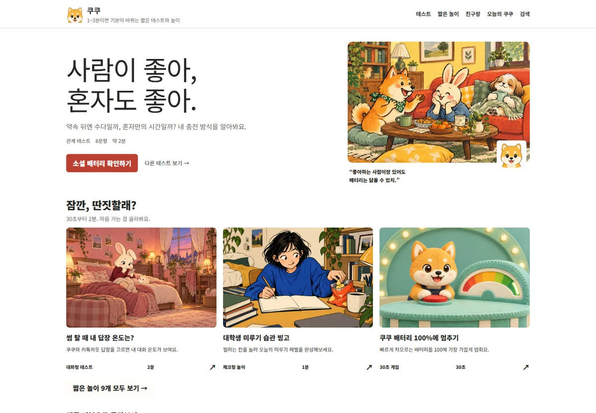
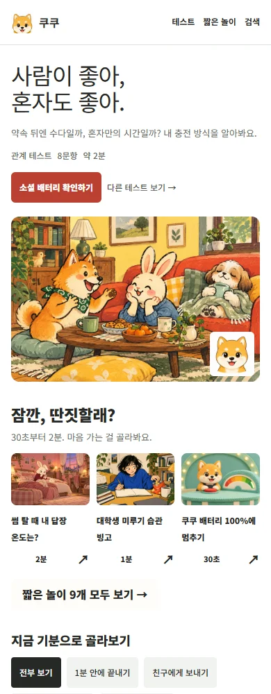
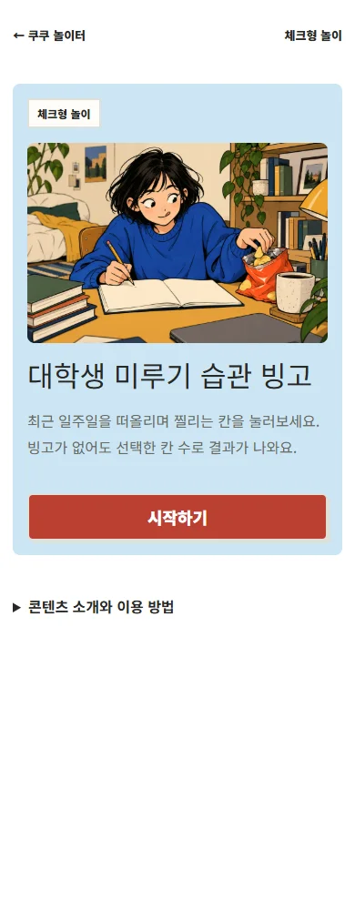
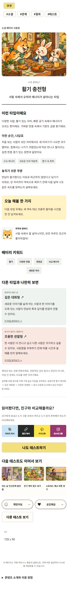

# 쿠쿠 일러스트 전체 적용 · 5·6단계

작성: **2026-10-20** · 범위: 테스트 25개·놀이 9개 · 상태: **5·6단계·운영 배포 완료**

## 1. 목표와 적용 범위

아이콘을 조합한 표지를 인물의 표정과 행동이 있는 장면으로 바꿉니다. 사이트의 탐색·진행·결과 틀은 유지하고, 테스트마다 인물과 공간을 달리하되 한 테스트의 표지와 결과는 이어지게 만들었습니다.

전체 순서는 콘텐츠 조사(1단계) → 컨셉·화풍 배정(2단계) → 화풍 기준과 가이드(3단계) → 대표 네 콘텐츠 제작(4단계) → 실제 화면 연결·검토(5단계) → 전체 콘텐츠 제작·적용(6단계)입니다. 이번 기록은 마지막 두 단계와 배포를 다룹니다.

| 구분 | 완료한 제작 범위 | 사용처 |
|---|---|---|
| 표지 | 34장 | 메인 대표·목록·검색·추천·테스트 및 놀이 소개 |
| 문답형 결과 | 101장 | 25개 테스트의 모든 결과 유형 |
| 놀이 결과 | 26장 | 답장 3·빙고 3·배터리 3·상자 1·관계 순위 5·에너지 배분 5·축제 4·감정 비우기 1·룰렛 1 |
| 합계 | **161장** | 4단계의 12장 재사용, 새로 채택한 그림 149장 |
| 공유 미리보기 | 161종 | 표지 34·문답형 결과 101·놀이 결과 그림 구분 26에 대응하는 1200×630 PNG |

상자·룰렛은 각각 공통 결과 그림을 씁니다. 날짜별 미션·룰렛의 실제 선택·빙고 개수·배터리 수치는 실제 글자로 표시합니다. 질문마다 그림을 넣는 작업, 상자와 룰렛의 행동별 추가 원화는 이번 범위에 포함하지 않았습니다.

## 2. 문제와 해결

| 확인한 문제 | 반영한 해결책 |
|---|---|
| 서로 다른 테스트도 공통 아이콘·같은 구도처럼 보임 | 34개 콘텐츠마다 출연 인물·장소·행동을 지정하고 장면형 표지 제작. 사용하지 않는 기존 SVG 표지 135개 제거 |
| 화풍 이름만 바꾸면 같은 얼굴·방이 반복될 수 있음 | 새 표지는 화풍의 재료 설명과 독립된 인물·공간을 사용. 결과는 해당 테스트의 표지를 참조해 연속성 유지 |
| 한 결과가 표지와 같은 장면이 되거나 인물이 중복됨 | 표정·행동·배치를 비교하고 중복 인물, 생각 말풍선 속 장면 나열, 과한 실사·CG 표현, 귀 잘림, 카드 구도 반복 등 13개 출력을 교체하고 이력 보관 |
| 놀이 결과는 큰 기호만 보여 그림이 끊김 | 놀이 결과 26종도 장면 그림 연결. 실제 판정 구간과 그림 구분을 일치시킴 |
| 그림을 소개 화면에 넣자 위아래 빈 띠가 생김 | 이미지 높이를 원본 비율에 따라 계산하도록 수정. 3:2 그림을 자르거나 늘이지 않음 |
| 결과에 따라 공유 그림이 누락될 위험 | 모든 원화 경로·해시를 빌드에서 확인. 원화와 생성 코드가 바뀌면 오래된 공유 미리보기를 자동 검사에서 탐지 |
| 제작용 장면명이 방문자용 공유 제목에 노출될 위험 | 공유 제목·설명은 실제 콘텐츠 원본에서 읽고, 제작 기록의 장면명은 사용하지 않음 |
| 축제 결말에 앞선 장면과 이어지지 않는 카드·운세 이야기가 남아 있음 | 실제 선택 흐름에 맞게 만남·장비 정리·기념사진·산책으로 결말 3종의 문장과 그림을 맞춤 |

풍부한 결과 설명, 상황 예시·주의점·행동 제안과 **해석을 읽은 뒤 공유하는 순서**는 유지합니다. 질문 점수, 참여 수 집계 규칙, 광고 활성화 여부는 바꾸지 않았습니다.

## 3. 최종 화풍 배정

| 화풍 | 콘텐츠 수 | 적용 방향 |
|---|---:|---|
| S1 과슈 생활극 | 9 | 불투명한 붓질·생활 공간·표정과 행동 |
| S2 펜선과 부드러운 명암 | 10 | 유기적인 선·형태 명암·서로 다른 사람과 동물 |
| S3 색연필 생활화 | 9 | 겹친 연필 결·종이 질감·인물과 주변 공간 |
| S4 펠트 미니어처 | 6 | 섬유·봉제·소품이 실제로 닿는 작은 세트 |

전체 34개 배정·출연 인물·그림 목록은 **[최종 제작 갤러리](docs/art-production/20261020/README.md)**, 실행한 프롬프트·참조 경로·채택/교체 이력·파일 해시는 [제작 기록 JSON](docs/art-production/20261020/production.json)에 있습니다. 2단계의 컨셉 묶음 8개는 탐색용 분류이고, 네 화풍과 일대일 관계가 아닙니다.

배경 그라데이션은 사용하지 않습니다. 그림 속 물감 명암·종이·빛·접촉 그림자는 인물과 공간의 입체감을 위한 표현입니다. 사이트 배경의 장식용 색 번짐과 구분합니다.

## 4. 여자 마스코트 보존

사용자가 선택한 **첫 S2 원본**을 화풍 기준·여자 마스코트 기준·빙고 표지 원본으로 보존했습니다. 세 파일은 동일한 SHA-256으로 자동 검사합니다. 공개용 WebP는 이 원본을 비율 유지해 압축한 파일이므로 원본 PNG와 해시는 다릅니다.

- [S2 기준 원본](docs/illustration-style/kuku-ink-comic-v1/reference.png)
- [여자 마스코트 원본](docs/mascots/human-companion-v1/reference.png)
- [빙고 표지 원본](docs/art-pilots/20261020/procrastination-bingo/cover.png)

여자 마스코트는 미루기 빙고 안에서만 사용했습니다. 이름·전신·추가 의상·쿠쿠와의 공동 출연·사이트 곳곳의 장식 배치는 추후 작업입니다. 다른 테스트의 검은 머리 인물을 이 마스코트의 새 외형으로 등록하지 않습니다.

## 5. 검증 기록

로컬 Edge에서 공개 배포물을 열어 검사했습니다. 외부 광고·분석 요청은 차단했으며 운영 참여 수를 추가하지 않았습니다.

| 검사 | 현재 기록 |
|---|---|
| 빌드 | 34개 소개·101개 정적 결과·루트 페이지 생성 성공. 원화 161장 누락·해시 검사 통과 |
| 공유 이미지 | 표지 34·문답형 결과 101·놀이 결과 26종 생성 성공. 1200×630, 원화 비율 유지 |
| Node 자동 검사 | **24개 모두 통과**. 전체 답변 조합 542,689개·모든 결과 도달 가능성·34개 콘텐츠 흐름·이미지 경로/해시·놀이 판정 경계·미리보기 최신 여부·패키지 비공개 파일 제외 검사 |
| PC·모바일 화면 | 최종 326화면 통과: 메인·검색·소개 34·결과 127을 390/1440px에서 각각 검사. 이미지 디코딩·비율·가로 넘침·JS 오류·문답형 해석 뒤 공유 순서 확인 |
| 실제 진행·클립보드 | 테스트 25개×두 폭=50회, 놀이 9개×두 폭=18회 완료. 정적 결과 101개도 각 폭에서 확인. 대표 테스트·놀이의 복사·붙여넣기·링크 복사·인스타그램 다운로드 4건 통과 |
| WebKit 추가 확인 | 로컬 실행 파일이 없어 실행하지 못함. 아래 실기기 미검증 범위로 구분 |
| 공개 배포물 | 최종 허용 목록 포장 검사 통과. 제작 문서·기준 그림·캡처·설정·분석 내보내기 제외 |
| 운영 배포 | 코드 `0dd3d8a`의 [배포 실행](https://github.com/jwkim1421/fun-things-collection/actions/runs/39422821771) 성공. 공개 응답 535개(빌드 표식 제외)가 로컬 파일과 일치, 비공개·폐기 경로 17개 HTTP 404 확인 |

공개 파일 536개는 총 60,450,605바이트입니다. 이 중 장면 WebP 161장은 총 27,131,592바이트, 가장 큰 한 장은 306,194바이트입니다. 방문마다 전체 파일을 받는 구조는 아니지만 기존 SVG보다 이미지 용량이 늘었습니다. 실제 통신 환경에서의 로딩 성능 개선을 입증한 결과는 아니며, 파일 크기 제한과 지연 로딩을 적용한 상태입니다.

운영 주소 [coocooing.kro.kr](https://coocooing.kro.kr/)에서도 대표 테스트 6회를 두 폭에서 확인했고 오류가 없었습니다. 이 검사는 API 쓰기 요청을 차단해 운영 참여 수를 늘리지 않았습니다. 클립보드 검사는 위 로컬 4건이며 운영 모드에서는 재실행하지 않았습니다. 공유 이미지와 장면 그림은 전체 파일 대조에 포함됐습니다. 운영 확인: 2026-10-20T12:37:19.666Z. 공개 포장 536개 중 `.nojekyll` 한 개는 빌드 표식이라 HTTP 파일 대조에서 제외했습니다. 배포 뒤 완료 기록만 갱신한 문서 커밋은 사이트 파일을 바꾸지 않습니다.

반복 빌드 검사에서 기존 주소 안내 HTML을 같은 내용으로 계속 쓰다가 Windows 파일 접근 오류가 두 차례 발생했습니다. 내용이 달라질 때만 쓰도록 수정한 뒤 전체 24개 검사가 통과했습니다. 외부 검사와 동시 실행을 분리하는 것만으로는 해결되지 않아 빌드 동작을 보완했습니다.

실물 휴대폰, 카카오톡·인스타그램 앱 내부의 실제 전송과 붙여넣기는 별도 확인 대상입니다. 브라우저 자동화 성공을 실기기 검사로 기록하지 않습니다. 이번 그림 교체가 클릭률·완료율·광고 수익을 높였다는 성과 자료는 아직 없습니다.

### 실제 화면 캡처

로컬 공개 배포물을 Edge에서 연 화면입니다. 빈 광고 응답으로 인한 외부 서비스 차이는 포함하지 않습니다.

## 6. 다른 컴퓨터·다음 AI에게 전달

1. 이 보고서와 [제작 갤러리](docs/art-production/20261020/README.md)를 읽고 대상 테스트를 고릅니다.
2. `production.json`의 대상 항목에서 실제 표지·결과, 화풍, 출연 인물, 프롬프트와 참조 역할을 확인합니다. 기준 파일을 직접 열어 봅니다.
3. 새 장면은 해당 테스트의 채택 표지를 인물·재료 참조로 사용하고 행동과 배치는 새로 지정합니다. 원본을 덮어써 화풍 기준을 바꾸지 않습니다.
4. 생성 PNG는 로컬 `.artifacts/art-production-originals/`에 보관하고 `node scripts/export-art.mjs`로 1080×720 WebP를 만듭니다. 실제 출력의 프롬프트·참조·원본 해시를 제작 기록에 남깁니다.
5. `npm run build` → `npm run build:previews` → `npm test` → `npm run test:browser` → `npm run test:artwork` → `npm run package:site` 순서로 확인합니다. 새 그림은 작은 카드·소개·결과·복사 이미지에서 직접 봅니다. 326화면 검사는 `test:artwork`로 재실행하며 보고서·캡처는 `.artifacts/qa-artwork/`에 저장됩니다. 배포 자동화에서도 같은 검사를 실행합니다.

Git에는 최종 WebP, 공유 PNG, 기준 그림·가이드·제작 기록을 보관합니다. 새로 생성한 대용량 PNG 원본은 로컬의 무시된 폴더에 있어 **다른 컴퓨터에 Git만 받아서는 복원되지 않습니다.** 픽셀 원본이 필요한 편집은 이 폴더를 별도로 복사해야 합니다. 일반 사이트 빌드·배포에는 커밋된 WebP와 PNG를 사용하므로 새 이미지 생성이나 원본 PNG가 필요하지 않습니다. 내보내기 도구도 원본이 없고 최종 WebP가 있으면 기존 파일을 유지합니다.

운영 문서·제작 기록·기준 PNG·검사 캡처·분석 자료·Worker 설정은 공개 배포물에 포함하지 않습니다. 배포에는 공개 파일만 추리는 `npm run package:site` 결과를 사용합니다.

### 새 컴퓨터와 배포 실행

프로젝트 루트에서 Node.js 22와 `npm ci`로 의존성을 설치합니다. Windows 검사는 설치된 Edge를 사용하며, Linux·macOS에서는 `npx playwright install chromium`으로 검사 브라우저를 준비합니다. 배포 자동화는 Node.js 22와 Chromium을 사용합니다.

`package:site`는 실행할 때마다 `.artifacts/site-임의문자/` 폴더를 만들고 정확한 경로를 출력합니다. 폴더 안을 검사한 뒤 코드·생성 자산을 커밋하고 `master`에 푸시합니다. GitHub의 [Publish public site 실행 화면](https://github.com/jwkim1421/fun-things-collection/actions/workflows/pages.yml)에서 `Run workflow`를 실행합니다. 정의는 [.github/workflows/pages.yml](.github/workflows/pages.yml)에 있으며 빌드·자동 검사·브라우저 검사·공개 포장이 성공한 뒤 GitHub Pages에 배포됩니다. 원격 `master`의 커밋과 실행 SHA가 같은지도 확인합니다.

이번 커밋·푸시·배포와 운영 파일 확인을 완료했습니다. 실물 휴대폰·실제 앱 전송은 운영자가 확인한 뒤 [운영 기록](COOCOO_GROWTH_PLAN.md)의 남은 일과 이 보고서에 기기·결과를 남깁니다.
