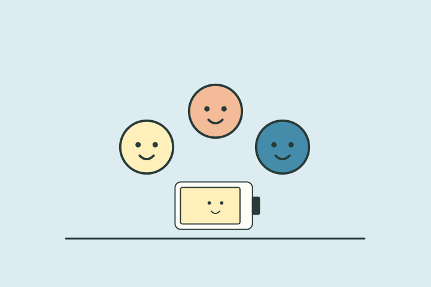

# 쿠쿠 테스트 그림 개선을 위한 도구 조사

작성·공식 자료 확인: **2026-10-20** · 대상: https://coocooing.kro.kr/

요청 이해: 현재의 아이콘 조합 같은 표지를 개선하기 위해, 장면을 그리는 이미지 생성 도구와 제작·적용 방법을 조사합니다. 현재 운영 상태는 [운영·성장 계획](COOCOO_GROWTH_PLAN.md), 앞선 화면 분석은 [심심테스트 벤치마킹](COOCOO_SIMSIMTEST_BENCHMARK_20261019.md)에서 관리합니다.

## 1. 결론과 이번에 확인한 범위

**개선할 수 있습니다. 현재 대화에서도 실제 그림을 생성할 수 있습니다.** 조사 후 전체 콘텐츠·화풍을 정리하고 [4단계 대표 표지·결과 12장](COOCOO_ILLUSTRATION_PILOT_20261020.md)을 준비했습니다. S2는 사용자 선택으로 첫 그림의 입체감을 복원했고, 여자 인물은 쿠쿠와 함께 사용할 마스코트로 등록했습니다. 다음은 실제 화면에 놓는 검토이며 운영 사이트에 적용하지는 않았습니다.

문제의 핵심은 파일 형식이나 색상 수보다 **장면과 표정의 부재**입니다. 지금의 휴대폰·하트·배터리를 더 많이 붙이면 같은 문제가 반복됩니다. 각 테스트가 다루는 상황을 한 장면으로 그리고, 그 안에서 인물이나 동물이 행동하도록 바꿔야 합니다.

이 조사 단계에서 코드 구조와 기존 이미지를 확인하고, OpenAI·Google·Midjourney·Adobe Firefly·Recraft·Ideogram의 공식 기능·요금·공개 이용 조건을 조사했습니다. 로컬 제작 대안으로 ComfyUI와 FLUX도 확인했습니다. **조사 단계에서 직접 생성한 것은 내장 도구 시안 1장입니다. 이후 3단계에서 추가한 기준 후보 3장은 별도 보고서에 기록했습니다. 다른 서비스의 결과 품질을 직접 비교한 순위표는 아닙니다.** 업체의 우수성 주장은 쿠쿠에서 검증한 성과로 인용하지 않았습니다.

| 항목 | 조사 단계의 상태 · 후속 진행은 위 3단계 보고서 참고 |
|---|---|
| 기존 그림의 반복 원인 확인 | 완료. 공통 SVG 부품·같은 구도 재사용을 코드에서 확인 |
| 도구·비용·조건 조사 | 완료. 가격이 읽히지 않은 부분과 계약 확인이 남은 부분은 아래에 표시 |
| 그림 생성 가능 여부 | 내장 도구로 원본 PNG 1장 생성·육안 확인 |
| 스타일·캐릭터 최종 확정 | 미확정. 이번 시안이 채택된 것은 아님 |
| 사이트 이미지 교체·빌드 변경·배포 | 미실시 |
| 클릭률·완료율·수익 개선 효과 | 미측정 |

## 2. 지금 그림이 아이콘 조합처럼 보이는 이유

[그림 생성 코드](scripts/artwork.mjs)는 `face`, `phone`, `heart`, `battery`, `book`, `cup` 같은 도형 함수를 만들고, 크기·회전·위치를 바꿔 배치합니다. 테스트 007·013·답장 온도 놀이에는 같은 휴대폰·말풍선·하트 구도가 사용됩니다. 여러 결과도 같은 방·얼굴·소파 구도를 공유합니다.

따라서 앞선 구현의 ‘주제 삽화 34개·결과 삽화 101개’는 파일 수에 관한 기록입니다. **서로 다른 장면을 135장 그렸다는 뜻은 아닙니다.** 그림 파일이 빠짐없이 배포된 것과 사용자가 기대한 그림의 매력을 충족한 것은 별개입니다.

| 비교 지점 | 지금 쿠쿠 | 사용자가 첨부한 심심테스트·푸망 카드에서 관찰한 점 | 쿠쿠의 개선 방향 |
|---|---|---|---|
| 주인공 | 둥근 얼굴·사물 부품 | 표정·자세가 있는 캐릭터 또는 의미 있는 사물 | 표정·시선·행동을 먼저 설계 |
| 구도 | 작은 물체 몇 개를 중앙에 배치 | 책상·상자·공간·포스터처럼 하나의 완성된 구성 | 주제마다 다른 장면·시점 사용 |
| 질감 | 균일한 선과 단색 면 | 낙서·붓질·종이·목재·입체 재료 등 다양함 | 손맛을 주되 작은 크기에서 읽히도록 정리 |
| 주제 구별 | 비슷한 소품의 반복 | 플러팅·전생·취향의 소재가 서로 다름 | 제목을 가려도 주제 차이가 보여야 함 |
| 글자 | 제목은 이미지 바깥 | 심심테스트는 그림과 제목 분리, 첨부된 푸망 예시는 포스터 안 큰 제목 | 홈은 그림·제목 분리, 홍보물은 글자를 별도로 편집 |

이 비교는 첨부 화면에 대한 관찰입니다. 두 사이트가 어떤 생성 도구를 썼는지, 작가에게 의뢰했는지, 사진·3D 제작을 병행했는지는 확인되지 않았습니다. 외형만으로 특정 AI 도구 사용을 단정하지 않습니다.

## 3. 실제 생성해 본 시안

**소셜 배터리 사용법 · 연구용 시안 · 사이트 미적용**

이후 사용자가 이 그림을 다른 AI도 참고할 수 있게 보존해 달라고 요청했습니다. [그림체 가이드 v1과 기준 PNG](docs/illustration-style/kuku-gouache-v1/STYLE_GUIDE.md)에 선·채색·질감·구도·캐릭터 구분과 주제 변경용 한영 요청문을 기록했습니다. 향후 이 그림체의 재사용 기준은 해당 가이드입니다. 아래 도구 선택·두 화풍 비교는 조사 당시 제안이며, 현재 제작 방향은 [2단계 컨셉·화풍 배정안](COOCOO_CONCEPT_STYLE_PLAN_20261020.md)을 봅니다.

| 기존 표지 | 내장 도구로 새로 만든 장면 |
|---|---|
|  |  |

시안에서는 얼굴·배터리를 나열하는 대신 모임에서 대화하는 친구와 편하게 쉬는 친구를 함께 그렸습니다. 단색으로 칠한 벽과 소파, 붓질 질감, 자세의 차이를 확인했습니다. 그라데이션 배경·글자·아이콘 장식은 요청하지 않았고 생성 결과에서도 보이지 않습니다.

**그대로 최종 채택하기에는 보완이 필요합니다.** 배경 소품이 많고 동화책 분위기가 강합니다. 작은 카드에서 주제 전달이 약해질 수 있으므로 소품을 줄이고 표정을 키워야 합니다. 기존 쿠쿠 얼굴 원본을 참조로 넣지 않았으므로 공식 마스코트와 같은 캐릭터라고 보장하지도 않습니다. 다음 시안에서는 캐릭터 기준 이미지를 함께 사용해야 합니다.

- 생성 방식: `imagegen` 스킬의 **내장 이미지 생성 도구**. 외부 API 키·별도 유료 구독을 새로 연결하지 않았습니다.
- 보존 원본: [시안 PNG](docs/images/social-battery-illustration-concept-20261020.png), 1536×1024px, 약 3.19MB. 문서용 원본이며 이 용량 그대로 웹에 올리는 것은 권하지 않습니다.
- 이번에 확인한 것: 한 장면을 가진 그림을 실제로 생성할 수 있음. 여러 장의 스타일 유지·한글 정확도·다른 서비스보다 우수한지는 확인하지 않았습니다.
- 정확한 생성 요청은 문서 마지막에 보존했습니다.

## 4. 도구별 비교

아래 ‘맞는 용도’는 공식 기능을 쿠쿠 작업에 대입한 판단입니다. 사용자가 원하는 그림체가 실제로 나오는지는 같은 제작 요청으로 시안을 비교해야 합니다. 요금은 미국 달러 공개 표시 기준이며 한국 결제 금액·세금·환율·계정별 제공량과 다를 수 있습니다.

| 도구 | 쿠쿠에서 먼저 시험할 용도 | 그림을 이어 만드는 방법 | 접근·비용 | 판단 |
|---|---|---|---|---|
| 현재 대화의 내장 이미지 생성 | 장면형 표지, 설명을 통한 수정 | 승인한 그림·캐릭터를 다음 요청의 참조로 사용 | 현재 사용 가능. 별도 API 키 불필요, Codex 사용 한도 소모 | **첫 시안 제작에 우선 사용** |
| OpenAI 이미지 API | 확정된 제작 요청으로 반복 생성·편집 | 이미지 입력·대화형 편집 | 별도 API 계정·과금 필요. 아래 토큰 요금 참조 | 반복 제작 자동화가 필요해질 때 |
| Google Gemini 이미지 생성 | 캐릭터를 유지하며 장면 변경, 수정 대안 | 참조 이미지·대화형 편집 | Google 계정. API는 프로젝트·키·결제 설정 별도 | **내장 도구가 목표 화풍에 미달하면 비교할 후보** |
| Midjourney | 다양한 그림 분위기 탐색 | Style Reference, 버전에 맞는 인물·사물 참조 | 웹 구독 월 $10부터 | 시각 탐색 후보. 범용 공식 API가 없어 코드 자동화에는 부적합 |
| Adobe Firefly | 생성 후 구도·색·일부 요소 보정 | 스타일·구도 참조, 편집 앱 연계 | Adobe 계정. Standard 월 $9.99, Pro 월 $19.99 | 편집 도구까지 함께 쓸 때 적합 |
| Recraft | 같은 선·색감으로 표지 시리즈 제작 | 스타일 참조, 재사용 스타일, 공식 API | 웹 무료본은 상업 사용 불가. 유료 웹·API는 별도 조건 | **시리즈 일관성 비교 후보** |
| Ideogram | 포스터형 홍보물, 글자·부분 수정 | 참조 이미지·스타일·재편집 기능 | Plus 월 $20, Pro 월 $60. API 별도 견적 확인 | 푸망 예시 같은 포스터를 시험할 후보 |

### 4.1 현재 내장 도구와 OpenAI API

이번 대화에서 이미지 생성에 성공했습니다. 별도 플러그인 설치나 API 키 입력부터 할 필요가 없습니다. 공식 안내는 내장 생성이 Codex 사용 한도를 소모한다고 설명합니다. **별도 비용이 전혀 없다거나 무제한이라고 뜻하지 않습니다.** 공식 안내상 내장은 GPT Image 2이며, 이번 도구 응답에는 실행 모델 ID가 따로 제시되지 않았습니다. [OpenAI 내장 이미지 생성 안내](https://learn.chatgpt.com/docs/image-generation).

반면 현재 API 문서는 GPT Image 2.5의 Sunburst·Flare를 안내합니다. 생성·편집과 이미지 입력을 지원하며, 대화 속에서 수정할 수 있습니다. 내장 기능과 API의 모델·결제 방식을 같은 것으로 취급하면 안 됩니다. [OpenAI API 이미지 가이드](https://developers.openai.com/api/docs/guides/image-generation).

쿠쿠에는 ‘새로 그리기’뿐 아니라 ‘토끼와 구도는 그대로 두고 소품만 줄이기’처럼 부분 수정하는 작업이 필요합니다. 이 방식으로 한 장의 기준 그림을 정교하게 만들고 다음 그림의 참조로 쓰는 것이 적합합니다. **매번 긴 프롬프트를 새로 넣는 것만으로 동일 캐릭터가 보장되지는 않습니다.** [공식 이미지 프롬프트 안내](https://developers.openai.com/api/docs/guides/image-prompting).

상업 이용에 관해서는 이번에 확인한 기능·요금 문서가 소유권 계약 조항을 대신하지 않습니다. **사용자 계정에 적용되는 계약의 출력물 이용 조항은 아직 대조하지 않았습니다.** 이번 시안은 미게시 상태이며, 상업 게시 전 확인 항목으로 남깁니다.

### 4.2 Google Gemini 이미지 생성, Nano Banana

Nano Banana는 앱 이름 하나가 아니라 Gemini 이미지 모델군을 가리킵니다. 현재 공식 문서에는 Nano Banana 2.1, 2 Lite, Pro 등이 구분돼 있습니다. 여러 참조 이미지와 대화형 편집을 지원하며 모델별 지원 범위가 다릅니다. 따라서 ‘나노바나나로 만들었다’만 기록하면 재현에 부족합니다. 모델·날짜·참조 그림까지 남겨야 합니다. 생성 이미지에는 SynthID가 포함됩니다. [Google 이미지 생성 문서](https://ai.google.dev/gemini-api/docs/image-generation).

쿠쿠에서는 같은 캐릭터를 답장·모임·공부 장면에 옮기는 비교 작업에 적합한 후보입니다. 다만 공식 기능 지원은 매번 같은 얼굴을 보장한다는 뜻이 아닙니다. 한국어 제목도 이번 조사에서 직접 생성·검수하지 않았습니다.

Google은 출력물 소유권을 주장하지 않는다고 안내하지만 이용자는 적용 약관과 타인 권리를 지켜야 합니다. API·AI Studio의 무료·유료 구분에 따라 입력·출력의 제품 개선 사용 조건도 달라집니다. 무료 이용이라고 모든 이미지 모델을 무료로 호출할 수 있는 것은 아닙니다. **이 설명을 소비자용 Gemini 앱의 구독·데이터 조건으로 옮겨 적용하지 않습니다.** [Gemini API 추가 약관](https://ai.google.dev/gemini-api/terms).

### 4.3 Midjourney

Style Reference는 색·재료·질감 같은 시각적 특성을 참고합니다. 등장인물의 동일성까지 고정하는 기능은 아니므로 캐릭터 참조와 구분해야 합니다. 현재 문서는 버전에 따른 기능 차이를 안내하므로 예전 V7용 설명을 그대로 적용하지 않습니다. [Style Reference 공식 문서](https://docs.midjourney.com/hc/en-us/articles/32180011136653-Style-Reference).

Basic·Standard·Pro·Mega는 월 $10·$30·$60·$120입니다. Standard부터 이미지 Relax 생성이 제공되지만 대기와 작업 시간이 있습니다. 비공개 Stealth는 Pro·Mega에만 제공됩니다. **월 $10을 내면 비공개·무제한이 모두 되는 구조가 아닙니다.** [요금·기능 비교](https://docs.midjourney.com/hc/en-us/articles/27870484040333-Comparing-Midjourney-Plans).

자신이 생성한 이미지의 상업 이용을 안내하며, 연 매출 $100만 초과 사업체는 회사용 상업 이용에 Pro·Mega가 필요합니다. 다른 사람이 만든 그림을 확대했다는 이유로 사용할 권리가 생기지는 않습니다. [상업 이용 안내](https://docs.midjourney.com/hc/en-us/articles/27870375276557-Using-Images-Videos-Commercially).

일반적으로 제공되는 공식 API가 없고 무단 자동화도 허용하지 않습니다. 쿠쿠 제작 스크립트에 비공식 ‘Midjourney API’를 붙이거나 브라우저를 자동 조작해 대량 생성하는 방식을 권하지 않습니다. [공식 커뮤니티 규정](https://docs.midjourney.com/hc/en-us/articles/32013696484109-Community-Guidelines).

### 4.4 Adobe Firefly

스타일 참조로 그림의 분위기를 지정하고, 구도 참조를 별도로 다룰 수 있습니다. 생성에서 끝내지 않고 일부 수정과 글자 배치를 편집 도구에서 마무리하는 작업에 적합한 후보입니다. [스타일 참조 안내](https://helpx.adobe.com/firefly/web/work-with-images/generate-images/reference-images-for-styling.html).

공식 미국 가격은 Standard 월 $9.99·Pro 월 $19.99입니다. 유료 플랜의 표준 이미지 기능과 프리미엄·파트너 모델의 크레딧 소모를 구분합니다. **Firefly 안에서 OpenAI·Google 모델을 골랐다고 Adobe 자체 모델과 같은 사용량·보호 조건이 적용되는 것은 아닙니다.** Adobe는 자체 Firefly 모델의 상업 이용을 안내하며 파트너 모델 출력은 사용자가 적합성을 판단하도록 구분합니다. 개인 플랜 전체에 기업용 권리 보상이 붙는다고 해석하지 않습니다. [가격·표준 기능·파트너 모델·상업 이용 FAQ](https://www.adobe.com/products/firefly/plans.html).

이미 Adobe 편집 앱을 쓰고 있다면 보유 플랜부터 확인할 가치가 있습니다. 현재 계정·보유 구독은 확인하지 않았습니다. 월 $9.99에 Photoshop 데스크톱 전체가 포함된다고 가정하지 않습니다.

### 4.5 Recraft

스타일을 정하고 연속된 그림에 재사용하는 기능이 있어 표지 시리즈 비교 후보입니다. **래스터 그림 생성도 지원하므로 아이콘·SVG 제작용으로만 볼 필요는 없습니다.** 업체가 제시하는 스타일 일치 성능 수치는 업체가 설계한 비교이며 쿠쿠 품질의 증거로 사용하지 않았습니다. [Recraft Styles](https://www.recraft.ai/v4styles).

**웹 무료 플랜으로 생성한 이미지는 상업 이용이 허용되지 않습니다.** 이후 유료로 전환해도 과거 무료 생성물의 권리가 소급 변경되지 않는다는 별도 안내가 있습니다. 광고 수익을 목표로 하는 쿠쿠에는 특히 중요한 차이입니다. 유료 웹 생성물은 생성 당시 플랜에 따른 권리·비공개 조건을 갖습니다. [현재 요금·권리 FAQ](https://www.recraft.ai/pricing), [무료→유료 전환과 기존 이미지 권리](https://www.recraft.ai/blog/ownership-and-commercial-use-faq).

공식 API는 웹 구독 크레딧과 별도 결제이며, API 약관은 생성한 출력물의 개인·상업 사용 권리를 명시합니다. API 결과를 다른 AI 학습에 쓰는 제한과 출처 표시 정보에 관한 조건도 있습니다. [API 약관 6절](https://www.recraft.ai/legal/developer-terms).

현재 웹 요금표의 플랜 가격은 이 조사 도구에서 불러오지 못했습니다. 과거 블로그의 월 구독료를 현재 요금으로 적지 않았습니다. API 단가는 아래에서 확인할 수 있습니다.

### 4.6 Ideogram

현재 4.5 안내에는 글자 수정·스케치 변환·스타일 참조·프레임 변경 사례가 있습니다. 그림과 타이포그래피가 함께 중요한 포스터를 시험할 후보입니다. 그렇다고 **한글이 가장 정확하다거나 오탈자가 없다고 검증한 것은 아닙니다.** [현재 모델 기능](https://ideogram.ai/models/4.5/).

월 결제 Plus $20·Pro $60과, 연 결제 환산 $15·$42를 구분해야 합니다. Plus는 월 2,400, Pro는 7,500 priority credits를 안내합니다. 크레딧 수는 완성 이미지 수와 같지 않고 모델·설정·편집에 따라 소모량이 달라집니다. 비공개 생성과 배치 생성의 플랜 차이도 확인해야 합니다. [현재 가격·크레딧 FAQ](https://ideogram.ai/pricing/).

약관은 생성 출력물의 상업 목적 사용을 제한하지 않는다고 명시합니다. 공개 콘텐츠의 다른 이용자 리믹스와 비공개 콘텐츠도 구분하므로 공개 갤러리에서 남의 그림을 가져오는 것과 자신의 출력물을 쓰는 것을 혼동하지 않습니다. [이용 약관 2.1·4절](https://ideogram.ai/legal/tos/).

API에는 실제 생성 없이 요청 가격을 조회하는 `dry_run`이 있습니다. 요금 페이지의 현재 모델별 표가 동적으로 읽히지 않았으므로 옛 3.0 API 단가를 4.5 단가로 옮기지 않았습니다. API를 선택할 때 같은 크기·참조 수·옵션으로 견적을 먼저 확인할 수 있습니다. [4.5 API의 가격 사전 조회](https://developer.ideogram.ai/api-reference/images/generate/ideogram-4-5).

### 4.7 로컬 제작: ComfyUI와 FLUX

ComfyUI는 여러 생성·편집 단계를 연결하는 실행 도구이며, 그 자체가 특정 그림 모델은 아닙니다. 로컬 실행은 가능하지만 하드웨어·모델·부속 기능 설치를 관리해야 합니다. CPU 실행도 가능하나 공식 문서에서 느린 방식으로 구분합니다. 현재 PC의 GPU·메모리와 목표 생성 시간을 확인하지 않았습니다. [ComfyUI 시스템 요구 사항](https://docs.comfy.org/installation/system_requirements).

‘모델 파일을 무료로 받음’과 ‘상업 제작을 자유롭게 할 수 있음’도 다릅니다. 예를 들어 공식 안내는 FLUX.2 klein 4B를 Apache 2.0, 9B를 비상업 라이선스로 구분합니다. dev 라이선스에는 모델 실행의 비상업 제한과 출력물 이용 조항이 별도로 있으므로 **모든 출력물의 상업 이용이 일괄 금지된다고 단정하는 것도 부정확합니다.** 쿠쿠용 제작 과정에 맞는 라이선스·API 조건을 선택해야 합니다. [모델별 라이선스 안내](https://help.bfl.ai/articles/7108141705-can-i-run-or-fine-tune-flux-2-klein-locally), [dev 라이선스 원문](https://bfl.ai/legal/non-commercial-license-terms).

현재 34개 표지를 개선하려고 로컬 생성 환경 구축부터 하는 것은 권하지 않습니다. 지속적으로 많은 그림을 만들고, 그림 방향이 이미 확정됐을 때 다시 검토할 대안입니다. API·클라우드 방식과 로컬 GPU 비용도 별도로 계산해야 합니다.

## 5. 비용을 어떻게 잡을 것인가

**제작 수량 가정:** 표지 34개 × 후보 3장 = **102장 생성**. 별도 편집·재생성·최종 고해상도 출력은 추가입니다. 결과 101종까지 같은 방식으로 만들면 총 135개 × 3 = 405장이므로, 표지와 결과를 동시에 전면 교체하지 않습니다.

| 경로 | 확인한 공개 단가 | 102장에 대한 계산·주의 |
|---|---|---|
| 현재 내장 생성 | 별도 API 청구 대신 Codex 사용 한도 소모 | 달러/장 단가는 확인할 수 없음. 현재 계정 잔여량도 미조회 |
| OpenAI GPT Image 2.5 API | 표준 이미지 출력 100만 토큰당 $30, 이미지 입력 $8, 텍스트 입력 $5 | 크기·품질·입력 이미지에 따라 토큰 수가 달라짐. 고정 장당 단가로 견적하지 않음 |
| Google Nano Banana 2.1 API | 1K 출력 약 $0.0336, 2K $0.0504 | 출력 부분만 각각 약 **$3.43 / $5.14**. 입력·생각 토큰·추가 편집·세금 별도 |
| Recraft V4 Styles API, 래스터 | 출력 $0.035/장, 스타일 생성 $0.005/요청 | 출력만 **$3.57**. 매번 스타일 생성도 함께 청구되는 102요청이면 **$4.08**. 2K Pro 래스터는 $0.10/장으로 별도 |
| Midjourney·Firefly·Ideogram 웹 | 위의 월 구독료·플랜별 사용량 기준 | 생성 시간·대기·편집·크레딧 차이 때문에 ‘102장 총액’으로 환산하지 않음 |

단가 출처: [OpenAI 가격표](https://developers.openai.com/api/docs/pricing), [Google 모델별 가격표](https://ai.google.dev/gemini-api/docs/pricing), [Recraft API 가격표](https://www.recraft.ai/docs/api-reference/pricing). 표의 곱셈은 이 보고서의 가정에 따른 계산이며 실제 청구 견적이 아닙니다. OpenAI의 할인 Batch 표를 표준 단가로 옮기지 않았습니다.

그림 생성비가 낮아도 **장면 기획·탈락안 검토·캐릭터 수정·축소 확인·웹 연결**이 남습니다. 싸게 102장을 한 번에 만드는 것보다, 세 주제에서 원하는 수준이 나오는지 먼저 확인하는 것이 낭비를 줄입니다. 이번에 유료 플랜 구매나 API 결제 연결은 하지 않았습니다.

## 6. 쿠쿠에 권하는 제작 방식

### 6.1 조사 당시의 첫 비교 제안

이 절과 6.3절은 전체 기획표 작성 전의 초기 제안입니다. 현재 대표 비교 대상·수량·순서는 [2단계 배정안](COOCOO_CONCEPT_STYLE_PLAN_20261020.md)으로 이어집니다. 아래 6장 비교나 모든 주제에 쿠쿠를 쓰는 제안을 현재 제작 지시로 해석하지 않습니다.

| 테스트·놀이 | 그림에서 전달할 장면 | 피할 표현 | 확인할 차이 |
|---|---|---|---|
| 소셜 배터리 사용법 | 모임에서 활기찬 친구와 쉬는 친구의 행동·표정 | 얼굴 세 개와 배터리 나열 | 여러 인물을 자연스럽게 묶을 수 있는가 |
| 썸 탈 때 내 답장 온도는? | 메시지를 쓰다 지우며 머뭇거리는 인물, 서로 다른 반응 | 휴대폰·하트·말풍선만 띄우기 | 표정과 자세만으로 상황이 전해지는가 |
| 대학생 미루기 습관 빙고 | 과제를 펼쳐 놓고 다른 일에 정신이 팔린 책상 장면 | 달력·커피·시계 아이콘 조합 | 생활 공감이 있고 앞의 두 그림과 구별되는가 |

이 세 개는 기존 홍보 후보와 맞춘 선택이며 실제 인기 순위가 아닙니다. 지금 생성한 소셜 배터리 시안은 이 중 하나의 가능성 확인입니다. 나머지 두 개와 비교 후보들은 아직 만들지 않았습니다.

**첫 비교의 수량 제안은 3주제 × 2화풍 = 6장입니다.** A는 붓질이 보이는 채색 장면, B는 펜 낙서와 단색 면으로 그린 만화 장면입니다. 각 주제를 두 화풍 모두로 그려 주제 선호와 화풍 선호가 섞이지 않게 합니다. 같은 장면 설명·캐릭터·비율을 유지하고 표현 방식만 비교합니다. 이번에 만든 1장은 참고용으로 두며, 6장 비교를 완료했다고 계산하지 않습니다. 5절의 102장은 전체 확대 시 비용 가정이고 첫 비교 수량과 다릅니다.

**캐릭터 기준은 기존 [쿠쿠 얼굴](assets/images/kuku-mascot-full.png)을 우선 유지하는 제안입니다.** 황금색 털·크림색 볼·귀 모양·큰 눈·웃는 입을 기준으로 쓰고 자세·몸동작·장면은 바꿉니다. 아직 몸 전체 기준은 없으므로 첫 비교에서 정합니다. 브랜드 얼굴을 새 캐릭터로 교체하는 작업은 별도 결정 사항입니다.

### 6.2 그림 방향의 기준

1. **한 장에 하나의 상황.** ‘사물 A+B+C’ 대신 ‘누가 어디서 무엇 때문에 어떤 행동을 하는가’를 정합니다.
2. **작은 크기에서 표정부터 보이게.** 실제 카드 크기와 가로 160·240px에서 함께 봅니다. 과도한 실내 소품과 얇은 선은 줄입니다.
3. **색은 발랄하게, 배경은 단색 면으로.** 그라데이션 배경을 쓰지 않습니다. 종이·붓질 질감은 가능하나 회색 안개·번쩍이는 광택으로 덮지 않습니다.
4. **주제마다 구도와 소재를 바꿉니다.** 모든 표지를 같은 강아지의 정면 모습으로 통일하면 다시 단조로워집니다. 캐릭터 중심·생활 장면·사물 이야기 등을 구분합니다.
5. **캐릭터와 그림체를 따로 고정합니다.** 쿠쿠 얼굴·몸 비율 기준과 선·채색·질감 기준을 각각 보존합니다. 참조 사용으로 시도하되 완전한 일치를 자동으로 보장한다고 쓰지 않습니다.
6. **한글 제목은 별도 글자로 편집합니다.** 홈에서는 지금처럼 HTML 제목을 유지합니다. 포스터형 홍보물은 그림을 만든 뒤 별도 텍스트 레이어로 제목을 얹습니다. 오탈자 수정·문구 변경 때 그림 전체를 다시 만들지 않게 합니다.
7. **프레임을 꽉 채우되 얼굴을 자르지 않습니다.** 불필요한 여백을 없애는 것과 얼굴·귀의 안전 영역을 없애는 것은 다릅니다. 화면 밖 카드 패딩을 새로 늘릴 이유도 없습니다.

### 6.3 도구 선택과 작업 순서

| 순서 | 할 일 | 다음 단계로 넘어갈 기준 |
|---|---|---|
| 1 | 내장 도구로 위 세 주제의 그림 방향을 비교 | 주제가 구별되고 사용자가 원하는 선·표정·채색의 방향을 선택할 수 있음 |
| 2 | 선택한 그림을 수정하고 캐릭터·색·선 기준 보존 | 작은 크기에서도 표정이 읽히고, 기준 캐릭터의 얼굴·비율이 맞음 |
| 3 | 내장 도구가 목표에 못 미치는 부분만 다른 도구와 비교 | 같은 주제·크기·수정 요구로 Google·Recraft 또는 Midjourney 등을 비교. 월 구독보다 먼저 실패 원인을 특정 |
| 4 | 표지 34개를 묶음별로 제작·검수 | 파일별 주제·중복 구도·캐릭터·권리·축소 화면 확인 |
| 5 | 승인 그림을 사이트에 연결하고 공유 미리보기 재생성 | 홈·검색·소개·추천·공유 이미지의 파일 연결·잘림·로딩 확인 |
| 6 | 결과 그림을 유형 차이에 맞춰 별도 기획 | 표지의 색만 바꾸는 방식 대신 결과의 행동·상황 차이가 보임 |
| 7 | 로컬 검증 후 공개 포장·배포·운영 확인 | 단계별 결과를 운영 문서에 따로 기록 |

처음부터 모델 학습이나 LoRA를 만들 필요는 없습니다. 참조 그림과 편집으로 일관성이 충분히 나오는지 확인하고, 해결되지 않는 문제가 남을 때 검토합니다. 경쟁 사이트 그림을 그대로 학습 자료로 모으는 방향도 이번 제안에 포함하지 않습니다.

## 7. 코드에 적용할 때 놓치면 안 되는 부분

현재 표지는 720×480 SVG, 공유 미리보기는 1200×630 PNG입니다. 새 그림도 우선 **3:2 원본 구도**로 제작하면 현재 카드 비율을 유지하기 쉽습니다. 인스타그램 4:5 홍보물과 공유용 1200×630은 별도 구성으로 내보내며 원본을 무작정 자르지 않습니다. 아래는 후속 적용 계획이며 이번에 수정한 코드는 아닙니다.

| 연결 지점 | 확인한 현재 구조 | 필요한 수정 |
|---|---|---|
| 빌드 | [build-site.mjs](scripts/build-site.mjs)가 [artwork.mjs](scripts/artwork.mjs)를 호출해 SVG를 매번 다시 씀 | 승인한 그림 경로를 한 곳에서 관리하고 빌드가 수동 제작물을 덮어쓰지 않도록 분리 |
| 홈·검색·테스트·놀이 | `main.js`, `search.js`, `test-page.js`, `playground.js`와 정적 생성 코드가 `.svg` 경로를 직접 만듦 | 목록만 바꾸지 말고 소개·추천·결과·공유 경로까지 같은 그림 정보를 사용 |
| 공유 미리보기 | [render-previews.mjs](scripts/render-previews.mjs)가 SVG를 읽고 원본 색·그림을 사용 | 래스터 원본·배경색·크롭 정보를 읽도록 보완. 주제·결과 PNG 135개와 최신성 정보 갱신 |
| 웹 용량 | 현재 SVG는 작은 도형 파일 | 생성 원본은 별도 보존, 웹용 WebP·PNG는 크기·화질 확인 후 출력. 카드당 150KB 이하를 초기 목표로 시험하되 합격 수치로 강제하지 않음 |
| 레이아웃·접근성 | 그림과 제목이 분리돼 있음 | 가로·세로 크기 지정, 얼굴 잘림 확인, 제목을 이미지 속 글자로 대체하지 않음 |
| 공개 포장 | [package-site.mjs](scripts/package-site.mjs)가 허용된 공개 파일만 포함 | 승인 웹 자산만 포함. 이번 보고서·시안·프롬프트·회계·계정 자료는 포함하지 않음 |

후속 변경은 콘텐츠 원본 → `npm run build` → `npm run build:previews` → `npm test` → 브라우저 확인 → `npm run package:site`·포장 검사 순서로 진행합니다. 파일 형식 변경으로 공유 이미지 복사·PNG 생성이 깨지지 않는지도 확인합니다. 운영 참여 수를 불필요하게 늘리는 실제 시작 검사는 이번 그림 조사에서 실행하지 않았습니다.

## 8. 그림 품질과 성과를 어떻게 확인할 것인가

**제작 합격과 실제 성과는 분리합니다.** 내가 만든 그림을 내가 보고 좋아졌다고 평가한 것만으로 클릭 증가를 증명할 수 없습니다.

- 제작 확인: 표정·귀·손발의 형태, 시선·행동의 연결, 글자 찌꺼기, 반복 구도, 그라데이션 배경, 작은 카드의 식별성, 공식 쿠쿠 캐릭터와의 차이를 검사합니다.
- 독립적인 이해 확인: 새 이용자에게 어떤 테스트의 그림인지 답을 미리 알려주지 않고 물어봅니다. 제작자가 설명해야만 뜻이 통하면 장면을 수정합니다. 이번에는 아직 수행하지 않았습니다.
- 사이트 확인: PC·모바일의 홈·검색·소개·추천·결과·공유에서 잘림·흐림·가로 넘침·누락을 검사합니다. 그림이 늦게 뜨며 화면이 밀리는지도 확인합니다.
- 성과 확인: 카드가 실제로 보인 횟수 대비 클릭, 시작 대비 완료, 공유 수신 후 시작을 나눠 봅니다. 현재 카드 노출 측정 여부·GA4 수신을 먼저 확인해야 합니다.
- 효과 비교: 충분한 방문이 생긴 뒤 같은 테스트·위치·문구에서 그림만 무작위로 나눠 비교합니다. 전후 기간만 비교하면 유입 채널·계절·배치 변경의 영향이 섞입니다. 현재 적은 트래픽에서 짧게 얻은 클릭 수를 개선 확정으로 쓰지 않습니다.

## 9. 남은 확인과 권장 결정

**우선 결정은 ‘어떤 서비스를 결제할까’보다 ‘어떤 그림 방향을 채택할까’입니다.** 이번 시안은 도구가 실제로 작동한다는 근거이고, 최종 화풍이나 결과 품질이 승인됐다는 근거는 아닙니다.

### 그림체를 통일할 범위 · 채택한 운영 원칙

**목표:** 홈에서 여러 테스트를 구경하는 재미를 살리면서, 하나의 테스트를 시작해 결과를 읽을 때는 같은 작품처럼 느껴지도록 합니다. 사용자는 2026-10-20 ‘사이트의 틀은 통일하고, 테스트마다 그림체는 달리하되, 한 테스트 안에서는 일관되게’를 채택했습니다. 현재 [2단계 배정안](COOCOO_CONCEPT_STYLE_PLAN_20261020.md)에 컨셉 묶음 8개·화풍 후보 4개·전체 34개 배정 초안을 기록했습니다. 실제 그림을 비교한 최종 채택은 아직 하지 않았습니다.

| 선택 | 기대하는 장점 | 우려되는 점 |
|---|---|---|
| 모든 테스트에 한 화풍 | 제작 기준·캐릭터·수정 관리가 쉬움. 쿠쿠 캐릭터 중심 시리즈에 적합 | 소재·구도까지 반복되면 테스트 간 구별이 약해질 수 있음. 모든 주제에 같은 분위기가 맞는 것은 아님 |
| 테스트마다 완전히 다른 화풍 | 각 테스트의 콘셉트와 분위기를 자유롭게 표현 | 새 화풍 검수와 캐릭터·결과 연결 관리 부담. 홈 전체의 완성도 편차를 관리해야 함 |
| **사이트 공통 규칙 + 테스트 단위 일관성** | 홈의 다양성과 개별 테스트의 연결감을 함께 추구 | 공통 화면 규칙과 작품별 기준을 구분해 기록해야 함 |

**채택한 것은 세 번째 방식입니다.** 공통으로 유지할 것은 로고·글꼴·카드 비율·제목과 참여 수의 위치·조작·공유 방식입니다. 그림체는 테스트 콘셉트에 맞게 선택하되, 같은 테스트의 표지·소개·질문 삽화·모든 결과는 같은 표현과 캐릭터 기준으로 묶습니다. 후속편이 있는 시리즈는 그 시리즈 안에서도 기준을 공유할 수 있습니다. 질문 화면 전체를 복잡한 그림 배경으로 덮는 제안은 아닙니다.

현재 비교 후보는 **과슈·펜 만화·색연필·펠트 미니어처**입니다. 후보를 정한 이유와 테스트별 제안은 [2단계 배정안](COOCOO_CONCEPT_STYLE_PLAN_20261020.md)에서 관리합니다. 카테고리마다 화풍을 기계적으로 고정하거나 쿠쿠 얼굴을 모든 표지에 반드시 등장시키지 않습니다. 후보 수는 기준 그림을 본 뒤 줄일 수 있습니다.

따라서 [과슈 가이드 v1](docs/illustration-style/kuku-gouache-v1/STYLE_GUIDE.md)은 재사용할 수 있는 화풍 한 종의 기준으로 보존합니다. 모든 테스트에 강제 적용하는 브랜드 규정으로 확대하지 않습니다. 각 테스트에 어떤 화풍을 선택했는지는 후속 제작 때 별도로 남깁니다.

관찰 근거는 사용자가 첨부한 카드 화면과 공개 목록입니다. [푸망 홈](https://poomang.com/)은 여러 주제와 이용자 제작 테스트를 함께 제공하고, [관계 유형 시리즈](https://poomang.com/series/myrelationshiptype)는 묶인 회차를 별도로 제공합니다. [심심테스트 홈](https://simsimtest.com/)도 여러 주제의 목록을 제공합니다. 이 공개 정보만으로 실제 작가 수나 화풍 다양성의 매출·클릭 효과를 확인할 수는 없습니다. 위 장단점은 쿠쿠에 대한 설계 판단입니다.

다음에 화면으로 검토할 때는 실제 홈 카드 배치에 여러 화풍의 대표 그림을 함께 놓고 봅니다. 그림이 작은 크기에서도 구별되고 전체 품질이 어울리는지 확인하는 과정이며 실제 클릭률 실험이 아닙니다. [3단계의 원본 기준 후보](docs/illustration-style/STYLE_INDEX.md)는 준비했지만 실제 사이트 화면에 놓는 검토는 아직 하지 않았습니다.

### 진행 순서 · 사용자 진행안의 보완

사용자 진행안은 전체를 컨셉별로 분류 → 필요한 컨셉과 화풍 파악 → 해당 화풍으로 테스트별 그림 제작·적용입니다. 이 흐름을 따르되 **주제·컨셉·화풍을 일대일로 고정하지 않고**, 대량 생성 전 대표 테스트의 표지와 결과를 함께 검토합니다. 현재 [1단계 기획표](COOCOO_CONTENT_ART_INVENTORY_20261020.md)·[2단계 배정 초안](COOCOO_CONCEPT_STYLE_PLAN_20261020.md)·[3단계 가이드](COOCOO_ILLUSTRATION_STYLE_GUIDES_20261020.md)에 이어 [4단계 표지·결과 묶음](COOCOO_ILLUSTRATION_PILOT_20261020.md)을 준비했습니다. 다음은 5단계의 실제 화면 검토이며 사이트에는 아직 적용하지 않았습니다.

범위는 콘텐츠 원본에서 **테스트 25개·놀이 9개·표지 34개·퀴즈 결과 101종**으로 재확인했습니다. 놀이의 점수·날짜·사용자 입력처럼 동적으로 달라지는 결과를 모두 별도 그림으로 생성할 필요는 없습니다. 질문마다 삽화를 추가하는 일도 필수가 아닙니다.

| 순서 | 작업 | 확인할 내용 |
|---|---|---|
| 1 | 34개 콘텐츠의 간단한 기획표 작성 | 제목뿐 아니라 문항·진행 방식·결과를 읽고 ID·제목, 핵심 상황·감정, 결과 유형의 의미·차이, 필요한 그림과 사용 위치 기록 |
| 2 | 기획표를 보고 컨셉 묶음과 화풍 후보를 각각 정리 | 컨셉은 ‘어떤 경험·장면을 보여줄지’, 화풍은 ‘어떤 선·색·재료로 그릴지’. 실제 묶음 수는 검토 후 기록 |
| 3 | 화풍별 기준 그림과 재사용 가이드 제작 | 서로 다른 장면에서도 같은 표현을 이어갈 수 있는지 확인. 캐릭터 기준·변경 가능한 색·구도·금지 표현을 구분 |
| 4 | 각 화풍마다 대표 콘텐츠 하나를 표지 + 의미가 다른 결과 두 종으로 시험 제작 | 표지는 테스트의 질문과 궁금증을, 결과는 해당 유형의 특징을 표현. 놀이의 결과가 동적이면 고정 삽화와 주요 결과 상태의 연결 확인. 표지에서 특정 결과를 정답처럼 미리 제시하지 않음 |
| 5 | 홈 목록과 테스트·결과 화면에 놓아 검토 | 작은 카드에서 구별되는지, 한 테스트 안에서 연결되는지, PC·모바일·공유 비율에서 잘리지 않는지 확인 |
| 6 | 테스트 25개·놀이 9개의 화풍·장면·파일 배정표를 확정하고 나머지 제작 | 놀이 표지도 포함. 같은 콘텐츠 안의 화풍은 유지하되 결과별 행동·표정·상황을 달리함. 색만 바꾼 결과 이미지를 반복하지 않음 |
| 7 | 웹용 파일·빌드·공유 이미지에 연결 후 검사·배포 | 원본 별도 보존, 용량·크롭·누락 확인. 기존 테스트 진행·결과 계산·참여 집계·공유 동작도 유지되는지 검사 |

예를 들어 연애라는 주제 안에서도 ‘답장을 보내기 전의 설렘’과 ‘내 플러팅 행동을 웃으며 돌아보기’는 서로 다른 컨셉으로 기획할 수 있습니다. 여러 컨셉이 같은 만화 화풍을 공유할 수 있고, 같은 주제의 테스트가 서로 다른 화풍을 선택할 수도 있습니다. 컨셉 수만큼 화풍을 새로 만들어야 하는 것은 아닙니다. 최초의 ‘두 화풍으로 시작’ 제안 뒤, 전체 기획표를 검토한 2단계에서는 네 후보를 비교하는 초안을 작성했습니다. 최종 운영 개수는 그림 검토 후 결정합니다.

전체 기획표를 만든 다음에는 각 화풍의 대표 콘텐츠에서 한 묶음의 품질을 먼저 확인하고 확장합니다. 과슈·펜 만화·다른 화풍의 개수나 생성 서비스부터 고정하지 않습니다. 현재 내장 도구의 결과가 목표에 못 미칠 경우에만 부족한 표현·일관성을 기준으로 다른 생성 경로를 비교합니다.

상업 게시 전에는 선택 경로의 계정 적용 약관과 생성 당시 플랜을 기록합니다. 특히 OpenAI 계정의 출력물 계약, Recraft 웹 무료본과 유료/API의 차이, 공개 생성물의 리믹스·비공개 조건은 위에서 구분한 상태를 유지합니다. 결과의 독점성·등록 가능한 저작권까지 서비스가 일괄 보장한다고 쓰지 않습니다.

### 조사·문서 검증 기록

- 도구의 기능·가격·상업 이용 구분은 위에 연결한 공식 페이지와 대조했습니다. OpenAI 계정 계약·Recraft 웹 구독 가격·Ideogram 동적 API 단가의 미확인 부분은 확정 사실로 쓰지 않았습니다.
- 비용표의 102장 계산, 시안 PNG의 크기·용량, 문서의 로컬 참조를 검사했습니다.
- `npm run package:site`로 공개 파일 483개를 포장해 검사했습니다. 보고서·문서 폴더·이번 시안·Worker 설정 등 비공개 대상 포함은 0건이며 공개 파일 내용은 작업 폴더와 일치했습니다. 원본 결과는 `.artifacts/illustration-research-20261020/package-check.json`에 보관합니다. 포장 검사는 배포 실행이 아닙니다.
- 별도 맥락 없이 복사본 전문을 읽는 검토에서 첫 비교 장수와 캐릭터 기준이 불명확하다는 지적을 받아 6.1절에 구체화했습니다.
- 운영 문서의 과거 SVG 배포 기록은 남기고, 이번 그림 품질 문제·조사 상태를 별도로 연결했습니다. 생성 파일 개수와 그림의 매력·유입 효과를 같은 성과로 취급하지 않습니다.
- 문서·시안만 추가했으므로 동작 자동 검사를 새로 실행하지 않았습니다. 코드 수정·배포·서비스별 품질 비교·실제 이용자 조사는 이번 완료 범위에 포함하지 않습니다.

### 시안 제작 기록: 실제 최종 프롬프트

이미지: `docs/images/social-battery-illustration-concept-20261020.png` · 내장 도구 사용 · 참조 이미지 입력 없음 · 불투명 배경 · 생성 후 파일 복사만 수행, 원본 수정 없음.

```text
Use case: illustration-story.
Asset type: one original editorial illustration concept for the Korean playful personality-test website Kuku, topic "social battery". This is a research sample, not a UI screenshot or poster.
Primary request: Make a charming hand-drawn narrative scene that communicates two different social-energy moods through characters acting together. It must feel like a carefully authored little illustrated story, not an icon combination.
Scene: a casual small living-room get-together around a low table. A friendly golden shiba dog character sitting near the table is enthusiastically telling a story, paws gesturing, leaning toward a smiling rabbit friend. On the other side, a second small dog is comfortably tucked into the end of the sofa with a cushion and a cup, enjoying a quiet moment while still included in the scene. Clear believable interaction, distinct expressive body poses and faces. One coherent interior scene, no split-screen.
Style/medium: lively independent picture-book illustration, slightly wobbly dark brown ink contours, hand-painted gouache flat color areas, visible dry-brush and light paper grain. Characterful drawing with specific room details and expressive poses. Friendly and witty, not generic corporate clip art, not polished 3D.
Composition/framing: landscape 3:2, three-quarter view, medium shot. The characters and their actions fill the frame, recognizable at a small thumbnail size; avoid large unused margins. Show the complete faces and ears, no clipped heads. A low table and sofa connect the composition.
Color: punchy coral-red sofa, butter-yellow wall, mint small accents, natural cream fur. Solid painted color blocks. No gradient backgrounds anywhere; shadows only as simple discrete flat shapes.
Text: none. No lettering, numbers, UI labels, speech-bubble text, logos, watermarks or typography. No battery symbol, floating hearts, stars, stickers, charts, decorative icon clusters, symmetrical lineup or isolated object collage.
Create entirely original characters and scene. Do not reproduce any existing competitor image.
```
