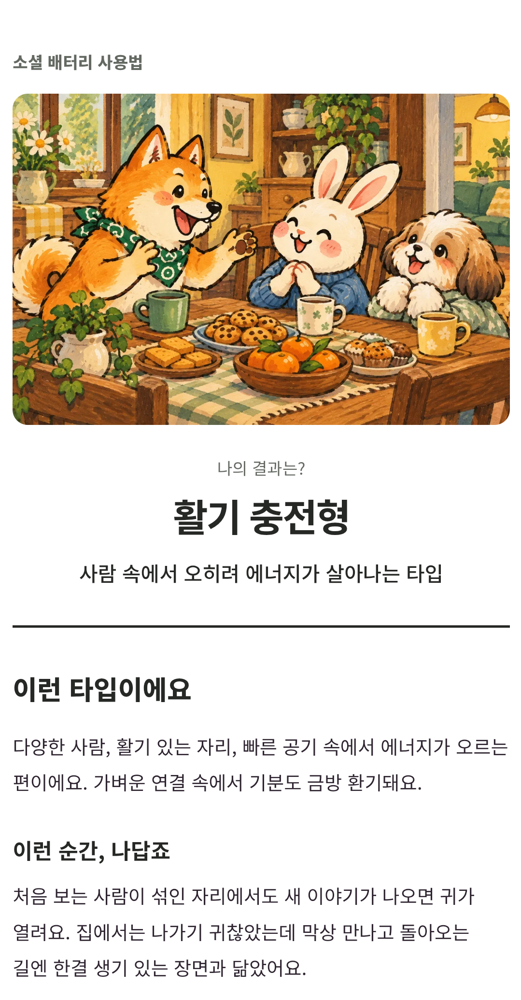
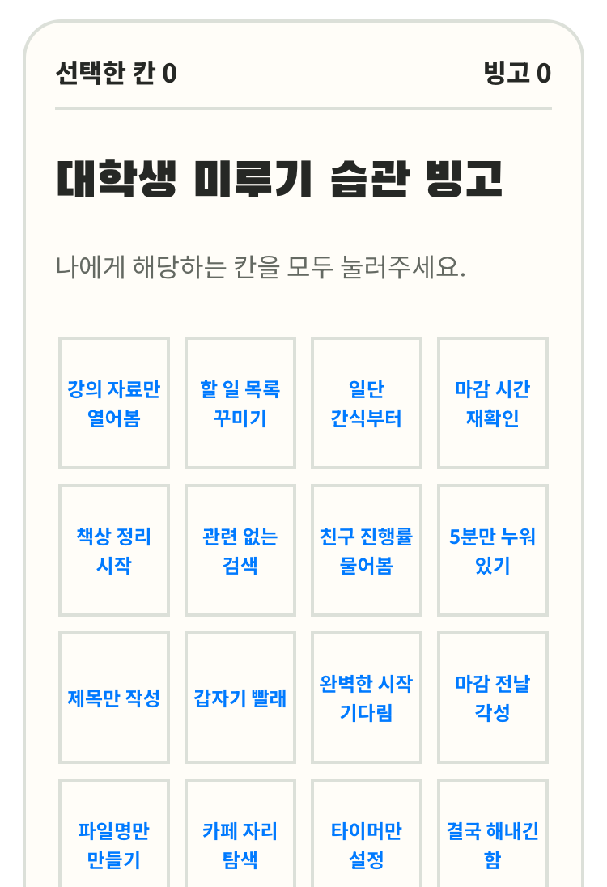
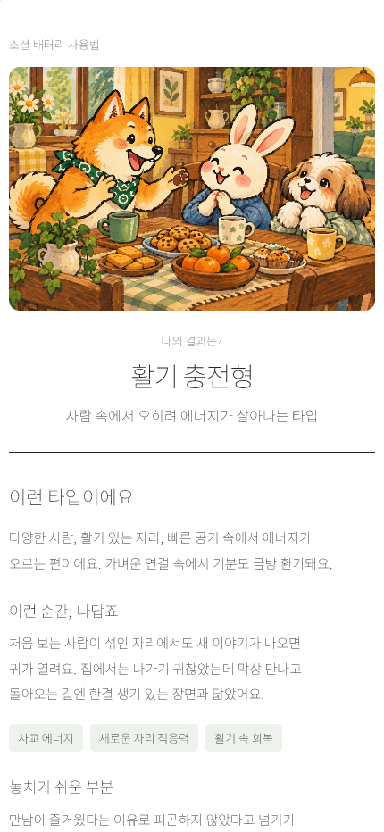

# 쿠쿠 모바일 검사 · 2026-10-26

목표는 문답형 25개·놀이 9개를 작은 휴대폰부터 큰 화면까지 진행하고, 결과를 읽고 공유하는 흐름이 유지되는지 확인하는 것입니다. **BrowserStack 실기기 5종에서 전체 콘텐츠를 확인했습니다.** 첫 실행 완료 169건과 Galaxy의 별도 재검사 1건을 합쳐 170개 경로를 완료했고, 문답형 결과 주소는 101종씩 총 505회 확인했습니다. Galaxy의 첫 실패 기록은 보존했으며 간헐적인 터치 문제는 계속 추적합니다.

운영 버전은 `review-20261021`입니다. 실기기 검사는 2026-10-26에 진행했습니다. 앞서 Windows 모바일 모사에서도 11개 크기·374개 콘텐츠 진행·1,397개 결과 화면 확인을 통과했습니다. **실제 카카오 메시지 전송·수신과 휴대폰에서 이미지 붙여넣기는 아직 완료하지 않았습니다.** 사이트 동작 코드와 배포 상태는 변경하지 않았습니다.

## 실기기에서 확인한 결과

| 기기·브라우저 | 서비스에서 확인한 OS | 화면 크기 / 처음 보이는 웹 내용 영역 · CSS px | 콘텐츠·결과 확인 |
|---|---|---|---|
| Pixel 7 · Chrome | Android 13.0 | 412×915 / 411×789 | 34개 완료·결과 주소 101종 통과 |
| Galaxy S24 Ultra · Chrome | Android 14.0 | 384×832 / 384×700 | 첫 실행 33개 완료·결과 주소 101종. 감정 쓰레기통은 별도 재검사 완료 |
| iPhone SE 2022 · Safari | iOS 15.4 | 375×667 / 375×548 | 34개 완료·결과 주소 101종 통과 |
| iPhone 13 · Safari | iOS 18.4 | 390×844 / 390×663 | 34개 완료·결과 주소 101종 통과 |
| iPhone 15 Pro Max · Safari | iOS 17.1 | 430×932 / 430×739 | 34개 완료·결과 주소 101종 통과 |

화면 크기와 웹 내용 영역은 다릅니다. 주소창·키보드 상태에 따라 실제 보이는 높이가 달라집니다. 실기기는 세로 방향으로 검사했습니다. 삼성 인터넷·iOS Chrome·카카오톡 내부 브라우저와 실기기 가로 회전은 별도 확인 대상입니다.

시작·모든 질문 선택·이전 답 복원·브라우저 뒤로/앞으로 이동·결과 해석·공유 버튼·수신 링크 열기·그림 로딩·가로 넘침을 확인했습니다. 각 콘텐츠의 대표 경로 한 번과 101개 결과 주소를 검사했으며, 모든 답변 조합을 실기기에서 수행한 것은 아닙니다. 놀이의 예산 배분은 프로그램으로 값을 입력했으므로 손가락 슬라이더 조작 검증과 구분합니다.

Android 두 기종에서는 이미지 복사 API가 성공했고, 입력 이벤트도 `isTrusted=true`·사용자 활성 상태로 확인했습니다. 실제 채팅창 붙여넣기까지 확인한 결과는 아닙니다. iPhone 세 기종에서는 도구의 입력이 `isTrusted=false`·사용자 비활성 상태였고 이미지·링크 복사가 거부됐습니다. 이 결과로 **사람이 직접 누르는 Safari에서도 복사가 실패한다고 결론 내리지 않습니다.** 제한 안내와 인스타그램 사용 안내까지만 확인했으며 휴대폰 파일 저장·인스타그램 게시도 남아 있습니다.

| 실제 Android · 소셜 배터리 결과 | 실제 작은 iPhone · 4×4 빙고 |
|---|---|
|  |  |

검증 수치·원본 해시·기기별 상태는 [실기기 검증 요약](docs/reviews/20261026/browserstack-verification.json)에 있습니다. Galaxy는 첫 전체 실행이 실패한 상태를 그대로 두고, 별도 성공한 재검사 근거를 연결했습니다. [BrowserStack 실행 목록](https://automate.browserstack.com/builds/d44d8d42783dd27a1150aa7d137df41020b27342)도 확인할 수 있습니다.

## 크기별 모바일 모사 결과

| 구분 | 화면 크기 · CSS 픽셀 | 상태 |
|---|---|---|
| Android 계열 설정 · Chromium | 360×740, 393×873, 412×915, 873×393 가로, 800×1280 태블릿 크기 | 전체 170회 진행·635개 결과 화면 통과 |
| iPhone 계열 설정 · Windows WebKit | 320×568, 375×667, 390×844, 430×932, 844×390 가로, 768×1024 태블릿 크기 | 전체 204회 진행·762개 결과 화면 통과 |

이 절은 Windows Chromium·WebKit에 모바일 설정과 터치를 적용한 모사 검사입니다. 특정 기종 전체나 모든 OS 버전의 검사 결과로 해석하지 않습니다. 배율 1을 사용하며 모바일 주소창·가상 키보드·앱 전환·카카오톡 내부 브라우저를 재현하지 않습니다. [모사 검증 요약](docs/reviews/20261026/mobile-emulation-verification.json)에 완료 수치와 원본 보고서 해시를 남겼습니다.

자동 검사 항목은 홈·검색, 모든 콘텐츠의 시작과 결과까지의 진행, 문답형 이전 답 선택 복원과 브라우저 뒤로·앞으로 이동, 상세 해석 뒤 공유 배치, 가로 넘침·그라데이션 배경·공유 버튼의 44px 영역, 결과 그림 로딩, 문답형 101종·놀이 26종의 결과 화면입니다. 놀이의 슬라이더는 자동화 도구로 값을 입력하고 나머지 진행 버튼은 터치합니다. 손가락 드래그·실물 키보드 검사는 따로 남습니다.

각 콘텐츠는 크기마다 대표 경로 한 번을 진행합니다. 문답형은 질문마다 첫 답변을 선택하고 나머지 유형은 결과 주소에서 확인합니다. 모든 답변 조합을 브라우저에서 수행한 검사는 아닙니다.

공유 네 버튼은 콘텐츠별로 실행합니다. Chromium에서는 클립보드 권한을 허용한 조건에서 실제 클립보드의 PNG 크기와 붙여넣기 이벤트·복사한 링크를 읽어 확인합니다. WebKit에서 복사가 거부되면 PNG 다운로드 대체 동작을 확인하고 복사 성공으로 기록하지 않습니다. WebKit의 링크 복사는 성공 안내까지만 확인하며 클립보드 내용 재확인은 별도입니다. 인스타그램은 안내·이미지 다운로드까지 확인하며 게시하지 않습니다.

정규 자동 검사에서는 카카오 SDK를 검사 대역으로 바꾸어 이미지 크기·링크·유입 표시를 확인하고, 수신 링크를 다시 엽니다. **요청 형식 확인은 실제 카카오톡 전송·수신 검증이 아닙니다.** 모사에서는 운영 쓰기와 외부 광고를 차단했습니다. 실기기에서도 QA 모드·분석 비활성화·커뮤니티 쓰기 차단을 적용했습니다. iPhone은 원격 요청 가로채기 충돌로 이 기능을 사용하지 않아 외부 광고가 로드될 수 있습니다. 이번 검사로 실제 집계 증가나 광고 수익을 확인했다고 보고하지 않습니다.

## 확인한 화면 문제와 해결 방향

1. **Galaxy 메모 입력 뒤 제출 터치:** 전체 실행에서 감정 쓰레기통 제출 버튼의 자동 터치가 시간 초과됐습니다. 별도 세션에서 키보드가 열린 상태의 버튼 위치와 실제 hit-test를 확인한 뒤 재검사했을 때 정상 완료됐습니다. 입력 후 원격 좌표·키보드 상태가 안정되는지 추가 확인해야 하며 사이트 오류로 확정하거나 실패 기록을 지우지 않았습니다.
2. **복사 제한 안내 문구:** 실제 Safari에서 제한이 발생했을 때도 ‘Chrome·Safari에서 열라’는 공통 안내가 나옵니다. 이미 Safari인 이용자에게 맞지 않으므로 권한·보안 설정과 이미지 다운로드를 안내하는 문구로 바꾸는 것이 좋습니다. 현재는 미수정입니다.
3. **가로 화면의 결과 이름:** 아래 캡처처럼 첫 화면에서 결과 이름을 확인하기 어렵습니다. 모사에서 확인한 개선 항목이며 실제 기기 가로 회전 검증과 구분합니다.
4. **iPhone 빙고의 파란 글자:** 위 실기기 캡처에서 빙고 버튼 글자가 파란색으로 표시됩니다. 버튼 글자색을 명시해 기기마다 사이트의 같은 색을 사용하도록 보완하는 것이 좋습니다. 현재는 미수정입니다.

소셜 배터리 결과를 873×393 가로 화면으로 보면 그림 아래의 결과 이름이 첫 화면 밖에 있습니다. 스크롤로 읽을 수 있지만 결과를 빨리 확인하기 어렵습니다. 가로로 짧은 화면에서 그림의 표시 높이를 제한하거나 그림과 결과 이름을 나란히 놓는 개선이 필요합니다. 그림 원본은 보존합니다. 이번 검사에서는 디자인 코드를 수정하지 않았습니다.

| 세로 화면 · Windows WebKit 430×932 | 가로 화면 · Windows Chromium 873×393 |
|---|---|
|  |  |

위 이미지는 실제 보이는 영역만 캡처했습니다. 스크롤 중 전체 페이지를 한 번에 캡처하면 화면 밖의 ‘본문 바로가기’ 링크가 그림에 나타나는 현상도 관찰했습니다. 일반 화면에서는 링크가 포커스를 받지 않을 때 화면 밖에 숨겨져 있음을 재확인해 사이트 오류로 분류하지 않았습니다.

## 실기기 접속과 무료 체험

[BrowserStack 가입 페이지](https://www.browserstack.com/users/sign_up)는 무료 계정과 수동 브라우저 검사 30분을 안내합니다. [지원 문서](https://www.browserstack.com/support/faq/plans-pricing/plans/what-do-i-get-with-a-free-trial)는 Live 30분·기기당 1분 제한을 적고 있습니다. 자동화 시간은 가입 페이지 100분·지원 문서 60분으로 달라 실제 계정 대시보드의 잔여량을 확인해야 합니다. 무료 체험으로 전체 실기기 검사를 완료할 수 있다고 보장하지 않습니다. 확인일은 2026-10-26입니다.

BrowserStack MCP 연결로 기기·세션 상태를 조회했고, MCP가 제공한 설정 안내와 공식 Playwright 연결 방식을 사용해 실제 검사를 실행했습니다. 사용자가 로컬에 입력한 인증으로 확인한 Automate 플랜은 `Free`, 동시 실행 가능 수는 5였습니다. 남은 분 수는 이 조회 결과에 없으므로 별도로 계산해 단정하지 않습니다. 결제·업그레이드는 하지 않았습니다.

인증 파일 `.artifacts/browserstack.local.json`은 Git·공개 배포·일반 전달 ZIP에 포함하지 않습니다. 계정 화면·접근 키·서명 영상 주소도 공개 검증 요약에서 제외했습니다. 자동 실기기 검사는 Chrome 플러그인 복구 없이 진행했습니다.

## 실제 카카오톡 전송 상태와 다음 행동

사용자는 ‘나와의 채팅’ 전송을 허용했습니다. 실제 SDK 2.8.1을 사용한 Android 검사에서 이미지 스크랩과 메시지 템플릿 검증 API는 HTTP 200을 반환했지만 앱 전환 화면은 보이지 않았습니다. SDK의 기본 앱 실행 경로와 원격 환경을 구분해야 하며 전송 성공으로 기록하지 않습니다.

별도 원격 세션 안에서만 공식 웹 공유 옵션 `throughTalk:false`를 사용해 같은 결과의 카카오계정 로그인 화면까지 열었습니다. **현재 사이트 버튼의 설정을 변경한 것이 아닙니다.** 아직 로그인·수신 대상을 선택하거나 메시지를 전송하지 않았습니다. 로그인 대기 세션은 시간 제한으로 종료됐습니다.

후속 확인에서 새 실기기 접속이 `Automate testing time expired`로 거절됐습니다. 현재 무료 Automate 시간은 소진된 상태이며, 종료된 세션 링크에서 로그인이나 직접 조작을 계속할 수 없습니다. Live 서비스의 잔여 시간은 확인하지 않았으므로 함께 소진됐다고 단정하지 않습니다.

사용자는 PC 카카오톡에 로그인해 두었습니다. 이 로그인은 BrowserStack 원격 기기나 브라우저의 카카오계정 로그인과 별개입니다. Windows 앱 제어 연결도 `Computer Use native pipe is unavailable`로 실패해 현재 에이전트가 PC 카카오톡을 직접 조작할 수 없습니다.

현재 가능한 PC 수신 확인 방법은 PC 브라우저에서 실제 결과 페이지의 카카오톡 버튼을 누르고, 필요한 경우 본인 카카오계정으로 인증한 뒤 ‘나와의 채팅’으로 전송하는 것입니다. 이는 PC 전송·수신 검사이며 모바일 앱 전환 검사와 구분합니다. 원격 검사 재개에는 사용 가능한 Automate 시간과 원격 로그인 세션이 필요합니다. 비밀번호나 인증번호를 채팅에 전달할 필요는 없습니다.

버튼 위치 참고: [BrowserStack 공식 안내](https://www.browserstack.com/docs/automate/playwright/interactive-session)의 새 대시보드에서는 `Build Runs → Tests`에서 실행 중인 테스트 아래의 **Interactive Debugging** 링크를 선택합니다. `Start an interactive session`이라는 설명 문구와 실제 버튼 이름을 구분해 안내해야 합니다. 공식 위치 그림은 https://www.browserstack.com/docs/static/img/automate/playwright/cad/interactive-debugging.webp 에 있습니다.

## 검사 다시 실행하기

실기기 검사는 사이트 패키지를 바꾸지 않도록 별도 폴더의 Playwright 1.59.0을 사용했습니다. 인증값은 로컬 파일의 `username`, `accessKey`로만 읽고 출력하지 않습니다. 설치 후 기기별로 아래 명령을 실행합니다.

```powershell
npm install --prefix .artifacts/browserstack-runner --ignore-scripts --no-audit --no-fund playwright@1.59.0
node scripts/browserstack-check.mjs android-pixel7
node scripts/browserstack-check.mjs android-galaxy
node scripts/browserstack-check.mjs ios-se2022
node scripts/browserstack-check.mjs ios-iphone13
node scripts/browserstack-check.mjs ios-pro-max
```

`--smoke`는 소셜 배터리·빙고만 진행하는 접속 검사입니다. `android-galaxy --only=emotion-trash`는 해당 놀이 한 개를 확인하는 진단이며 전체 실행과 섞어 세지 않습니다. 실기기 원본은 `.artifacts/qa-browserstack-*/report.json`에 보존합니다.

아래는 실기기와 구분되는 Windows 모바일 모사 명령입니다.

```powershell
# 설치된 Edge로 Android 계열 크기 검사. 실제 운영 사이트에 접속하되 쓰기는 차단.
node scripts/mobile-check.mjs --live

# 이 작업 폴더에 이미 설치된 Windows WebKit 사용.
$env:PLAYWRIGHT_BROWSERS_PATH = Join-Path (Get-Location) '.artifacts/browser-engines'
node scripts/mobile-check.mjs --webkit --live
```

`--live`를 빼면 공개 파일을 포장한 로컬 사이트를 검사합니다. WebKit 실행 파일은 Git에 없으므로 다른 PC에서는 Playwright WebKit 설치가 필요합니다. `--resume`은 오류가 없는 중간 보고서에서 완료 항목을 이어갑니다. 새 배포나 코드 변경 뒤에는 이 옵션 없이 검사합니다.

상세 보고서와 캡처는 `.artifacts/qa-mobile-chromium-live/`, `.artifacts/qa-mobile-webkit-live/`에 저장하며 공개 사이트에 포함하지 않습니다. 두 엔진의 공유 검사는 Windows 클립보드가 섞이지 않도록 순서를 조정합니다. 강제 종료로 `.artifacts/mobile-share.lock` 파일이 남았다면 검사 프로세스가 모두 종료된 것을 확인한 뒤 해당 파일만 제거하고 재시작합니다.

이번 작업의 사이트 동작 코드는 변경하지 않았습니다. 검사 도구·운영 기록과 실제 배포 상태는 구분합니다.
