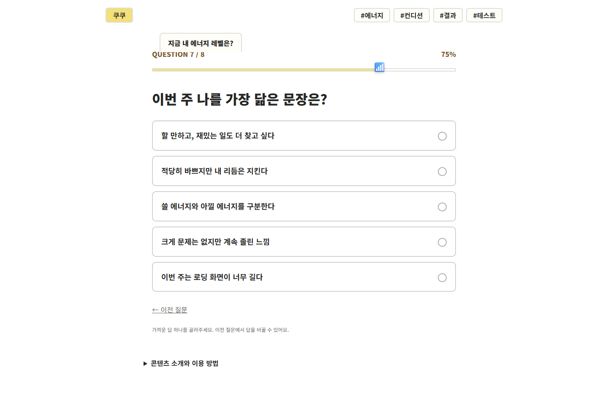
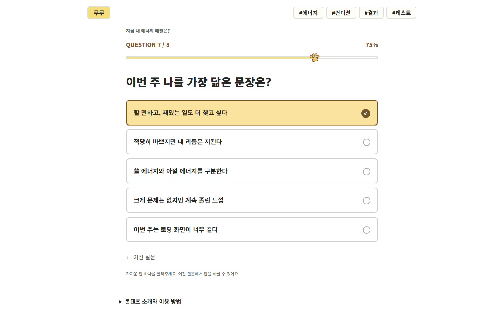
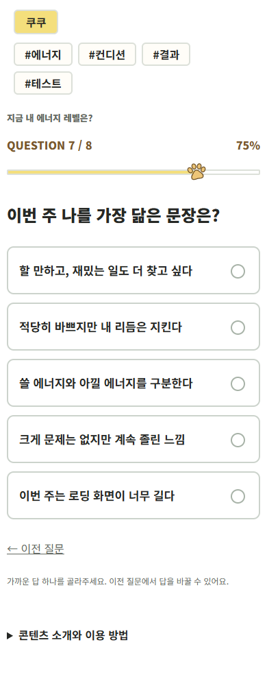
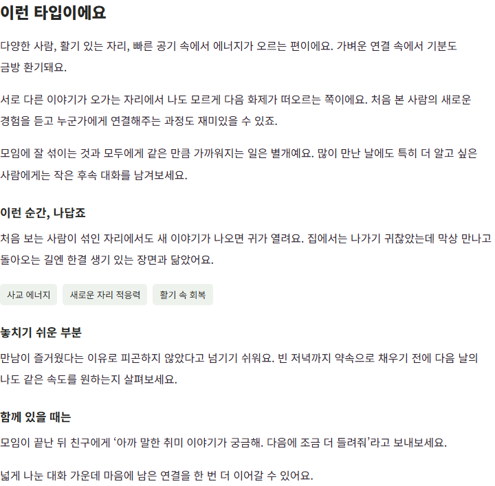

# 질문 화면과 결과 글 개선

작성: 2026-11-03 · 대상: 쿠쿠의 문답형 테스트 25개, 결과 101종

목표는 제목·진행 상태·질문을 겹침 없이 읽고, 답을 눌렀다는 반응을 확인한 뒤, 내 유형에 대한 충분한 설명을 읽도록 만드는 것입니다. **로컬 검증을 마쳤고, 사용자 요청에 따라 커밋·푸시·배포를 진행 중입니다.** 배포 버전은 `reading-20261103`입니다.

## 문제와 수정 내용

| 확인한 문제 | 수정한 내용 |
|---|---|
| 테스트 제목 탭이 `QUESTION n / n`에 겹침 | 제목을 문서의 정상 흐름에 놓고 진행 정보와 분리했습니다. 제목이 길어져 줄이 바뀌어도 아래 내용을 덮지 않습니다. 제목 상자의 장식 테두리와 불필요한 상단 공간도 없앴습니다. |
| 진행 표시가 테스트별 이모지여서 에너지 테스트에 차트가 나타남 | 황토색 채움과 잉크색 윤곽의 작은 쿠쿠 발자국으로 통일했습니다. 이미지 위에 덧씌우지 않고 진행선에서만 사용합니다. 질문 화면과 결과 로딩 화면에 함께 적용했습니다. |
| 선택된 답변 왼쪽에 두꺼운 안쪽 선이 생김 | 왼쪽 선을 제거했습니다. 마우스를 올리면 카드 전체 색·테두리·아래 그림자가 바뀌고, 누르면 카드 전체가 짧게 눌리며 체크가 표시됩니다. 이전 질문으로 돌아가도 선택이 표시됩니다. |
| 결과의 설명이 짧고 읽을 내용이 부족함 | 101종마다 서로 다른 추가 해석과 실제로 건넬 만한 대화 예시를 썼습니다. 기존 설명·상황·강점·주의점·오늘의 행동·유형 비교를 유지했습니다. 추가한 글은 결과마다 250~283자, 평균 268자입니다. |

선택지의 왼쪽 테두리나 안쪽 세로 그림자로 선택을 강조하는 효과는 앞으로도 사용하지 않습니다. 색·체크·카드 전체의 눌림을 사용하고, 마우스를 올렸다는 이유만으로 카드 위치를 움직이지 않습니다.

## 결과를 읽는 순서

그림과 결과 이름 → 기존 설명과 추가 해석 → 나다운 일상 장면·강점 → 놓치기 쉬운 부분 → **함께 있을 때는** → 오늘 해볼 한 가지 → 쿠쿠 코멘트·키워드·다른 유형 비교 → 공유입니다.

‘함께 있을 때는’에는 추상적인 조언만 넣지 않고 상대에게 실제로 할 말을 적었습니다. 예를 들어 소셜 배터리의 휴식 보존형은 약속을 잡을 때 먼저 귀가 시간을 알리는 예시를, 에너지의 선택 절전형은 오늘 가능한 일의 분량을 말하는 예시를 제공합니다. 여행·소비·팀플·취향·AI 협업도 각 주제에 맞게 썼습니다.

유형은 재미를 위한 이야기입니다. 새 설명을 성격·건강의 확정 판정이나 효과가 입증된 처방으로 표현하지 않았습니다. 그림 161장, 결과 주소 101개, 질문과 판정 방식은 유지합니다.

## 화면 확인

수정 전 코드를 로컬에서 다시 열어 에너지 테스트 7번 질문의 겹침을 재현했습니다. PC 1440px에서 제목 아래 끝은 124px, 진행 문구 위 끝은 116px로 **8px 겹쳤습니다**.

아래는 외부 광고·분석 요청을 차단한 로컬 캡처입니다. 운영 배포 화면과 구분합니다.

수정 전 PC: 제목 탭이 진행 문구를 덮고 차트 이모지가 표시됩니다.



수정 후 PC: 제목을 분리했고 발자국으로 진행을 표시합니다. 이전 질문으로 돌아왔을 때도 카드 전체 색과 체크로 선택이 보입니다.



수정 후 모바일: 390px 화면입니다.



확장한 결과 글: 소셜 배터리 ‘활기 충전형’의 해석 부분입니다. 이 아래에 오늘 해볼 행동·유형 비교가 이어지고 그 뒤에 공유가 나옵니다.



## 검증 상태

- `npm run build`: 34개 콘텐츠·101개 결과 페이지 재생성 완료. 결과 주소를 직접 열거나 JavaScript를 끈 경우에도 새 해석을 읽을 수 있도록 원본 데이터에서 생성합니다.
- `npm test`: 27개 통과. 모든 판정 조합·101유형 도달·이전 질문 선택 복원·공유 순서·기존 그림 보존을 확인했습니다. 새 글의 누락·중복과 정적 결과의 동일 본문도 검사합니다.
- 추가 브라우저 검사: 아래 두 엔진 모두 통과했습니다. 창 크기를 조정한 Windows 브라우저 검사이며 실제 휴대폰 검사가 아닙니다.

| 엔진 | 화면 크기 | 테스트 완료 | 질문 화면 | 결과 직접 열기 | JavaScript를 끈 결과 |
|---|---|---:|---:|---:|---:|
| Chromium 156 | 320×740·390×844·768×1024·1440×900 | 100회 | 840개 | 202개 | 101개 |
| WebKit 27.2 | 동일한 4크기 | 100회 | 840개 | 202개 | 101개 |

총 200회 완료·1,680개 질문 화면에서 제목과 진행 문구 사이가 **16px**로 유지됐습니다. 진행 표시가 질문이나 카운트와 겹치지 않는지, 가로 넘침이 없는지, 이전 답의 선택이 유지되는지, 선택 표시의 테두리 두께가 사방에서 같은지와 왼쪽 안쪽 선이 없는지도 확인했습니다. PC 대표 화면에서는 마우스 올림과 키보드 선택도 확인했습니다.

각 테스트의 브라우저 진행은 첫 번째 답변을 고르는 대표 경로입니다. 결과 직접 열기는 엔진마다 320·1440px에서 101종 전체를 확인한 별도 검사입니다. 판정 조합 전체는 Node 검사에서 확인하며, 모든 답변 조합을 브라우저로 진행했다는 뜻은 아닙니다. 글의 누락·중복 검사는 독자의 공감도나 만족도를 입증하는 지표로 사용하지 않습니다.

첫 브라우저 실행에서는 기존 마우스 올림의 `위로 2px 이동` 때문에 버튼 가장자리에서 포인터 진입·이탈이 반복되는 현상을 재현했습니다. 올림 때 위치 이동을 제거한 뒤 **양쪽 엔진의 전체 검사를 다시 실행해 통과**했습니다. 첫 실행의 실패와 수정 후 통과를 구분합니다.

`npm run package:site`로 만든 공개 파일 536개를 검사했습니다. 미추적 파일·운영 문서·검사 캡처·계정 인증 파일·Worker 설정은 포함되지 않았습니다. 새 그림이나 기존 공유 미리보기의 교체도 없습니다.

최종 횟수·실행 기록의 해시·검사한 원본 파일의 해시는 [검증 요약](docs/reviews/20261103/question-verification.json)에 보존했습니다.

실제 Android·iPhone을 새로 검사한 것은 아닙니다. 카카오 실제 전송과 휴대폰의 이미지 붙여넣기 확인은 [앞선 모바일 검사 기록](COOCOO_MOBILE_QA_20261026.md)의 미완료 상태를 유지합니다. 이번 검사는 운영 참여 수를 늘리는 검사가 아닙니다.

## 재검사 방법과 다음 일

```text
npm run build
npm test
npm run test:questions
npm run test:questions -- --webkit
npm run package:site
```

WebKit 실행 파일은 해당 컴퓨터에 설치되어 있어야 합니다. 이 작업 환경에서는 `.artifacts/browser-engines`를 `PLAYWRIGHT_BROWSERS_PATH`로 지정해 실행했습니다. 상세 검사 기록은 `.artifacts/qa-questions-chromium/report.json`과 `.artifacts/qa-questions-webkit/report.json`에 저장합니다.

사용자 요청에 따라 검증된 파일의 커밋·푸시와 배포를 진행합니다. 배포 후 운영 파일 일치와 실제 질문·결과를 확인하고 이 문서에 결과를 남깁니다. 문서·검사 캡처·비공개 인증 파일은 공개 사이트 패키지에서 제외합니다.
