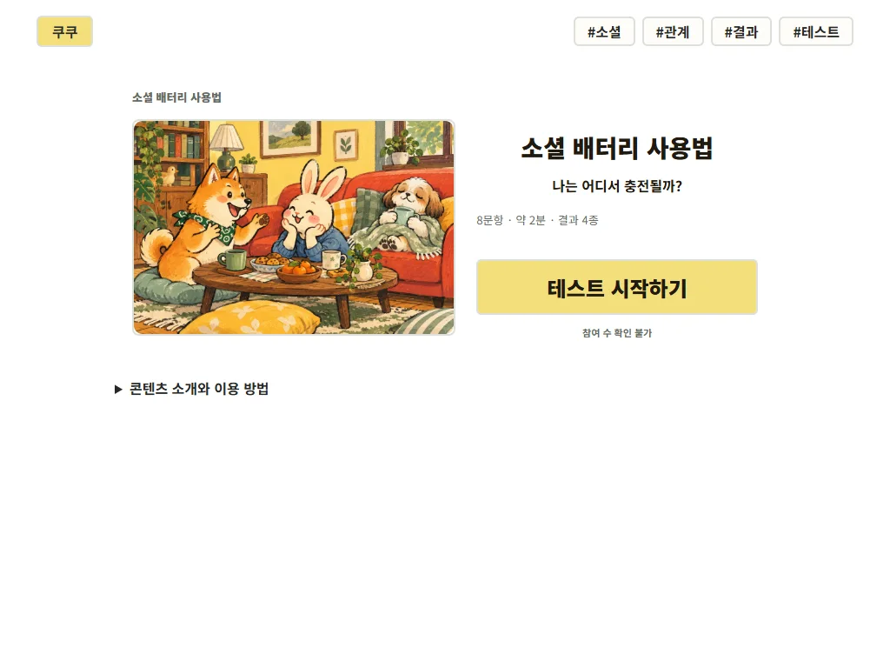
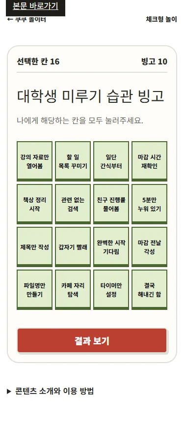

# 외부 리뷰 반영·검증 기록

작성: 2026-10-21 · 상태: **코드 수정·로컬 검증·운영 배포·운영 확인 완료**

## 목표와 반영 범위

시작 버튼을 곧바로 찾고, 화면에 보이는 대로 조작하고, 고른 답과 연결되는 결과를 충분히 읽게 하는 것이 목표입니다. [승인한 계획](COOCOO_CLAUDE_REVIEW_PLAN_20261021.md)의 시작·조작 → 판정 시범 → 전체 검토 → 발견·응답 → 배포 순서로 진행합니다.

| 확인한 문제 | 수정한 동작 |
|---|---|
| PC에서 큰 표지 아래로 시작 버튼이 밀림 | 그림과 시작 영역을 좌우 배치. 표지는 자르지 않고 제목 탭도 그림 위에 겹치지 않게 배치 |
| 모바일 빙고는 2열, 판정은 4열 | 4×4로 통일하고 완성 줄의 칸을 강조. 0칸이면 결과 버튼 곁에 선택 안내 |
| 상자에서 다시 하기를 눌러도 같은 결과 | 하루 고정은 유지하고 내 버튼을 ‘오늘 결과 다시 보기’로 변경. 친구 링크는 ‘나도 해보기’ |
| 작은 조작 영역·좁은 홈 놀이 카드 | 슬라이더·순위 버튼·푸터 링크의 터치 영역 보완. 모바일 추천 놀이 2열 |
| 모든 진행 표시가 기차 | 연애 열차는 기차, 다른 테스트는 기존 콘텐츠 아이콘 사용 |
| 반응이 추천 아래 있고 요청 처리 상태가 없음 | 해석 → 공유·재시도 → 반응 → 다음 콘텐츠 순서. 저장 중·성공·실패 안내, 연타 직렬화, 실패 후 재시도·취소 |
| 참여 수가 나타나지 않으면 원인을 모름 | 확인 중·조회 불가를 표시. 성공한 0회와 미확인을 구별하고 연결 복구 시 재조회 |
| 느리거나 실패한 그림의 빈 공간 | 원래 비율과 제목·링크 유지, 실패 시 중립 안내. 전체 이미지를 강제로 선로딩하지 않음 |
| 배터리 30초의 의미가 불명확, 공유 복원 경계값 불일치 | 예상 시간·직접 멈추기를 명시. 화면·점수·공유에 같은 반올림 값 사용. 페이지 이탈 시 타이머 정리 |

161개 일러스트, 첫 여자 마스코트 원본, 101개 결과 키·주소, 상세 해석·상황·주의점·행동·유형 비교와 공유 버튼 순서를 보존합니다. 광고 설정은 기존 상태를 유지합니다.

## 판정을 어떻게 바꿨나

001·013·020·024·025부터 시작했습니다. 점수와 코드를 제거한 자료를 별도 검토자에게 전달해 **20유형×3개=60개**의 의미상 분명한 응답을 먼저 고정했고 실제 함수로 모두 확인했습니다. 이후 나머지 20개를 읽고 79사례를 받았습니다. 이 과정에서 018의 가을 사색과 겨울 정리가 기존 문항에서 구별되지 않는 문제가 나와 문항을 보완하고 12사례를 다시 받았습니다. 옛 018 두 사례를 새 사례로 대체한 **149사례·101유형 전부가 현재 실제 판정 함수를 통과**했습니다.

구형 20개 테스트는 기존 질문 수를 유지하며 유형을 직접 구별하지 못하던 세 상황에 네 행동을 제시합니다. 이 문항은 각 2점, 다른 이분법은 가장 가까운 행동 유형에 1점을 줍니다. 12문항인 001은 보조 문항 아홉 개에 핵심 행동이 묻히지 않도록 세 직접 문항에 각 3점을 줍니다. 유형마다 추가 보너스를 붙이지 않습니다. 004·005·006·016·017의 이용 시간은 선택지를 읽을 여유를 고려해 약 2분으로 조정했으며, 실제 이용자의 측정값은 아닙니다.

총점 동점이면 마지막 자기 설명, 직접 행동 질문, 나머지 질문 순으로 해당 답의 점수를 비교합니다. 각 테스트의 문항 순서와 점수는 [명세 스냅샷](docs/reviews/20261021/scoring-spec.json)에 있으며 결과에도 순서를 표시합니다. 021·022·024·025는 기존 문항·점수를 유지하고 동점 규칙을 변경합니다. 023은 기존 합계 구간을 유지합니다. 분석 이벤트에는 판정 버전을 별도로 기록합니다.

두 유형이 현실에서 동시에 나타날 수 있습니다. 특히 소셜 배터리의 관찰 방식과 혼자 회복할 필요는 서로 배타적인 성격이 아닙니다. 이 구현은 반복해서 고른 행동을 설명하는 재미용 분류입니다. 대표 사례를 통과해도 심리검사의 타당성이나 실제 사람의 결과 분포를 검증한 것은 아닙니다. 독립 검토도 같은 계열 AI의 자연어 판단이므로 실제 이용자 검토를 대신하지 않습니다.

001의 걱정 표현은 ‘최근 대화와 상대 상황을 살펴보기’로 바꿨고, 020은 관찰 자체가 충전이라는 단정 대신 ‘편했던 장면’을 묻도록 고쳤습니다. 별도 검토자가 기존 대표 사례와 충돌하지 않음을 확인했습니다.

## 전체 25개 검토

아래 범위는 각 테스트에서 가장 드문 결과와 가장 많은 결과의 비율입니다. **모든 선택지를 같은 확률로 독립 선택한 구조 진단**이며 운영 이용자 비율이 아닙니다. 균등하게 맞추기 위한 합격선을 사용하지 않았습니다. 수정 후 632,289개 조합을 실제 판정 함수로 계산했습니다.

| 테스트 | 문제·해결 판단 | 유형별 최저~최고 비중: 전 → 후 |
|---|---|---|
| 001 내 연애 열차 운행 타입은? | 적극성·안정감에 겹쳐 주던 보너스를 정리하고 배려·관찰 행동을 따로 선택 | 0.51~61.65% → 13.75~38.37% |
| 002 직장인 회복력 체크 | 리셋 선택에 점수가 반복 누적되던 구조를 정리. 책임·정서적 지지·휴식 설계·부담을 구별 | 3.32~72.36% → 9.24~51.88% |
| 003 나만의 여행 성향 찾기 | 계획 대 즉흥만 묻던 상황에서 편안함·현지 생활감을 함께 구별 | 1.95~46.97% → 21.28~28.72% |
| 004 집중력 루틴 진단 | 짧은 시간 관리·장기 몰입·환경 준비·흥미 자극을 직접 구별 | 6.64~43.16% → 15.11~28.39% |
| 005 친구 케미 점수 보기 | 실무와 분위기 중심 질문에 경청·역할 없이 함께 있기 선택 보완 | 2.15~47.07% → 14.53~35.47% |
| 006 주말 충전 방식 찾기 | 집 대 외출에서 사람·생활 정리·새 장소라는 다른 회복원 구별 | 8.01~40.82% → 21.33~28.67% |
| 007 썸 대화 온도 체크 | 대화 속도뿐 아니라 꾸준함·장난·타이밍 읽기를 따로 선택 | 4.30~48.44% → 21.14~28.86% |
| 008 첫인상보다 오래가는 내 매력은? | 다정함·편안함·재치·의외성을 구별할 실제 행동 보완 | 3.13~55.47% → 20.95~29.05% |
| 009 결정을 내리는 순간의 나 | 분석/직감 위주에서 사람 간 조율·빠른 결론의 선택 기회 보완 | 1.56~59.38% → 20.95~36.91% |
| 010 돈 쓸 때 드러나는 소비 타입 | 계획/즐거움에 가려졌던 취향 수집·남기는 안전감 구별 | 1.17~58.20% → 20.95~36.91% |
| 011 팀플에서 맡게 되는 역할 | 전체 관리에 몰리던 점수를 정리하고 실행·조율·활기를 별도로 표현 | 1.95~66.41% → 14.16~45.12% |
| 012 쉬는 날 인간관계 충전법 | 혼자 취미를 즐기는 시간과 연락까지 끊는 잠수를 구별 | 14.06~42.19% → 11.23~35.16% |
| 013 나의 플러팅 방식 찾기 | 선명한 접근/배려만으로 묶였던 장난·은근한 취향 교환을 구별 | 1.17~53.52% → 21.14~28.86% |
| 014 사진첩 무드로 보는 감성 타입 | 구도·추억 위주에서 취향 수집·우연한 표정·시간순 기록 구별 | 12.50~38.28% → 14.45~36.57% |
| 015 내 방이 말해주는 취향 무드 | 비우기의 반대편을 한데 묶지 않고 포근함·수집·색 포인트로 구별 | 5.86~64.06% → 14.16~45.12% |
| 016 약속 잡을 때 드러나는 일정 성향 | 정확함/유연함 외에 당일 컨디션·전체 코스 준비를 따로 선택 | 6.25~45.31% → 14.65~36.38% |
| 017 칭찬 들었을 때 반응 타입 | 수줍음/동기 외에 담담한 곱씹기·유머 반응 구별 | 1.56~58.59% → 20.95~36.91% |
| 018 계절이 바뀌면 깨어나는 감성은? | 독립 검토에서 가을/겨울을 구별하지 못함. 사색과 비움·마무리 행동을 분리하고 재검토 | 13.28~33.59% → 21.73~28.27% |
| 019 스트레스 해소 버튼 찾기 | 움직임/대화 외에 자극 줄이기·만들기 몰입의 선택 기회 보완 | 2.34~61.72% → 14.65~36.38% |
| 020 소셜 배터리 사용법 | 다양한 사람·깊은 연결·관찰하는 참여·혼자 회복을 구별. 단일 성격 축으로 해석하지 않음 | 2.34~66.41% → 13.96~44.73% |
| 021 지금 내 에너지 레벨은? | 기존 5지선다와 점수 유지. 동점에서 첫 유형이 이기던 규칙만 변경 | 14.16~29.71% → 20.00~20.00% |
| 022 오늘 끌리는 장면은? | 기존 장면 선택과 점수 유지. 동점 규칙만 변경 | 18.75~33.17% → 25.00~25.00% |
| 023 요즘 내 여유 잔량은? | 0~24점 합계와 네 구간 유지. 가운데 쏠림을 오류로 단정하지 않음 | 1.85~52.14% → 1.85~52.14% |
| 024 AI와 일할 때 나는 어떤 파트너? | 기존 6문항과 점수 유지. 3:3 동점은 마지막 자기 설명을 우선 | 15.48~36.72% → 25.00~25.00% |
| 025 알림 OFF, 나의 오프라인 모드는? | 기존 6문항과 점수 유지. 3:3 동점은 마지막 자기 설명을 우선 | 15.48~36.72% → 25.00~25.00% |

023의 여백 넉넉형은 19~24점, 여백 실종형은 0~6점이라는 극단 응답이 필요합니다. 문항 수가 같은 점수 합은 가운데에 모일 수 있어 비율만 보고 경계를 옮기지 않았습니다. 002도 회복 루틴을 묻는 보조 질문이 많아 리셋 유형이 상대적으로 많습니다. 동점 발생 자체를 없애려는 추가 가중치나 무작위 처리는 넣지 않았습니다.

전후 전체 수치: [수정 전](docs/reviews/20261021/distribution.json) · [수정 후](docs/reviews/20261021/distribution-after.json). 대표 응답·전달 자료·이전 계절 문항의 문제 근거는 [검토 자료 안내](docs/reviews/20261021/README.md)에 보존합니다. 예전에 도달 불가 수정을 확인하던 여섯 사례도 새 직접 행동 질문에서 같은 의미를 고르게 이관했습니다.

## 검증과 배포

로컬 검증을 완료했습니다. [보관한 검사 요약](docs/reviews/20261021/local-verification.json)에 실행 범위와 한계를 기록했습니다.

| 구분 | 통과 결과 |
|---|---|
| Node 검사 | 27개. 실제 함수 632,289개 조합과 결과 등록 순서 반전, 독립 대표 답변 149개·101유형, 공유·기록·합계 구간·배터리 경계값 |
| 전체 진행 | 문답형 25개·놀이 9개를 390/1440px에서 각각 완료: 총 68회. PNG 클립보드·붙여넣기 등 4건 |
| 일러스트 | 소개·결과·홈·검색 326화면. 비율·로딩·넘침·공유 위치 검사 |
| 추가 회귀 검사 | 소개 238화면(34개×7크기), 빙고 21패턴, 지연·실패·재시도·취소·이미지 404 검사 |
| 공개 포장 | 536파일, 비공개 문서·자료·설정 0개 |

PC 강조 검사는 시작 클릭 뒤 포인터가 답변 위에 남아 있던 조건을 수정했습니다. 포인터를 밖으로 옮긴 기본 상태와 올림·누름의 변화 모두 확인합니다. 처음 실패한 반응 순서는 실제 DOM 위치를 바로잡았고, 이미지 검사 선택자도 실제 카드 제목에 맞춰 고친 뒤 전체 재검사를 통과했습니다.

**운영 배포 완료:** 코드 `d509ed0f`의 [GitHub Pages 실행](https://github.com/jwkim1421/fun-things-collection/actions/runs/39565501573)이 성공했습니다. GitHub 환경에서도 빌드·27개 검사·전체 진행·일러스트·추가 회귀 검사를 통과했습니다.

운영 공개 파일 **535개 전체**가 로컬 공개 포장과 일치했고, 비공개·폐기 경로 22개는 HTTP 404였습니다. 운영 대표 테스트 6회와 소개 18화면·모바일 빙고 첫 네 칸(한 줄·강조 4칸)을 확인했습니다. 운영 브라우저 검사에서 클립보드는 검사하지 않았으며 앞 표의 4건은 로컬 결과입니다. [배포 확인 자료](docs/reviews/20261021/deployment-verification.json)에 범위와 배포 코드를 기록했습니다.

실물 휴대폰, Safari, 실제 카카오톡 메시지·인스타그램 게시·클립보드 권한은 별도 확인 범위입니다. 운영 참여·반응을 이번 검사에서 추가하거나 기존 리뷰 수치를 차감하지 않습니다. 시작·완료·공유 유입·수익의 변화는 배포 뒤 실제 자료로 관찰해야 합니다.
