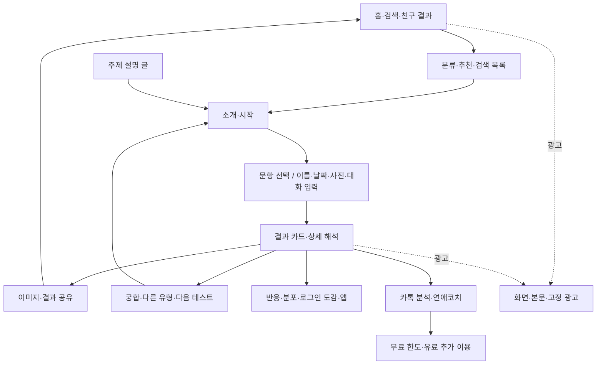
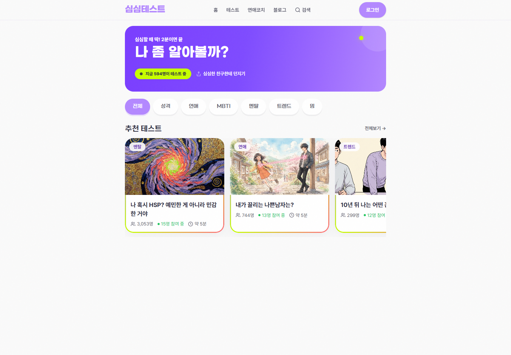
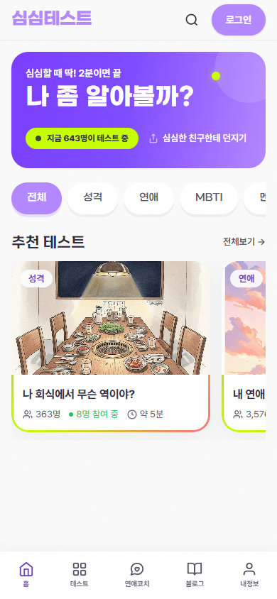
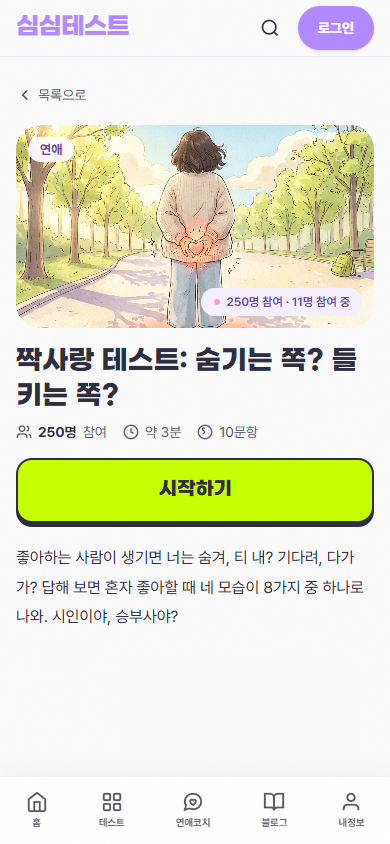
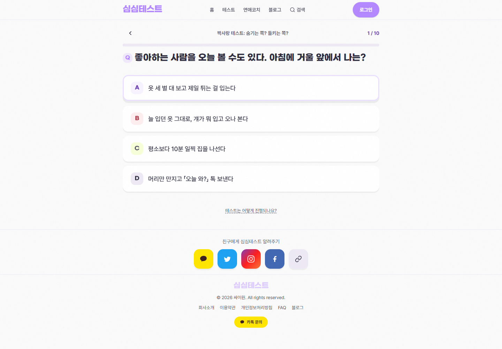
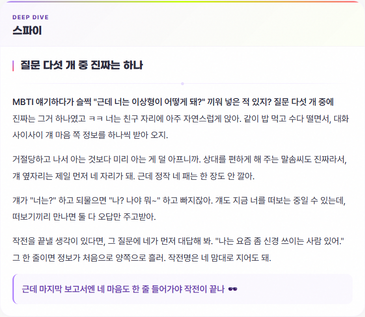
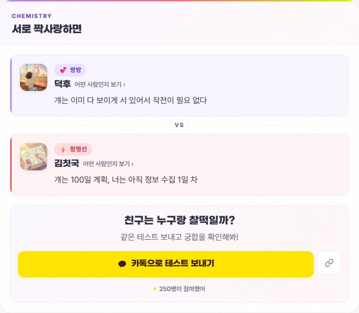
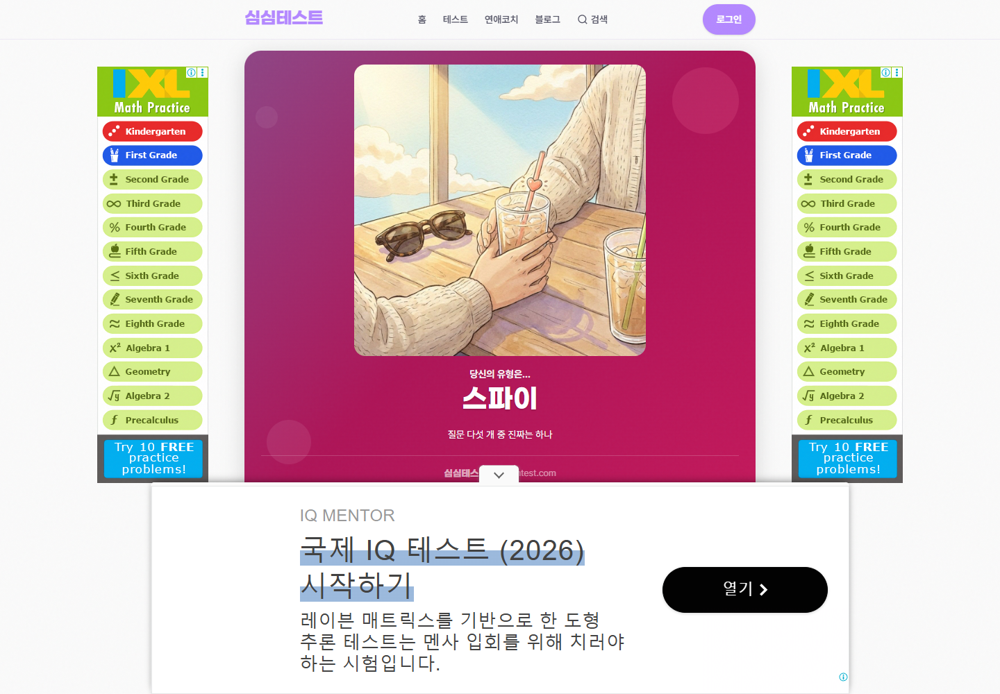
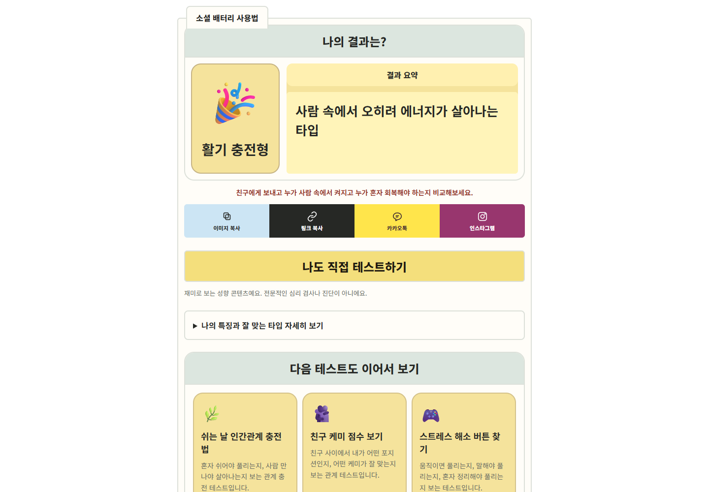

# 심심테스트 벤치마킹과 쿠쿠 개선 기준서

조사일: 2026-10-19 · 대상: 심심테스트 공개 웹 서비스, 쿠쿠 운영 코드와 이전 코드 · 용도: 다음 수정의 근거와 검수 기준

**이번 작업은 분석이다. 쿠쿠 코드·광고 설정·운영 배포는 변경하지 않았다.** ‘적용안’은 구현 완료 표시가 아니다. 현재 운영 상태는 [운영·유입·수익 개선 기록](COOCOO_GROWTH_PLAN.md)에서 관리한다.

요청 해석: [지정한 스파이 결과](https://simsimtest.com/results/aa1890eac41f79cf63029a33520e4507)를 출발점으로 메인·목록·각 테스트·결과·공유·재방문·수익 구조를 조사한다. 결과보다 공유가 먼저인 문제, 결과 축약, PC 선택 반응 부족을 확인하고 쿠쿠 수정 목록을 작성한다. 분석보다 시안 구현을 먼저 하지 않는다.

## 목차

1. [결론](#1-결론)
2. [조사 방법과 범위](#2-조사-방법과-범위)
3. [서비스 지도](#3-서비스-지도)
4. [메인·목록·검색](#4-메인목록검색)
5. [테스트 소개·문항·선택 반응](#5-테스트-소개문항선택-반응)
6. [결과 내용·궁합·읽는 순서](#6-결과-내용궁합읽는-순서)
7. [저장·복사·SNS 공유](#7-저장복사sns-공유)
8. [계정·재방문·검색 글·홍보](#8-계정재방문검색-글홍보)
9. [광고·유료 서비스·수익 구조](#9-광고유료-서비스수익-구조)
10. [쿠쿠의 이전·현재 비교](#10-쿠쿠의-이전현재-비교)
11. [화면·접근성·실패 상태](#11-화면접근성실패-상태)
12. [적용 목록과 개발 순서](#12-적용-목록과-개발-순서)
13. [검수와 성과 판단](#13-검수와-성과-판단)
14. [부록 A: 심심테스트 86개](#부록-a-심심테스트-86개-조사-원장)
15. [부록 B: 쿠쿠 25개 테스트·9개 놀이](#부록-b-쿠쿠-콘텐츠별-점검표)
16. [부록 C: 증거·미확인 사항](#부록-c-증거와-미확인-사항)

## 1. 결론

### 1.1 사용자 지적은 코드와 화면에서 확인됐다

- **결과를 읽는 순서가 깨졌다.** 현재 쿠쿠는 이름·한 줄 요약 다음에 공유 요청과 4버튼, 재시작을 배치한다. 특징·조언·궁합은 기본으로 닫힌 ‘자세히 보기’ 안에 있다.
- **접었을 뿐 아니라 내용도 줄였다.** 동일한 기존 결과 93종을 과거·현재 표시 코드에 넣으면 해석 영역 평균은 공백 제외 910자에서 약 212자로 줄고, 현재 기본 화면에 공개된 같은 영역의 설명은 평균 약 18자다. 비교 방법은 10절에 있다.
- **PC 답변의 누름 반응이 없다.** 쿠쿠 실제 답변 버튼의 기본·마우스 올림·누르는 동안 배경·테두리·그림자·변형이 같았다. 참고 사이트는 테두리 강조·위로 이동·누르면 축소되는 반응을 제공했다.

공유를 앞으로 옮기고 설명을 줄이는 것을 개선으로 기록한 이전 판단을 철회한다. 배포 성공과 이용 경험의 개선은 별개다.

### 1.2 참고할 핵심과 복제하지 않을 부분

| 참고에서 관찰한 요소 | 기능에 대한 해석 | 쿠쿠 적용 방향 |
|---|---|---|
| 주제별 표지·유형별 결과 그림 | 목록 구별과 결과를 받는 보상을 만듦 | 단색 조건 안에서 그림의 소재·장면·제목을 구분 |
| 상황을 떠올리는 질문·답변 | 추상적 단어 대신 행동을 고르게 함 | 문항의 상황·답변 행동·결과 해석을 연결 |
| 진행·이전 질문·선택 표시·버튼 반응 | 내가 무엇을 눌렀는지 확인 가능 | 올림·누름·처리 중·이전 선택을 분리 |
| 기본 공개된 상세 해석 | 이름을 생활 속 경험과 연결 | 핵심 해석을 펼쳐서 먼저 제공 |
| 궁합 이유·상대 유형 소개 | 친구도 해볼 이유를 만듦 | 유형명 나열 대신 상호작용과 조율을 설명 |
| 결과 링크·테스트 링크·다운로드 구분 | 보내는 목적이 다름 | 복사 내용과 수신 화면을 정확히 정의 |
| 주제 글→테스트→관련 유형 | 검색·탐색의 입구가 늘어남 | 고유한 안내 글과 홍보 소재로 연결 |

그대로 가져오면 안 되는 요소도 있다.

1. 참고 사이트 역시 **큰 결과 카드 뒤, 상세 해석 앞에 공유 버튼**을 둔다. 사용자 요구와 다르므로 쿠쿠에는 이 순서를 복제하지 않는다.
2. 참고의 보라 그라데이션·둥근 장식·다색 배경은 쿠쿠의 요구사항이 아니다. **그라데이션 금지·불필요한 바깥 패딩 제거가 우선**이다. 그림·글자 위계·명확한 조작 반응으로 생동감을 만든다.
3. 화면을 덮는 광고, 상세 해석 앞의 계정·다른 상품 유도, 문항 푸터의 사이트 공유를 좋은 사례로 간주하지 않는다.
4. 실시간 숫자·추천 알고리즘·광고 수익·AI의 내부 처리는 공개 화면으로 입증되지 않았다. 그럴듯한 숫자와 효능을 만들어 넣지 않는다.
5. 정신건강·호르몬·사주 관련 표현이 있다는 사실과 타당성이 입증됐다는 주장은 다르다. 쿠쿠를 전문 진단처럼 설명하지 않는다.

### 1.3 색과 여백 제약의 정확한 뜻

**단색은 각 표면에 그라데이션을 쓰지 않는다는 뜻이며 사이트 전체를 한 색으로 제한한다는 뜻이 아니다.** 테스트마다 다른 단색·그림 소재·포인트색을 사용할 수 있다. 참고의 그라데이션을 가져오지 않는다. 최종 색 조합·그림 시안은 이 보고서에서 확정하지 않았다.

패딩 0은 페이지 바깥·대표 영역·검색 대표·기분 필터의 불필요한 상자 여백을 다시 만들지 않는 기준이다. 읽는 본문의 폭, 글자와 테두리 사이 간격, 답변 사이 구분, 누를 영역까지 모두 0으로 만드는 요구가 아니다. 이번에는 기존 코드의 간격을 바꾸지 않았고, 다음 대표 화면 검수에서는 제거할 바깥 여백과 유지할 읽기·조작 간격을 나란히 표시해야 한다.

## 2. 조사 방법과 범위

### 2.1 증거의 구분

| 구분 | 이 문서에서 뜻하는 것 |
|---|---|
| 직접 관찰 | 공개 페이지를 열고 조작, 화면·DOM·응답·복사 내용 등을 기록 |
| 코드 확인 | 쿠쿠 현재 파일과 Git의 이전 표시 코드를 확인·실행 |
| 사이트 안내 | FAQ·정책·화면이 주장하는 내용. 서버 내부 검증과 다름 |
| 해석·적용안 | 관찰과 사용자 요구를 근거로 한 판단. 성과 실측이 아님 |
| 미확인 | 로그인·결제·실물 앱·서버·정산 자료 등이 필요한 부분 |

### 2.2 환경·단위·수치의 한계

- Windows의 격리된 Edge에서 비로그인 공개 화면을 조사했다. 기존 계정 세션을 이용하지 않았다.
- PC는 1440px, 모바일 기본은 390px다. 지정 결과는 320·375·390·414·768·1440·1920px도 확인했다.
- 모바일은 브라우저 모사와 너비 변경이다. **실물 iPhone Safari·Android·카카오톡·인스타그램 앱 검증과 다르다.**
- 광고 허용 초기 관찰과 광고 차단 구조 점검을 분리했다. `clean` 캡처는 광고 차단 상태다. 광고 예약 공간은 남을 수 있다.
- ‘테스트 완료’는 원장에 적힌 한 답변 경로다. 전체 답변 조합·성별 분기·모든 유형·로그인 개인화 결과를 검증했다는 뜻이 아니다.
- 사진·실제 대화·연락처·계정·결제 정보는 제출하지 않았다. 반응·댓글·광고 클릭·SNS 실제 전송도 하지 않았다.
- 참고 사이트를 정상 진행한 조사 방문이 참여 수에 들어갈 수 있다. 조사 중 숫자 변화는 자연 유입 성과가 아니다. 쿠쿠 점검은 `?qa=1`을 사용했다.
- 추천·광고 소재·순위·숫자는 당시 스냅샷이다. 형식·집계 정의와 변하는 값을 구분한다.

### 2.3 최종 확인 범위

| 대상 | 이번 확인 | 포함하지 않는 것 |
|---|---|---|
| 참고 전체 86개 | 86개 소개 PC·390px, 입력 형식 분류 | 숨겨진·비공개 콘텐츠 |
| 일반 선택형 80개 | PC 한 경로씩 총 806문항 완료, 첫 문항 모바일 배치, 공개 결과 URL 80개 PC·모바일 재확인 | 나머지 문항의 모바일 전 경로·모든 답 조합·모든 성별·모든 결과 |
| 특수 입력 6개 | 이름·날짜는 가상 값으로 결과까지, 사진 3개·대화 1개는 입력·안내까지 | 사진·대화 제출·AI 생성·유료 결과 |
| 지정 결과 | 스타일·PNG 다운로드·링크·인스타 복사·카톡 로그인 진입·7너비·광고 스크롤 | SNS 실제 전송·실물 앱 |
| 쿠쿠 25개 | QA에서 PC 한 경로씩 완료, 소개·첫 문항·결과 PC/390px 150상태, 93종 표시 코드 비교 | 실물 폰·새로운 사용자 만족도 |
| 쿠쿠 놀이 9개 | 현재 데이터·진행·결과 코드와 기존 검증 기록 검토 | 이번에 9개 놀이를 모두 실물로 재진행한 것은 아님 |

초기 자동 진행에서 색상 아우라·사랑의 언어는 이동 대기 시간이 초과됐다. 일반 이용 경로로 다시 진행해 각각 10문항과 결과를 확인했다. 이를 사이트 고장으로 확정하지 않았다. 성별 창 때문에 멈춘 4개도 여성 선택 한 분기만 추가 완료했다. 원장의 완료 수는 이 보완 결과를 반영한다.

## 3. 서비스 지도



쿠쿠의 당장 필요한 수정은 D의 선택 확인과 E의 결과 내용·읽는 순서다. 계정·앱·AI 코치·결제까지 모두 개발해야 한다는 뜻이 아니다.

| 영역·실제 주소 | 하는 일 | 구분해서 볼 부분 |
|---|---|---|
| [홈](https://simsimtest.com/) | 추천·분류·코치·숨은 보석·실시간·누적 인기·최신·도감 | 여러 섹션의 목적과 중복 |
| [전체 분류](https://simsimtest.com/categories) | 86개 공개 목록과 주제 | 검색 기본 화면의 20개와 차이 |
| [검색](https://simsimtest.com/quizzes) | 검색어·인기·최신·분류 | 빈 결과·주소 유지·필터 결합 |
| [짝사랑 소개](https://simsimtest.com/quizzes/crush-type) | 표지·제목·시간·문항 수·시작·설명·추천·댓글 | 시작 전 기대 형성 |
| 소개에서 이동한 문항 | 한 문항·자동 다음·이전·도움말 | 상태·복원·중복 입력 |
| [지정한 공유 결과](https://simsimtest.com/results/aa1890eac41f79cf63029a33520e4507) | 해석·공유·궁합·반응·분포 | 받은 사람과 본인 완료의 문맥 |
| [덕후 유형 소개](https://simsimtest.com/quizzes/crush-type/types/deokhu) | 공개 유형 설명·궁합·다른 유형·참여 | 개인 결과 링크와 별도 페이지 |
| 이름·사주·사진·대화 | 문항형과 다른 입력·계산·분석 | 정보 처리·대기·실패·비용 |
| [연애코치](https://simsimtest.com/coach) | 5캐릭터 대화·무료·유료 | 테스트와 다른 상품 |
| [카톡·고민](https://simsimtest.com/quizzes/katalk) | 캡처·고민 입력과 분석 | 쿠쿠의 로컬 메모와 다른 처리 |
| [블로그](https://simsimtest.com/blog) | 태그·글·관련 테스트 | 검색 유입 통로. 검색 성과는 미확인 |
| [로그인](https://simsimtest.com/session/new) | 카카오·Google·이메일·가입 | 테스트 참여와 저장·댓글 조건 구분 |
| [소개](https://simsimtest.com/about)·[FAQ](https://simsimtest.com/faq)·[약관](https://simsimtest.com/terms)·[개인정보](https://simsimtest.com/privacy) | 운영 주체·정책·문의 | 안내의 최신성과 실제 처리의 일치 |

## 4. 메인·목록·검색

### 4.1 실제 배치



출처: [심심테스트 홈](https://simsimtest.com/). 색이나 그라데이션의 복제 시안이 아니라 배치 분석용 캡처다.

| 위에서 아래로 | 구성 | 분석·쿠쿠와의 관계 |
|---|---|---|
| 헤더 | 로고·홈·테스트·코치·블로그·검색·로그인 | 전역 탐색과 계정 입구 |
| 대표 영역 | 큰 질문·짧은 소개·이용 중 숫자·사이트 공유 | 하나의 대표 테스트를 권하는 쿠쿠와 목적이 다름 |
| 분류 칩 | 전체·성격·연애·MBTI·멘탈·트렌드·밈 | 주제를 바로 좁힘 |
| 추천 | 이미지 카드 4개를 가로 연결 | PC에서도 가로 스크롤. 4열 격자가 아님 |
| 코치 | 관계 단계별 5캐릭터·대화 분석 | 자사 별도 서비스 전환 |
| 숨은 보석 | 인기와 다른 완주 기준을 설명한 추천 | 새 콘텐츠를 발견할 별도 이유 |
| 실시간 인기 | 순위·변동·참여 중 | 집계 방식은 미확인 |
| 전체 인기 | 누적 수치 중심 | 최신·추천과 기준이 다름 |
| 최신·도감 | 새 콘텐츠·저장 유도 | 반복 방문과 계정 전환 |
| 푸터·모바일 메뉴 | 정책·문의·사이트 공유·주요 메뉴 | 본문·공유·광고와 겹치지 않는지 따로 검사 |

PC 1440px에서 중앙 `main`은 768px, 안쪽 콘텐츠는 736px였다. 추천 카드 약 280px·간격 16px이며 가로 스크롤을 쓴다. 넓은 화면에서도 본문의 읽는 폭은 유지하고 양쪽 공간에 광고를 배치하는 구조다. 이 값을 쿠쿠 모든 화면에 고정할 이유는 없다.

### 4.2 카드가 덜 단조로운 이유

단순히 색이 많기 때문은 아니다. **장면이 있는 표지 → 분류 → 구체적인 제목 → 참여·시간 정보**가 반복된다. 고양이·인물·물건·상황처럼 표지의 소재가 달라 같은 테두리와 글꼴 안에서도 주제가 구분된다.

쿠쿠는 단색 칸·작은 이모지·비슷한 문구의 반복에 의존한다. 색만 더 칠하면 카드의 의미가 충분히 달라지지 않는다. 다음 수정은 주제별 소재와 제목 위계를 먼저 정하고, 배경은 단색으로 유지해야 한다.

| 요소 | 참고 관찰 | 쿠쿠 기준 |
|---|---|---|
| 표지 | 큰 그림이 주제를 전달 | 고유한 장면·그림. 남의 자산을 가져오지 않기 |
| 제목 | 생활 장면·질문·행동이 보임 | 무엇을 고르고 무엇이 나오는지 이해 가능 |
| 보조 정보 | 분류·참여·대략 시간 | 시간과 화살표의 칸 분리, 실패 수치를 0으로 위장하지 않기 |
| 링크 | 그림·본문을 포함한 카드 | 전체 클릭·키보드·상태 일관성 |
| 긴 제목 | 여러 줄 | 핵심 단어 잘림과 불규칙 높이 검사 |
| 반응 | 문항은 올림·누름 변화가 명확 | 카드와 답변 각각의 상태를 별도 검수 |

### 4.3 검색·정렬·분류

[검색](https://simsimtest.com/quizzes)에서 ‘짝사랑’ 제출 후 검색어가 주소에 남고 1개가 표시됐다. 존재하지 않는 검색어는 0개와 해당 검색어를 포함한 안내가 나왔다. 인기·최신은 서로 다른 첫 항목을 보여줬다. MBTI는 5개였다.

주의할 점: `/quizzes` 기본은 **20개 테스트**, `/categories`는 **86개**를 보여줬다. 둘 다 ‘전체’라는 표현을 사용하므로 어느 화면이 완전한 목록인지 혼동할 수 있다. 쿠쿠에는 이 이원화를 그대로 만들지 않는다.

쿠쿠의 전체 보기·분류·검색은 같은 콘텐츠 원장을 사용해야 한다. 검색어·분류·정렬의 결합, 뒤로 복귀, 0건의 검색어 수정·초기화, 집계 불러오기 실패를 확인한다. 인기 근거가 없으면 운영자 추천이라고 쓴다. 검색 대표 영역의 불필요한 패딩은 되살리지 않는다.

### 4.4 모바일



모바일은 상단 메뉴를 줄이고 하단에 홈·테스트·코치·블로그·내정보를 고정한다. 결과 페이지에서 전환은 768px 부근이었다. 하단 메뉴·토스트·광고·안전 영역이 겹치면 오히려 조작을 방해한다. 쿠쿠는 참고에 있다는 이유만으로 로그인·고정 메뉴부터 추가하지 않는다.

## 5. 테스트 소개·문항·선택 반응

### 5.1 시작 전에 무엇을 알려주는가



출처: [짝사랑 소개](https://simsimtest.com/quizzes/crush-type). 표지·제목·약 3분·10문항·시작·설명이 이어진다. 소개는 8유형이 나온다고 안내한다. 숫자가 실제 데이터와 일치하는지와 시간 추정의 정확성은 별도 검수 대상이다.

| 구성 | 맡는 일 | 쿠쿠 검수 |
|---|---|---|
| 목록 복귀 | 시작하지 않고 탐색 계속 | 공유 진입도 돌아갈 곳 제공 |
| 대표 그림·제목 | 어떤 테스트인지 기대 형성 | 목록·소개·결과의 소재 연결 |
| 시간·문항·결과 종류 | 할 일을 예상 | 실제 데이터 기준, 추정 시간은 오차 검토 |
| 큰 시작 버튼 | 핵심 행동 하나 강조 | PC 눌림·키보드·연타 검사 |
| 설명 | 어떤 상황을 묻고 무엇이 나오는지 | 의미 없는 감성 문구로 대체하지 않기 |
| 추천·댓글 | 다른 콘텐츠·참여 | 시작보다 먼저 행동을 분산하지 않기 |

일부 테스트는 시작 뒤 성별 선택창을 띄운다. 추가 입력이 필요하면 시작 전에 알리는 편이 명확하다. 쿠쿠에 없는 성별 질문을 습관적으로 붙이지 않는다. 필요한 입력과 결과의 관계가 있어야 한다.

### 5.2 기본 문항의 정보 구조

이전 질문 화살표 → 테스트 이름·현재/전체 문항 → 진행 막대 → 질문 하나 → A·B·C·D 표시와 답변 전체를 누르는 버튼 → 진행 도움말 순서다. 답을 고르면 자동으로 다음 질문으로 간다. 첫 문항 진행률은 아직 답하기 전이므로 0%였다.



이 문항은 배치·조작을 비교하는 자료이며 원문을 쿠쿠 질문으로 복제하지 않는다.

### 5.3 PC ‘타격감’의 실제 차이

| 상태 | 심심테스트 짝사랑 | 쿠쿠 소셜 배터리 |
|---|---|---|
| 기본 | 흰 배경·투명 3px 테두리·얕은 아래 그림자 | 밝은 배경·연한 2px 테두리·그림자·변형 없음 |
| 마우스 올림 | 테두리 강조·약 2px 위로 이동·그림자 변화 | 배경·테두리·그림자·변형 그대로 |
| 누르는 동안 | 포인트 테두리·약 0.98배 축소·그림자 변화 | 그대로 |
| 답 처리 | 선택·다른 버튼 비활성화하는 폼 처리 | 클릭 뒤 다음 문항을 즉시 다시 그림 |
| 이전 질문 | 선택 클래스가 남음 | 답변 복원과 별도로 선택 표시를 보완해야 함 |
| 키보드 | 포커스 테두리 관찰 | Tab으로 옮긴 답변에 파란 3px 포커스 확인. 마우스 반응 부족과 별개 |

전환 애니메이션 중 값은 소수점으로 흔들리므로 대표값이다. 한 번 측정한 이동 시간은 서비스 속도 점수로 쓰지 않는다.

수정의 핵심은 느리게 만드는 것이 아니라 **올릴 때 누를 수 있음을 알리고, 누르는 순간 반응하고, 돌아왔을 때 고른 답을 확인하는 것**이다. 선택 확인 시간을 둘지는 구현 때 정하되 연타 방지·자동 다음 이동·키보드·모션 감소 설정을 함께 검수한다. 효과음·진동을 기본 추가하라는 근거는 없다.

### 5.4 질문과 결과가 연결되는가

참고의 일반 문항은 대화·모임·회사·연애 등 구체적 장면에서 어떤 행동을 하는지 고르게 한다. 결과는 그 행동의 이유와 상대에게 보이는 모습을 설명한다. 쿠쿠의 각 문항은 다음을 대조해야 한다.

- 떠올릴 수 있는 상황·시간·상대가 있는가.
- 답변들이 같은 질문에 답하는가. 행동·가치판단·이유를 무질서하게 섞지 않는가.
- 한 답만 명백히 바람직하거나 결과를 바로 드러내지 않는가.
- 긴 답변도 버튼 전체가 눌리고 줄바꿈이 자연스러운가.
- 결과의 특성을 실제 질문에서 물었는가. 묻지 않은 삶 전체를 단정하지 않는가.
- 그림 선택형이면 그림과 답의 뜻이 연결되는가. 장식 이모지를 실제 일러스트 선택처럼 안내하지 않는가.
- 점수·동점 규칙이 답변의 뜻과 일치하는가. 전 조합 도달 가능은 심리적 타당성 증명이 아니다.

### 5.5 같은 테스트가 아닌 여러 형식

| 형식 | 관찰한 구조 | 별도 확인할 것 | 쿠쿠와의 관계 |
|---|---|---|---|
| 상황·성향 | 한 문항·여러 답·자동 이동 | 이전 답·새로고침·연타·중도 이탈 | 기존 버튼형의 직접 비교 |
| 능력 시험 | 선택 UI와 점수·등급 결과 | 정답·점수 근거·재시험 | 성향형과 어투 구분 |
| 밸런스·축 | 방향 선택과 비율·유형 | 경계값·동점·비율 뜻 | 점수형 결과의 참고 |
| 이름 두 사람 | 2입력과 계산 | 빈값·한글·순서 교환·길이 | 현재 없는 기능, 추가 의무 없음 |
| 생일·사주 | 연·월·일 등 입력 | 날짜·필수·범위·설명 | 심리검사와 다른 계산 |
| 사진 | 셀카·두 사진 등 | 형식·용량·동의·전송·실패·대기 | 별도 개인정보·비용 범위 |
| 대화·고민 | 글·캡처·분석·코치 | 보관·무료 한도·가격·오류 | 현재 쿠쿠 로컬 메모와 다름 |

각 테스트가 무엇에 해당하고 어디까지 확인했는지는 부록 A에 적었다. 사진·결제 결과를 보지 않고 선택형과 같다고 처리하지 않는다.

### 5.6 특수 입력에서 실제 달랐던 것

| 입력형 | 직접 확인한 입력·결과 | 쿠쿠에 남길 교훈 |
|---|---|---|
| 이름 궁합 | 두 이름 필수. 가상 이름 ‘가나다·라마바’로 같은 주소 안에서 결과로 바뀜. 오행 점수·케미 유형·양쪽 이름 순서별 획수 점수·계산 단계·분포·관계 설명·공유 제공 | 수치만 주지 않고 계산 근거와 해석을 함께 제공. 운세 계산을 성격의 과학적 근거로 사용하지 않기 |
| 연애 사주 | 연·월·일 선택. 가상 2000-01-01로 공개 유형 결과 이동. 긴 해석·잘 풀릴 때·힘들 때·좋은 상대·다른 상대 제공 | 특수 입력과 결과 경로를 일반 문항형과 분리. 실제 이름·생일 수집을 쿠쿠에 추가할 필요 없음 |
| 연애 동물·동네 관상 | 1인 사진 안내, 갤러리와 카메라 파일 입력, 사진 전 결과 버튼 비활성 | 업로드 전 준비 조건·버튼 상태를 명확히 함 |
| 두 사람 사진 | 내 사진·상대 사진의 2슬롯, 둘 다 준비 전 결과 비활성 | 다른 사람 사진 입력을 무심코 유도하는 문구까지 복제하지 않기 |
| 카톡·고민 | 캡처·속마음·다툼·이별 진입. 대화 입력, 관계 선택 등 별도 폼 | 입력 전 처리·보관·한도·가격 설명 필요. 쿠쿠 로컬 메모와 혼동 금지 |

사진 화면은 ‘기기 안에서만 분석·서버로 보내지 않음’이라고 안내했다. 반면 개인정보처리방침은 사진·AI 분석을 포괄적으로 설명한다. **안내의 존재만 확인했으며 실제 전송·분석·삭제를 검증하지 않았다.** 사진을 제출하지 않아 결과·용량 초과·얼굴 인식 실패·카메라 권한 상태는 미확인이다. 카톡 화면은 쓴 글을 하루 보관한다고 안내했다. 실제 보관 이행은 미확인이다.

## 6. 결과 내용·궁합·읽는 순서

### 6.1 제공된 스파이 결과의 실제 순서

| 순서 | 블록 | 기능·주의점 |
|---|---|---|
| 1 | 큰 그림·유형·짧은 문구·브랜드 | 결과를 받는 보상. 이것만으로 충분한 해석은 아님 |
| 2 | 나도 해보기·친구 결과 안내 | 공유를 받은 사람의 직접 참여 |
| 3 | 스타일 6개 | 저장할 카드 표현 선택 |
| 4 | 이미지 저장·스토리 안내 | 파일로 가져가기. 클립보드 복사와 다름 |
| 5 | 카톡·링크·인스타 | 상세 해석보다 앞. 쿠쿠에는 이 순서 복제 금지 |
| 6 | 상세 해석 | 장면·이유·맹점·다음 행동·마무리. 기본 공개 |
| 7 | 코치 조언 | 구체적인 행동. 모든 결과의 공통 필수 블록은 아님 |
| 8 | 궁합 2유형·이유·유형 링크 | 친구에게 보내는 이유 형성 |
| 9 | 친구에게 같은 테스트 보내기 | 내 결과 링크와 다른 목적 |
| 10 | 반응 5종 | 읽은 소감 표현 |
| 11 | 앱·로그인·도감 | 재방문·보관 유도 |
| 12 | 결과 분포 | 다른 유형과 내 위치 |
| 13 | 다른 테스트 4개 | 다음 콘텐츠 |
| 14 | 사이트 공유·정책·문의 | 서비스 전체 입구와 지원 |

사이사이와 PC 양옆·화면 고정 영역에 광고가 들어온다. 사용자 긴 캡처에서 같은 광고가 반복되는 모습은 고정 광고가 스크롤 합성에 반복됐을 수도 있다. 반복 이미지 수를 독립 광고 슬롯 수로 세지 않는다.

### 6.2 해석이 읽을 만해지는 구조



출처: [지정 결과](https://simsimtest.com/results/aa1890eac41f79cf63029a33520e4507). 원문 전재나 콘텐츠 복제용 자료가 아니다.

| 서술 역할 | 관찰 | 쿠쿠 확인 질문 |
|---|---|---|
| 알아보는 장면 | 구체적인 관계 속 행동으로 시작 | 내가 왜 이 유형인지 떠올릴 사례가 있는가 |
| 이유·강점 | 행동하는 마음과 잘하는 점 | 선택과 연결되는 이유가 있는가 |
| 놓치는 지점 | 상대에게 전달되는 신호와 엇갈림 | 낙인 대신 실제 생기는 불편을 설명하는가 |
| 다음 행동 | 한 번 해볼 작은 행동 | 어느 결과에나 붙는 조언은 아닌가 |
| 마무리 | 같은 소재를 다시 쓰는 짧은 문장 | 유형을 기억할 지점이 있는가 |

스파이의 `.detail-prose`는 본문 4문단과 마무리 1문단, 공백 제외 약 334자였다. 별도 코치 조언은 약 64자였다. **옛 쿠쿠의 평균 910자를 무조건 복원하자는 뜻이 아니다.** 길이보다 장면·이유·한계·행동이 한 유형 안에서 이어지는 것이 중요하다.

다른 완료 결과에는 긴 카드 요약, 점수·나이·양쪽 비율, 카톡 분석·로그인 유도 등 변형이 있었다. 한 화면을 모든 테스트의 공통 결과 형식으로 일반화하지 않는다. 각 유형의 가능한 수 전체는 실제 완료한 결과 수와 구분한다.

결과의 품질도 일정하지 않았다. 관찰한 좀비 생존 ‘팀 빌더’ 결과는 상세 영역에서 카드의 짧은 설명을 반복했고, 좋은 궁합과 다른 궁합에 같은 ‘론 울프’가 나왔다. 두 관계가 왜 다른지 별도 이유도 충분하지 않았다. 이 사례는 스파이 결과의 장점을 서비스 전체의 품질 보증으로 일반화하면 안 된다는 근거다. 쿠쿠는 **중복 없는 본문과 궁합의 일관성**까지 검사해야 한다.

점·퍼센트·나이·온도·dB처럼 숫자의 표현도 여러 종류였다. 수치가 눈에 띈다는 장점과 측정값처럼 오해할 위험을 함께 본다. 실제 질문과 계산이 설명할 수 있는 수치만 사용하고, 단위를 붙였다고 객관적 측정이 된다고 설명하지 않는다.

### 6.3 궁합과 다른 유형



좋은 궁합·엇갈리는 궁합의 이름과 이유를 보여주고 상대 유형을 누르면 공개 소개로 이동한다. [덕후 소개](https://simsimtest.com/quizzes/crush-type/types/deokhu)는 상세 해석·궁합·다른 7유형의 소개·직접 참여를 제공했다.

쿠쿠의 이름과 한 문장 궁합은 상호작용을 충분히 설명하지 못한다. 다음에는 어떤 상황에서 돕는지, 어디에서 오해하고 어떻게 맞추는지 적는다. 실제 존재하는 결과인지 검사한다. 주제에 맞지 않는 테스트에 연애 궁합을 억지로 붙이지 않는다. ‘위험 궁합’을 실제 관계의 판정으로 복제하지 않는다.

### 6.4 분포·반응·계정 유도

결과 분포는 유형별 막대·비율·현재 유형 강조를 쓴다. 반응은 5종이다. 일부 완료 결과에서 소개의 참여 수와 분포의 참여 수가 크게 달랐다. 시작·완료·기간·누적 등 집계 모수를 서버에서 확인하지 못해 원인을 단정할 수 없다.

쿠쿠는 실제 집계가 있는 반응 2종을 유지할 수 있다. 분포를 추가하려면 완료 결과별 집계·중복·QA 제외와 표시할 모집단이 먼저다. 표본이 없는 칸을 그럴듯한 비율로 채우거나 시작 횟수를 사람 수로 바꾸지 않는다. 계정 도감은 로그인 후 실제 저장 동작까지 확인한 기능이 아니다.

### 6.5 쿠쿠의 목표 순서

아래는 참고의 콘텐츠 장점에 **사용자의 읽기 우선 요구**를 적용한 기준이다. 미구현이다.

1. 테스트·유형 이름, 결과 그림, 한 줄 요약.
2. **기본으로 펼친 핵심 해석:** 구체적 장면·강점과 이유·놓치는 점.
3. 오늘 해볼 행동과 중복되지 않는 쿠쿠의 한마디.
4. 주제에 맞는 관계·궁합 해석.
5. **이미지 복사 → 링크 복사 → 카카오톡 → 인스타그램.**
6. 반응·실제 분포·다시 하기·다른 테스트.
7. 조작과 떨어진 광고·정책·문의.

본문을 접은 채 버튼만 아래로 옮기는 수정으로 끝내지 않는다. 표지가 바뀌어도 해석이 비어 있으면 해결되지 않는다.

## 7. 저장·복사·SNS 공유

### 7.1 버튼을 실제 눌러 확인한 내용

| 조작 | 직접 확인 | 미확인 |
|---|---|---|
| 결과 이미지 저장 | `심심테스트-결과.png` 다운로드. 이번 파일 600×341px·약 110KB | 실물 폰 사진 보관함·메시지 앱 붙여넣기 |
| 스타일 6개 | 선택 표시·카드 배경·글자색 변경 | 모든 결과·테마의 대비와 저장 결과 전 조합 |
| 결과 링크 복사 | 결과 주소와 `utm_source=link_copy`, `utm_medium=share`, 테스트 캠페인 | 실제 수신 방문·집계 |
| 인스타 스토리 버튼 | `utm_source=instagram` 링크를 **텍스트 클립보드에 복사**, 붙여넣기 안내 | 인스타 앱 자동 업로드·스토리 생성 |
| 카톡 결과 보내기 | 비로그인 PC에서 `accounts.kakao.com` 로그인 진입 | 수신자 선택·실제 전송·앱 전환 |
| 같은 테스트 보내기 | 별도 버튼과 테스트 링크 복사 존재 | 실제 친구 참여·최종 비교 |

참고의 저장은 사용자가 쿠쿠에 요구한 **이미지 클립보드 복사**와 다르다. PNG는 페이지 전체나 긴 해석이 아니라 유형 그림·이름·짧은 문구·브랜드를 담은 가로 카드였다. 인스타 버튼 존재를 이미지 직접 게시라고 설명하면 안 된다.

### 7.2 본인·친구·공개 유형의 문맥

참고의 개인 결과 URL은 `/results/불투명한식별자`, 공개 유형은 `/quizzes/테스트/types/유형`이다. 제공 결과에는 친구가 공유했다는 안내와 직접 참여가 있었다. 직접 완료한 화면에서는 도감·다른 서비스 유도가 추가되기도 했다.

쿠쿠는 `?result=유형키&shared=1`로 결과를 복원한다. 참고처럼 서버에 개인 결과를 저장하는 것과 다르다. 공유 개선을 이유로 답변 전체를 URL에 넣거나 서버 저장부터 구축할 필요는 없다.

| 방문 문맥 | 안내·주요 행동 |
|---|---|
| 내가 방금 완료 | 내 결과·해석. ‘다시 하기’는 보조 행동 |
| 친구 결과로 방문 | 친구 결과라는 사실·해석·‘나도 테스트하기’ |
| 공개 유형 소개로 방문 | 가능한 유형 하나의 설명·‘내 유형 알아보기’ |
| 잘못되거나 오래된 결과 키 | 복원 불가 안내·원본 테스트 진입 |

현재 본인 결과에도 ‘나도 직접 테스트하기’가 나오는 쿠쿠의 공통 문구를 이 문맥에 맞춰 분리해야 한다.

### 7.3 쿠쿠의 네 버튼이 지켜야 할 동작

- **이미지 복사:** 성공하면 PNG가 클립보드에 있어야 한다. 다운로드·OS 공유창 표시를 복사 성공이라고 하지 않는다.
- **링크 복사:** 같은 결과를 읽을 링크여야 한다. QA·개인정보·답변·임시 주소를 넣지 않는다.
- **카카오톡:** SDK·키·허용 도메인·앱 환경을 확인한다. 준비되지 않았으면 성공 표시 대신 링크 복사를 제공한다.
- **인스타그램:** 실제로 한 이미지 복사·저장·링크 복사를 정확히 알린다. 앱에서 붙여넣기·게시가 필요하면 그 사실을 적는다.
- **공통:** 취소·권한 거절·팝업 차단·오프라인·SDK 차단 때 무한 대기나 중복 창을 띄우지 않는다. 문자 공유는 다시 넣지 않는다.

이미지 복사는 HTTPS와 브라우저 권한·사용자 동작 등 지원 조건을 따른다. 모든 PC·폰에 무조건 보장할 수는 없다. 지원 환경은 실제 붙여넣기로 검증하고 실패 시에만 저장 대안을 명확히 제공한다. 근거: [MDN Clipboard.write](https://developer.mozilla.org/en-US/docs/Web/API/Clipboard/write).

### 7.4 링크 미리보기·이미지·측정

참고 결과의 서버 HTML에는 유형·테스트 이름이 들어간 OG 제목과 결과 전용 이미지 주소가 있었다. OG에 선언한 크기는 1200×630이고 앞서 실제 다운로드는 600×341이었다. 선언·다운로드·스토리용 자산을 같은 것으로 취급하지 않는다.

쿠쿠도 정적 콘텐츠 OG, 카카오 SDK 메시지, 클립보드 PNG를 따로 검사한다. `?result=`만 바꾸면 모든 SNS 수집기가 JavaScript 화면까지 읽는다고 가정하지 않는다. 결과별 미리보기 페이지가 필요한지는 구현 범위와 배포 구조를 보고 정한다.

공유 클릭은 전송 완료가 아니다. 복사 성공은 클립보드 쓰기까지다. **버튼 동작 성공 → 수신 링크 방문 → 받은 사람의 시작·완료**를 분리해 센다. 사이트 푸터 전체 공유와 내 결과 공유도 구분한다.

## 8. 계정·재방문·검색 글·홍보

### 8.1 계정과 도감

[로그인](https://simsimtest.com/session/new)은 카카오·Google·이메일과 가입을 제공한다. 일반 선택형은 비회원으로 진행됐다. 저장·도감·댓글은 로그인으로 유도한다. 비밀번호 찾기는 준비 중 안내였다. 로그인 후 저장·삭제·기기간 동기화·중복 계정은 확인하지 않았다.

쿠쿠는 계정부터 개발할 단계가 아니다. 읽을 가치와 다시 찾을 콘텐츠를 먼저 회복해야 한다. 저장 수요가 확인되면 기기 내 기록과 계정 저장의 목적·비용·정보 처리를 비교한다. 친구 결과를 내 완료로 저장하거나 QA를 실제 활동으로 기록하지 않는다.

### 8.2 캐릭터·앱·알림

결과 뒤에는 앱으로 데려가기·새 테스트 알림·코치 캐릭터 같은 반복 방문 통로가 있다. 캐릭터는 장식뿐 아니라 설명 말투와 재방문 이유에 연결된다. 쿠쿠도 얼굴 스티커 수를 늘리기보다 유형에 맞는 한마디·새 콘텐츠 발행 규칙·연결 주제를 먼저 정리한다.

설치율·알림 수신·채널 친구·재방문 기여는 알 수 없다. 버튼의 존재를 성장 성과로 쓰지 않는다. 문의 링크가 있다고 실제 문의나 채널 메시지를 보내지는 않았다.

### 8.3 블로그와 검색 입구

[블로그](https://simsimtest.com/blog)는 태그·필자·날짜·요약·페이지 이동을 제공했다. 첫 화면은 8글과 `1 / 9` 안내였다. [이름 궁합 설명 글](https://simsimtest.com/blog/name-compatibility-calculation)은 도입·절별 설명·계산 표·예시·FAQ·참고 자료·관련 테스트·다른 글로 이어졌다. 검색 순위·조회·전환은 미확인이다.

쿠쿠의 사이트 글과 네이버 블로그는 다음 구조를 참고한다.

1. 테스트 주제에서 실제 궁금할 질문 하나를 선택한다.
2. 뜻·상황·차이·예시를 설명한다. 링크만 반복하는 글로 만들지 않는다.
3. 해당 테스트가 묻는 것과 결과 범위를 소개한다.
4. 유형별 구체적인 장면 일부와 해당 테스트를 연결한다.
5. 고유한 해설·출처·재미용 한계를 남긴다.

인스타그램 카드·릴스는 같은 소재를 한 상황·대조되는 행동·짧은 결과·테스트 진입으로 재구성한다. 참고의 문항·그림·해석을 복사하지 않는다. 계정 로그인·게시 권한·앱 접근은 별도이며 이번에 게시하지 않았다.

### 8.4 쿠쿠 홍보를 결과 품질과 연결하기

| 매체 | 만들 자료 | 사이트 연결 | 확인할 성과 |
|---|---|---|---|
| 인스타 카드 | 같은 상황에서 서로 다른 답·결과 장면 | 해당 테스트 소개 | 프로필·링크 방문, 시작·완료 |
| 릴스 | 상황 제시→선택→결과의 짧은 장면 | 테스트별 구분 링크 | 조회와 방문·완료를 구분 |
| 네이버 블로그 | 주제 설명·예시·재미용 범위 | 관련 테스트 1개 중심 | 실제 유입·랜딩·완료 |
| 사이트 글·유형 소개 | 직접 읽을 수 있는 고유한 해설 | 원본 테스트·관련 유형 | 색인·검색 유입·다음 참여 |

이미지와 광고를 늘리기 전에 공유를 받은 사람이 실제로 읽을 결과를 충분히 제공해야 한다. 유입을 늘렸는데 결과가 실망스러우면 홍보 소재만 바꾸어 해결되지 않는다.

## 9. 광고·유료 서비스·수익 구조

### 9.1 실제 광고 관찰



중앙 결과·양옆 세로 광고·큰 고정 광고가 함께 관찰됐다. 소재는 조사 시점의 외부 광고이며 쿠쿠의 제휴나 광고가 아니다.

| 장치 | 확인 증거 | 알 수 없는 것 | 쿠쿠 판단 |
|---|---|---|---|
| Google 광고 | 광고 DOM·iframe·관련 네트워크 요청 | 정산·단가·수익 비중·쿠쿠 승인 가능성 | 같은 스크립트 삽입은 승인 대책이 아님 |
| PC 양옆 | 본문 바깥 세로 소재 | 너비·충전율별 변동 | 승인과 읽기 폭을 정한 뒤 별도 검토 |
| 본문 사이 | 소개·결과 사이 슬롯 | 예약 공간과 유효 노출 차이 | 핵심 해석·공유·버튼을 갈라놓지 않기 |
| 화면 고정 | 큰 고정 영역과 접기 장치 | 자동 광고 설정·노출 조건 | 화면을 가리는 형태는 좋은 UX로 채택하지 않기 |
| 본문 추천 링크 | 해석 중 외부 추천처럼 보이는 문구 | 계약·제휴·정산 방식 | 쿠쿠 광고는 본문과 구분 |
| 자사 상품 유도 | 카톡 분석·연애코치 | 구매 전환·이익·비용 | 현재 목표와 자원에 맞는지 따로 결정 |

광고 차단 상태에는 예약된 빈 공간이 남았다. 빈 슬롯 때문에 내용이 끝난 것처럼 보이는지도 검수 대상이다. 질문 화면에 광고가 없다고 전체 서비스가 무광고인 것으로 표현하지 않는다.

지정 결과를 0·1300·2600px 스크롤해 PC 양옆 광고가 같은 화면 위치를 유지하는 것을 확인했다. 본문에는 336×280 자리 2개, 별도 자동 고정 광고는 이 관찰에서 약 1005×305px였다. 0×0 비활성 광고 요소도 있어 DOM 개수 전체를 노출 수로 세지 않았다. 모바일 재관찰은 본문 320×100 자리 2개가 채워졌고 PC와 같은 큰 고정 광고는 그 순간 보이지 않았다. 광고 동작은 조건에 따라 달라진다.

### 9.2 유료 상품

[코치](https://simsimtest.com/coach)는 관계 단계별 5캐릭터, 무료 하루 한 번·최대 2번 주고받기, 추가 10번 2,900원부터라는 안내가 있었다. 상세에는 예시 질문·입력창·비회원 사용 안내가 있다. 실제 메시지·구매·환불을 진행하지 않았다.

[FAQ](https://simsimtest.com/faq)의 현재 브라우저 화면은 카톡 딥 분석을 1,900원 유료라고 안내했다. 검색 도구의 오래된 내용에는 990원이 남아 현재 화면을 우선했다. FAQ의 ‘유료는 하나’와 코치의 추가 유료 안내는 일치하는 설명이 아니므로 실제 결제 범위를 다시 확인해야 한다.

광고와 유료 분석·대화가 함께 있는 구조라는 해석은 가능하다. **매출·이익·전환율·AI 비용·환불율은 미확인**이다. 이를 쿠쿠에 AI 상담·결제를 추가하라는 요구로 바꾸지 않는다.

### 9.3 쿠쿠의 현재 조건

- 사용자 확인: `kro.kr` AdSense 등록 불가, 애드핏 승인 거절. 거절 사유는 미확인.
- AdSense·애드핏은 비활성. 기존 쿠팡 배너가 있으며 확인된 수익 성과는 없다.
- 광고 위치를 늘리거나 `ads.txt`를 채우는 것만으로 승인이 해결되지 않는다. 승인된 광고망과 실제 발급 식별 정보가 먼저다. Google 안내도 판매자 인증과 사이트의 준비 상태를 구분한다. [AdSense ads.txt 가이드](https://support.google.com/adsense/answer/12171612?hl=ko)
- 우선 결과 품질·완료 경험·다음 참여를 회복한다. 유입이 적은 상태에서 화면을 더 가리는 것은 검증되지 않은 수익 실험이다.
- 대체 광고망·독립 도메인·제휴 콘텐츠는 자격·승인·비용을 별도 확인한다. 이번 분석은 계정 신청·도메인 구매의 실행이 아니다.

### 9.4 실제로 필요한 수익 자료

| 판단 | 필요한 자료 | 잘못된 대체 |
|---|---|---|
| 자연 유입 | 소스·매체·방문 페이지 | 시작 누적을 사람 수로 바꿈 |
| 콘텐츠 매력 | 시작 대비 완료·결과 읽기·다음 참여 | 길어졌으므로 만족 증가라고 결론 |
| 확산 | 공유 링크 수신과 수신자의 완료 | 버튼 클릭을 실제 전송으로 집계 |
| 광고 | 계정의 유효 노출·클릭·정산 | 화면에 광고가 있으므로 고수익 추정 |
| 제휴 | 클릭·주문·취소·확정 수익 | 배너 표시를 매출로 계산 |
| 유료 | 구매·환불·제공 비용·재구매 | 가격표 금액을 매출로 인용 |

## 10. 쿠쿠의 이전·현재 비교

### 10.1 비교 방법

과거 표시 코드는 Git `bc5aa50a5f6865c56263e57012c31e8761e5d7a0`, 현재 표시 코드와 공통 데이터는 `e7b165cbb6b989095d6f69c2f9f01878e6874178`로 고정했다. 처음 로컬에서 측정한 값을 이 두 고정 버전으로 오프라인 재현해 일치를 확인했다. **현재 기준의 기존 23개·93결과 데이터를 두 표시 코드에 동일하게 넣었다.** 신규 2개·8결과는 과거 비교에서 제외했다. 표시 코드의 영향을 분리한 실험이며 과거 데이터 원문 전체의 동일성을 주장하는 측정은 아니다.

집계 영역: `.result-summary-copy`, `.result-traits`, `.result-kuku-comment p`, `.result-match-board`. 공백 제외 글자 수다. 버튼·광고·키워드·다른 테스트 소개는 제외했다. 기본 공개는 닫힌 `details` 안을 제외한다는 뜻이며 첫 모니터 한 화면에 전부 들어온다는 뜻은 아니다.

[93종 결과별 원장](docs/benchmark-simsimtest/2026-10-19/kuku-result-comparison.json)에 결과 ID·이름·분량·평균·코드/데이터 SHA-256을 보관했다. [재현 스크립트](docs/benchmark-simsimtest/2026-10-19/reproduce-result-comparison.mjs)는 사이트에 접속하지 않고 Git의 두 버전을 읽어 실행한다. Windows·Edge와 프로젝트 개발 의존성, 해당 Git 이력이 있는 프로젝트 루트에서 다음 명령을 사용한다.

```powershell
node docs/benchmark-simsimtest/2026-10-19/reproduce-result-comparison.mjs .artifacts/simsim-benchmark/reproduced-comparison.json
```

원장의 문자 수는 공백 제외 JavaScript 문자열 길이다. 이모지의 화면상 글자 개수와 다를 수 있으나 두 버전에 같은 방식을 적용했다.

| 동일 데이터 93종 평균 | 과거 | 현재 | 차이 |
|---|---:|---:|---|
| 해석 전체 | 910자 | 약 212자 | 약 77% 감소 |
| 펼치기 전 공개 해석 | 910자 | 약 18자 | 약 98% 감소 |
| 해당 영역 문단 | 약 21.7개 | 약 7.2개 | 자동 문장 분할 영향. 품질 점수 아님 |

### 10.2 소셜 배터리의 차이

| 결과 | 과거 전체·기본 공개 | 현재 펼친 전체 | 현재 기본 공개 |
|---|---:|---:|---:|
| 활기 충전형 | 844자 | 174자 | 18자 |
| 깊은 대화형 | 843자 | 172자 | 18자 |
| 조용한 관찰형 | 836자 | 174자 | 16자 |
| 휴식 보존형 | 862자 | 177자 | 22자 |



QA 모드에서 직접 완료한 화면이다. 결과보다 먼저 공유·재시작을 만나고, 해석을 접어 둔 상태를 확인할 수 있다.

현재는 한 줄을 읽으면 공유와 재시작을 만난다. 상세를 열어도 과거보다 적다. **접힘 제거와 내용 복원을 별도 작업으로 해야 한다.**

### 10.3 무엇이 바뀌었나

| 항목 | 과거 | 현재 | 다음 기준 |
|---|---|---|---|
| 요약 | 공개 | 공개 | 유형을 압축하는 한 줄 |
| 원본 설명 | 요약부터 공개 | 상세 접힘 안 | 기본 본문 공개 |
| 확장 서술 | 여러 자동 문장 함수 | 호출·함수 일부 제거 | 의미 있는 문장 복원과 고유한 서술 보강 |
| 특징 | 도입·강점·팁·후속 | 강점 짧은 문구·팁 중심 | 나열보다 실제 상황 해석 |
| 궁합 | 이름·설명·확장·후속 | 이름·짧은 설명 | 이유·조율 보강 |
| 공유 | 해석 뒤 | 공유·재시작 뒤 접힌 해석 | 읽기 우선으로 복구 |

옛 확장 문장에는 키워드를 끼워 넣은 반복이 있었다. 반복을 줄이는 목적이 결과 대부분을 없애도 된다는 근거는 아니었다. 과거 문장을 복구 자료로 보존하고, 실제 의미 있는 부분을 골라 복원한 뒤 유형별 빈 영역을 새로 작성해야 한다.

### 10.4 자동 검사의 맹점

[Node 검사](scripts/site.test.mjs)는 **공유 버튼이 상세 설명보다 먼저 있음**을 정상 조건으로 고정하고 있다. 구현자의 의도대로 출력되는지는 확인하지만 그 의도가 이용자에게 맞는지는 입증하지 못한다.

이 조건은 ‘핵심 해석이 기본 공개되고 공유보다 먼저 나옴’으로 바뀌어야 한다. 본인과 친구 결과의 문구·집계도 검사한다. 그래도 재미·납득·공유 의향은 실제 이용자 관찰이 필요하다.

## 11. 화면·접근성·실패 상태

### 11.1 읽기와 조작 기준

| 주제 | 관찰·문제 | 쿠쿠 검수 |
|---|---|---|
| 읽는 폭 | 참고는 PC 중앙 폭 제한 | 화면 전체로 본문을 늘리지 않고 바깥의 낭비 간격 제거 |
| 글자 | 참고 PC 답변 16px/24px, 이번 쿠쿠 답변 24px 굵은 글자 | 질문·본문·답변·표제의 위계와 긴 문장 검사 |
| 색 | 참고는 그림·여러 색·그라데이션 | 단색으로도 읽기 대비·선택 상태가 구분돼야 함 |
| 간격 | 광고 예약 공간이 크게 남기도 함 | 빈 슬롯·반복 제목·불필요 패딩 제거 |
| 그림 | 표지·유형 그림의 비중 큼 | 얼굴·중요 소재 잘림·실패·비율 고정 |
| 키보드 | 건너뛰기·포커스·진행 역할 존재 | Tab·Enter·Space·이전 직접 조작 |
| 터치 | 긴 버튼과 고정 메뉴 | 조작 영역·스크롤·안전 영역·확대·길게 누르기 |
| 움직임 | 이동·축소·진입 효과 | 모션 감소에서도 선택이 보임 |
| 알림 | 복사 토스트 | 성공·실패·취소 구분, 가림 없음 |

지정 결과의 광고 차단 상태는 7개 너비에서 문서 가로 넘침이 0이었다. 모든 광고·문항·기기의 정상 판정이 아니다. 쿠쿠 25개는 소개·첫 문항·완료 결과를 PC·390px로 검사해 150상태에서 문서 가로 넘침이 없었다. 그럼에도 결과 내용·순서·누름 반응 문제는 그대로 있었다. ‘넘침 없음’을 ‘좋은 화면’으로 해석하지 않는다.

### 11.2 참고 사이트의 단점도 기록한다

- 이전 답의 선택 클래스는 있으나 `aria-pressed`가 따옴표를 포함한 문자열로 관찰됐다. 시각 상태와 보조기기 의미는 따로 확인해야 한다.
- 공유·로그인·다른 상품 유도가 상세보다 앞에 끼어들기도 한다.
- 검색 캐시 가격과 현재 화면, FAQ와 코치 무료·유료 설명에 차이가 있다.
- 없는 주소는 영어 기본 404 설명이며 서비스 복귀 링크가 없었다.
- 고정 광고가 화면의 큰 영역을 차지하는 상태가 있었다.
- 참여와 분포의 모수가 다른 사례가 있다. 의미 설명이 필요하다.

‘참고와 같음’을 합격 기준으로 삼지 않는다. 장점은 근거와 함께 적용하고 단점은 재현하지 않는다.

### 11.3 상태별 누락 방지 목록

| 화면 | 정상 외에 확인할 것 |
|---|---|
| 홈·목록 | 0개·긴 제목·이미지·집계 실패·분류 복귀·페이지 이동 |
| 소개 | 직접·공유 유입·시간·문항 수·연타·작은 화면·비로그인 |
| 문항 | 이전·답 변경·브라우저 뒤로·새로고침·오프라인·키보드·긴 답·마지막 답 |
| 결과 생성 | 실제 계산·대기·중복 완료·취소·실패 |
| 결과 | 모든 키·잘못된 키·접힘 기본값·본문·궁합·순서 |
| 공유 | 권한 거절·SDK·앱 없음·팝업 차단·취소·다운로드 실패·수신 방문 |
| 광고 | 꺼짐·차단·빈 응답·실패·늦은 삽입·가림·QA |
| 기록·수치 | 새 방문·재시작·친구·뒤로 복원·저장 불가·집계 서버 실패 |
| 특수 입력 | 필수·형식·용량·취소·대기·정책·삭제·과금 경계 |

특수 입력·결제는 현재 쿠쿠에 없는 기능이다. 분석 누락을 막는 지도이며 이번 개발에 모두 추가하라는 목록이 아니다.

## 12. 적용 목록과 개발 순서

### 12.1 수정 원장

아래는 **분석 완료 당시의 제안 목록**이다. 이후 사용자 요청으로 진행한 구현·로컬 검증·남은 외부 확인은 [운영 원장](COOCOO_GROWTH_PLAN.md#벤치마킹-적용--2026-10-19-로컬-개선-미배포)에서 관리한다. 이 보고서의 관찰 시점과 과거 배포 성공을 새 구현의 운영 성과로 재사용하지 않는다.

| ID·우선 | 확인 문제 | 근거 | 수정 | 완료 기준 |
|---|---|---|---|---|
| R01 최우선 | 읽기보다 공유·재시작 | 사용자·6·10절 | 템플릿 순서·접힘 | 해당 콘텐츠에 필요한 해석·조언·관계 설명이 기본 공개되고 공유보다 앞. 놀이는 부록 B.2의 결과 기준 적용 |
| R02 최우선 | 설명 대부분 축약 | 93종 비교 | 기존 문장 복원·101결과 고유 서술 | 장면·이유·맹점·행동이 있고 반복으로 채우지 않음 |
| Q01 최우선 | PC 누름 반응 없음 | 실제 스타일 | 상태 CSS·선택 확인·입력 처리 | 기본·올림·누름·처리 중을 구분 |
| Q02 높음 | 이전 답 표시 약함 | 참고·쿠쿠 상태 구조 | 선택·뒤로 복원 | 이전 선택이 보이고 변경 계산 반영 |
| R03 높음 | 본인에게도 ‘나도 직접’ | 현재 템플릿 | 완료·친구 문맥 분리 | 본인은 다시 하기, 친구는 직접 참여 |
| R04 높음 | 이모지 중심 결과 | 그림·해석 카드 비교 | 결과 소재·그림·글자 위계 | 주제와 연결, 잘림·누락 없음 |
| R05 높음 | 궁합 근거·탐색 부족 | 참고 궁합·유형 소개 | 이유·차이·조율·실제 연결 | 존재하는 유형, 주제와 맞는 해석 |
| H01 높음 | 목록의 구별 약함 | 홈·표지 관찰 | 고유 표지·제목·보조 정보 | 단색 조건으로 주제가 구별됨 |
| H02 높음 | 시간·화살표·얼굴 재발 위험 | 앞선 지적 | 공통 카드·이미지 비율 | 320px부터 PC까지 겹침·잘림 없음 |
| S01 높음 | 복사·저장·앱 공유 혼동 | 실제 동작·사용자 계약 | 4버튼 유지·정확한 성공 안내 | PNG 붙여넣기·링크 복사를 분리 확인 |
| S02 보통 | 결과 미리보기 문맥 | 참고 OG | 메타·SDK·PNG 구분 | 미리보기와 실제 유형 일치 |
| H03 보통 | 추천·분류·전체·놀이 경쟁 | 홈 구조 | 섹션 목적·반복 조정 | 처음 할 것과 다음 할 것 구분 |
| C01 높음 | 질문·결과 연결 재검토 | 문항 사례·과거 점수 오류 | 25개·101결과 대조 | 묻지 않은 특성 단정 없음, 동점·점수 의미 일치 |
| M01 보통 | 클릭을 확산 성과로 오해 | 7·9절 | 성공·수신·완료 분리 | QA 제외·실제 계정 대조 |
| A01 후속 | 광고 미승인·수익 미확인 | 사용자·현재 설정 | 상태 유지·대체안 별도 | 승인·발급 정보 확인 전 비활성 |
| B01 후속 | 검색·홍보 소재 부족 | 주제 글·유형 페이지 | 글·카드·릴스 연결 | 고유 내용·출처·해당 테스트·유입 측정 |

### 12.2 소스 범위

| 소스 | 다음 구현에서 맡을 일 | 이번 작업 |
|---|---|---|
| [test-page.js](assets/js/test-page.js) | 순서·접힘·문맥·선택·이전 | 읽기·과거 비교 |
| [style.css](assets/css/style.css) | 카드·문항·결과 상태·반응형 | 읽기·계산 스타일 비교 |
| [content-data.js](assets/js/content-data.js)·[extra-content-data.js](assets/js/extra-content-data.js) | 질문·해석·조언·궁합 | 25개·101결과 원장 |
| [catalog.js](assets/js/catalog.js)·[playground.js](assets/js/playground.js) | 목록·놀이의 일관성 | 9개 형식 확인 |
| [share.js](assets/js/share.js) | 복사·SDK·실패·수신 문맥 | 기존 구현 확인·실제 전송 없음 |
| [site.test.mjs](scripts/site.test.mjs) | 잘못된 순서 조건 교체·회귀 | 현재 조건의 맹점 확인 |
| 빌드·배포 | 원본 데이터 기반 생성·허용 목록 | 이번 분석에서 미변경 |

### 12.3 구현 순서

1. 결과 기본 공개·읽기 순서와 클릭 반응부터 고친다.
2. 소셜 배터리 등 대표 테스트의 해석·그림·궁합을 끝까지 검수해 기준을 정한다. 임의의 시안을 완성본처럼 배포하지 않는다.
3. 확정 기준으로 25개·101결과를 모두 검토한다. 놀이 9개는 각 형식의 결과 계약을 적용한다.
4. 메인·목록·소개를 같은 주제별 표지 기준으로 연결한다. 그라데이션·불필요 패딩을 되살리지 않는다.
5. 실물 공유·미리보기·집계·광고 비활성을 검수한다.
6. 구현·로컬 브라우저·패키지·배포·운영 확인을 나누어 기록한다. 보고서·계정 자료는 공개 패키지에서 제외한다.

## 13. 검수와 성과 판단

### 13.1 기능 합격 기준

| 확인 | 행동 | 기대 |
|---|---|---|
| 읽기 | 완료 | 펼치기 없이 핵심 해석을 읽고 공유를 만남 |
| 모든 유형 | 101키·대표 답변 | 빈 설명·없는 궁합·다른 제목·공통 대체 문장 없음 |
| 마우스 | 올림→누름 유지→놓기 | 반응·답 한 번·다음 질문 |
| 키보드 | Tab·Enter·Space·이전 | 위치·선택 표시, 마우스 없이 진행 |
| 연타 | 같은·다른 답 빠른 클릭 | 문항 건너뜀·중복 완료·중복 집계 없음 |
| 복원 | 이전·브라우저 뒤로·답 변경 | 선택 복원·변경 계산 |
| 반응형 | 320~1920px 7너비 | 넘침·제목 잘림·시간 겹침·얼굴 잘림·답 가림 없음 |
| 문맥 | 직접·친구 링크 | 안내·행동 구분, 친구를 내 완료로 집계하지 않음 |
| 이미지 | 복사→실제 입력칸 붙여넣기 | PNG 확인, 실패 시 거짓 성공 없음 |
| 링크·앱 | 복사·진입·취소 | 같은 유형·정확한 안내·중복 창 없음 |
| 광고 | 꺼짐·차단·빈 응답·정상 | 진행·결과·공유 유지·버튼 가림 없음 |
| 수치 | 시작·완료·재도전·QA·복원 | 집계 정의와 일치, 실패를 실제 0으로 위장 안 함 |

Node는 계산·조건·순서 회귀, 브라우저는 입력·배치·복사를 확인한다. 두 검사 통과가 재미·납득·수익성을 입증하지 않는다.

### 13.2 독립적인 이용자 확인

첫 이용자에게 ‘공유가 너무 이르지 않나’처럼 답을 주지 않는다. 스스로 골라 완료하게 한 뒤 결과를 무엇으로 이해했는지, 기억나는 구체적 설명이 무엇인지, 다음에 하고 싶은 행동이 무엇인지 묻는다. 작업에 참여하지 않은 사람의 관찰과 실제 행동을 기록한다.

글자·스크롤·체류가 늘었다고 만족 증가로 결론 내리지 않는다. 광고나 불필요한 길이가 시간을 늘릴 수도 있다. 완료·다음 참여·공유 수신과 함께 읽는다. 현재 작은 유입에서 작은 차이를 통계적 승리라고 발표하지 않는다.

### 13.3 완료의 경계

이 보고서는 공개 화면과 쿠쿠 코드로 판단 가능한 범위를 넓게 조사한 자료다. 로그인 후 기록·모든 개인화 결과·실물 앱·실제 수익까지 검증했다는 문서가 아니다. 미확인은 부록 C에 남긴다. 이를 숨긴 채 ‘전부 정상’으로 정리하지 않는다.

## 부록 A. 심심테스트 86개 조사 원장

공개 전체 목록 86개를 중복 없는 주소로 대조했다. 일반 선택형 80개는 PC 한 경로씩 806문항을 끝냈고, 소개·첫 문항의 모바일 배치와 결과 URL의 PC·모바일 배치를 확인했다. 결과 모바일은 **완료 세션을 이어서가 아니라 공개 결과 URL을 직접 연 검사**다. 모든 문항의 모바일 진행·모든 답변·모든 유형을 확인한 뜻이 아니다.

이름·날짜 2개는 가상 입력으로 결과까지, 사진 3개·대화 1개는 입력 화면까지만 확인했다. 성별 입력 4개는 여성 한 분기다. 나머지 분기·사진 분석·실제 대화 생성은 미확인이다.

주제별 목록 수: 성격 15개 · 연애 44개 · MBTI 5개 · 멘탈 11개 · 트렌드 7개 · 밈 4개. 순서는 조사한 전체 목록의 순서다. 표의 결과명은 관찰한 **한 결과**이며 가능한 결과 전체 목록이 아니다.

각 행의 S번호는 [세션값을 제거한 증거 색인](docs/benchmark-simsimtest/2026-10-19/benchmark-evidence.json)의 evidenceId와 대응한다. 선택형 결과 링크는 관찰한 공개 결과를 직접 연다. 이름 결과는 같은 주소에서 화면이 바뀌었으므로 캡처에 연결했고, 사진·대화는 입력 주소에 연결했다. 페이지가 바뀔 수 있으므로 당시 수치·진행 위치·너비 검사는 색인을 함께 확인한다.

| 번호 | 테스트·직접 주소 | 분류 | 실제 진행 | 관찰한 결과·형식 | 확인 범위·특이점 | 증거·결과/입력 |
|---:|---|---|---|---|---|---|
| 1 | [이름 궁합 테스트 — 한글 오행으로 보는 케미](https://simsimtest.com/quizzes/name-compatibility) | 연애 | 이름 2개 | 가상 이름으로 점수·계산·케미 결과 | 빈값 필수 안내·PC/모바일 결과 | [S001](docs/benchmark-simsimtest/2026-10-19/name-compatibility-followup-mobile.png) |
| 2 | [나의 진짜 이상형은?](https://simsimtest.com/quizzes/real-ideal-type) | 연애 | 10문항 · 4선택 | 새벽 3시의 전화형 / 유형·서술 | PC 완료·모바일 첫 문항/결과 | [S002](https://simsimtest.com/results/c6ffbef35cb52c7ac8b793770e258107) |
| 3 | [에겐테토 테스트 — 진짜 너는 어느 쪽일까](https://simsimtest.com/quizzes/egen-teto-drama) | 연애 | 10문항 · 4선택 | 달빛 에겐녀 / 유형·서술 | PC 완료·모바일 첫 문항/결과 · 성별: 여성 | [S003](https://simsimtest.com/results/911e07e7ac6345a0b767425401b6d69c) |
| 4 | [소시오패스 테스트 — 나의 소시오패스 지수는?](https://simsimtest.com/quizzes/sociopath-profile) | 멘탈 | 12문항 · 4선택 | SUBJECT-06: 냉정한 계산기 / 수치·유형 | PC 완료·모바일 첫 문항/결과 | [S004](https://simsimtest.com/results/9da82a0dff8b00d9b22ad02c1462044c) |
| 5 | [나의 질투 유형은?](https://simsimtest.com/quizzes/jealousy-type) | 연애 | 10문항 · 8선택 | 직진 화끈러 / 수치·유형 | PC 완료·모바일 첫 문항/결과 · 연애 회로 연속물 | [S005](https://simsimtest.com/results/6635bf641910e29ac5d88811e6a4306a) |
| 6 | [제1회 전국 여자어 능력 평가](https://simsimtest.com/quizzes/female-language-exam) | 연애 | 12문항 · 4선택 | 4급 평균이하 / 유형·서술 | PC 완료·모바일 첫 문항/결과 · 시험/해석형 | [S006](https://simsimtest.com/results/ebd6b8f73fc6409f54a353b34d5bebc7) |
| 7 | [정신연령 테스트](https://simsimtest.com/quizzes/mental-age-type) | 성격 | 12문항 · 6선택 | 관종 스무 살 / 수치·유형 | PC 완료·모바일 첫 문항/결과 · 결과에 실제 나이 입력칸 | [S007](https://simsimtest.com/results/84c07fa7342423f90146b66320498dd7) |
| 8 | [츤데레 얀데레, 나 무슨 데레지?](https://simsimtest.com/quizzes/dere-type) | 연애 | 10문항 · 4선택 | 순한맛 얀데레 / 비율·유형 | PC 완료·모바일 첫 문항/결과 · 성별: 여성 | [S008](https://simsimtest.com/results/980bba6fbef33f12666c72398123e164) |
| 9 | [남자어 번역 능력 시험](https://simsimtest.com/quizzes/male-language-test) | 연애 | 10문항 · 4선택 | 남자어 문맹 / 유형·서술 | PC 완료·모바일 첫 문항/결과 · 시험/해석형 | [S009](https://simsimtest.com/results/af13687cf7bcf60ecf347ad37c0e7cdd) |
| 10 | [내 연애 사주, 오행으로 본다](https://simsimtest.com/quizzes/love-saju) | 연애 | 연·월·일 | 가상 날짜로 돌부처산 결과 | PC/모바일 입력·결과 | [S010](https://simsimtest.com/love-saju/mountain) |
| 11 | [나의 여자력 등급은?](https://simsimtest.com/quizzes/girl-power-level) | 밈 | 12문항 · 2선택 | 꾸안꾸 내추럴러 / 비율·유형 | PC 완료·모바일 첫 문항/결과 | [S011](https://simsimtest.com/results/f1a533af91bd101f238563332530b26f) |
| 12 | [나 전생에 뭐 하던 사람이었지?](https://simsimtest.com/quizzes/past-life-job) | 성격 | 10문항 · 4선택 | 줄광대 / 비율·유형 | PC 완료·모바일 첫 문항/결과 | [S012](https://simsimtest.com/results/efeaa7fb1f03bf0d6cf8f5cb6317988c) |
| 13 | [내가 뿜는 컬러 아우라는?](https://simsimtest.com/quizzes/color-aura) | 성격 | 10문항 · 4선택 | 선플라워 스파크: 봄 웜 비비드 / 유형·서술 | PC 완료·모바일 첫 문항/결과 · 대기 초과 후 재진행 완료 | [S013](https://simsimtest.com/results/c24b627c808d9eab0f1b8949506caae4) |
| 14 | [너의 대화 스타일은?](https://simsimtest.com/quizzes/your-chat-style) | 성격 | 10문항 · 8선택 | ㅋㅋ 자판기 / 유형·서술 | PC 완료·모바일 첫 문항/결과 | [S014](https://simsimtest.com/results/8c50a958a22fbec4b07a582a7e804a0f) |
| 15 | [좀비 아포칼립스 생존 유형 테스트](https://simsimtest.com/quizzes/zombie-survival-type) | 밈 | 8문항 · 6선택 | 🤝 팀 빌더 생존자 / 유형·서술 | PC 완료·모바일 첫 문항/결과 · 상세 요약 반복·궁합 중복 | [S015](https://simsimtest.com/results/e415fc179040715c36f8082c6f4e7741) |
| 16 | [내 사랑의 언어는?](https://simsimtest.com/quizzes/my-love-language) | 연애 | 10문항 · 4선택 | 칭찬샤워 / 유형·서술 | PC 완료·모바일 첫 문항/결과 · 대기 초과 후 재진행 완료 | [S016](https://simsimtest.com/results/6176d62f064807334ea8b5bf7c4879c7) |
| 17 | [당신이 고양이라면?](https://simsimtest.com/quizzes/if-you-were-a-cat) | 밈 | 8문항 · 6선택 | 💎 새침한 샴 / 유형·서술 | PC 완료·모바일 첫 문항/결과 | [S017](https://simsimtest.com/results/bfc8404336d123853647171df395ac64) |
| 18 | [나의 사랑 신호는?](https://simsimtest.com/quizzes/my-love-signal) | 연애 | 10문항 · 4선택 | 한마디에 진심 담는형 / 유형·서술 | PC 완료·모바일 첫 문항/결과 | [S018](https://simsimtest.com/results/710840037d83b058e7eb530224e11f07) |
| 19 | [꼰대력 테스트](https://simsimtest.com/quizzes/kkondae-score) | 트렌드 | 10문항 · 4선택 | 풀잎 화석 / 수치·유형 | PC 완료·모바일 첫 문항/결과 | [S019](https://simsimtest.com/results/aee57d90636949a95bb57aba06477b97) |
| 20 | [공감능력 테스트](https://simsimtest.com/quizzes/empathy-sensitivity) | 멘탈 | 10문항 · 4선택 | 선택 수신기 / 수치·유형 | PC 완료·모바일 첫 문항/결과 | [S020](https://simsimtest.com/results/2e3db776528647083f034ffc49ba464a) |
| 21 | [나 로판 빙의하면 누구 됨?](https://simsimtest.com/quizzes/ropan-possession) | 성격 | 10문항 · 4선택 | 예고편 / 비율·유형 | PC 완료·모바일 첫 문항/결과 | [S021](https://simsimtest.com/results/853c7a0d7ac830d023319e5a4a98bac9) |
| 22 | [여자어 번역 능력 시험](https://simsimtest.com/quizzes/female-language-test) | 연애 | 10문항 · 4선택 | 여자어 마스터 / 유형·서술 | PC 완료·모바일 첫 문항/결과 · 시험/해석형 | [S022](https://simsimtest.com/results/e066627d17f994b512f9c36171048334) |
| 23 | [스트레스 지수 테스트 — 내 스트레스 온도계는?](https://simsimtest.com/quizzes/stress-thermometer) | 멘탈 | 10문항 · 4선택 | 과열경보 / 수치·유형 | PC 완료·모바일 첫 문항/결과 | [S023](https://simsimtest.com/results/b79434e4161edbc4d334cf1f9832169a) |
| 24 | [제2회 전국 플러팅 능력 평가](https://simsimtest.com/quizzes/flirting-ability-exam) | 연애 | 12문항 · 4선택 | 4급 평균이하 / 유형·서술 | PC 완료·모바일 첫 문항/결과 · 시험/해석형 | [S024](https://simsimtest.com/results/a3aef2ddcc99adcaf24cedbd0d33d61d) |
| 25 | [제1회 전국 남자어 능력 평가](https://simsimtest.com/quizzes/male-language-exam) | 연애 | 12문항 · 4선택 | 4급 반타작 / 수치·유형 | PC 완료·모바일 첫 문항/결과 · 시험/해석형 | [S025](https://simsimtest.com/results/5f0ed3abe9866fee4f80789a31792845) |
| 26 | [내 모태솔로 레벨은?](https://simsimtest.com/quizzes/moso-level) | 트렌드 | 10문항 · 4선택 | 잠꼬대 / 유형·서술 | PC 완료·모바일 첫 문항/결과 | [S026](https://simsimtest.com/results/fa44ac4a968b61f9ba1a41ab202f2905) |
| 27 | [내 안에 사는 야생동물 테스트](https://simsimtest.com/quizzes/inner-wild) | 성격 | 12문항 · 4선택 | 돌고래 / 수치·유형 | PC 완료·모바일 첫 문항/결과 · 성별: 여성 | [S027](https://simsimtest.com/results/8ff11136b0d43a59380041eb1d211c03) |
| 28 | [내가 부자가 될 상인가?](https://simsimtest.com/quizzes/wealth-mindset-type) | 성격 | 10문항 · 8선택 | 탕진 파이터 / 유형·서술 | PC 완료·모바일 첫 문항/결과 | [S028](https://simsimtest.com/results/f7c61f2284385a75a41e83913d1ed221) |
| 29 | [편의점 MBTI](https://simsimtest.com/quizzes/convenience-store-mbti) | MBTI | 12문항 · 4선택 | ENTJ 효율동선러 / 유형·서술 | PC 완료·모바일 첫 문항/결과 | [S029](https://simsimtest.com/results/975c4833a3411a4783b705d8614142f9) |
| 30 | [내 사상체질 8체질은?](https://simsimtest.com/quizzes/sasang-8constitution) | 성격 | 10문항 · 4선택 | 목양체질 — 먹방파이터 / 유형·서술 | PC 완료·모바일 첫 문항/결과 | [S030](https://simsimtest.com/results/6e730ce89a83c6a10d2a8d2c5800f60c) |
| 31 | [연애할 때 나의 유형은?](https://simsimtest.com/quizzes/dating-attachment) | 연애 | 10문항 · 4선택 | 자유로운 늑대형 / 유형·서술 | PC 완료·모바일 첫 문항/결과 | [S031](https://simsimtest.com/results/11d1686410af8eb73c5c0a00c0733ebf) |
| 32 | [나의 고백 성공률은?](https://simsimtest.com/quizzes/confession) | 연애 | 10문항 · 4선택 | 냅다 다이버 / 비율·유형 | PC 완료·모바일 첫 문항/결과 | [S032](https://simsimtest.com/results/939ee7da0c9cfb72956edf904104b8a1) |
| 33 | [나의 친구 손절 유형은? · 관계 유통기한 테스트](https://simsimtest.com/quizzes/friend-cutoff-type) | 성격 | 10문항 · 4선택 | 칸별 보관 / 수치·유형 | PC 완료·모바일 첫 문항/결과 | [S033](https://simsimtest.com/results/66363c4f892b07213ee56f492daf56b2) |
| 34 | [연애 밸런스 게임](https://simsimtest.com/quizzes/love-balance-game) | 연애 | 10문항 · 2선택 | 밸런스 드라이버 / 비율·유형 | PC 완료·모바일 첫 문항/결과 | [S034](https://simsimtest.com/results/80ec83561a1de2be2d7cf3d5fb128bbf) |
| 35 | [나도 혹시 착한아이 증후군?](https://simsimtest.com/quizzes/good-kid-syndrome) | 성격 | 10문항 · 4선택 | 대타구함 / 유형·서술 | PC 완료·모바일 첫 문항/결과 | [S035](https://simsimtest.com/results/389dd0ff2f07934c4e08e3ca095285c6) |
| 36 | [나 혹시 퐁퐁남?](https://simsimtest.com/quizzes/am-i-ppongppong) | 연애 | 10문항 · 4선택 | 극한 퐁퐁남 / 유형·서술 | PC 완료·모바일 첫 문항/결과 | [S036](https://simsimtest.com/results/cfc71962b45dbc0348229616ee1903a4) |
| 37 | [나는 -A일까 -T일까?](https://simsimtest.com/quizzes/mbti-a-t) | MBTI | 5문항 · 2선택 | -A 자기주장형 / 유형·서술 | PC 완료·모바일 첫 문항/결과 | [S037](https://simsimtest.com/results/71a77366d8b81b7b5f0c7a14984931bb) |
| 38 | [나 혹시 ADHD? 탭 테스트](https://simsimtest.com/quizzes/brain-tabs) | 멘탈 | 11문항 · 4선택 | 일단 클릭러 / 유형·서술 | PC 완료·모바일 첫 문항/결과 | [S038](https://simsimtest.com/results/b98ef028d671063c01ed8e0fe76b0af5) |
| 39 | [나의 연애 준비도는?](https://simsimtest.com/quizzes/love-readiness) | 연애 | 10문항 · 4선택 | 연애 세미프로 / 유형·서술 | PC 완료·모바일 첫 문항/결과 | [S039](https://simsimtest.com/results/ae0ef1b339106453a715a8f5f582090c) |
| 40 | [나의 연애 능력치는?](https://simsimtest.com/quizzes/love-stat) | 연애 | 10문항 · 4선택 | 솔로 캐리 / 유형·서술 | PC 완료·모바일 첫 문항/결과 | [S040](https://simsimtest.com/results/dd865146afa6cf487c9738960d518ba5) |
| 41 | [오늘 내 마음의 날씨는?](https://simsimtest.com/quizzes/emotion-weather) | 멘탈 | 10문항 · 4선택 | 안개 / 유형·서술 | PC 완료·모바일 첫 문항/결과 | [S041](https://simsimtest.com/results/a52c7c257cc37d76cc99ed19cc75ee19) |
| 42 | [내 뇌, 무슨 동물이게?](https://simsimtest.com/quizzes/animal-brain-type) | 밈 | 10문항 · 4선택 | 금붕어뇌 / 유형·서술 | PC 완료·모바일 첫 문항/결과 | [S042](https://simsimtest.com/results/f5e857085cc2fb14094412fd6dd8191d) |
| 43 | [이별 후 72시간, 나는 뭘 하고 있을까?](https://simsimtest.com/quizzes/breakup-type) | 연애 | 10문항 · 8선택 | 감정 화장실형 / 유형·서술 | PC 완료·모바일 첫 문항/결과 · 연애 회로 연속물 | [S043](https://simsimtest.com/results/5cba83be0813ff1c0cd18ada0a683844) |
| 44 | [우리 썸 단계는?](https://simsimtest.com/quizzes/some-stage) | 연애 | 10문항 · 4선택 | 프렌들리 매치형 / 유형·서술 | PC 완료·모바일 첫 문항/결과 | [S044](https://simsimtest.com/results/d8dc88422cce3669a4a2056feab72be5) |
| 45 | [내 방어기제 비상구는?](https://simsimtest.com/quizzes/defense-mechanism) | 멘탈 | 10문항 · 4선택 | 옥상 환기구 / 수치·유형 | PC 완료·모바일 첫 문항/결과 | [S045](https://simsimtest.com/results/4f7e0b9c8fbf3b655f5f87a79f1cdfcc) |
| 46 | [내 자존감 온도는 몇 도?](https://simsimtest.com/quizzes/self-esteem-armor) | 멘탈 | 10문항 · 4선택 | 봄바람 / 유형·서술 | PC 완료·모바일 첫 문항/결과 | [S046](https://simsimtest.com/results/f818ff00239d11175198534bb2931766) |
| 47 | [나 혹시 HSP? 예민한 게 아니라 민감한 거야](https://simsimtest.com/quizzes/sensitivity-frequency) | 멘탈 | 10문항 · 4선택 | 볼륨 조절러 / 유형·서술 | PC 완료·모바일 첫 문항/결과 | [S047](https://simsimtest.com/results/8b09a2fac8aa02e09ca0429a0cc600a6) |
| 48 | [회사에서 나의 유형은?](https://simsimtest.com/quizzes/office-personality-type) | 트렌드 | 8문항 · 6선택 | 🎯 디테일 장인형 / 유형·서술 | PC 완료·모바일 첫 문항/결과 | [S048](https://simsimtest.com/results/f8aa998006f9c16127eb089d35ce18bb) |
| 49 | [셀카로 감별하는 내 연애 동물](https://simsimtest.com/quizzes/love-animal) | 연애 | 사진 1장 | 입력 화면까지 | 갤러리/카메라·준비 전 버튼 비활성 · 업로드 안 함 | [S049](https://simsimtest.com/quizzes/love-animal/play/photo) |
| 50 | [내 번아웃 배터리 타입은?](https://simsimtest.com/quizzes/burnout-battery-type) | 멘탈 | 10문항 · 4선택 | 에너자이저 / 유형·서술 | PC 완료·모바일 첫 문항/결과 | [S050](https://simsimtest.com/results/2ada828c58dfde808f33f9546f77ce58) |
| 51 | [연애할 때 나의 애착 유형은?](https://simsimtest.com/quizzes/attachment-style) | 연애 | 10문항 · 4선택 | 단파 전환 / 유형·서술 | PC 완료·모바일 첫 문항/결과 | [S051](https://simsimtest.com/results/f5200aefeda24f956d664d98ff093b5e) |
| 52 | [너의 권태기 패턴은?](https://simsimtest.com/quizzes/boredom-pattern) | 연애 | 10문항 · 4선택 | 조용한 경보형 / 유형·서술 | PC 완료·모바일 첫 문항/결과 · 연애 회로 연속물 | [S052](https://simsimtest.com/results/a1a70547da0033188e2ef3071826d43c) |
| 53 | [너의 연애 오라 색깔은?](https://simsimtest.com/quizzes/love-aura-color) | 연애 | 10문항 · 4선택 | 레드 오라: 직진 불꽃 / 유형·서술 | PC 완료·모바일 첫 문항/결과 | [S053](https://simsimtest.com/results/ca43d9ca249393b8b1ed1ec68dc6e7e2) |
| 54 | [제2회 전국 플러팅 능력 평가 — 남자편](https://simsimtest.com/quizzes/flirting-ability-exam-male) | 연애 | 12문항 · 4선택 | 2급 우수 / 유형·서술 | PC 완료·모바일 첫 문항/결과 · 시험/해석형 | [S054](https://simsimtest.com/results/c4efbca5bf15252fee4a9a06a9da5b83) |
| 55 | [왕사남 눈물 유형 테스트](https://simsimtest.com/quizzes/king-tears-type) | 성격 | 10문항 · 4선택 | 성삼문 (부러지지 않는 붓) / 유형·서술 | PC 완료·모바일 첫 문항/결과 | [S055](https://simsimtest.com/results/e352ac0dd1ac01147ab46e7d7d8b8592) |
| 56 | [소개팅 첫인상 감별서](https://simsimtest.com/quizzes/blind-date-impression) | 연애 | 10문항 · 4선택 | 미스터리 안개형 / 유형·서술 | PC 완료·모바일 첫 문항/결과 | [S056](https://simsimtest.com/results/c8c1e2d5be538c7f7ac93af8ad4e30c6) |
| 57 | [네 MBTI의 안감은?](https://simsimtest.com/quizzes/mbti-shadow) | MBTI | 10문항 · 4선택 | 소리 없는 관종 / 유형·서술 | PC 완료·모바일 첫 문항/결과 | [S057](https://simsimtest.com/results/6525e7efcb8a0e21b2bfe9528d45be52) |
| 58 | [12시간 비행, 너는 어떤 옆자리야? — 옆자리 등급 매기기](https://simsimtest.com/quizzes/flight-seatmate) | 성격 | 8문항 · 4선택 | 잠만보 / 수치·유형 | PC 완료·모바일 첫 문항/결과 | [S058](https://simsimtest.com/results/cc55dc839c4175acf3e29cb41a8fb6d4) |
| 59 | [완벽주의 테스트 — 내 완벽 알람은 몇 점?](https://simsimtest.com/quizzes/perfectionism-test) | 멘탈 | 10문항 · 4선택 | 취향 큐레이터 / 수치·유형 | PC 완료·모바일 첫 문항/결과 | [S059](https://simsimtest.com/results/bc0b6f36921c6c75533777629ff280be) |
| 60 | [10년 뒤 나는 어떤 꼰대일까?](https://simsimtest.com/quizzes/future-kkondae) | 트렌드 | 10문항 · 4선택 | 이미봤음 / 유형·서술 | PC 완료·모바일 첫 문항/결과 | [S060](https://simsimtest.com/results/3db3481fea6ef93f61f4f2722d7bdbe0) |
| 61 | [나 혹시 도파민 중독? 네 도파민 유형을 찾아봐](https://simsimtest.com/quizzes/dopamine-type) | 멘탈 | 10문항 · 4선택 | 이벤트 중독 / 유형·서술 | PC 완료·모바일 첫 문항/결과 | [S061](https://simsimtest.com/results/b20f3c383b35a98a4e5ccea1e15ba645) |
| 62 | [내가 끌리는 나쁜남자는?](https://simsimtest.com/quizzes/bad-boy-type) | 연애 | 10문항 · 4선택 | 자뻑공작새 / 유형·서술 | PC 완료·모바일 첫 문항/결과 | [S062](https://simsimtest.com/results/ea8ed43bd5e54806d4c5a2aa71761dd1) |
| 63 | [MBTI 궁합 케미 진폭 테스트 — 너의 운명은 시간을 어떻게 견딜까](https://simsimtest.com/quizzes/mbti-chemistry) | MBTI | 12문항 · 4선택 | 연쇄 폭발 / 수치·유형 | PC 완료·모바일 첫 문항/결과 | [S063](https://simsimtest.com/results/e624bb5c2289985870bb5c0da3786409) |
| 64 | [연애 전투 일지](https://simsimtest.com/quizzes/fight-style) | 연애 | 10문항 · 4선택 | 논리 큐레이터형 / 유형·서술 | PC 완료·모바일 첫 문항/결과 · 연애 회로 연속물 | [S064](https://simsimtest.com/results/c94263e8332bb6828f5ef3e76cbbf8d3) |
| 65 | [짝사랑 테스트: 숨기는 쪽? 들키는 쪽?](https://simsimtest.com/quizzes/crush-type) | 연애 | 10문항 · 4선택 | 시인 / 유형·서술 | PC 완료·모바일 첫 문항/결과 | [S065](https://simsimtest.com/results/54d981f3c2abf42f97c5b57945eecb77) |
| 66 | [연애의 조건 테스트: 다 줘도 이건 못 줘](https://simsimtest.com/quizzes/love-condition-type) | 연애 | 10문항 · 4선택 | 목깁스 / 비율·유형 | PC 완료·모바일 첫 문항/결과 | [S066](https://simsimtest.com/results/60110c21540e9779e65c8b106ac2a955) |
| 67 | [연애 규칙괴담: 나는 몇 번 규칙에 걸릴까?](https://simsimtest.com/quizzes/love-rule-horror) | 연애 | 10문항 · 4선택 | 밑줄러 / 유형·서술 | PC 완료·모바일 첫 문항/결과 | [S067](https://simsimtest.com/results/ca68d7d4d6217bb6323c7f60afe7943e) |
| 68 | [에니어그램 연애 유형 테스트](https://simsimtest.com/quizzes/enneagram-love) | 연애 | 10문항 · 4선택 | 무대의 주인공 (3번 성취가) / 유형·서술 | PC 완료·모바일 첫 문항/결과 | [S068](https://simsimtest.com/results/988b35d0428b1c6836181d9c58f1ba31) |
| 69 | [나의 연애 레드플래그 수리 보고서](https://simsimtest.com/quizzes/red-flag-type) | 연애 | 10문항 · 4선택 | 유령 모드형 / 유형·서술 | PC 완료·모바일 첫 문항/결과 | [S069](https://simsimtest.com/results/813097d2db5ed4ef8a8db618ce4fce02) |
| 70 | [양자역학, 진짜 이해한 거 맞아?](https://simsimtest.com/quizzes/quantum-literacy) | 트렌드 | 10문항 · 4선택 | 슈뢰딩거의 룸메 / 수치·유형 | PC 완료·모바일 첫 문항/결과 · 시험/해석형 | [S070](https://simsimtest.com/results/26ed4bc878993a7dfe56e3551cb4b626) |
| 71 | [나의 가스라이팅 방어막은?](https://simsimtest.com/quizzes/gaslighting-shield) | 연애 | 10문항 · 4선택 | 고무방패 / 유형·서술 | PC 완료·모바일 첫 문항/결과 | [S071](https://simsimtest.com/results/2eeb1bfa222743b7e96502b2ba43f289) |
| 72 | [나의 연애 킬포는?](https://simsimtest.com/quizzes/love-killpo) | 연애 | 10문항 · 4선택 | 온기 지뢰 / 수치·유형 | PC 완료·모바일 첫 문항/결과 | [S072](https://simsimtest.com/results/df1b1a0e9fc63c2a5853b39a4893adaa) |
| 73 | [제3회 전국 그린라이트 판독 고사](https://simsimtest.com/quizzes/greenlight-exam) | 연애 | 8문항 · 4선택 | 5급 뇌피셜 / 수치·유형 | PC 완료·모바일 첫 문항/결과 · 시험/해석형 | [S073](https://simsimtest.com/results/6a599114a9d83dc14ae56bf0ea7250dc) |
| 74 | [내 반려견의 MBTI는?](https://simsimtest.com/quizzes/dog-mbti) | MBTI | 12문항 · 4선택 | INTP 철학자 / 유형·서술 | PC 완료·모바일 첫 문항/결과 | [S074](https://simsimtest.com/results/ce396d8a9271dab4de774301e6fdf2bb) |
| 75 | [나 회식에서 무슨 역이야?](https://simsimtest.com/quizzes/hoesik-character) | 성격 | 10문항 · 4선택 | 선불 폭죽 / 비율·유형 | PC 완료·모바일 첫 문항/결과 | [S075](https://simsimtest.com/results/bc0a9ef29d911fb7affd0990e9ab6ab2) |
| 76 | [추석 잔소리 방어 유형](https://simsimtest.com/quizzes/jansori-defense) | 트렌드 | 6문항 · 4선택 | 따박이 / 유형·서술 | PC 완료·모바일 첫 문항/결과 | [S076](https://simsimtest.com/results/095a5cebb0780a821dbea6f89f27133a) |
| 77 | [나의 SNS 성격은?](https://simsimtest.com/quizzes/my-sns-personality) | 트렌드 | 10문항 · 8선택 | 프로필 집착러 / 유형·서술 | PC 완료·모바일 첫 문항/결과 | [S077](https://simsimtest.com/results/475c849b0c372a70ae68fb82c7673771) |
| 78 | [그 사람, 혹시 나르시시스트?](https://simsimtest.com/quizzes/narcissist-radar) | 연애 | 12문항 · 4선택 | 느린 초록불 / 수치·유형 | PC 완료·모바일 첫 문항/결과 | [S078](https://simsimtest.com/results/870fa321ce13e7cccff08fffb99c2189) |
| 79 | [에겐테토 연애 테스트 — 연애만 하면 뒤집히는 사람 있다](https://simsimtest.com/quizzes/egen-teto-love) | 연애 | 10문항 · 4선택 | 달빛 에겐녀 / 유형·서술 | PC 완료·모바일 첫 문항/결과 · 성별: 여성 | [S079](https://simsimtest.com/results/63fdfcbc53118ed20e0821ddd6ac71ec) |
| 80 | [나의 오운완 유형은?](https://simsimtest.com/quizzes/workout-style-type) | 성격 | 10문항 · 4선택 | 리커버리 마스터 / 유형·서술 | PC 완료·모바일 첫 문항/결과 | [S080](https://simsimtest.com/results/5784b703fc472861b40240d5d2cf0fae) |
| 81 | [엉가남 테스트: 연애하면 내 엉덩이는 깃털? 볼링공?](https://simsimtest.com/quizzes/eonggaman-type) | 연애 | 10문항 · 4선택 | 맷돌 / 수치·유형 | PC 완료·모바일 첫 문항/결과 | [S081](https://simsimtest.com/results/bd96c21950af4b1d2520cdb1c7567ec8) |
| 82 | [우리 동네 관상 테스트](https://simsimtest.com/quizzes/dongne-gwansang) | 연애 | 사진 1장 | 입력 화면까지 | 갤러리/카메라·준비 전 버튼 비활성 · 업로드 안 함 | [S082](https://simsimtest.com/quizzes/dongne-gwansang/play/photo) |
| 83 | [셀카 두 장으로 보는 우리 케미 보고서](https://simsimtest.com/quizzes/couple-chemistry) | 연애 | 사진 2장 | 입력 화면까지 | 갤러리/카메라·준비 전 버튼 비활성 · 업로드 안 함 | [S083](https://simsimtest.com/quizzes/couple-chemistry/play/photo) |
| 84 | [더치페이 vs 플렉스, 우리 데이트통장 까봤더니?](https://simsimtest.com/quizzes/date-spending-type) | 성격 | 10문항 · 4선택 | 마음 한도초과 / 수치·유형 | PC 완료·모바일 첫 문항/결과 | [S084](https://simsimtest.com/results/ccf702be43e008983aaa727caaaa66c2) |
| 85 | [첫눈 핑계로 누구한테 연락할 거야?](https://simsimtest.com/quizzes/first-snow-contact) | 연애 | 10문항 · 4선택 | 제설차 소복이 / 유형·서술 | PC 완료·모바일 첫 문항/결과 | [S085](https://simsimtest.com/results/2adb69647b1bf4f0837e398bd25c9d59) |
| 86 | [그 카톡, 관심일까 예의일까?](https://simsimtest.com/quizzes/katalk) | 연애 | 캡처·대화·고민 | 입력 화면까지 | 제출·분석·결제 미실시 | [S086](https://simsimtest.com/quizzes/katalk?door=katalk&pick=katalk) |

### A.1 공통 패턴과 예외

- 문항 수는 이번 선택형 경로에서 5~12개였다. 실제 진행 수와 소개의 문항 수가 80개 모두 일치했다.
- 선택지는 2·4·6·8개였다. 6·8선택은 첫 문항의 모바일 넘침만이 아니라 세로 스크롤·마지막 답 접근·다음 문항 전환도 중요하다. 세로로 길다는 사실만으로 오류라고 보지는 않는다.
- 성별 추가 창은 에겐테토·데레·야생동물·에겐테토 연애에서 관찰됐다. 이번 완료는 한 분기이며 다른 성별 결과를 확인하지 않았다.
- 공개 메타는 결과 유형 669종이라고 안내한다. **사이트의 안내 수치이며 이번에 669종을 모두 읽고 검증한 수가 아니다.**
- 고른 답의 내용은 세션과 위치에 따라 순서가 다르게 관찰됐다. A/B 위치 자체보다 실제 답과 결과의 연결을 검사해야 한다. 서버의 무작위 배치 방식은 확인하지 않았다.
- 결과는 이름뿐 아니라 비율·나이·온도·지수·등급 등 표현이 달랐다. 단위의 존재가 실제 측정 타당성은 아니다.

## 부록 B. 쿠쿠 콘텐츠별 점검표

### B.1 테스트 25개

현재 데이터 25개·101결과를 확인했다. 아래 설명 길이는 **원본 `description`만, 공백 포함 최소~최대**다. 요약·강점·조언·궁합은 제외하므로 10절의 공백 제외 렌더링 분량과 비교하면 안 된다. 모든 테스트에서 PC 한 경로 완료, 소개·첫 문항·결과의 PC/390px 배치를 확인했다.

| ID·테스트 | 문항·선택·표현 | 결과 수 | 원본 설명 길이 | 개별 콘텐츠 수정 기준 |
|---|---|---:|---:|---|
| [test-001 내 연애 열차 운행 타입은?](https://coocooing.kro.kr/tests/test-001.html?qa=1) | 12문항·2답·문장 | 4 | 167~190자 | 연애의 실제 장면·기대와 표현의 차이를 열차 비유와 연결. 장점·한계·관계 행동을 분리 |
| [test-002 직장인 회복력 체크](https://coocooing.kro.kr/tests/test-002.html?qa=1) | 10문항·2답·문장 | 4 | 94~110자 | 회복되는 상황과 방해되는 상황·다음 작은 행동을 각 유형별로 구체화 |
| [test-003 나만의 여행 성향 찾기](https://coocooing.kro.kr/tests/test-003.html?qa=1) | 10문항·2답·문장 | 4 | 91~96자 | 여행 일정·동행·즉흥 선택을 실제 장면으로 해석. 여행지 추천으로 범위를 넓히지 않음 |
| [test-004 집중력 루틴 진단](https://coocooing.kro.kr/tests/test-004.html?qa=1) | 10문항·2답·문장 | 4 | 84~91자 | 집중 환경·시작 조건·흔들리는 순간의 차이를 설명 |
| [test-005 친구 케미 점수 보기](https://coocooing.kro.kr/tests/test-005.html?qa=1) | 10문항·2답·문장 | 4 | 87~90자 | 나의 친구 역할과 두 사람의 실제 궁합 계산을 혼동하지 않기. 역할 간 상호작용 설명 |
| [test-006 주말 충전 방식 찾기](https://coocooing.kro.kr/tests/test-006.html?qa=1) | 10문항·2답·문장 | 4 | 83~92자 | 혼자/사람 외에 주말에 실제로 회복되는 활동을 구분. 012·020과 중복 문장 대조 |
| [test-007 썸 대화 온도 체크](https://coocooing.kro.kr/tests/test-007.html?qa=1) | 8문항·2답·문장 | 4 | 73~81자 | 대화 장면·온도 차이·오해를 풀 행동. 실제 대화 분석 기능처럼 안내하지 않기 |
| [test-008 첫인상보다 오래가는 내 매력은?](https://coocooing.kro.kr/tests/test-008.html?qa=1) | 8문항·2답·문장 | 4 | 65~77자 | 처음 보이는 인상과 시간이 지나 드러나는 매력의 차이를 예시로 설명 |
| [test-009 결정을 내리는 순간의 나](https://coocooing.kro.kr/tests/test-009.html?qa=1) | 8문항·2답·문장 | 4 | 69~79자 | 결정 장면·속도·조율·정보 수집의 이유를 설명. 조율 결과의 도달성 유지 |
| [test-010 돈 쓸 때 드러나는 소비 타입](https://coocooing.kro.kr/tests/test-010.html?qa=1) | 8문항·2답·문장 | 4 | 62~75자 | 소비 상황·선택 이유·주저하는 지점을 유형별로 연결 |
| [test-011 팀플에서 맡게 되는 역할](https://coocooing.kro.kr/tests/test-011.html?qa=1) | 8문항·2답·문장 | 4 | 70~80자 | 팀에서 드러나는 행동과 다른 역할과 협업할 방법을 설명 |
| [test-012 쉬는 날 인간관계 충전법](https://coocooing.kro.kr/tests/test-012.html?qa=1) | 8문항·2답·문장 | 4 | 67~76자 | 연락·만남 뒤 회복과 거리 두기의 차이. 잠수 회복형의 의미를 구체화 |
| [test-013 나의 플러팅 방식 찾기](https://coocooing.kro.kr/tests/test-013.html?qa=1) | 8문항·2답·문장 | 4 | 65~75자 | 호감 표현의 구체적 행동·상대가 놓치는 신호·한 가지 대화 행동 |
| [test-014 사진첩 무드로 보는 감성 타입](https://coocooing.kro.kr/tests/test-014.html?qa=1) | 8문항·2답·문장 | 4 | 65~67자 | 사진을 실제 업로드하는 기능과 구분. 선택한 감성 장면과 해석 연결 |
| [test-015 내 방이 말해주는 취향 무드](https://coocooing.kro.kr/tests/test-015.html?qa=1) | 8문항·2답·문장 | 4 | 69~72자 | 공간·색감·정돈 취향의 이유와 생활 예시. 색감 결과의 도달성 유지 |
| [test-016 약속 잡을 때 드러나는 일정 성향](https://coocooing.kro.kr/tests/test-016.html?qa=1) | 8문항·2답·문장 | 4 | 62~78자 | 약속 제안·변경·여백·정리의 행동과 갈등 조율. 큐레이터 결과 유지 |
| [test-017 칭찬 들었을 때 반응 타입](https://coocooing.kro.kr/tests/test-017.html?qa=1) | 8문항·2답·문장 | 4 | 63~81자 | 칭찬을 받는 반응과 속마음·편한 표현의 차이 |
| [test-018 계절이 바뀌면 깨어나는 감성은?](https://coocooing.kro.kr/tests/test-018.html?qa=1) | 8문항·2답·문장 | 4 | 68~77자 | 계절 비유를 구체적인 생활 리듬으로 설명. 겨울 결과 유지 |
| [test-019 스트레스 해소 버튼 찾기](https://coocooing.kro.kr/tests/test-019.html?qa=1) | 8문항·2답·문장 | 4 | 64~84자 | 해소 행동·필요한 환경·지금 해볼 작은 행동. 감정 메모 놀이와 구분 |
| [test-020 소셜 배터리 사용법](https://coocooing.kro.kr/tests/test-020.html?qa=1) | 8문항·2답·문장 | 4 | 63~71자 | 사람 속 충전·깊은 대화·관찰·혼자 회복을 구체적인 하루와 관계 장면으로 구분 |
| [test-021 지금 내 에너지 레벨은?](https://coocooing.kro.kr/tests/test-021.html?qa=1) | 8문항·5답·5선택 | 5 | 68~78자 | 5단계 선택·5결과를 구분하고 에너지 단계마다 다른 행동을 제시 |
| [test-022 오늘 끌리는 장면은?](https://coocooing.kro.kr/tests/test-022.html?qa=1) | 8문항·4답·이모지 장면 | 4 | 76~81자 | 현재 이모지 중심 이미지 선택을 실제 장면 자산과 연결. 4선택 터치·줄바꿈 확인 |
| [test-023 요즘 내 여유 잔량은?](https://coocooing.kro.kr/tests/test-023.html?qa=1) | 8문항·4답·문장 | 4 | 73~85자 | 합산 점수 구간·현재 여유의 이유·오늘 줄이거나 확보할 것을 설명 |
| [test-024 AI와 일할 때 나는 어떤 파트너?](https://coocooing.kro.kr/tests/test-024.html?qa=1) | 6문항·4답·문장 | 4 | 79~92자 | AI와 일하는 역할의 차이·협업 장면·확인 습관. 실제 AI 호출 기능과 구분 |
| [test-025 알림 OFF, 나의 오프라인 모드는?](https://coocooing.kro.kr/tests/test-025.html?qa=1) | 6문항·4답·문장 | 4 | 90~98자 | 알림을 끈 뒤 하는 활동과 회복 이유·관계 방식을 구분. 우열처럼 서술하지 않기 |

공통으로 기본 펼침·해석 우선·PC 상태 반응·본인/친구 문맥·4버튼 계약을 적용해야 한다. `test-023`은 합산 0~24의 4구간을 쓰며, 024·025는 동점 우선 규칙을 설명한다. 계산을 바꾸지 않는 결과 편집과 점수를 바꾸는 작업을 구분하고, 후자는 전 조합 검사를 다시 수행한다.

### B.2 놀이 9개

이번에는 진행·결과 코드와 기존 검증 기록을 확인했다. 9개 전체를 이번에 실물 기기에서 재검사한 것은 아니다. 심리테스트처럼 긴 성격 해석을 모든 놀이에 억지로 붙이지 않는다. **공통 놀이 결과도 짧은 요약 뒤 공유 버튼, 그 다음 상세 문장이어서 읽기 순서 수정 대상**이다.

| 놀이 | 입력 방식 | 결과에서 먼저 보여줄 것 | 개별 검수 |
|---|---|---|---|
| [썸 탈 때 내 답장 온도는?](https://coocooing.kro.kr/play/chat-temperature.html?qa=1) | 대화 답 선택 | 답장 온도·대화 해석 | 질문 클릭 반응·선택 복원·따뜻함과 관계 진단의 구분 |
| [대학생 미루기 습관 빙고](https://coocooing.kro.kr/play/procrastination-bingo.html?qa=1) | 칸 선택·빙고 | 완성 줄·선택 패턴 | 칸 선택/해제·완성 줄 표시·수치와 설명의 일치 |
| [쿠쿠 배터리 100%에 멈추기](https://coocooing.kro.kr/play/battery-stop.html?qa=1) | 움직이는 값 멈춤 | 정지 값·100과 차이 | 멈추는 즉시 반응·타이머 정리·재시작·점수 이미지 일치 |
| [쿠쿠의 오늘 상자](https://coocooing.kro.kr/play/today-box.html?qa=1) | 상자 선택 | 날짜별 작은 미션 | 같은 날짜 재현·날짜 경계·친구 결과가 내 기록을 덮지 않음 |
| [관계에서 포기 못 하는 것 순위](https://coocooing.kro.kr/play/relationship-ranking.html?qa=1) | 5항목 순서 변경 | 관계 우선순위 | 드래그 외 이동 버튼·모바일 터치·키보드·순서 공유 복원 |
| [이번 주 에너지 100을 어디에 쓸까?](https://coocooing.kro.kr/play/weekly-energy-budget.html?qa=1) | 100 배분 | 분배·중심 유형 | 합계·남은 값·0/100·범위 입력·공유 수치 일치 |
| [축제 날, 쿠쿠를 어디서 만날까?](https://coocooing.kro.kr/play/campus-festival-story.html?qa=1) | 분기 선택 | 선택 경로·결말 | 경로 복원·이전 선택·결말별 해석·존재하는 다음 경로 |
| [오늘 마음, 여기 두고 갈래?](https://coocooing.kro.kr/play/emotion-trash.html?qa=1) | 짧은 메모·보내기 | 정리 동작·코멘트 | 입력 내용을 URL·분석·공유 카드에 넣지 않음·지움 동작 |
| [쿠쿠야, 하나만 골라줘](https://coocooing.kro.kr/play/choice-roulette.html?qa=1) | 후보 켜기·추첨 | 선택된 항목 | 후보 0/1·회전 중 연타·제외 후보 미선택·결과 복원 |

놀이 결과의 공유 위치는 [playground.js](assets/js/playground.js)의 `renderPlayResult`와 `resultActions`가 함께 결정한다. 카드·놀이 시간·화살표·클릭 반응은 심리테스트 카드와 별도로 검사한다.

## 부록 C. 증거와 미확인 사항

### C.1 화면 색인

캡처는 비로그인 공개 화면과 쿠쿠 QA다. 다른 사이트 화면은 분석용 참고이며 쿠쿠의 배포 이미지로 사용하지 않는다. 광고 소재·추천 순서·수치는 달라질 수 있다.

| 증거 | 캡처 | 상태 |
|---|---|---|
| 메인 PC | [이미지](docs/benchmark-simsimtest/2026-10-19/reference-home-1440-clean.png) | 1440px·광고 차단 |
| 메인 모바일 | [이미지](docs/benchmark-simsimtest/2026-10-19/reference-home-390-clean.png) | 390px·광고 차단 |
| 전체 목록 | [이미지](docs/benchmark-simsimtest/2026-10-19/catalog-clean-pc.png) | 86개·PC |
| 검색 1건 | [이미지](docs/benchmark-simsimtest/2026-10-19/search-match-pc.png) | 검색어 유지 |
| 검색 0건 | [이미지](docs/benchmark-simsimtest/2026-10-19/search-empty-pc.png) | 빈 결과 안내 |
| 시작 화면 | [이미지](docs/benchmark-simsimtest/2026-10-19/crush-intro-mobile-viewport.png) | 390px |
| 문항 올림 | [이미지](docs/benchmark-simsimtest/2026-10-19/reference-choice-hover.png) | PC hover |
| 문항 누름 | [이미지](docs/benchmark-simsimtest/2026-10-19/reference-choice-pressed.png) | PC active |
| 진행 도움말 | [이미지](docs/benchmark-simsimtest/2026-10-19/reference-question-help-pc.png) | 진행 방식 팝오버 |
| 지정 결과 전체 | [이미지](docs/benchmark-simsimtest/2026-10-19/reference-result-pc-clean.png) | 광고 차단·빈 예약 공간 포함 |
| 상세 해석 | [이미지](docs/benchmark-simsimtest/2026-10-19/reference-deep-dive-pc.png) | 본문 구조 |
| 궁합 | [이미지](docs/benchmark-simsimtest/2026-10-19/reference-chemistry-pc.png) | 유형 링크·테스트 공유 |
| 모바일 결과 | [이미지](docs/benchmark-simsimtest/2026-10-19/reference-result-mobile-live-ads.png) | 390px·광고 허용 당시 첫 화면 |
| PC 광고와 스크롤 | [이미지](docs/benchmark-simsimtest/2026-10-19/reference-ad-scroll-1300-pc.png) | 양옆·본문·하단 고정 |
| 이름 결과 | [이미지](docs/benchmark-simsimtest/2026-10-19/name-compatibility-followup-mobile.png) | 가상 이름·계산 설명 |
| 날짜 결과 | [이미지](docs/benchmark-simsimtest/2026-10-19/love-saju-followup-mobile.png) | 가상 날짜 |
| 성별 추가 입력 | [이미지](docs/benchmark-simsimtest/2026-10-19/egen-teto-drama-gender-pc.png) | 시작 후 모달 |
| 사진 입력 | [이미지](docs/benchmark-simsimtest/2026-10-19/love-animal-followup-mobile.png) | 제출 전 비활성 버튼 |
| 두 사람 사진 | [이미지](docs/benchmark-simsimtest/2026-10-19/couple-chemistry-followup-mobile.png) | 2슬롯·업로드 미실시 |
| 카톡 입력 | [이미지](docs/benchmark-simsimtest/2026-10-19/katalk-followup-mobile.png) | 캡처·대화 입력만 확인 |
| 코치 목록 | [이미지](docs/benchmark-simsimtest/2026-10-19/coach-pc.png) | 캐릭터·가격 안내 |
| 로그인 | [이미지](docs/benchmark-simsimtest/2026-10-19/login-mobile.png) | 계정 진입만 확인 |
| 블로그 | [이미지](docs/benchmark-simsimtest/2026-10-19/blog-pc.png) | 태그·날짜·페이지 |
| 설명 글 | [이미지](docs/benchmark-simsimtest/2026-10-19/blog-article-pc.png) | 목차성 제목·예시·관련 테스트 |
| 공개 유형 | [이미지](docs/benchmark-simsimtest/2026-10-19/type-deokhu-pc.png) | 다른 유형·직접 참여 |
| 쿠쿠 기본 결과 | [이미지](docs/benchmark-simsimtest/2026-10-19/kuku-test-020-result-1440.png) | 닫힌 해석·공유 우선 |
| 쿠쿠 마우스 올림 | [이미지](docs/benchmark-simsimtest/2026-10-19/kuku-choice-hover.png) | 반응 비교 |
| 쿠쿠 누르는 중 | [이미지](docs/benchmark-simsimtest/2026-10-19/kuku-choice-pressed.png) | 반응 비교 |
| 쿠쿠 키보드 | [이미지](docs/benchmark-simsimtest/2026-10-19/kuku-choice-keyboard.png) | Tab 포커스는 있음 |
| 쿠쿠 5선택 | [이미지](docs/benchmark-simsimtest/2026-10-19/kuku-test-021-question-390.png) | 390px |
| 쿠쿠 장면 선택 | [이미지](docs/benchmark-simsimtest/2026-10-19/kuku-test-022-question-390.png) | 이모지 선택 |
| 쿠쿠 새 4선택 | [이미지](docs/benchmark-simsimtest/2026-10-19/kuku-test-024-question-390.png) | AI 협업 선택형 |

### C.2 공개 출처

- 메인·분류·검색·각 테스트·공개 결과·유형·코치·블로그·계정·정책의 직접 주소는 해당 절과 원장에 연결했다.
- 이미지 복사의 조건: [MDN Clipboard.write](https://developer.mozilla.org/en-US/docs/Web/API/Clipboard/write).
- `ads.txt`의 역할과 사이트 준비 상태의 구분: [Google AdSense ads.txt 가이드](https://support.google.com/adsense/answer/12171612?hl=ko).
- 쿠쿠 코드: 현재 워크스페이스와 운영 코드 `e7b165c`, 이전 표시 코드 `bc5aa50`. 비교는 동일한 현재 데이터로 실행해 표시 변화만 분리했다.
- 기존 운영·분석 기록: [COOCOO_GROWTH_PLAN.md](COOCOO_GROWTH_PLAN.md). [과거 디자인 계획](COOCOO_SITE_UPDATE_PLAN.md)은 역사 자료다.

### C.3 외부에서 확인하지 못한 사항

| 영역 | 미확인 내용 | 실제 확인에 필요한 것 |
|---|---|---|
| 모든 분기·유형 | 나머지 성별·답 조합·669종 전체 해석·개인화 | 각 공개 경로 추가 점검 또는 운영 자료. 원장 범위를 넘겨 완료 주장 금지 |
| 사진·대화 | 인식 정확도·로컬/서버 처리·삭제·실제 분석·실패 | 정보 처리 동의와 시험 자료·네트워크·서버 검증 |
| 계정 | 도감 저장·동기화·삭제·구매 내역 | 소유자가 허용한 시험 계정 |
| 결제 | 실제 청구·제공·환불·무료 한도 적용 | 결제 경로·약관·시험 결제 허가 |
| 광고 | 매출·노출 단가·유효 클릭·정산·계약 | 해당 운영자의 광고 계정 자료 |
| 쿠쿠 승인 | 애드핏 거절 사유·대체 광고 자격 | 소유자의 심사 답변·광고망 공식 확인 |
| 실제 앱 | PNG 붙여넣기·사진 저장·카톡 전송·인스타 게시 | 실물 기기·앱·로그인. 이번에는 전송 안 함 |
| 접근성 | 전체 스크린리더·고대비·확대·실물 터치 | 보조기기·접근성 전수 검사 |
| 성능 | 정식 Lighthouse·실사용 Core Web Vitals·느린 망 전수 | 성능 측정 환경·실사용 자료. 한 번의 이동 시간을 점수로 쓰지 않음 |
| 심리적 타당성 | 진단·검사 신뢰도·수치 단위의 근거 | 검증 연구. UI나 도달성 검사로 대신하지 않음 |
| 성장 | 참고 서비스의 유입·완료·공유·유료 전환·재방문 | 실제 분석 계정. 화면 숫자를 분석 데이터로 추정하지 않음 |

### C.4 기록 보관과 공개 범위

보고서·캡처는 유지보수 자료다. [페이지별 증거 색인](docs/benchmark-simsimtest/2026-10-19/benchmark-evidence.json)에는 S001~S086의 공개 결과/입력 주소·문항 수·선택 위치·검사 너비와 결과를 남겼다. 원문을 대량 복제하지 않도록 문항·답변은 해시로 식별했다. 보완 완료 6개는 답변 텍스트 해시를 보존하지 못해 선택 위치·문항 주소·결과로만 추적한다. 이를 모든 선택 내용을 완전히 재현하는 원장이라고 부르지 않는다.

[쿠쿠 93결과 비교 원장](docs/benchmark-simsimtest/2026-10-19/kuku-result-comparison.json)과 [오프라인 재현 스크립트](docs/benchmark-simsimtest/2026-10-19/reproduce-result-comparison.mjs)는 고정한 Git 코드·데이터 식별자와 해시를 포함한다. 실행 방법은 10.1절에 있다. 이 파일들에도 계정·세션값은 없다.

원시 DOM·익명 조사 세션 값·광고 요청 URL·상세 실행 JSON은 `.artifacts/simsim-benchmark/`의 Git 제외 자료로 분리했다. 보고서와 안전한 원장도 공개 사이트 배포물에는 넣지 않는다. GA4 내보내기·계정 화면·Worker 설정을 제외하는 기존 원칙을 유지한다. 공개 GitHub 저장소에 커밋한 문서와 원장은 저장소에서 읽을 수 있으므로 개인 자료와 혼동하지 않는다.

### C.5 이 문서의 다음 사용

분석 당시 정한 구현 출발점은 12절의 R01·R02·Q01이다. 이후 실제 구현·검증·배포 상태는 [운영 원장](COOCOO_GROWTH_PLAN.md)에서 확인한다. 이 문서의 관찰 시점을 새 운영 성과로 덮어쓰지 않는다. 색·그라데이션·여백·배치에 관한 기존 사용자 요구와 이번 읽기 우선 요구가 참고 사이트보다 우선한다.
