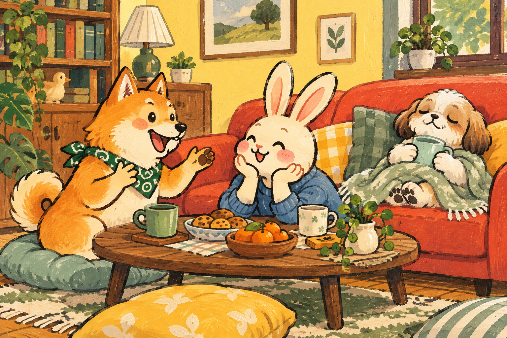
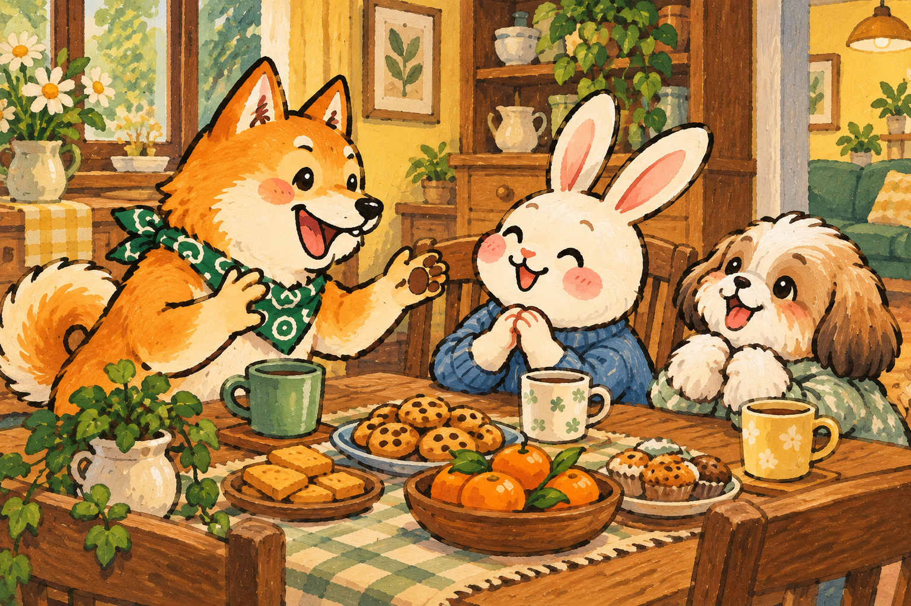
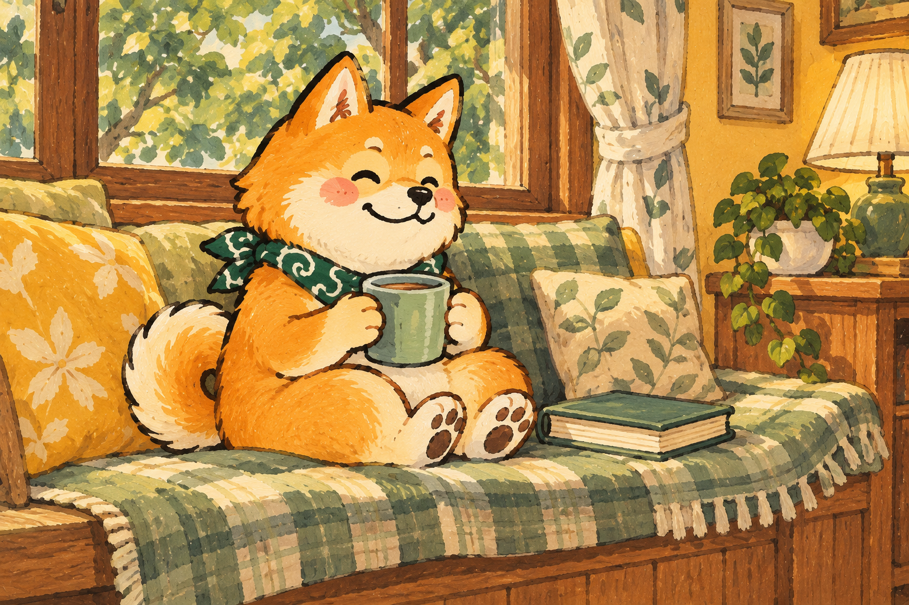
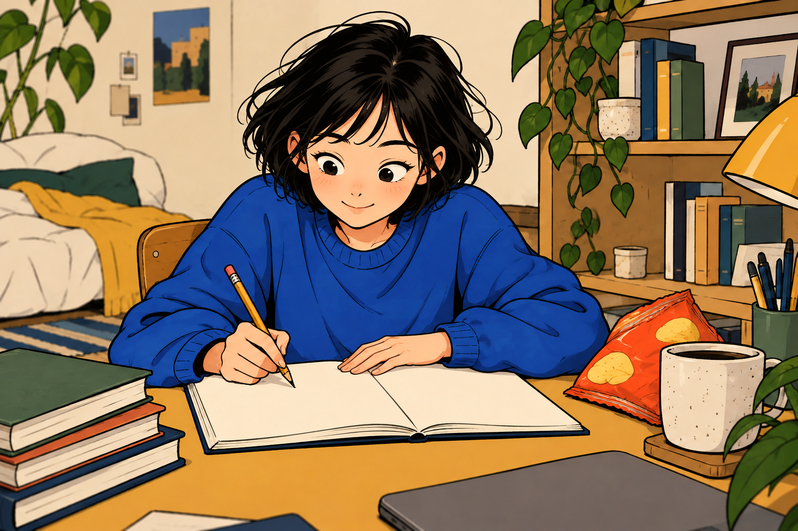
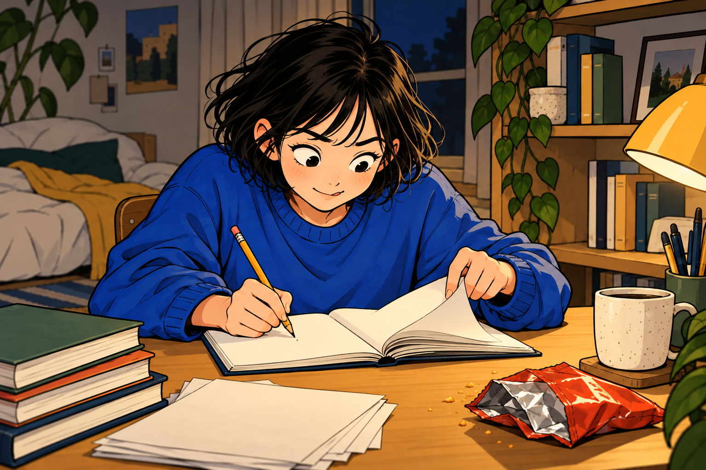
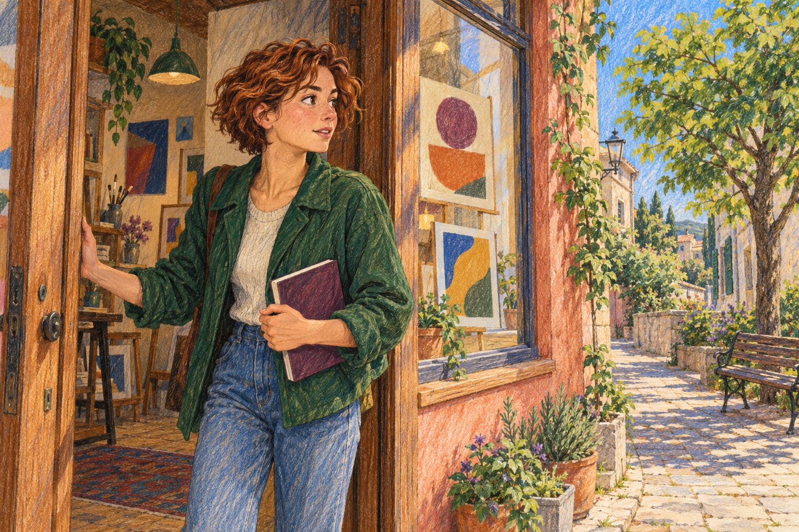
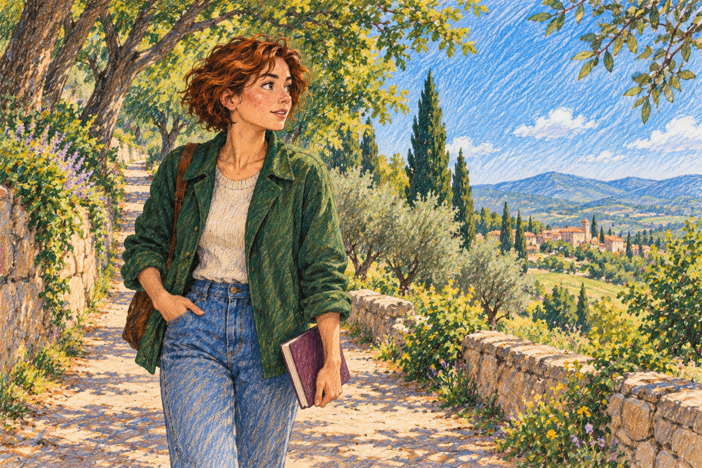
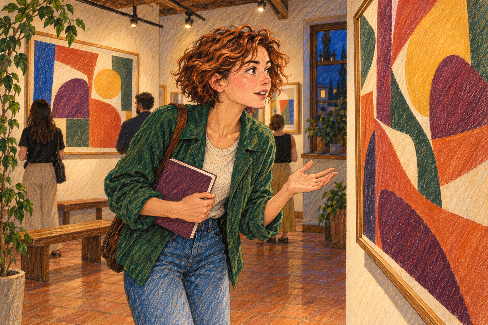
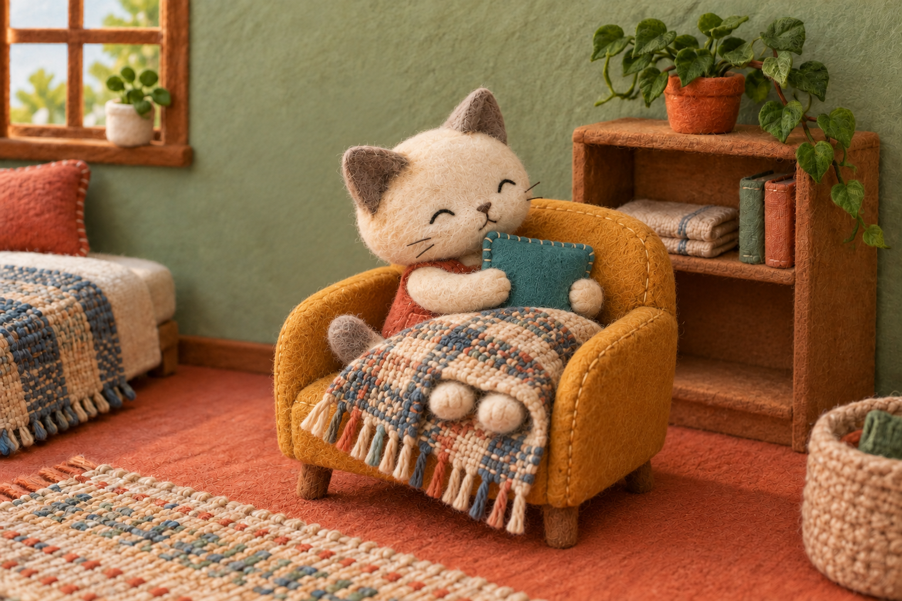
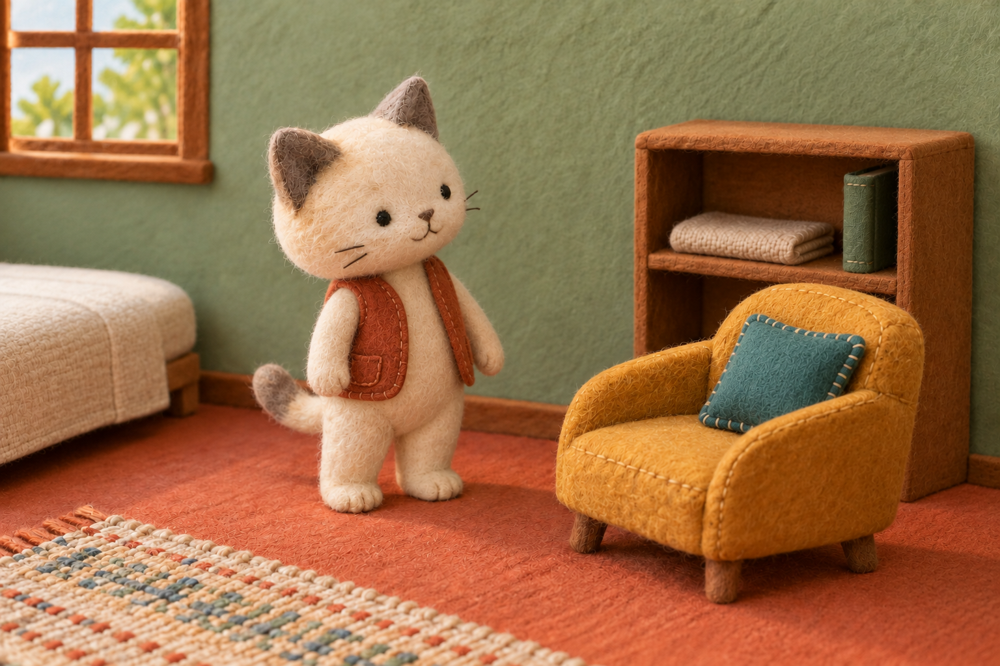

# 쿠쿠 대표 표지·결과 비교 · 4단계

작성: **2026-10-20** · 상태: **4개 콘텐츠·12개 이미지의 제작 시안, 사이트 미적용**

표지 4장은 기존 기준 PNG를 재사용하고, 결과는 각 화풍마다 두 종씩 새로 만들었습니다. 아래 그림은 모두 같은 폴더의 원본 PNG로 연결됩니다. 그림을 누르면 원본을 볼 수 있습니다. 실제 생성·참조 이력은 [생성 기록](GENERATION_RECORD.md), 크기·해시는 [파일 목록](manifest.json)에 있습니다.

## 1. 이번에 반영한 사용자 결정

- S2 펜 그림은 **첫 번째 출력으로 복원**했습니다. 지나치게 선명한 선과 평평한 색 면으로 바꾼 두 수정은 현재 기준에서 제외합니다.
- 첫 그림의 여자 캐릭터는 **쿠쿠와 함께 사용할 마스코트로 등록**했습니다. 이름·보이지 않은 전신 규격·쿠쿠와의 서사는 미정이며 이번에 사이트에 배치하지 않습니다.
- S2 결과는 첫 그림의 얼굴·검은 단발·파란 니트와 부드러운 명암을 이어갑니다. 배경 그라데이션 금지는 유지하되 인물·물체의 입체감을 지우지 않습니다.
- 표지·결과의 제목·숫자·점수는 그림에 넣지 않습니다. 현재 유형 의미를 실제 텍스트로 보여줄 때 조합하는 원화입니다.

## 2. S1 과슈 · 소셜 배터리 사용법

주인공은 표지 왼쪽의 금갈색 시바견입니다. 오른쪽의 늘어진 귀 강아지를 혼자 회복 결과의 주인공으로 바꾸지 않았습니다. 시바견의 털·얼굴·진녹색 스카프와 과슈 재료를 이어갑니다. 이 시바견을 기존 쿠쿠와 같은 캐릭터로 확정한 것은 아닙니다.

| 표지 · 모임의 서로 다른 에너지 | `crowd` · 활기 충전형 | `recharge` · 휴식 보존형 |
|---|---|---|
|  |  |  |

**결과의 차이:** 사람들 속에서 반응하며 활기를 얻는 행동과 즐거운 약속 뒤 혼자 편안히 쉬는 행동입니다. 회복을 우울·배제·낮은 등급으로 그리지 않았습니다.

**원본에서 본 점:** 두 결과에서 얼굴·스카프·붓질이 이어지고 인물 수·자세·공간이 달라졌습니다. 표지와 활기 결과는 모임 소재와 주인공의 표현이 많이 겹칩니다. 작은 카드에서 충분히 구별되는지는 후속 화면 검토에 남깁니다.

## 3. S2 부드러운 펜 생활 만화 · 미루기 습관 빙고

사용자가 선택한 첫 여자 캐릭터를 두 결과에 동일하게 참조했습니다. 선·피부·머리·옷의 명암과 방의 깊이를 유지하고, 과거의 단색 면 평면화는 적용하지 않았습니다.

| 표지 · 과제와 간식 사이 | `count-low` · 미루기 방어 우등생 | `count-high` · 마감 직전 집중 각성형 |
|---|---|---|
|  |  |  |

**결과의 차이:** 작은 행동으로 먼저 시작하는 모습과 미룬 뒤 밤에 집중이 붙는 모습입니다. 늦어진 사람을 무능하게 묘사하거나 밤샘을 우월한 방식으로 표현하지 않습니다.

**구분의 성격:** `count-low`·`count-high`는 그림 제작용 이름입니다. 실제 놀이의 유형은 선택한 칸 수로 정하며, 빙고 완성 수·점수·밤의 시각을 그림에 고정하지 않았습니다. 가운데 범위의 세 번째 유형은 이번 대표 비교에 포함하지 않았습니다.

**원본에서 본 점:** 얼굴·머리·니트·공간과 부드러운 채색이 이어졌습니다. 두 결과 모두 필기하는 장면이므로 차이는 낮·밤, 표정, 페이지를 넘기는 동작, 책상 상태에 있습니다. 실제 표시 크기에서 이 단서가 남는지 확인해야 합니다.

그림만으로 ‘미룬 뒤’라는 과거 행동까지 판단할 수는 없습니다. 실제 유형의 결과 설명과 함께 사용하며 밤 장면 자체를 유형 판정 근거로 쓰지 않습니다.

## 4. S3 색연필 · 오늘 끌리는 장면은?

짧은 동갈색 곱슬머리·초록 재킷·자두색 수첩의 같은 인물을 사용했습니다. 그 인물을 새로운 사이트 마스코트로 등록한 것은 아닙니다.

| 표지 · 문 앞에서 머물 곳 바라보기 | `open` · 바람 환기형 | `sparkle` · 반짝 점화형 |
|---|---|---|
|  |  |  |

**결과의 차이:** 넓은 풍경과 새로운 공기를 찾는 장면, 선명한 색과 재미있는 발견에 반응하는 장면입니다. 반짝임을 떠다니는 별·발광 효과로 대신하지 않았습니다.

**원본에서 본 점:** 얼굴·수첩·옷과 방향성 있는 연필 결이 이어지고, 야외의 넓음과 실내의 가까운 발견을 구별했습니다. 세부 풍경과 전시 배경이 많으므로 실제 카드에서는 인물의 크기와 배경 밀도를 다시 봅니다. 네 결과 중 두 종만 제작했으며 질문 선택 장면 32장은 이번 범위가 아닙니다.

## 5. S4 펠트 · 내 방이 말해주는 취향 무드

크림 몸·회색 귀·무광 자수 눈·주황 조끼의 같은 고양이를 사용했습니다. 세이지 벽·주황 바닥·창·선반·노란 의자로 방을 연결합니다. 이 고양이는 쿠쿠의 새 외형이 아닙니다.

| 표지 · 쿠션을 어디에 둘까 | `cozy` · 포근 아지트형 | `minimal` · 여백 미니멀형 |
|---|---|---|
|  |  |  |

**결과의 차이:** 감싸는 천과 물건을 사용하며 머무는 행동, 필요한 물건만 남긴 공간에서 편안히 있는 행동입니다. 벽 색만 바꾼 변형으로 만들지 않았습니다.

**원본에서 본 점:** 재료·얼굴·조끼·주요 가구가 이어지고, 자세·덮개·물건 수가 달라졌습니다. 가구 위치와 시점이 픽셀 단위로 같은 것은 아닙니다. 섬유와 자수 눈이 실제 작은 크기에서도 남는지, 쿠쿠를 같은 재료로 만들 수 있는지는 별도 확인 사항입니다.

## 6. 이번 결과를 어디까지 사용할 수 있는가

이 묶음은 원본 수준에서 **같은 인물·재료를 다른 장면에 이어 만드는 첫 비교**입니다. 자동 검사나 제작자의 판단만으로 최종 채택·유입 효과를 확정하지 않습니다. 화풍별 주제가 달라 보편적인 선호 순위를 가리는 비교도 아닙니다.

다음 5단계에서 기존 홈·소개·결과·공유 틀에 놓고 PC·모바일의 표시 크기·잘림·읽기 순서·용량을 확인합니다. 그때 결과 간 차이가 읽히지 않으면 해당 장면·구도부터 수정합니다. 이번에는 화면 코드·공개 이미지 연결·배포를 변경하지 않았습니다.

전체 제작의 검토용 기본안 161장에 포함된 자리 중 **표지 4개·결과 8개, 총 12개 자리**를 비교했습니다. 161장에 12장을 추가한다는 뜻이 아닙니다. 기존 표지 4장은 파일 복사이고, 새 결과 8장은 참조 이미지를 사용한 생성입니다.
