# 쿠쿠 최종 일러스트 갤러리 · 2026-10-20

34개 콘텐츠의 최종 배정과 표지·결과 161장입니다. [적용 보고서](../../../COOCOO_ILLUSTRATION_ROLLOUT_20261020.md)와 [실제 프롬프트·참조·파일 해시](production.json)를 함께 봅니다.

각 테스트의 표지는 해당 결과 그림의 인물·재료 참조입니다. 화풍 기준 PNG를 모든 테스트의 공통 등장인물로 사용하지 않습니다. 그림 제목과 실제 사용자 수치는 웹 텍스트로 표시합니다.

## test-001 · 내 연애 열차 운행 타입은?

화풍 **S1** · [기준 가이드](../../../docs/illustration-style/kuku-gouache-v1/STYLE_GUIDE.md)

산호색 코트의 하얀 토끼와 겨자색 스카프의 회색 고양이, 작은 청록색 기차역과 객실.

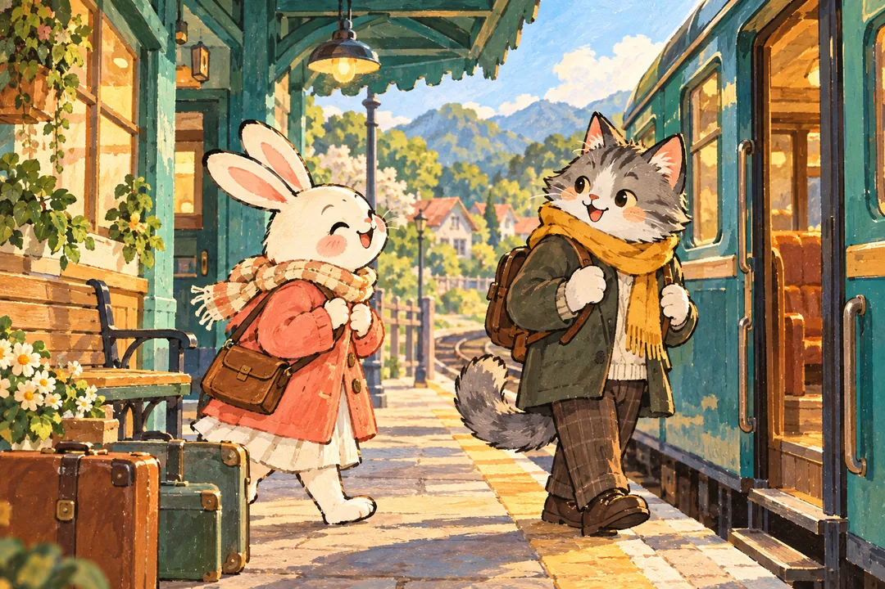

- [직진 기관사형 · engine](../../../assets/images/covers/test-001-engine.webp): 먼저 손을 내밀며 함께 탈 열차를 제안하는 인물. 속도감은 있으나 상대를 끌고 가지 않는다.
- [안정 역장형 · station](../../../assets/images/covers/test-001-station.webp): 상대가 도착할 때까지 편안하게 기다리며 함께 움직일 시간을 맞추는 플랫폼 장면.
- [다정 안내원형 · guide](../../../assets/images/covers/test-001-guide.webp): 지친 상대에게 자리를 내주고 이야기에 귀 기울이는 객실 장면.
- [관찰 신호등형 · signal](../../../assets/images/covers/test-001-signal.webp): 플랫폼에서 상대 반응을 보고 다가갈 순간을 고르는 인물. 외면하거나 감시하는 모습으로 그리지 않는다.

## test-002 · 직장인 회복력 체크

화풍 **S2** · [기준 가이드](../../../docs/illustration-style/kuku-ink-comic-v1/STYLE_GUIDE.md)

갈색 옆가르마 머리의 남성, 회색 카디건과 남색 바지, 빨간 머그가 있는 남색 사무실.

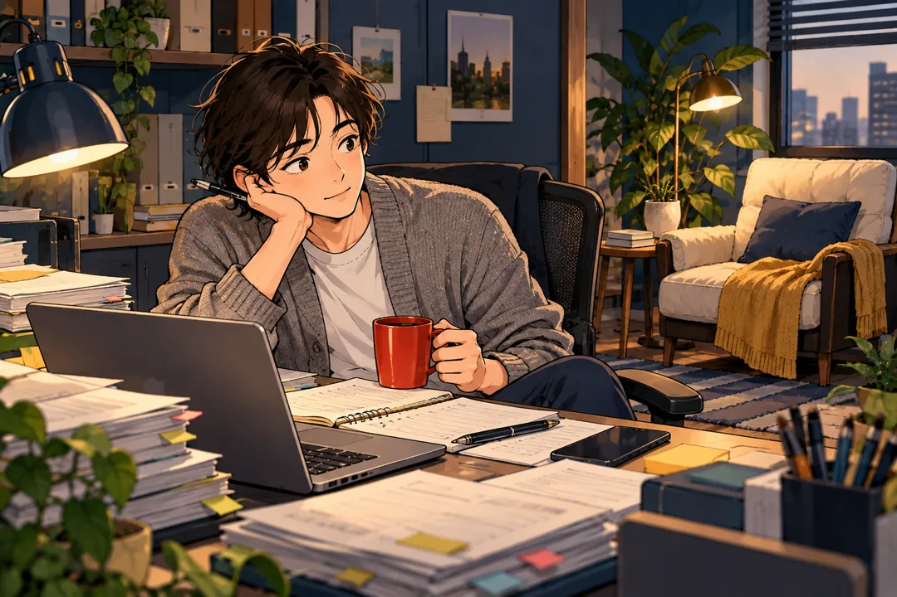

- [버티는 스프린터형 · sprint](../../../assets/images/covers/test-002-sprint.webp): 마감 자료를 마무리하면서도 옆에 놓인 쉬는 자리를 계속 지나치는 인물.
- [회복 쿠션형 · buffer](../../../assets/images/covers/test-002-buffer.webp): 바쁜 사무실 한쪽에서 동료와 잠깐 차를 마시며 표정이 풀리는 장면.
- [리셋 설계형 · reset](../../../assets/images/covers/test-002-reset.webp): 업무 도구를 덮고 미리 정한 짧은 산책을 시작하는 인물.
- [방전 경고형 · alert](../../../assets/images/covers/test-002-alert.webp): 새 요청을 잠시 내려놓고 의자에 앉아 쉬어 갈 공간을 만드는 인물. 위험 경보나 쓰러진 몸으로 과장하지 않는다.

## test-003 · 나만의 여행 성향 찾기

화풍 **S3** · [기준 가이드](../../../docs/illustration-style/kuku-colored-pencil-v1/STYLE_GUIDE.md)

갈색 포니테일 여성 여행자, 남색 캡과 청록 바람막이, 주황 크로스백. 여행지 시장 골목과 작은 숙소.

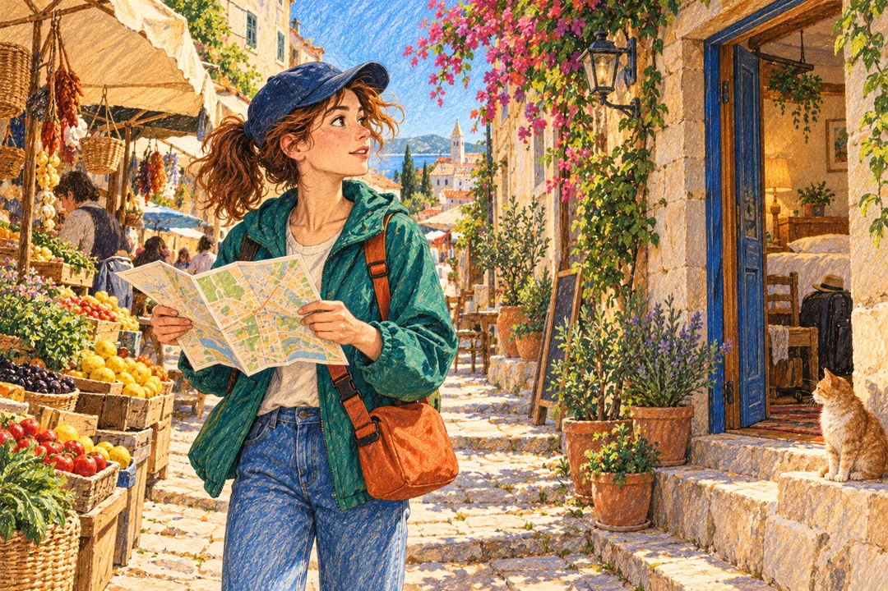

- [동선 설계자형 · planner](../../../assets/images/covers/test-003-planner.webp): 숙소 탁자에서 지도 위 동선을 차분히 살펴보고 연필로 표시하는 여행자 한 명. 출발 장면이나 문가의 두 번째 인물은 그리지 않는다.
- [즉흥 모험가형 · explorer](../../../assets/images/covers/test-003-explorer.webp): 예정에 없던 작은 골목을 발견하고 호기심 어린 표정으로 방향을 바꾸는 여행자.
- [안정 휴양형 · comfort](../../../assets/images/covers/test-003-comfort.webp): 편안한 숙소 창가에 짐을 내려놓고 잠깐 쉬며 바깥 풍경을 즐기는 여행자.
- [동네 산책가형 · local](../../../assets/images/covers/test-003-local.webp): 동네 빵집과 시장에서 주민의 일상을 구경하며 천천히 걷는 여행자.

## test-004 · 집중력 루틴 진단

화풍 **S3** · [기준 가이드](../../../docs/illustration-style/kuku-colored-pencil-v1/STYLE_GUIDE.md)

짧은 버즈컷과 둥근 안경의 학생, 황토색 스웨터, 파란 작업대와 짙은 초록 스탠드.

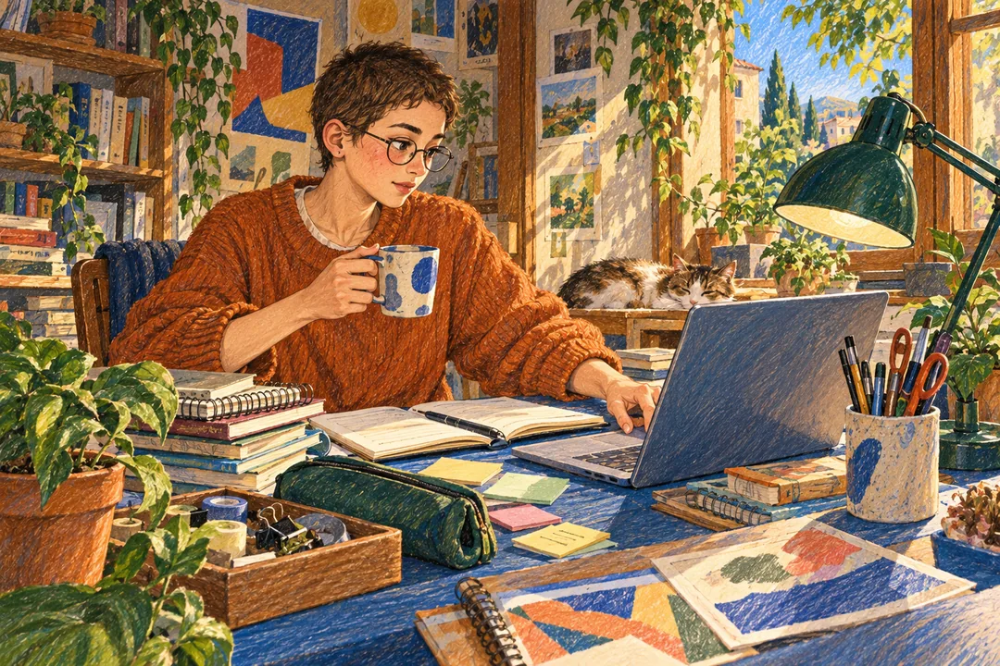

- [시간 설계형 · timer](../../../assets/images/covers/test-004-timer.webp): 탁상 타이머 옆에서 작은 작업 하나를 끝내고 다음 구간을 준비하는 인물.
- [몰입 잠수형 · diver](../../../assets/images/covers/test-004-diver.webp): 한 자료를 깊이 들여다보며 주변보다 작업에 시선이 모이는 인물. 위험한 수중 장면으로 비유할 필요는 없다.
- [루틴 관리자형 · ritual](../../../assets/images/covers/test-004-ritual.webp): 같은 조명·컵·노트를 자기 자리에 놓으며 작업을 시작하는 인물.
- [반짝 아이디어형 · spark](../../../assets/images/covers/test-004-spark.webp): 다른 예시를 펼쳐 비교하다 새 연결을 발견하고 손으로 시도하는 인물. 떠다니는 전구 아이콘으로 대체하지 않는다.

## test-005 · 친구 케미 점수 보기

화풍 **S1** · [기준 가이드](../../../docs/illustration-style/kuku-gouache-v1/STYLE_GUIDE.md)

파란 멜빵의 노란 오리 주인공과 갈색 곰·하얀 토끼 친구들, 붉은 체크 소풍자리와 숲.

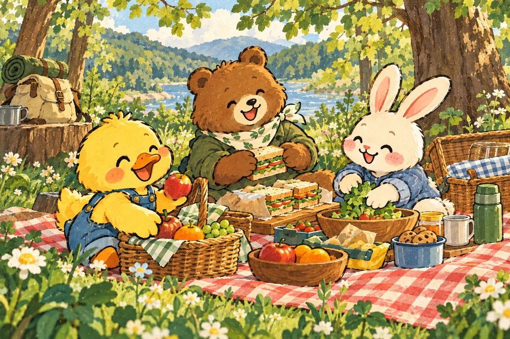

- [든든한 총무형 · manager](../../../assets/images/covers/test-005-manager.webp): 모임 준비물을 나누며 예약과 준비가 빠진 곳을 챙기는 친구.
- [다정한 공감형 · listener](../../../assets/images/covers/test-005-listener.webp): 잠시 조용해진 친구 옆에서 몸을 기울여 이야기를 듣는 인물.
- [분위기 메이커형 · spark](../../../assets/images/covers/test-005-spark.webp): 어색한 친구들이 함께 웃도록 가벼운 행동이나 이야기를 꺼내는 인물.
- [자유로운 즉흥형 · free](../../../assets/images/covers/test-005-free.webp): 갑자기 제안된 산책에 자연스럽게 합류해 친구와 보폭을 맞추는 인물.

## test-006 · 주말 충전 방식 찾기

화풍 **S1** · [기준 가이드](../../../docs/illustration-style/kuku-gouache-v1/STYLE_GUIDE.md)

벽돌색 맨투셔츠의 둥근 고슴도치, 민트색 현관과 동네 골목, 코랄색 소파.

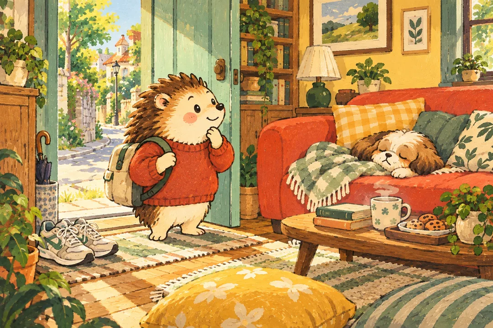

- [포근 집콕형 · cocoon](../../../assets/images/covers/test-006-cocoon.webp): 익숙한 잠옷과 담요를 두고 소파에서 편하게 주말을 시작하는 인물.
- [약속 충전형 · social](../../../assets/images/covers/test-006-social.webp): 약속 장소에 도착해 반가운 친구를 보고 생기 있는 표정으로 인사하는 인물.
- [리듬 회복형 · reset](../../../assets/images/covers/test-006-reset.webp): 빨래나 장보기를 마친 뒤 쉴 시간도 남겨 둔 주말의 생활 장면.
- [가벼운 산책형 · roam](../../../assets/images/covers/test-006-roam.webp): 운동화를 신고 동네 나무와 새 가게를 구경하며 가볍게 걷는 인물.

## test-007 · 썸 대화 온도 체크

화풍 **S2** · [기준 가이드](../../../docs/illustration-style/kuku-ink-comic-v1/STYLE_GUIDE.md)

긴 갈색 웨이브 머리 여성, 연보라 카디건, 초록 벽과 분홍 의자가 있는 방, 휴대폰.

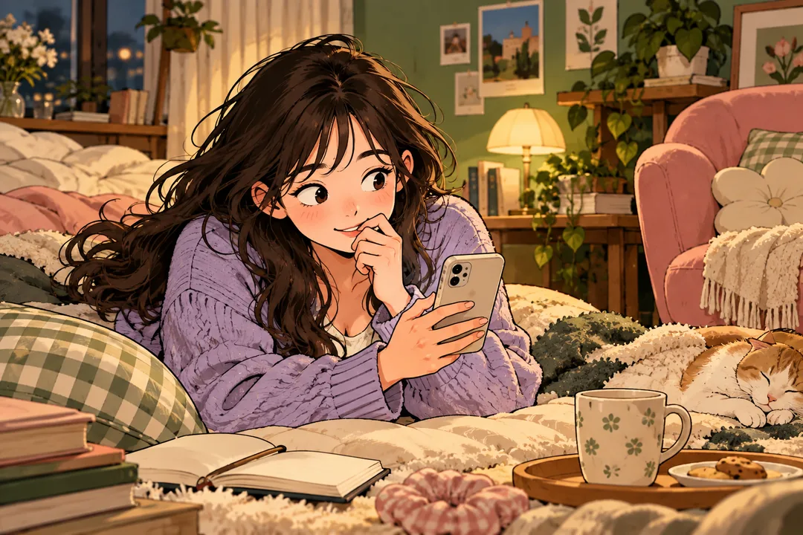

- [직진 온도상승형 · spark](../../../assets/images/covers/test-007-spark.webp): 즐거운 대화가 이어지자 먼저 다음 만남을 제안하려 몸을 앞으로 기울이는 인물.
- [편안한 스며듦형 · steady](../../../assets/images/covers/test-007-steady.webp): 편한 자리에서 일상 이야기를 무리 없이 이어가며 차분히 답장을 쓰는 인물.
- [장난 센스형 · tease](../../../assets/images/covers/test-007-tease.webp): 둘만 통하는 장난을 떠올려 웃으며 메시지를 보내는 인물.
- [차분 관찰형 · calm](../../../assets/images/covers/test-007-calm.webp): 앞서 나눈 말을 되짚으며 적당한 타이밍에 신중하게 답하는 인물.

## test-008 · 첫인상보다 오래가는 내 매력은?

화풍 **S1** · [기준 가이드](../../../docs/illustration-style/kuku-gouache-v1/STYLE_GUIDE.md)

빨간 조끼의 회색 너구리, 청록색 단골 카페와 동물 친구들.

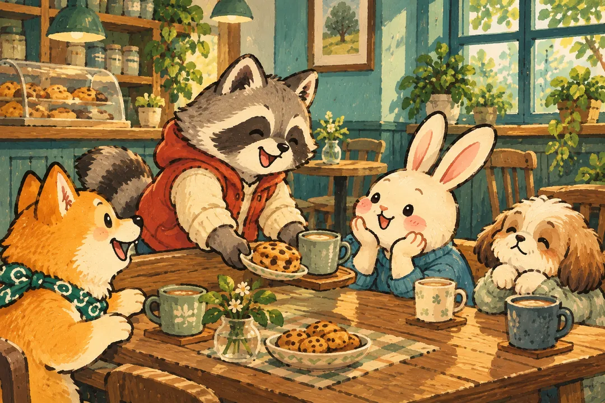

- [은근 발광형 · glow](../../../assets/images/covers/test-008-glow.webp): 친구의 작은 취향을 기억해 알맞은 물건을 건네며 뒤늦게 배려가 드러나는 인물.
- [포근 안정형 · comfort](../../../assets/images/covers/test-008-comfort.webp): 옆자리에 앉은 친구가 부담 없이 쉬고 침묵도 편안한 장면.
- [위트 레이더형 · wit](../../../assets/images/covers/test-008-wit.webp): 적절한 순간의 한마디로 주변 친구들의 표정이 풀리는 장면.
- [미스터리 잔상형 · mystery](../../../assets/images/covers/test-008-mystery.webp): 평소 조용했던 인물이 의외의 취미 작업을 보여주고 친구가 호기심 있게 바라보는 장면.

## test-009 · 결정을 내리는 순간의 나

화풍 **S3** · [기준 가이드](../../../docs/illustration-style/kuku-colored-pencil-v1/STYLE_GUIDE.md)

갈색 낮은 번 헤어 여성, 이끼색 블라우스, 주황 폴더를 놓은 창가 작업실.

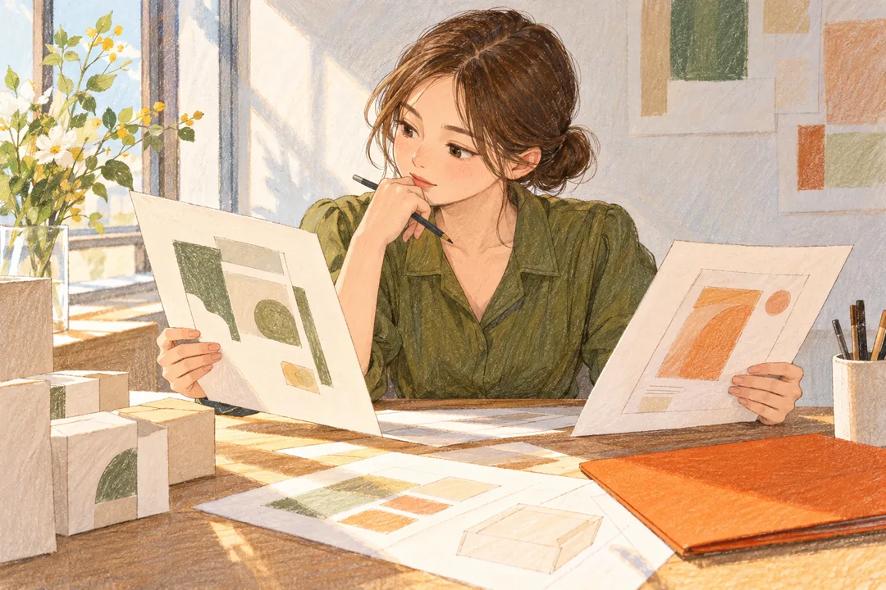

- [분석 나침반형 · logic](../../../assets/images/covers/test-009-logic.webp): 몇 개의 선택을 비교하며 조건을 정리한 뒤 하나를 고르는 인물. 비교 글자는 실제 텍스트로 별도 배치한다.
- [직감 스위치형 · gut](../../../assets/images/covers/test-009-gut.webp): 선택지를 둘러보다 마음이 끌리는 쪽에 자연스럽게 손을 뻗는 인물.
- [조율 밸런스형 · harmony](../../../assets/images/covers/test-009-harmony.webp): 친구들의 서로 다른 조건을 듣고 모두가 편한 중간 선택을 제안하는 인물.
- [빠른 결정형 · quick](../../../assets/images/covers/test-009-quick.webp): 충분한 후보가 남자 하나를 결정하고 다음 행동으로 경쾌하게 넘어가는 인물.

## test-010 · 돈 쓸 때 드러나는 소비 타입

화풍 **S3** · [기준 가이드](../../../docs/illustration-style/kuku-colored-pencil-v1/STYLE_GUIDE.md)

검은 웨이브 머리 남성, 크림색 줄무늬 셔츠와 겨자색 천가방, 보라색 가게와 작은 집.

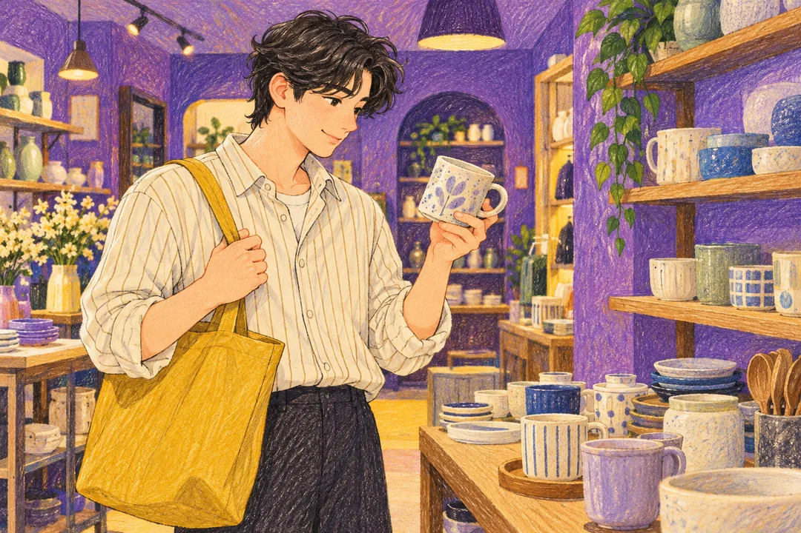

- [예산 설계형 · planner](../../../assets/images/covers/test-010-planner.webp): 집에서 필요한 지출을 정리한 뒤 마음 편하게 구매를 결정하는 인물.
- [기분 충전형 · joy](../../../assets/images/covers/test-010-joy.webp): 지친 하루에 좋아하는 디저트를 골라 잠깐 표정이 밝아지는 인물.
- [취향 수집형 · curator](../../../assets/images/covers/test-010-curator.webp): 소품 가게에서 재료와 디테일을 살피며 오래 쓸 물건을 고르는 인물.
- [절제 저축형 · saver](../../../assets/images/covers/test-010-saver.webp): 사지 않을 물건은 가볍게 내려놓고 자신이 선택한 산책을 이어가는 인물.

## test-011 · 팀플에서 맡게 되는 역할

화풍 **S2** · [기준 가이드](../../../docs/illustration-style/kuku-ink-comic-v1/STYLE_GUIDE.md)

짧은 검은 곱슬머리와 붉은 후드티의 학생 주인공, 민트 셔츠·남색 조끼의 팀원, 공동 모형 작업대.

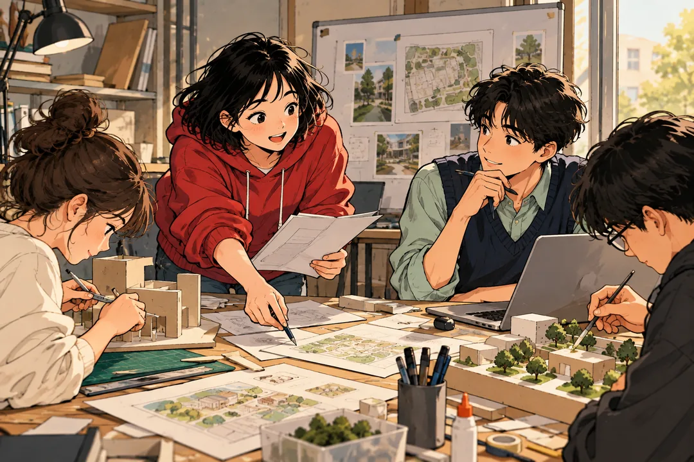

- [흐름 리더형 · captain](../../../assets/images/covers/test-011-captain.webp): 공동 작업 흐름을 짚으며 팀원들에게 다음 할 일을 함께 확인하는 인물.
- [실행 메이커형 · maker](../../../assets/images/covers/test-011-maker.webp): 회의 내용을 바탕으로 첫 모형이나 초안을 손으로 만드는 인물.
- [조율 브릿지형 · mediator](../../../assets/images/covers/test-011-mediator.webp): 엇갈린 의견을 가진 두 팀원 사이에서 서로의 말을 연결해 주는 인물.
- [분위기 점화형 · spark](../../../assets/images/covers/test-011-spark.webp): 지친 작업대에 새로운 예시를 가져와 팀원들이 다시 관심을 보이는 장면.

## test-012 · 쉬는 날 인간관계 충전법

화풍 **S1** · [기준 가이드](../../../docs/illustration-style/kuku-gouache-v1/STYLE_GUIDE.md)

데님 셔츠의 삼색 고양이, 라일락색 방과 조용한 동네 산책로.

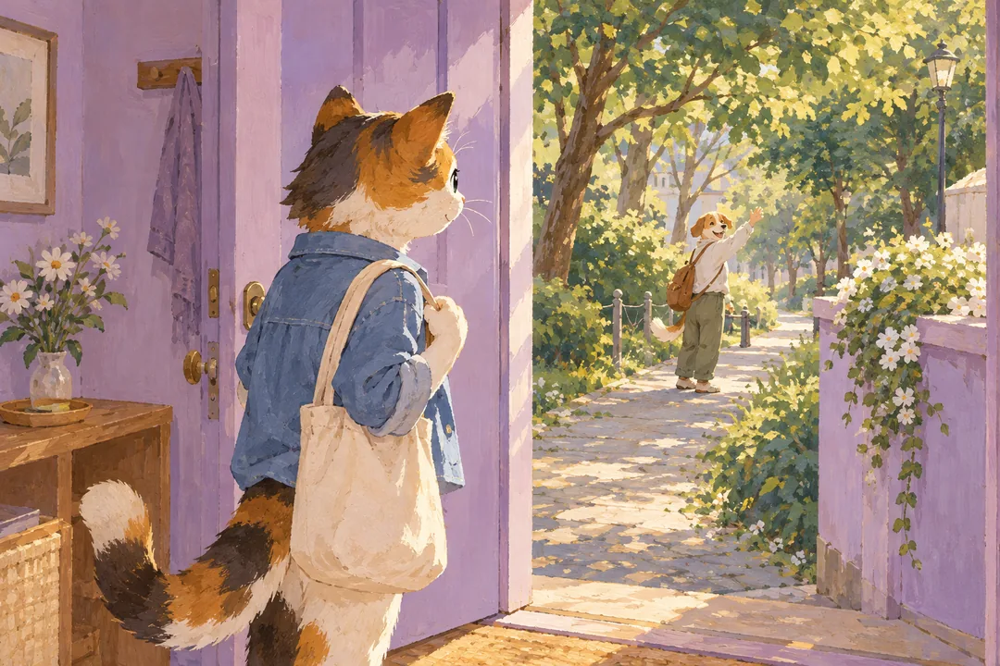

- [혼자 숨고르기형 · solo](../../../assets/images/covers/test-012-solo.webp): 혼자 산책하거나 식사하며 자기 속도를 되찾는 인물. 연락을 극적으로 거절하는 장면과 구별한다.
- [도란도란 1대1형 · duo](../../../assets/images/covers/test-012-duo.webp): 편한 친구 한 명과 차를 마시며 침묵도 어색하지 않은 장면.
- [가벼운 모임형 · circle](../../../assets/images/covers/test-012-circle.webp): 역할 부담 없는 작은 모임에서 여러 이야기를 들으며 가볍게 웃는 인물.
- [잠수 회복형 · vanish](../../../assets/images/covers/test-012-vanish.webp): 휴대폰을 보이지 않는 곳에 두고 아무 대답도 요구받지 않는 쉬는 자리에 머무는 인물.

## test-013 · 나의 플러팅 방식 찾기

화풍 **S2** · [기준 가이드](../../../docs/illustration-style/kuku-ink-comic-v1/STYLE_GUIDE.md)

짧은 적갈색 머리와 파란 후드의 남성 주인공, 긴 검은 생머리와 분홍 재킷의 상대, 강변 보행로.

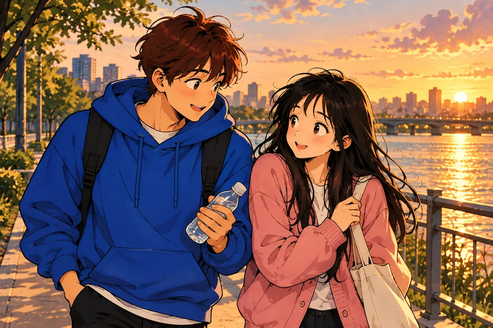

- [직진 시그널형 · direct](../../../assets/images/covers/test-013-direct.webp): 관심 있는 상대에게 둘이 만날 장소를 손짓으로 제안하는 인물.
- [장난 유도형 · play](../../../assets/images/covers/test-013-play.webp): 가벼운 장난을 주고받으며 서로 웃음이 번지는 두 사람.
- [다정 배려형 · care](../../../assets/images/covers/test-013-care.webp): 상대가 좋아하는 음료나 필요한 도움을 자연스럽게 건네는 인물.
- [은근 스며듦형 · subtle](../../../assets/images/covers/test-013-subtle.webp): 같은 취향을 매개로 옆자리에 앉아 대화할 계기를 만드는 인물.

## test-014 · 사진첩 무드로 보는 감성 타입

화풍 **S3** · [기준 가이드](../../../docs/illustration-style/kuku-colored-pencil-v1/STYLE_GUIDE.md)

긴 검은 땋은 머리와 둥근 검은 안경의 인물, 파란 작업 재킷, 카메라와 나무 사진 보관함.

- [무드 아카이버형 · archive](../../../assets/images/covers/test-014-archive.webp): 작은 일상 사진들을 모아 취향에 맞게 보관하는 인물.
- [빛과 구도형 · aesthetic](../../../assets/images/covers/test-014-aesthetic.webp): 창가의 빛과 물체 위치를 조금씩 바꾸며 구도를 맞춰 촬영하는 인물.
- [순간 포착형 · candid](../../../assets/images/covers/test-014-candid.webp): 친구가 자연스럽게 웃는 짧은 순간을 재빨리 포착하는 인물.
- [이야기 편집형 · story](../../../assets/images/covers/test-014-story.webp): 하루의 시작부터 끝까지 사진을 순서대로 놓아 이야기를 엮는 인물.

## test-015 · 내 방이 말해주는 취향 무드

화풍 **S4** · [기준 가이드](../../../docs/illustration-style/kuku-felt-miniature-v1/STYLE_GUIDE.md)

표지와 동일한 크림색 고양이, 회색 귀·꼬리, 녹슨 주황 조끼. 같은 방의 창·침대·노란 의자·선반 유지.

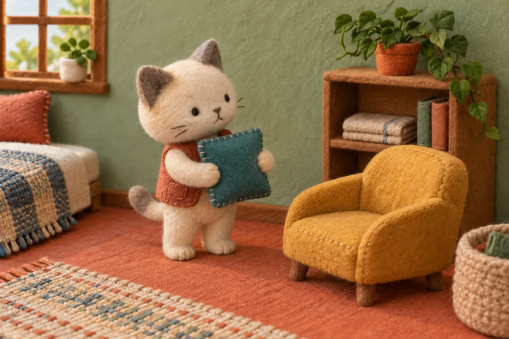

- [포근 아지트형 · cozy](../../../assets/images/covers/test-015-cozy.webp): 부드러운 담요와 낮은 조명 아래 몸을 편하게 기대는 공간.
- [여백 미니멀형 · minimal](../../../assets/images/covers/test-015-minimal.webp): 필요한 물건이 제자리에 있고 책상 면이 비어 있는 방에서 편하게 앉은 인물.
- [취향 수집형 · collector](../../../assets/images/covers/test-015-collector.webp): 취향 소품과 여행 기억을 선반에 놓으며 각 물건을 아끼는 인물.
- [색감 포인트형 · color](../../../assets/images/covers/test-015-color.webp): 같은 방에서 컵이나 천의 포인트색을 바꿔 분위기 변화를 즐기는 인물. 나머지 결과의 단순 색상 변형으로 끝내지 않는다.

## test-016 · 약속 잡을 때 드러나는 일정 성향

화풍 **S2** · [기준 가이드](../../../docs/illustration-style/kuku-ink-comic-v1/STYLE_GUIDE.md)

갈색 포니테일 여성, 빨간 레인코트와 남색 백팩, 버스 정류장과 도심 만남 장소.

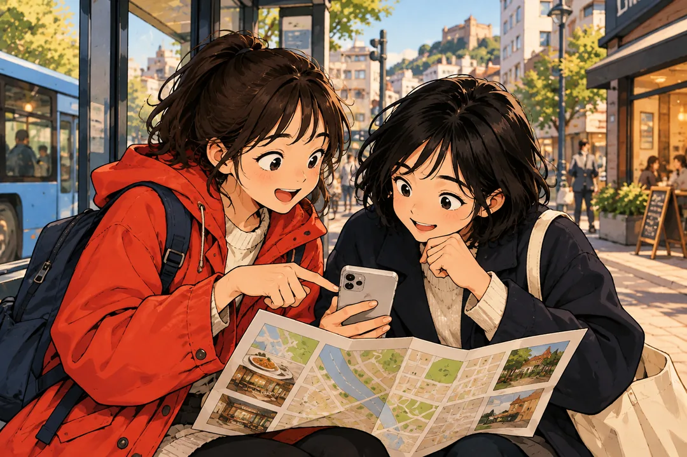

- [정시 앵커형 · anchor](../../../assets/images/covers/test-016-anchor.webp): 만날 시간과 경로를 미리 확인하고 약속 장소에 여유 있게 도착한 인물.
- [유연 적응형 · flex](../../../assets/images/covers/test-016-flex.webp): 장소가 바뀌었다는 소식을 듣고 친구와 다른 길로 자연스럽게 이동하는 인물.
- [당일 펄스형 · pulse](../../../assets/images/covers/test-016-pulse.webp): 오늘 빈 시간과 컨디션을 확인한 뒤 가볍게 친구를 만나러 나서는 인물.
- [정리 큐레이터형 · curator](../../../assets/images/covers/test-016-curator.webp): 친구 취향에 맞춰 만남·식사·다음 장소를 한 동선으로 엮어 제안하는 인물.

## test-017 · 칭찬 들었을 때 반응 타입

화풍 **S2** · [기준 가이드](../../../docs/illustration-style/kuku-ink-comic-v1/STYLE_GUIDE.md)

풍성한 검은 곱슬머리 남성, 복숭아색 셔츠, 녹색 벽의 작은 동아리 작업실.

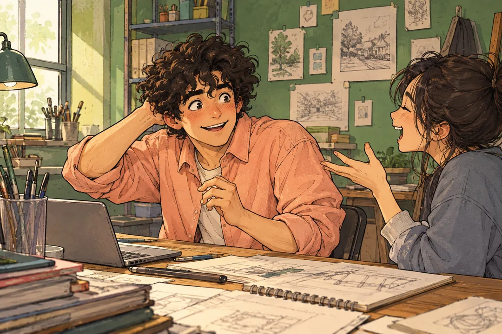

- [수줍 수납형 · shy](../../../assets/images/covers/test-017-shy.webp): 볼이 붉어지고 시선이 살짝 비껴가며 손을 모으는 수줍은 반응.
- [에너지 충전형 · fuel](../../../assets/images/covers/test-017-fuel.webp): 칭찬을 들은 뒤 자세가 펴지고 하던 작업에 다시 손을 올리는 인물.
- [덤덤 흡수형 · cool](../../../assets/images/covers/test-017-cool.webp): 겉으로는 작게 고개를 끄덕이지만 혼자 돌아서서 미묘하게 미소 짓는 인물.
- [장난 회피형 · joke](../../../assets/images/covers/test-017-joke.webp): 민망함을 장난스러운 몸짓으로 넘기고 친구도 함께 웃는 장면.

## test-018 · 계절이 바뀌면 깨어나는 감성은?

화풍 **S3** · [기준 가이드](../../../docs/illustration-style/kuku-colored-pencil-v1/STYLE_GUIDE.md)

긴 갈색 땋은 머리 여성, 크림 니트와 밤색 멜빵치마, 계절이 바뀌는 정원과 집.

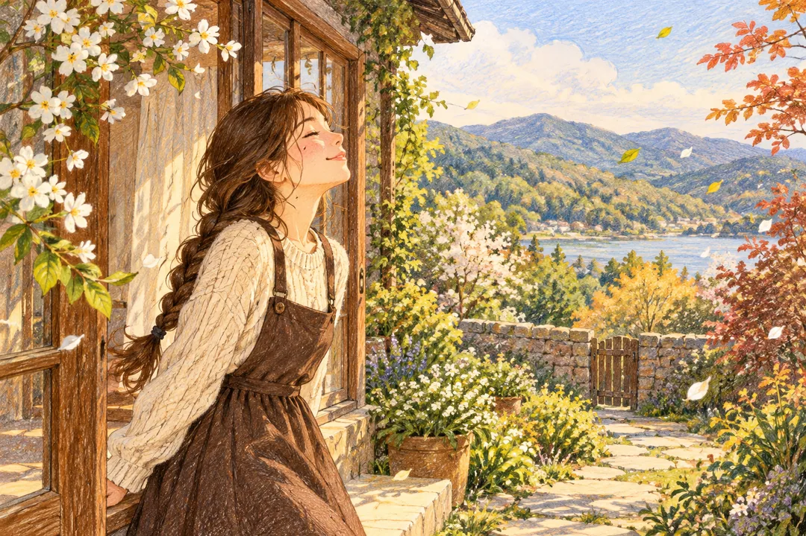

- [봄빛 시작형 · bloom](../../../assets/images/covers/test-018-bloom.webp): 새 노트를 열고 창밖의 새잎을 보며 작은 시작을 준비하는 인물.
- [여름 활력형 · blaze](../../../assets/images/covers/test-018-blaze.webp): 빛이 선명한 바깥에서 몸을 움직이며 사람과 풍경을 즐기는 인물.
- [가을 사색형 · hush](../../../assets/images/covers/test-018-hush.webp): 서늘한 길에서 음악과 바람에 잠깐 멈춰 생각하는 인물.
- [겨울 정리형 · frost](../../../assets/images/covers/test-018-frost.webp): 조용한 실내에서 물건과 기록의 자리를 찾아 차분히 정리하는 인물.

## test-019 · 스트레스 해소 버튼 찾기

화풍 **S1** · [기준 가이드](../../../docs/illustration-style/kuku-gouache-v1/STYLE_GUIDE.md)

짧은 검은 웨이브 머리 여성, 자두색 상의와 카키 바지, 작업실과 강변 산책로.

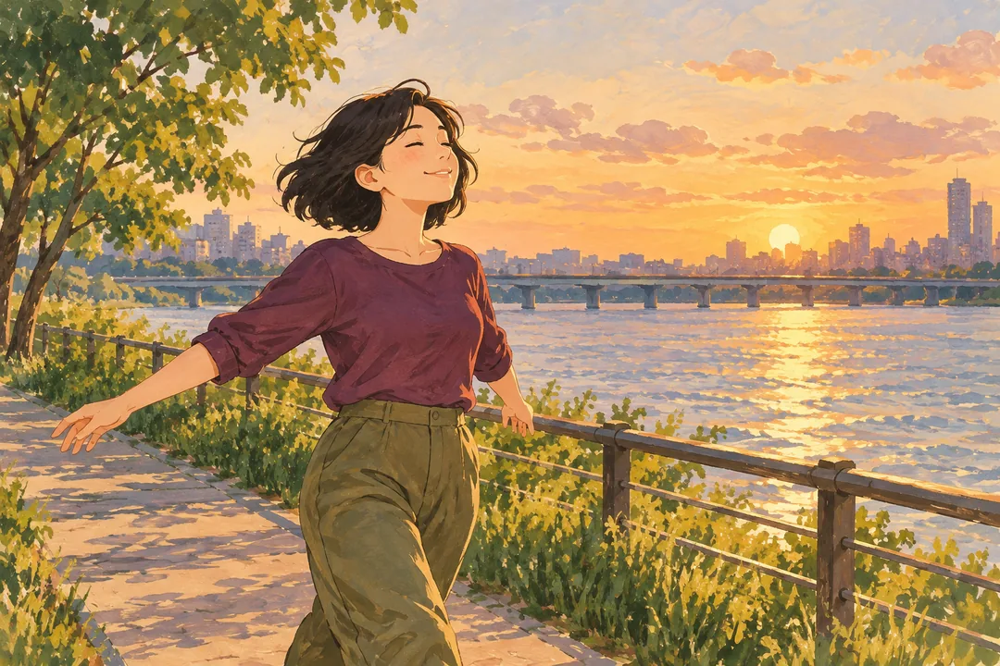

- [몸부터 전환형 · move](../../../assets/images/covers/test-019-move.webp): 앉아 있던 자리에서 일어나 바깥 길을 걸으며 몸을 펴는 인물.
- [말로 정리형 · talk](../../../assets/images/covers/test-019-talk.webp): 들어 주는 상대에게 자기 이야기를 건네며 표정이 풀리는 장면.
- [포근 잠수형 · nest](../../../assets/images/covers/test-019-nest.webp): 소리와 자극을 줄인 익숙한 자리에서 아무 결정 없이 쉬는 인물.
- [몰입 창작형 · create](../../../assets/images/covers/test-019-create.webp): 손으로 작은 물건을 만들거나 책상 한 부분을 정리하며 집중을 옮기는 인물.

## test-020 · 소셜 배터리 사용법

화풍 **S1** · [기준 가이드](../../../docs/illustration-style/kuku-gouache-v1/STYLE_GUIDE.md)

기준 표지의 금갈색 시바견과 초록 스카프, 흰 토끼·작은 갈색 강아지 친구들. 같은 캐릭터 비율·붓결. 이 시바는 쿠쿠 공통 외형 기준과 별개다.

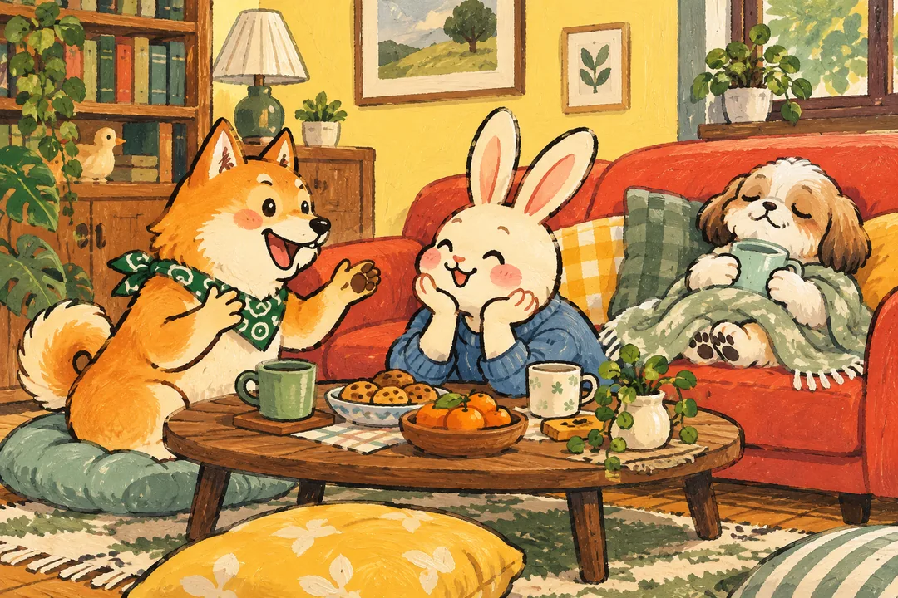

- [활기 충전형 · crowd](../../../assets/images/covers/test-020-crowd.webp): 여러 친구 사이에서 새 화제에 반응하며 표정과 몸짓이 살아나는 인물.
- [깊은 대화형 · deep](../../../assets/images/covers/test-020-deep.webp): 모임 뒤 가까운 사람과 마주 앉아 깊은 이야기에 집중하는 인물.
- [조용한 관찰형 · observer](../../../assets/images/covers/test-020-observer.webp): 새 모임의 이야기를 귀 기울여 듣고 적절한 순간에 연결하는 인물. 소속감 있는 자리로 표현한다.
- [휴식 보존형 · recharge](../../../assets/images/covers/test-020-recharge.webp): 즐거운 약속을 마치고 집에 돌아와 혼자 쉴 시간을 편하게 확보한 인물.

## test-021 · 지금 내 에너지 레벨은?

화풍 **S4** · [기준 가이드](../../../docs/illustration-style/kuku-felt-miniature-v1/STYLE_GUIDE.md)

크림색 펠트 토끼, 회색 귀 끝과 청록 조끼, 남색 벽·낮은 나무 탁자의 작은 집.

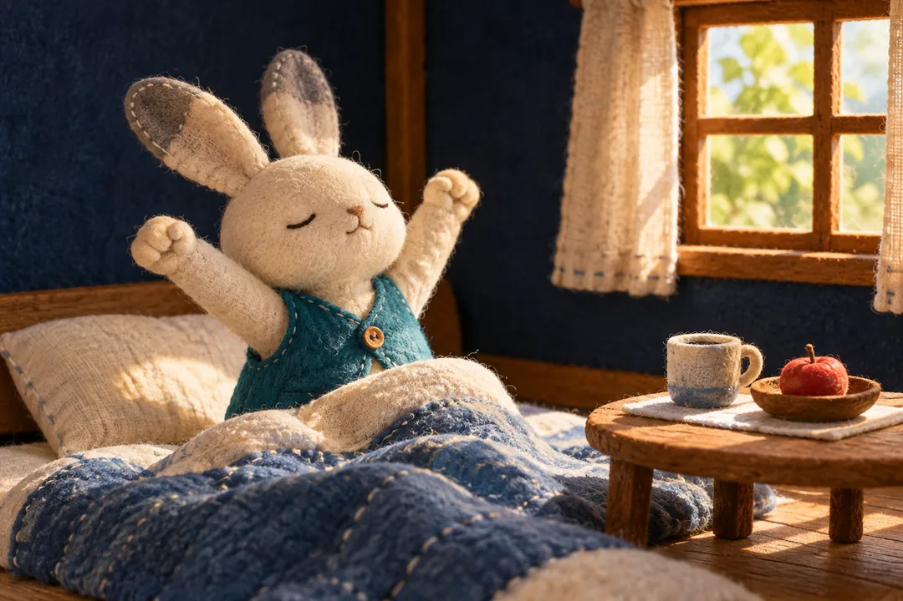

- [에너지 만땅형 · full](../../../assets/images/covers/test-021-full.webp): 할 일을 마친 뒤 새로운 즐거움에도 관심을 보이며 활기 있게 움직이는 인물.
- [안정 유지형 · steady](../../../assets/images/covers/test-021-steady.webp): 일과 가벼운 취미를 무리 없이 이어 가는 고른 일상 장면.
- [선택 절전형 · saving](../../../assets/images/covers/test-021-saving.webp): 여러 요청 중 지금 할 한 가지를 고르고 나머지는 잠시 내려놓는 인물.
- [느린 충전형 · low](../../../assets/images/covers/test-021-low.webp): 하나를 마친 뒤 잠깐 쉬며 다음 행동을 천천히 준비하는 인물.
- [완전 방전형 · empty](../../../assets/images/covers/test-021-empty.webp): 새 일을 더 얹지 않고 편한 자리에 기대 쉬는 인물. 무능·질병·위기처럼 과장하지 않는다.

## test-022 · 오늘 끌리는 장면은?

화풍 **S3** · [기준 가이드](../../../docs/illustration-style/kuku-colored-pencil-v1/STYLE_GUIDE.md)

기준 표지의 짧은 적갈색 곱슬머리 인물, 초록 재킷·크림 이너·청바지·자두색 수첩.

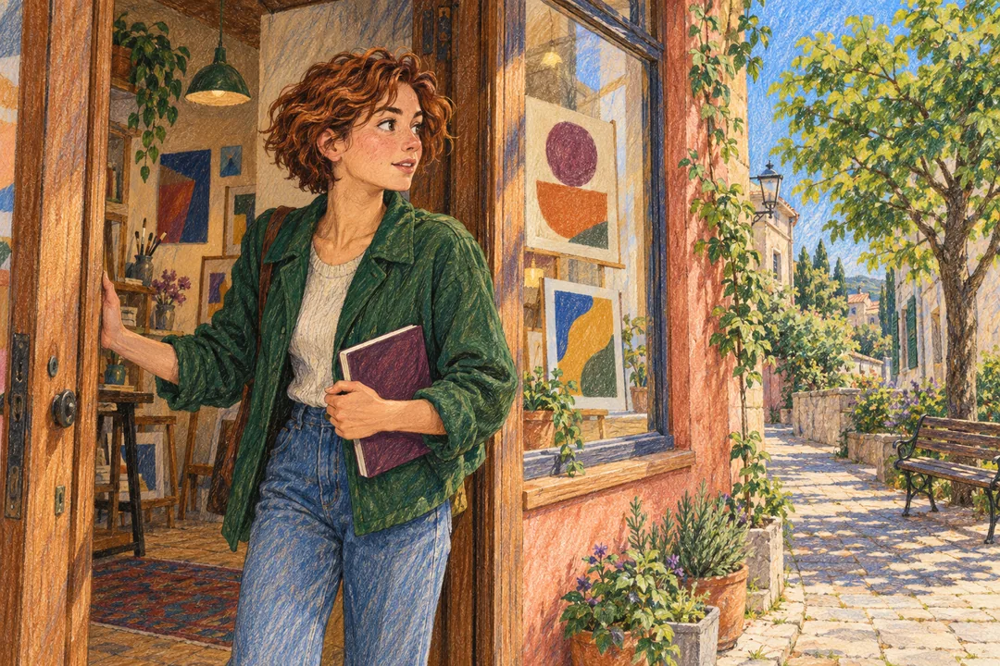

- [바람 환기형 · open](../../../assets/images/covers/test-022-open.webp): 창문을 열어 넓은 하늘과 이어지는 길을 바라보는 인물.
- [반짝 점화형 · sparkle](../../../assets/images/covers/test-022-sparkle.webp): 작은 전시나 밤의 활기 속에서 재미있는 장면을 발견해 눈이 반짝이는 인물. 그라데이션 배경 금지는 공통 제약이며, 명암·재료 표현은 화풍 선정 후 정한다.
- [고요 관찰형 · calm](../../../assets/images/covers/test-022-calm.webp): 움직이는 벽의 빛이나 찻잔의 김을 조용히 바라보며 잠시 머무는 인물.
- [포근한 귀가형 · cozy](../../../assets/images/covers/test-022-cozy.webp): 집에 돌아와 작은 조명을 켜고 익숙한 자리에 편하게 앉는 인물.

## test-023 · 요즘 내 여유 잔량은?

화풍 **S2** · [기준 가이드](../../../docs/illustration-style/kuku-ink-comic-v1/STYLE_GUIDE.md)

짧은 적갈색 머리 남성, 초록 카디건과 연파란 바지, 코랄색 책상·하얀 벽의 작업실.

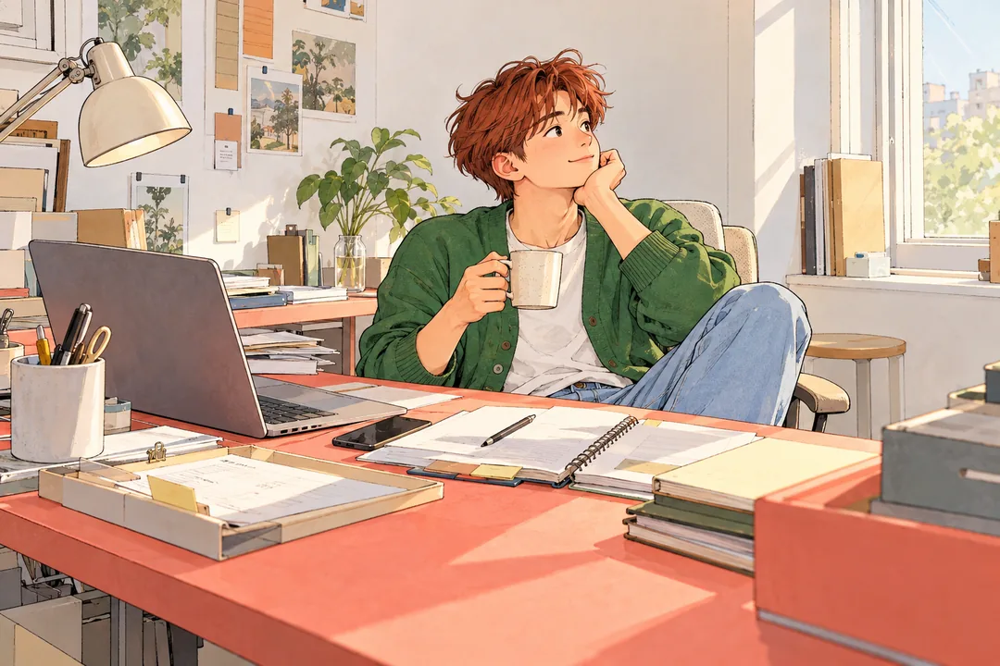

- [여백 넉넉형 · wide](../../../assets/images/covers/test-023-wide.webp): 새 제안을 듣고도 잠깐 생각할 틈이 있어 주변을 둘러보는 인물.
- [숨통 한 칸형 · room](../../../assets/images/covers/test-023-room.webp): 바쁜 하루 중 자기 점심이나 짧은 차 시간을 지키는 인물.
- [빽빽 일정형 · tight](../../../assets/images/covers/test-023-tight.webp): 한 작업을 하는 동안 다음 일정도 신경 쓰여 책상 옆 시계를 곁눈질하는 인물.
- [여백 실종형 · packed](../../../assets/images/covers/test-023-packed.webp): 쉬는 중에도 할 일을 다시 들여다보다 잠시 내려놓는 인물. 원화에 점수·탭 개수·알림 숫자를 고정하지 않는다.

## test-024 · AI와 일할 때 나는 어떤 파트너?

화풍 **S2** · [기준 가이드](../../../docs/illustration-style/kuku-ink-comic-v1/STYLE_GUIDE.md)

턱 길이 갈색 일자머리 여성, 겨자색 셔츠와 남색 바지, 청록 책상에서 노트북의 초안을 직접 검토.

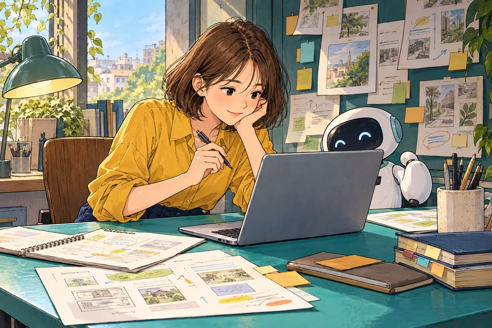

- [방향 잡는 기획자 · director](../../../assets/images/covers/test-024-director.webp): 요청 전에 대상과 목적을 작업 순서로 정리해 도움을 맡기는 인물.
- [내 색 입히는 편집자 · editor](../../../assets/images/covers/test-024-editor.webp): 받은 초안에 직접 표시하고 자기 표현으로 다듬는 인물. 실제 문장은 나중에 텍스트로 처리한다.
- [옆길 찾는 탐험가 · explorer](../../../assets/images/covers/test-024-explorer.webp): 서로 다른 시안을 펼쳐 보고 새 방향을 시도하며 즐거워하는 인물.
- [근거 챙기는 검증가 · verifier](../../../assets/images/covers/test-024-verifier.webp): 초안 옆에서 별도의 원문 자료를 대조하며 근거를 확인하는 인물.

## test-025 · 알림 OFF, 나의 오프라인 모드는?

화풍 **S1** · [기준 가이드](../../../docs/illustration-style/kuku-gouache-v1/STYLE_GUIDE.md)

짧은 회색 곱슬머리 성인, 빨간 오버셔츠와 남색 앞치마, 동네 서점·공방·골목.

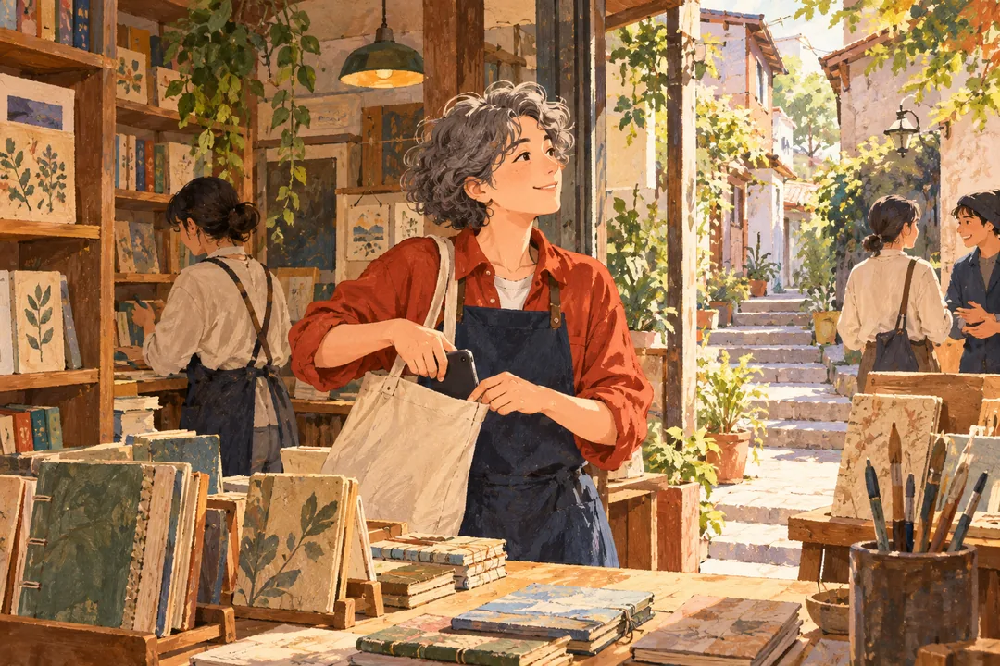

- [손끝 몰입 모드 · maker](../../../assets/images/covers/test-025-maker.webp): 화면 대신 종이와 재료를 만지며 작은 작업물을 완성하는 인물.
- [골목 탐험 모드 · wanderer](../../../assets/images/covers/test-025-wanderer.webp): 근처 골목에서 직접 발견한 가게나 작은 공원을 호기심 있게 바라보는 인물.
- [익숙한 평온 모드 · keeper](../../../assets/images/covers/test-025-keeper.webp): 좋아하던 음악이나 책을 다시 꺼내 익숙한 감각에 오래 머무는 인물.
- [눈앞의 대화 모드 · connector](../../../assets/images/covers/test-025-connector.webp): 휴대폰을 치운 식탁에서 마주 앉은 사람의 표정과 이야기에 집중하는 인물.

## chat-temperature · 썸 탈 때 내 답장 온도는?

화풍 **S2** · [기준 가이드](../../../docs/illustration-style/kuku-ink-comic-v1/STYLE_GUIDE.md)

크림 토끼, 버건디 니트, 분홍 방과 작은 새 친구. 휴대폰으로 대화하는 장면. 새 친구는 쿠쿠 마스코트가 아니다.

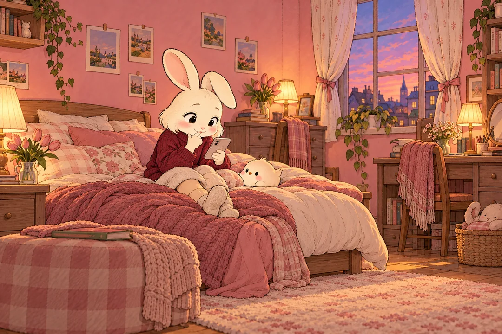

- [포근한 38도 답장형 · warm](../../../assets/images/covers/chat-temperature-warm.webp): 받은 말을 반갑게 받아 주며 상대에게 다시 관심을 건네는 표정과 손동작.
- [은근한 24도 답장형 · calm](../../../assets/images/covers/chat-temperature-calm.webp): 편안한 자세로 메시지를 읽고 짧지만 성의 있게 답하는 인물.
- [직진 42도 답장형 · direct](../../../assets/images/covers/chat-temperature-direct.webp): 답장을 계기로 다음 만남을 바로 제안하려 준비하는 인물.

## procrastination-bingo · 대학생 미루기 습관 빙고

화풍 **S2** · [기준 가이드](../../../docs/illustration-style/kuku-ink-comic-v1/STYLE_GUIDE.md)

기준 표지의 여자 마스코트: 검은 단발·큰 검은 눈·따뜻한 볼·코발트 니트. 책상·방의 깊이와 부드러운 명암 유지.

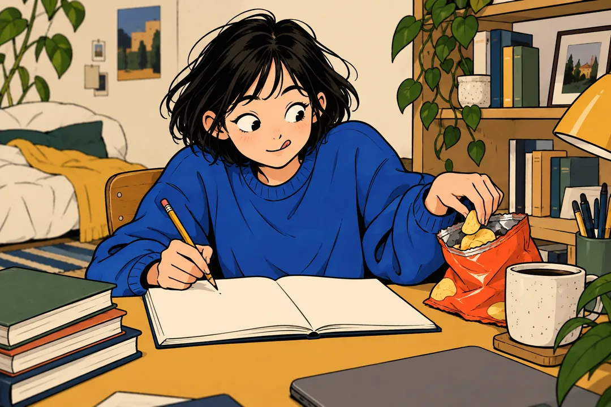

- [미루기 방어 우등생 · count-low](../../../assets/images/covers/procrastination-bingo-count-low.webp): 빈 노트 앞에서 고민하기보다 첫 줄이나 작은 작업을 실제로 시작한 인물.
- [합리적 미루기 협상가 · count-mid](../../../assets/images/covers/procrastination-bingo-count-mid.webp): 준비와 간식 사이에서 이제 초안을 시작하자며 자기와 타협하는 인물.
- [마감 직전 집중 각성형 · count-high](../../../assets/images/covers/procrastination-bingo-count-high.webp): 여러 딴짓거리를 옆으로 밀고 마감 직전에 급히 작업에 몰입한 인물. 무능한 사람으로 조롱하지 않는다.

## battery-stop · 쿠쿠 배터리 100%에 멈추기

화풍 **S4** · [기준 가이드](../../../docs/illustration-style/kuku-felt-miniature-v1/STYLE_GUIDE.md)

쿠쿠 얼굴 참조의 금빛 시바견을 작은 펠트 인형으로 표현. 이 게임에서는 남색 앞치마, 민트색 놀이 탁자와 빨간 정지 버튼.

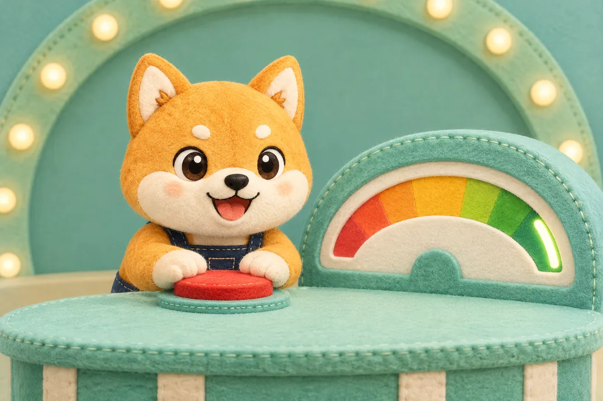

- [쿠쿠 충전 장인 · perfect](../../../assets/images/covers/battery-stop-perfect.webp): 정확히 멈춘 순간 손을 떼고 뿌듯해하는 쿠쿠. 점수는 이미지 밖에 표시.
- [감 좋은 충전러 · close](../../../assets/images/covers/battery-stop-close.webp): 살짝 아쉬워도 웃으며 게이지를 가리키는 쿠쿠.
- [과감한 타이밍 탐험가 · wild](../../../assets/images/covers/battery-stop-wild.webp): 예상보다 일찍 또는 늦게 멈춰 놀란 뒤 다시 도전하려는 쿠쿠. 실패자를 비난하는 표정은 피한다.

## today-box · 쿠쿠의 오늘 상자

화풍 **S4** · [기준 가이드](../../../docs/illustration-style/kuku-felt-miniature-v1/STYLE_GUIDE.md)

쿠쿠 얼굴 참조의 금빛 시바견 펠트 인형, 크림색 작업 앞치마, 코랄색 선반과 색깔 상자가 있는 작은 상자 가게.

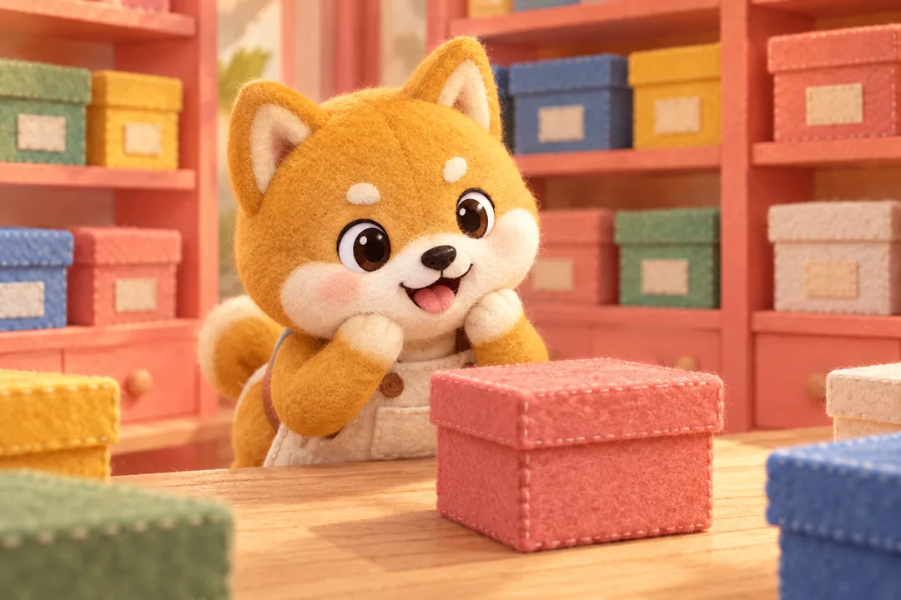

- [공통 미션 전달 장면 · mission-shared](../../../assets/images/covers/today-box-mission-shared.webp): 열린 상자에서 작은 미션 카드를 꺼내 건네는 쿠쿠. 카드 내용·날짜는 실제 텍스트로 얹는다.

## relationship-ranking · 관계에서 포기 못 하는 것 순위

화풍 **S3** · [기준 가이드](../../../docs/illustration-style/kuku-colored-pencil-v1/STYLE_GUIDE.md)

검은 낮은 번 헤어 여성, 크림 줄무늬 블라우스, 푸른 방의 붉은 원형 탁자와 가치 카드. 상대는 짧은 갈색 머리와 녹색 셔츠.

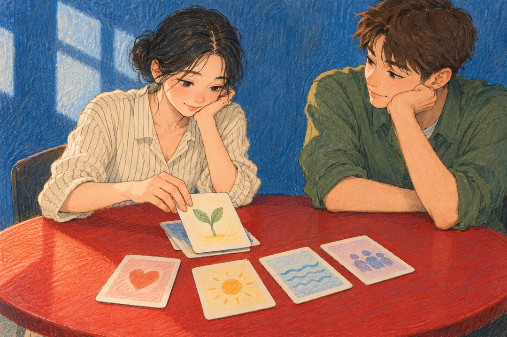

- [안심 우선형 · trust](../../../assets/images/covers/relationship-ranking-trust.webp): 서로 눈을 맞추며 솔직한 이야기를 편하게 꺼내는 두 사람.
- [웃음 우선형 · fun](../../../assets/images/covers/relationship-ranking-fun.webp): 사소한 장난에도 함께 크게 웃는 두 사람.
- [여백 우선형 · space](../../../assets/images/covers/relationship-ranking-space.webp): 서로 다른 활동을 하며 각자의 시간을 편하게 존중하는 두 사람.
- [자극 우선형 · growth](../../../assets/images/covers/relationship-ranking-growth.webp): 한 사람이 새 시도를 보여 주고 상대가 용기를 주며 함께 배우는 장면.
- [박자 우선형 · rhythm](../../../assets/images/covers/relationship-ranking-rhythm.webp): 만남과 연락의 속도를 무리 없이 맞추며 같은 보폭으로 걷는 두 사람.

## weekly-energy-budget · 이번 주 에너지 100을 어디에 쓸까?

화풍 **S3** · [기준 가이드](../../../docs/illustration-style/kuku-colored-pencil-v1/STYLE_GUIDE.md)

짧은 적갈색 곱슬머리 인물, 보라 후드와 남색 바지, 노란 주간 계획 탁자와 작은 원룸.

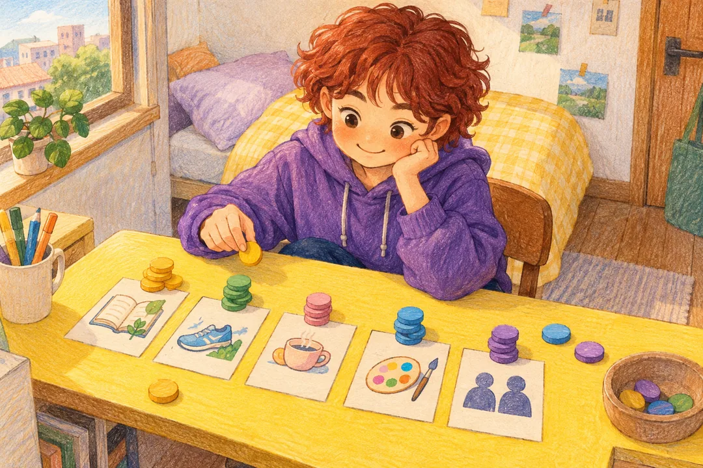

- [마감 집중 투자형 · study](../../../assets/images/covers/weekly-energy-budget-study.webp): 마무리할 과제에 시간과 관심을 두고 작업하는 인물.
- [사람 약속 투자형 · people](../../../assets/images/covers/weekly-energy-budget-people.webp): 친구들과 만날 자리를 마련하며 기대하는 인물.
- [설렘 집중 투자형 · love](../../../assets/images/covers/weekly-energy-budget-love.webp): 좋아하는 사람과의 만남을 준비하며 설레는 인물.
- [좋아하는 것 투자형 · hobby](../../../assets/images/covers/weekly-energy-budget-hobby.webp): 좋아하는 취미 도구나 작품에 시간을 들이며 즐거워하는 인물.
- [회복 우선 투자형 · rest](../../../assets/images/covers/weekly-energy-budget-rest.webp): 비워 둔 시간에 아무 새 일정도 더하지 않고 쉬는 인물.

## campus-festival-story · 축제 날, 쿠쿠를 어디서 만날까?

화풍 **S4** · [기준 가이드](../../../docs/illustration-style/kuku-felt-miniature-v1/STYLE_GUIDE.md)

쿠쿠 얼굴 참조의 금빛 시바견 펠트 인형과 민트 멜빵의 작은 여우 친구, 코랄·남색 축제 깃발, 천 부스·작은 무대 세트.

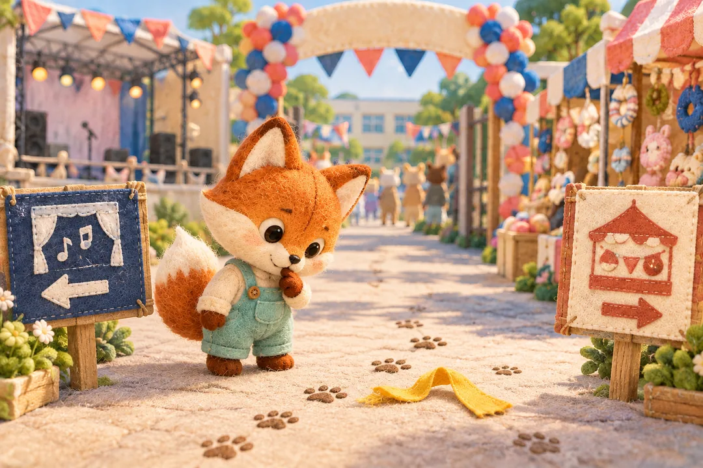

- [현장 돌파형 결말 · spotlight](../../../assets/images/covers/campus-festival-story-spotlight.webp): 무대 장비를 옮기던 쿠쿠를 찾고 손수건을 흔들며 반갑게 만나는 장면.
- [같이 즐기는 결말 · together](../../../assets/images/covers/campus-festival-story-together.webp): 멀리 공연이 보이는 축제 길에서 쿠쿠가 손을 흔드는 여우 주인공과 친구들에게 다가와 함께 박수 치는 장면.
- [장난 선공형 결말 · mischief](../../../assets/images/covers/campus-festival-story-mischief.webp): 무대 뒤 커튼 옆에서 소품 모자를 쓴 여우 주인공이 등장하자, 장비 정리 중 천을 들고 있던 쿠쿠가 놀랐다가 함께 웃는 장면. 카드나 타로 부스 없음.
- [느긋한 관찰형 결말 · observer](../../../assets/images/covers/campus-festival-story-observer.webp): 축제 길에서 두리번거리며 걸어오던 쿠쿠가 벤치에 앉은 여우 주인공을 발견하고 반갑게 미소 짓는 장면. 타로 카드 없음.

## emotion-trash · 오늘 마음, 여기 두고 갈래?

화풍 **S1** · [기준 가이드](../../../docs/illustration-style/kuku-gouache-v1/STYLE_GUIDE.md)

검은 짧은 생머리 인물, 청록색 스웨터, 살구색 작은 책상과 나무 휴지통, 종이.

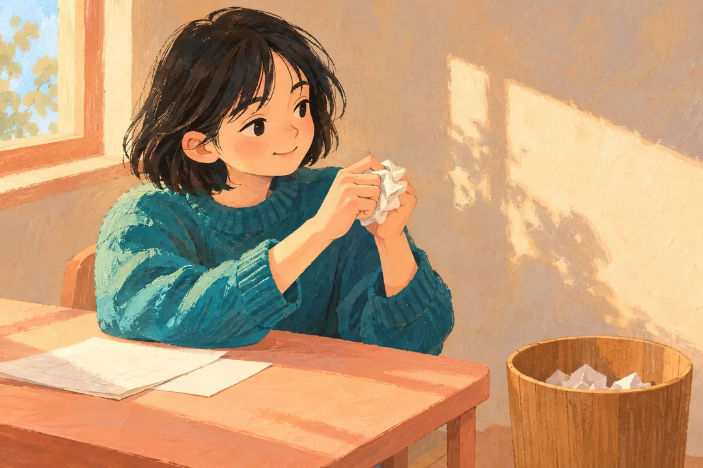

- [여기 두고 가기 완료 · trash-done](../../../assets/images/covers/emotion-trash-trash-done.webp): 구겨진 종이를 놓아 보내고 손과 어깨의 힘이 조금 풀린 인물. 종이의 개인 문장은 보이지 않는다.

## choice-roulette · 쿠쿠야, 하나만 골라줘

화풍 **S4** · [기준 가이드](../../../docs/illustration-style/kuku-felt-miniature-v1/STYLE_GUIDE.md)

쿠쿠 얼굴 참조의 금빛 시바견 펠트 인형, 벽돌색 멜빵, 초록 천을 덮은 놀이 탁자와 실제 둥근 선택 도구.

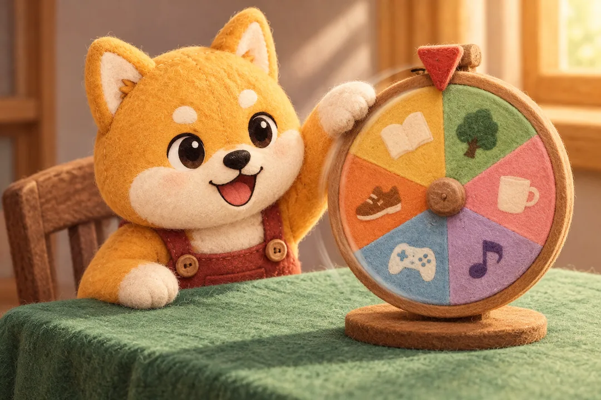

- [공통 선택 전달 장면 · roulette-shared](../../../assets/images/covers/choice-roulette-roulette-shared.webp): 멈춘 선택 도구에서 결과 카드를 꺼내 건네는 쿠쿠. 행동명은 실제 텍스트로 표시한다.

## 보관과 재사용

공개 WebP는 1080×720이며 비율을 유지해 압축했습니다. 생성 PNG 원본은 로컬의 무시된 `.artifacts/art-production-originals/`에 있고 Git에는 포함하지 않습니다. 다른 컴퓨터에서 일반 빌드·배포는 커밋된 최종 이미지로 가능하며, 원본 편집이 필요하면 PNG 폴더도 별도로 복사합니다. 4단계 재사용 원본은 `docs/art-pilots/20261020/`에 있습니다.

`production.json`의 `prompt`와 `references`는 채택 출력의 실제 입력입니다. `history`는 교체된 출력의 입력·원본 해시·거절 이유이며 현재 기준으로 사용하지 않습니다. 4단계 재사용 항목은 `sourceRecord`의 원본 기록으로 이어집니다.

상자·룰렛은 공통 결과 그림을 사용합니다. 질문별 장면과 행동별 추가 원화는 후속 범위입니다. 여자 마스코트의 첫 원본을 바꾸거나 사이트 장식으로 확장하는 작업도 별도입니다.
