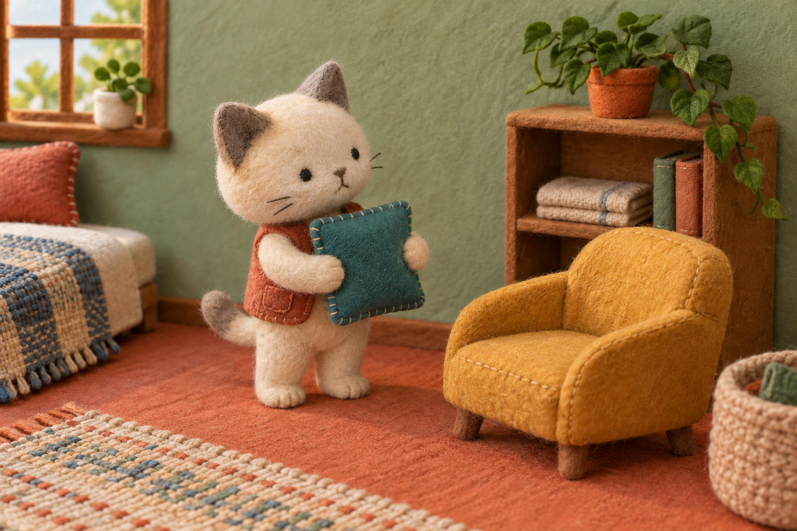

# 쿠쿠 그림체 기준 후보 모음 · v1

**후속 채택:** 5·6단계에서 네 화풍을 34개 콘텐츠·161장에 적용했습니다. 아래는 기준 후보를 준비하던 시점의 설명이며, 현재 배정·그림·검사·배포 상태는 [전체 적용 보고서](../../COOCOO_ILLUSTRATION_ROLLOUT_20261020.md)와 [최종 제작 갤러리](../art-production/20261020/README.md)를 봅니다.

작성: 2026-10-20 · 범위: **4개 화풍 기준 후보·가이드·대표 제작 방향**

사이트의 틀은 통일하고, 테스트별 그림은 다양하게 만들되 한 테스트 안에서는 일관되게 유지합니다. 아래는 그 작업을 이어 갈 참조 묶음입니다. 최종 사이트 적용·표지 채택·다른 장면에서의 재현성까지 승인한 자료는 아닙니다.

## 1. 전달 방법

- **화풍 자체만 전달:** 해당 폴더의 `STYLE_GUIDE.md`와 `reference.png` 두 파일을 함께 첨부합니다.
- **대표 테스트의 표지·결과를 이어 제작:** 해당 두 파일에 이 문서의 3절도 함께 전달합니다. 두 파일만 받은 작업자에게 모음 문서의 주인공 기준까지 알고 있다고 가정하지 않습니다.
- **네 후보와 대표 방향을 전달:** 이 파일과 아래 네 폴더의 현재 `STYLE_GUIDE.md`·`reference.png`만 전달합니다. `history`는 제외하며 현재 기준 묶음은 Markdown 5개·PNG 4개, 총 9개 파일입니다.
- 이미지는 그림체 참조와 인물 외형 참조의 역할을 나누어 지정합니다. 링크만 전달해서 상대가 실제 이미지를 볼 수 있다고 가정하지 않습니다.
- 쿠쿠 외형이 필요한 새 장면에는 별도 캐릭터 기준 이미지를 추가합니다. 그 파일은 이 묶음에 포함되지 않습니다. 현재 표지 후보의 인물을 쿠쿠로 바꾸는 지시도 아닙니다.

| ID | 후보 | 가이드 | 기준 PNG | 대표 대상 |
|---|---|---|---|---|
| S1 | 과슈 생활극 | [가이드](kuku-gouache-v1/STYLE_GUIDE.md) | [원본](kuku-gouache-v1/reference.png) | 소셜 배터리 |
| S2 | 펜선과 부드러운 명암의 생활 만화 | [가이드](kuku-ink-comic-v1/STYLE_GUIDE.md) | [원본](kuku-ink-comic-v1/reference.png) | 미루기 빙고 |
| S3 | 색연필 생활화 | [가이드](kuku-colored-pencil-v1/STYLE_GUIDE.md) | [원본](kuku-colored-pencil-v1/reference.png) | 오늘 끌리는 장면 |
| S4 | 펠트 미니어처 | [가이드](kuku-felt-miniature-v1/STYLE_GUIDE.md) | [원본](kuku-felt-miniature-v1/reference.png) | 내 방 취향 |

## 2. 그림으로 비교하기

장면이 서로 다르므로 화풍 선호 순위를 가리는 비교가 아닙니다. 각 표현의 선·색·재료와 맡은 상황을 함께 봅니다.

### S1 · 과슈 생활극

짙은 갈색 선과 불투명한 붓질, 둥근 표정, 연결된 생활 공간이 중심입니다. 기존 기준 PNG·가이드를 수정하지 않고 보존했습니다. 모든 테스트에 이 거실과 동물을 반복하지 않습니다.

### S2 · 펜선과 부드러운 명암의 생활 만화

사용자가 선택한 **첫 번째 출력으로 원본을 복원**했습니다. 펜선과 부드러운 피부·머리·옷의 명암, 연결된 생활 공간의 깊이가 기준입니다. 평면적으로 바꾼 두 번째·세 번째 수정은 현재 기준에서 제외합니다. 이 여자 캐릭터는 쿠쿠와 함께 사용할 마스코트로 등록했으며, 즉시 사이트에 배치하거나 전 테스트에 의무 출연시키지는 않습니다.

### S3 · 색연필 생활화

가는 윤곽·겹친 연필 결·종이 틈과 인물의 공간 관계가 중심입니다. 흐린 베이지색으로만 제한하지 않았습니다. 원본의 세부 배경은 작은 화면에서 다시 정리할 후보입니다.

### S4 · 펠트 미니어처

섬유·봉제·무광 자수 눈·세트 안의 물리적 접촉이 중심입니다. 실제 인형을 제작·촬영한 이력이 아닌 생성 이미지입니다. 눈의 반사를 줄이는 수정을 했고, 다른 포즈의 재현은 아직 확인하지 않았습니다.

## 3. 대표 콘텐츠에서 이어 쓸 제작 방향

아래는 표지와 결과를 연결하기 위한 **대표 제작 초안**입니다. 화풍 전체의 공통 캐릭터나 최종 사이트 자산 규격이 아닙니다. 새 결과를 만들 때 기준 PNG를 실제로 확인하고 이 외형 설명을 함께 전달합니다.

| 화풍·대상 | 유지할 주인공·인물 기준 | 공간·장면 기준 | 4단계 제작 대상 두 결과 |
|---|---|---|---|
| S1 · test-020 | 기준 그림 왼쪽의 금갈색 시바견, 크림 볼·가슴, 진녹색 스카프. 기존 쿠쿠와 동일 인물로 확정하지 않음 | 표지는 서로 다른 에너지의 모임. 결과는 같은 시바견이 모임에서 활기를 얻거나 귀가해 혼자 쉬는 행동 | `crowd` 활기 / `recharge` 혼자 회복 |
| S2 · procrastination-bingo | 첫 시안의 검은 단발·코발트 니트 여자 마스코트. 머리·얼굴 비율·의상·부드러운 채색을 두 결과에서도 유지 | 한 공부 공간에서 일찍 작은 작업을 시작하는 행동과 딴짓을 치우고 막판에 몰입하는 행동을 구별 | `count-low` 착수 / `count-high` 막판 몰입. 둘 다 제작용 구분 |
| S3 · test-022 | 짧은 동갈색 곱슬머리, 초록 재킷, 자두색 수첩의 인물 | 열린 길을 바라보는 행동과 활기 있는 전시에서 무언가를 발견하는 행동을 같은 연필 표현으로 연결 | `open` 열린 공간 / `sparkle` 활기 있는 발견 |
| S4 · test-015 | 크림 몸·회색 귀·무광 자수 눈·녹슨 주황색 조끼의 고양이 | 같은 방 구조를 기준으로 포근하게 머무는 행동과 필요한 것만 남긴 공간에서 편하게 있는 행동. 벽 색만 바꾸지 않음 | `cozy` 포근함 / `minimal` 비움 |

S1의 혼자 회복 결과에서 주인공을 오른쪽의 늘어진 귀 강아지로 바꾸지 않습니다. 모임과 혼자 쉬는 장면의 **같은 주인공**을 확인하려는 비교입니다. S4의 고양이도 쿠쿠의 새 외형으로 정한 것이 아닙니다.

**S1 요청문의 용도 변경:** 보존한 과슈 가이드 6절의 요청문은 표지용입니다. 결과 제작 때는 장면뿐 아니라 첫 줄의 목적을 ‘쿠쿠 테스트의 해당 결과 장면’으로 바꾸고 용도·비율도 결과 사용처에 맞게 지정합니다. 기존 과슈 파일은 이 주의점을 모음 문서에 남기는 방식으로 보존했습니다.

test-020·022·015의 영문 값은 현재 퀴즈 원본의 결과 키이고, 빙고의 `count-low`·`count-high`는 1단계에서 정한 그림 제작용 구분입니다. 이 표는 이미지 파일명이나 운영 사이트 연결이 완료됐다는 뜻이 아닙니다.

## 4. 공통 제약과 아직 확인할 것

- 네 화풍 모두 **그라데이션 배경을 사용하지 않습니다.** S4의 재료·겹침·접촉 그림자와 디지털 배경 색 번짐을 구분합니다.
- 생성 원화에 제목·유형명·점수·온도·날짜·배분·입력문을 직접 넣지 않습니다. 실제 텍스트로 표시할 내용입니다.
- 주요 얼굴·귀·손동작은 보존하고 불필요한 빈 테두리는 추가하지 않습니다. 기준 PNG의 3:2는 사용처별 최종 크기 확정이 아닙니다.
- 4단계에서 각 표지에 이어 다른 결과 두 종씩을 제작했습니다. 원본의 인물·표현과 결과 의미를 비교하는 자료이며 실제 화면 판독·공유 비율까지 확인한 상태는 아닙니다.
- 최종 후보 채택·기존 홈/테스트/결과/공유 이미지에 놓는 화면 검토·공개 교체는 별도 후속 작업입니다.

각 가이드에는 실제 원본 크기·파일 해시·생성 경로·요청문·수정 이력과 새 주제용 요청문이 있습니다. 원본을 덮어쓰지 말고 채택한 후속 파일을 새 버전으로 보존합니다.
