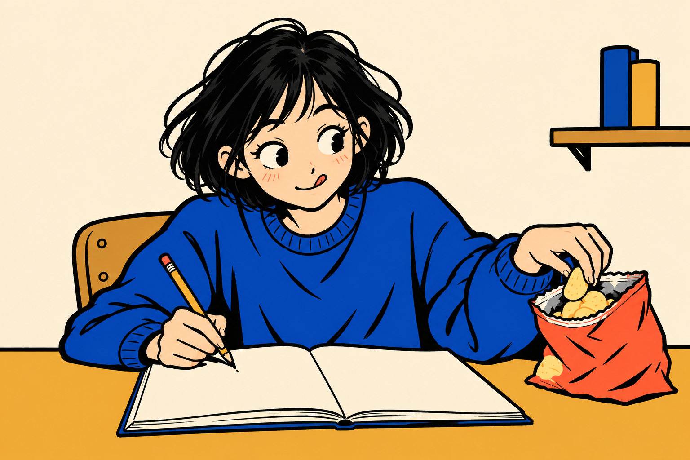

# 그림체 가이드 S2 · 굵은 펜선의 상황 만화

작성: 2026-10-20 · 기준 ID: `kuku-ink-comic-v1` · 상태: **기준 후보, 사이트 미적용**

## 1. 다른 작업자에게 전달할 자료

이 `STYLE_GUIDE.md`와 같은 폴더의 `reference.png`를 **실제 파일로 함께 첨부**합니다. 폴더를 옮겨도 아래 이미지 연결은 유지됩니다. Markdown 링크만 보내는 것으로 이미지 첨부를 대신하지 않습니다.



참조는 **선·채색·단순화·표정의 기준**입니다. 새 콘텐츠에 같은 대학생·파란 옷·과자·책상을 자동으로 넣지 않습니다. 같은 테스트의 후속 장면이라면 별도로 지정한 인물 외형과 의상도 유지합니다.

## 2. 그림에서 확인한 특징과 유지할 규칙

**한 문장:** 굵기가 달라지는 검은 펜선과 선명한 색 면으로, 인물의 시선·손·몸짓이 한순간의 상황을 전달하는 한 컷 만화.

| 요소 | 기준 그림에서 보이는 특징 | 후속 제작 규칙 |
|---|---|---|
| 외곽선 | 검정에 가까운 굵은 선과 더 가는 내부선, 부분적으로 흔들리는 경계 | 주요 행동의 외곽은 굵게, 얼굴·손·주름은 필요한 선만 남김 |
| 단순화 | 큰 눈, 작은 입, 단순한 코, 과자를 향한 눈과 손 | 얼굴과 손의 행동을 먼저 읽게 함. 모든 인물에 같은 얼굴을 붙이지 않음 |
| 채색 | 파랑 옷·코랄 포장·노랑 탁자·크림 벽의 큰 색 면 | 적은 수의 선명한 주색과 보조색. 색을 바꿀 수 있으나 면의 분명함은 유지 |
| 명암 | 머리·옷에 검은 면과 분리된 짙은 부분이 있음 | 밝고 어두움을 구별된 면으로 표현. 배경의 디지털 그라데이션·후광 금지 |
| 공간 | 의자·노트·과자가 같은 책상 주변에 연결됨 | 인물과 물건이 실제로 닿고 놓인 공간. 아이콘을 띄우거나 스티커처럼 배열하지 않음 |
| 표정·동작 | 글 쓰던 손과 과자를 집는 손, 옆으로 향한 시선 | 유머는 구체적인 행동에서 만듦. 말풍선 문장·장식 기호로 대신하지 않음 |
| 밀도 | 초기 시안보다 배경을 크게 줄이고 인물이 화면을 채움 | 장면에 필요한 배경만 남김. 얼굴·핵심 동작을 보호하되 큰 빈 테두리는 추가하지 않음 |

색 이름은 이 원본의 관찰값입니다. 코발트색 옷이 화풍 전체의 필수 의상이라는 뜻은 아닙니다. 정교한 머리카락 묘사가 일부 남아 있으므로 후속 그림을 더 세밀한 애니메이션 삽화로 확대하지 않습니다.

## 3. 고정할 것과 바꿀 것

| 화풍에서 고정 | 새 콘텐츠에 맞게 변경 |
|---|---|
| 강한 검은 펜선, 필요한 내부선, 선명한 색 면 | 인물의 종·외형·의상·주조색 |
| 한 컷 안의 분명한 행동과 시선 | 장소·소품·시간·카메라 방향 |
| 배경 그라데이션·문자·아이콘 콜라주 제외 | 주제에 필요한 구체적 상황 |

‘미루기 빙고’에서 이어 그릴 때는 검은 단발·코발트 맨투맨의 대학생을 주인공 후보로 유지합니다. 이 인물은 사이트 공통 캐릭터나 쿠쿠가 아닙니다. 다른 테스트에 사용할 인물은 별도로 정합니다.

## 4. 복사해서 사용할 요청문

대괄호를 채우고 `reference.png`를 첨부합니다. 이미지 참조가 불가능한 환경에서는 그림체를 확인한 것으로 쓰지 말고 텍스트 기준만 사용했다고 기록합니다.

```text
첨부한 reference.png는 선·단순화·색 면·표정의 그림체 참조입니다.
같은 책상·대학생·과자 구도를 복제하지 말고 다음 한 장면을 그려 주세요.
장면: [누가 / 어디에서 / 어떤 행동을 하며 / 무엇을 느끼는가]
인물 외형: [새 인물 설명 또는 함께 첨부한 인물 기준의 유지 항목]
핵심 동작: [시선·손·자세로 읽혀야 할 행동]
용도와 비율: [표지/결과, 필요한 가로세로 비율]
검정에 가까운 굵기가 다른 손그림 펜선, 필요한 내부선, 선명한 소수의 색 면을 유지하세요.
한 컷의 연결된 공간에 인물과 물건을 놓고, 얼굴과 핵심 손동작을 프레임 안에 보존하세요.
장면에 필요한 배경만 남기고 큰 빈 테두리나 제목용 여백은 만들지 마세요.
배경 그라데이션·발광·부드러운 에어브러시·물감 붓질·사실적인 광택은 제외하세요.
그림 안에는 글자·숫자·말풍선 문장·로고·워터마크·떠다니는 하트나 기호를 넣지 마세요.
```

```text
Use the attached reference.png for variable-width near-black pen contours,
simple expressive features and strong flat color areas, not for its original scene.
New scene: [who does what, where, with which emotion].
Character identity: [new character or explicit identity-reference invariants].
Key readable action: [gaze, hands and body gesture]. Format: [use and aspect ratio].
Draw one coherent single-panel situation with physically connected subjects and props.
Keep the complete head and important gestures inside the frame, without a large empty border.
Use only necessary background details and discrete hard-edged shadow shapes.
Exclude gradient backgrounds, glow, airbrush shading, painterly brushwork,
lettering, numerals, logos, watermark, speech-bubble text and floating icon decorations.
```

## 5. 제작할 때 확인할 것

1. 표정·시선·두 손에서 설명 없이도 행동이 읽히는지 봅니다.
2. 굵은 외곽선과 필요한 내부선이 남고, 정교한 애니메이션 배경으로 돌아가지 않았는지 봅니다.
3. 손가락·연필·포장·탁자의 접촉을 확인합니다. 형태 오류를 손맛으로 넘기지 않습니다.
4. 얼굴·핵심 동작의 잘림, 배경 그라데이션, 글자 찌꺼기가 없는지 확인합니다.
5. 실제 카드·공유 이미지 판독은 후속 단계에서 확인합니다. 이번 원본 육안 검토를 실기기 검사로 부르지 않습니다.

이번에 확인한 것은 한 장면과 그 수정입니다. 다른 장면에서 같은 표현·인물을 이어 만들 수 있는지는 표지와 다른 결과 두 종을 만드는 다음 단계에 남아 있습니다.

## 6. 생성 기록

| 항목 | 값 |
|---|---|
| 최초 생성일 | 2026-10-20 |
| 생성 경로 | 내장 `imagegen`. 외부 API·CLI 미사용 |
| 입력 | 최초는 텍스트만 사용. 수정 2회는 직전 생성 이미지 1장을 편집 대상으로 지정 |
| 보존한 후보 | 배경 간소화 후 머리 잘림과 배경을 조정한 세 번째 출력 |
| 최종 파일 | `reference.png` · PNG · 1536×1024px · 1,537,768바이트 |
| SHA-256 | `b4c526e13259cd50a884093c69721563bcf24a050b414f74d267a25dcf793c96` |
| 이미지 수령 후 처리 | 파일 복사만 수행. 별도 이미지 편집·크롭·색 보정 없음 |
| 모델 ID·seed·요금 | 도구가 제공하지 않아 추정값을 쓰지 않음 |

아래는 실제 입력을 보관한 이력입니다. 새 장면의 제작 요청에는 4절을 사용합니다. 같은 픽셀·인물의 재출력을 보장하는 기록이 아닙니다.


## 7. 최초 생성 입력 · 기준으로 채택하지 않은 출력

```text
Use case: illustration-story.
Asset type: one style-reference illustration for Kuku's "college procrastination bingo" cover candidate. This is an illustration, not a poster, website screenshot or style sheet.
Primary request: a witty, lively single-panel pen comic showing the instant a university student gets distracted from starting an assignment.
Scene: a small lived-in study desk. A young adult student with a short slightly messy black bob and an oversized cobalt-blue sweatshirt sits on a simple chair. One hand holds a pencil suspended above an open blank notebook; the other reaches toward an open little snack bag on the same desk. Their eyes have wandered toward the snack, shoulders hunched in a sheepish, amused "just one more bite" hesitation. The posture, gaze and competing hand movements tell the story without text. A small pile of closed course books is enough to establish the setting. Keep props few and physically connected to the desk.
Style/medium: original characterful indie one-panel comic, bold near-black variable-width felt-tip and brush-pen contours, a little irregular and dry at corners; decisive lively drawing, simplified expressive face and hands, flat opaque spot colors. No painted brushwork and no pencil shading. Simple readable proportions, not generic corporate characters or rounded white mascot clip art.
Color: cobalt blue sweatshirt, tomato-coral accent on the snack bag, warm mustard desk detail, cream paper and wall; most of the structure is black line and cream. Limited strong colors with clean discrete flat shadow shapes. A solid cream wall with one plain contrasting panel or shelf is fine. Absolutely no gradient background, smooth shading, glow or vignette.
Composition: landscape 3:2, medium three-quarter view, one coherent full-bleed room scene. Make the student's face, both hands, notebook and tempting snack large enough to read in a small thumbnail. Preserve complete head and important hand gestures inside the frame. No oversized empty border or reserved title area. A little comfortable breathing room around the face, not decorative padding.
Text: none anywhere. All pages and packaging are unlettered. No letters, numbers, logos, watermark, captions, speech bubbles, emoji, floating hearts, stars, arrows, motion-symbol clusters, UI, battery symbols or collage.
Make it feel authored through a specific funny action, not through random wobble, all-over noise or ornamental stickers. Keep anatomy and object contacts coherent. Entirely original scene and characters, do not imitate a named artist or competitor image.
```

## 8. 수정 입력 1 · 선·색·배경 간소화

```text
Use case: style-transfer.
Edit target: the most recent generated student-at-desk illustration.
Make one targeted revision: change the drawing and rendering into a much simpler bold hand-drawn spot-color PEN COMIC, removing the elaborate scenic rendering. Preserve the student with a black bob, blue sweatshirt, sheepish sideways gaze, pencil in one hand over an unlettered notebook, other hand taking a snack from a coral bag. Preserve that specific action and readable hand contact. Keep the landscape 3:2 frame and complete face and both hands.
Replace fine anime illustration linework with visibly bold, uneven near-black felt-tip/brush-pen lines and simplified shapes; simplified comic facial features, no detailed eyelashes. Hard-edged FLAT color areas only. Cobalt blue, coral, mustard and cream, black contours. No airbrush, digital lighting, blended skin shadow, gradient or vignette anywhere, especially the background. Shadows, if any, must be separate flat shapes.
Simplify the environment aggressively to a single solid cream wall, one short shelf with just two unlettered books, chair and desk. Remove plants, bed, framed pictures, wall postcards, desk lamp, mug, laptop, excess books and ornamental surface details. Do not replace removed objects with icons. The student and notebook should dominate a coherent room scene, not be floating isolated stickers. Fill the frame without an empty outer margin. Keep just the notebook, pencil and snack on the desk. Aim for witty contemporary independent one-panel comic drawing, not polished anime key art, corporate vector art or a painted picture book.
Absolutely no text, numerals, logos, watermark, speech bubbles or floating comic symbols. Do not add new characters or props.
```

## 9. 수정 입력 2 · 머리 여유와 배경 보정

```text
Use case: precise-object-edit.
Edit target: the most recent simplified student pen-comic image.
Keep this exact character identity, short black bob, cobalt sweatshirt, face expression, hand anatomy and snack-taking action, notebook, snack bag and bold irregular black pen style.
Make only a framing-and-background correction: reframe slightly wider so the complete hair silhouette has a small visible gap below the top image edge; keep both hands and the notebook fully in the frame. This is head protection, not a large blank margin. Retain the landscape 3:2 canvas and subject dominance.
The wall must be ONE EVEN SOLID cream color, absolutely no gradual changes in hue or brightness, shading, vignette, glow, airbrush or gradient on the wall. Keep the single short shelf and two books. Keep other color areas flat with only distinct hard-edged ink or color shapes, no blended shading. No added objects or lettering, numbers, logos, decorative symbols or border.
```
