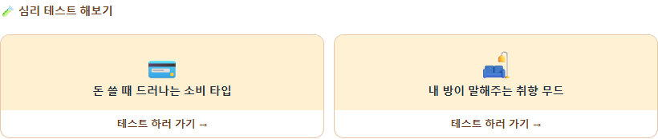
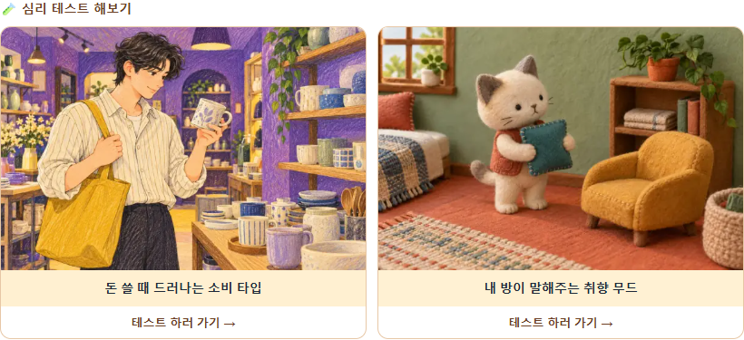
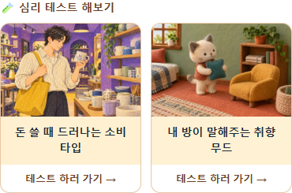

# 티스토리 테스트 카드에 기존 그림 넣기

확인일: 2026-11-06 · 대상: https://hvyair.tistory.com/391

목표는 블로그의 테스트 카드에도 쿠쿠에서 만든 표지 그림을 보여주는 것입니다.

## 원인

최초 검사에서는 `.fbv-psych` 블록 안에 테스트 링크는 2개지만 이미지 태그는 0개였습니다. 소비 타입 카드는 `💳`, 방 취향 카드는 `🛋️` 문자를 직접 넣었습니다. 쿠쿠의 링크 미리보기 정보를 자동으로 불러오는 카드가 아니므로 쿠쿠의 `og:image`를 변경해도 이 영역은 바뀌지 않습니다.

후속 검사에서는 블로그 관리자가 원본 그림 두 장을 넣은 것을 확인했습니다. 저장된 HTML에는 `loading="lazy"`가 없고 두 원본 파일 합계는 321,058바이트였습니다. 현재 교체용 HTML은 작은 표지 합계 72,190바이트와 글·카드별 UTM 링크를 사용합니다. 배포·이벤트 수신 상태는 [이번 실행 기록](../../COOCOO_BLOG_ACQUISITION_20261106.md)에 있습니다.

앞서 제공한 394번 글은 비공개였으며, 391번 공개 글에서 위 구조를 확인했습니다. 쿠쿠 사이트의 이미지 설정 오류가 원인이 아닙니다.

## 교체 방법

1. 티스토리 글 편집기의 HTML 모드를 엽니다.
2. ‘🧪 심리 테스트 해보기’ 제목과 두 카드를 포함하는 `fbv-psych` 블록을 찾습니다.
3. 해당 블록을 [교체용 HTML](tistory-test-cards-illustrated.html)의 전체 내용으로 바꿉니다.
4. PC·모바일 미리보기에서 그림과 링크를 확인한 뒤 글을 저장합니다.

교체용 파일은 작은 표지의 ``와 글·카드별 유입 구분 링크를 넣습니다. 제목·이동 버튼·2열 배치를 유지하고 이미지 주변 패딩은 0으로 둡니다. 이미지 비율은 3:2로 유지해 그림을 자르지 않습니다. 이미 그림 카드가 적용됐다면 [Claude 전달문](CLAUDE_HANDOFF.md)에 있는 `src`·`href` 주소만 바꿔도 됩니다.

| 테스트 | 연결 주소 | 그림 주소 |
|---|---|---|
| 돈 쓸 때 드러나는 소비 타입 | [test-010](https://coocooing.kro.kr/tests/test-010.html) | [카드용 작은 표지](https://coocooing.kro.kr/assets/images/card-thumbs/test-010.webp) |
| 내 방이 말해주는 취향 무드 | [test-015](https://coocooing.kro.kr/tests/test-015.html) | [카드용 작은 표지](https://coocooing.kro.kr/assets/images/card-thumbs/test-015.webp) |

새 블로그 카드도 `href`의 테스트 번호와 `assets/images/card-thumbs/test-번호.webp`의 번호를 맞춥니다. `card-thumbs`는 600×400의 작은 그림, `covers`는 원본 그림, `assets/images/og/test-번호.png`는 제목·설명이 함께 들어간 공유용 카드입니다. 본문에 이미 제목을 쓰는 이번 구성에는 `card-thumbs`를 사용합니다.

## 확인 결과와 적용 상태

작은 표지 34개와 자동 검사 29개를 통과했습니다. 별도 브라우저에서 교체안을 넣어 1440·390px의 이미지 로딩·3:2 비율·가로 넘침 없음·UTM 링크와 시작·완료 이벤트 형식을 확인했습니다. 이 검사는 공개 글 저장을 포함하지 않습니다. 아래 수정 후 이미지는 **적용 전 미리보기**입니다.

수정 전 공개 글:

교체안 PC 미리보기:

교체안 모바일 크기 미리보기:

